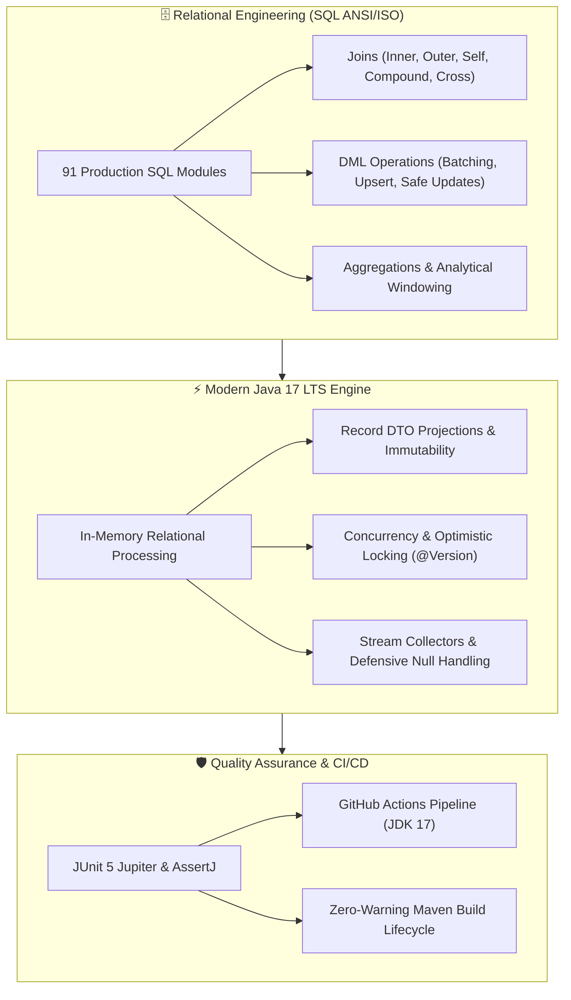

# 🚀 Java 17 LTS & Relational Database Enterprise Mastery Suite

[](https://github.com/MickaelGeronimo/java-sql-mastery-suite/actions/workflows/ci.yml)
[](https://openjdk.org/projects/jdk/17/)
[](https://maven.apache.org/)
[](https://junit.org/junit5/)
[](LICENSE)

An enterprise-grade laboratory and pedagogical showcase bridging **Relational Database Engineering (MySQL 8.0 & PostgreSQL 16)** with **Java 17 LTS Modern Software Architecture**.

Designed to demonstrate production-level mastery of data consistency, distributed joins, concurrency control, in-memory stream relational processing, optimistic locking, and algorithmic problem-solving.

---

## 🏛️ High-Level Architecture Overview



---

## 📦 Core Functional Pillars

### 1. In-Memory Relational Engine & Join Algebra (`com.mickaelgeronimo.mastery.joins`)
- **Equi-Joins & Anti-Joins**: Direct translation between relational algebra ($R \bowtie S$) and Java 17 Streams with hash-join and nested-loop simulations.
- **Fan-Out Anomaly Mitigations**: Demonstrates the classical cartesian aggregation trap where joining 1:N and N:M child tables duplicates parent metric totals (`SUM()`, `AVG()`), and implements defensive deduplication algorithms.
- **Distributed Microservice Joins**: Simulates asynchronous multi-database health audits and cross-boundary network joins with scatter-gather parallel execution.
- **Hierarchical Self-Joins**: Corporate organizational tree traversals and multi-level manager-subordinate relationship resolution.

### 2. Transactional Concurrency & DML (`com.mickaelgeronimo.mastery.dml`)
- **Optimistic Locking (`@Version`)**: Software transactional memory model simulating JPA/Hibernate `@Version` increments and lost-update collision rejection.
- **Safe Update Safeguards**: Implementation of MySQL Error 1175 guardrails preventing mutations on unbounded tables without indexed key filters.
- **Chunked Batch Processing**: High-throughput memory-safe partition updating designed to eliminate lock escalation and buffer pool exhaustion.
- **Hierarchical Parent-Child Inserts**: Primary/foreign key linkage simulations replicating database `LAST_INSERT_ID()` semantics.

### 3. Aggregations, DTO Projections & Null Safety (`com.mickaelgeronimo.mastery.aggregate`)
- **Spring Data JPA DTO Projections**: In-memory demonstration of construct-expression projections using immutable Java Records (`RevenueMetricsDTO`).
- **Defensive Null Handling**: Mirroring SQL `COALESCE(SUM(amount), 0)` using Java `Optional` and `BigDecimal.ZERO` to eradicate `NullPointerException` risks on empty datasets.
- **Subquery Filtering**: Resolving dynamic thresholds (e.g. invoices above calculated average) in stream pipelines.

### 4. Algorithmic Problem Solving (`com.mickaelgeronimo.mastery.algorithms`)
- **Combinatorics & Constraint Satisfaction**: Real-world committee permutation algorithms respecting complex exclusion rules (e.g. Fundamental Counting Principle under non-overlapping couple constraints).

### 5. Core Object-Oriented Principles (`com.mickaelgeronimo.mastery.core`)
- Strong encapsulation, polymorphism, generic containers (`Box<T>`, `Product<T, U>`), multithreaded coordination (`MyRunnable`), and domain models (`Employee`, `Student`, `Person`, `User`).

---

## 🗂️ Project Structure

```
├── .github/
│   └── workflows/
│       └── ci.yml                      # Automated CI verification on Java 17
├── docs/
│   ├── README.md                       # Documentation index
│   ├── architecture/                   # Distributed Kafka & Ledger State Machines
│   ├── dashboards/                     # Interactive Accounting Close Visualizations
│   └── career/                         # FAANG-grade CV and LaTeX resume sources
├── sql/
│   ├── README.md                       # Curriculum documentation
│   ├── 01-filtering-and-sorting/       # LIMIT, OFFSET, and paging strategies
│   ├── 02-inner-joins/                 # Multi-table, composite keys, cross-DB
│   ├── 03-outer-and-self-joins/        # Left/Right/Full Outer and Self-referencing
│   ├── 04-using-clause-natural-and-cross-joins/
│   ├── 05-unions/                      # UNION vs UNION ALL execution mechanics
│   ├── 06-table-attributes-and-ctas/   # Constraints, defaults, and CTAS copies
│   ├── 07-dml-operations/              # Single, Batch, Hierarchical, Upserts
│   ├── 08-database-administration-and-restore/
│   └── 09-aggregations-and-grouping/   # Aggregate functions, GROUP BY, HAVING
├── src/
│   ├── main/
│   │   ├── java/com/mickaelgeronimo/mastery/
│   │   │   ├── aggregate/              # Projections, DTOs, metrics
│   │   │   ├── algorithms/             # Combinatorics & constraint solvers
│   │   │   ├── core/                   # Generics, OOP models, concurrency
│   │   │   ├── dml/                    # Safe batching, updates, locks
│   │   │   ├── joins/                  # In-memory relational join engine
│   │   │   └── unions/                 # Stream concatenation and distinct sets
│   │   └── resources/                  # Application test fixtures and data
│   └── test/
│       └── java/com/mickaelgeronimo/mastery/
│           ├── aggregate/              # Metric projection & NPE defense tests
│           ├── algorithms/             # Combinatorics logic tests
│           ├── core/                   # Generics, Geometry, Models tests
│           ├── dml/                    # Optimistic locking & Safe update tests
│           └── joins/                  # Relational algebra tests
├── pom.xml                             # Apache Maven build configuration
├── LICENSE                             # MIT Open Source License
└── .gitignore                          # Standard enterprise gitignore
```

---

## 🛠️ Quickstart & Execution

### Prerequisites
- **JDK 17 LTS** (Adoptium Temurin, Oracle, or OpenJDK)
- **Apache Maven 3.8+**
- **Git 2.40+**

### 1. Compile the Entire Suite
```bash
mvn clean compile
```

### 2. Execute the Automated Test Suite
```bash
mvn test
```
*Executes all 19 unit & integration tests covering relational joins, concurrency collisions, geometric polymorphism, and DTO projection metrics.*

### 3. Run a Specific Demonstration
You can execute any of the 112 individual demos using the Maven Exec plugin:

```bash
# Execute Optimistic Locking & Lost-Update Demo
mvn exec:java -Dexec.mainClass="com.mickaelgeronimo.mastery.dml.update.UpdatingSingleRowPart2AdvancedDemo"

# Execute Spring Data JPA DTO Projection & Aggregation Demo
mvn exec:java -Dexec.mainClass="com.mickaelgeronimo.mastery.aggregate.AggregateAdvancedPitfallsAndSpringDemo"

# Execute In-Memory Inner Join Relational Engine Demo
mvn exec:java -Dexec.mainClass="com.mickaelgeronimo.mastery.joins.inner.InnerJoinJavaDemo"

# Execute Combinatorics & Permutation Analysis
mvn exec:java -Dexec.mainClass="com.mickaelgeronimo.mastery.algorithms.AnaliseCombinatoriaEnem"
```

---

## 💡 Code Highlights

### Optimistic Locking Simulation (`@Version`)
```java
// Simulates: UPDATE invoices SET payment_total = ?, version = version + 1 
//            WHERE id = ? AND version = ?
public synchronized boolean updateOptimistic(BigDecimal newPayment, int expectedVersion) {
    if (this.version != expectedVersion) {
        return false; // Stale data detected: 0 rows affected -> OptimisticLockException
    }
    this.paymentTotal = newPayment;
    this.version++;
    return true;
}
```

### Defensive Aggregation (SQL `COALESCE` in Java 17)
```java
// Equivalent to: SELECT COALESCE(SUM(invoice_total), 0) FROM invoices WHERE ...
BigDecimal safeSum = invoiceStream
    .map(Invoice::invoiceTotal)
    .reduce(BigDecimal::add)
    .orElse(BigDecimal.ZERO); // Guarantees zero NullPointerExceptions on empty datasets
```

---

## 👨‍💻 Author

**Mickael Geronimo**  
*Senior Backend Engineer | Distributed Systems & Financial Infrastructure*  
- **GitHub**: [@MickaelGeronimo](https://github.com/mickaelgeronimo)
- **LinkedIn**: [linkedin.com/in/mickael-geronimo](https://linkedin.com/in/mickael-geronimo)
- **Email**: `mickaeldevoriginal@protonmail.com`

---

## 📄 License

This repository is distributed under the terms of the [MIT License](LICENSE).
