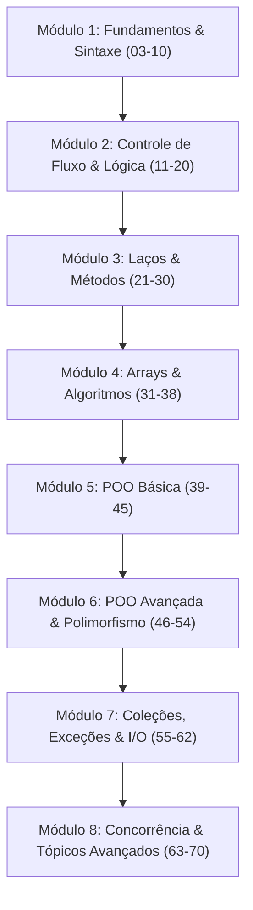

# 🎓 Currículo Completo de Java: Da Fundamentação ao Multithreading Avançado

Este repositório contém a organização pedagógica definitiva de todos os **70 capítulos** do curso de formação em Java. Cada capítulo possui seu próprio diretório com materiais transcritos, dissecados passo a passo ("do zero"), tabelas didáticas e suíte prática.

---

## 🗺️ Mapa de Navegação por Módulos

---

## 📦 Módulo 1: Fundamentos da Linguagem e Sintaxe Básica (Capítulos 03 a 10)

| Capítulo | Diretório | Descrição |
| :---: | :--- | :--- |
| **01** | [**`capitulo_01_introducao_e_comentarios`](./capitulo_01_introducao_e_comentarios/README.md) | Introdução à sintaxe Java, estrutura de código, boas práticas e comentários. |
| **03** | [**`capitulo_03_arithmetic_operators`**](./capitulo_03_arithmetic_operators/README.md) | Operadores aritméticos, incremento/decremento (++ e --), PEMDAS e módulo. |
| **04** | [**`capitulo_04_mad_libs`**](./capitulo_04_mad_libs/README.md) | Jogo interativo Mad Libs com Scanner e concatenação de textos. |
| **05** | [**`capitulo_05_shopping_cart`**](./capitulo_05_shopping_cart/README.md) | Carrinho de compras, cálculos com precisão e resolução do bug de buffer do Scanner. |
| **07** | [**`capitulo_07_math_class`**](./capitulo_07_math_class/README.md) | A classe `Math`, potências, hipotenusa, circunferência e juros compostos. |
| **09** | [**`capitulo_09_random_numbers`**](./capitulo_09_random_numbers/README.md) | Geração de números pseudoaleatórios com `Random`, dados e moeda. |
| **10** | [**`capitulo_10_printf`**](./capitulo_10_printf/README.md) | Formatação cirúrgica com `printf`, especificadores, as 4 flags, largura e precisão. |

---

## 🔀 Módulo 2: Controle de Fluxo, Lógica e Decisões (Capítulos 11 a 20)

| Capítulo | Diretório | Descrição |
| :---: | :--- | :--- |
| **11** | [**`capitulo_11_if_statements`**](./capitulo_11_if_statements/README.md) | Estruturas condicionais (`if`, `else if`, `else`) e ordem de avaliação. |
| **12** | [**`capitulo_12_nested_if`**](./capitulo_12_nested_if/README.md) | Condicionais aninhadas multinível e validações encadeadas. |
| **13** | [**`capitulo_13_string_methods`**](./capitulo_13_string_methods/README.md) | Métodos essenciais de `String`: `equals`, `contains`, `isEmpty`, `trim`, `replace`. |
| **14** | [**`capitulo_14_substring`**](./capitulo_14_substring/README.md) | Fatiamento de textos com `substring` e `indexOf`. |
| **15** | [**`capitulo_15_weight_conversion`**](./capitulo_15_weight_conversion/README.md) | Projeto conversor de peso interativo (libras para quilos e vice-versa). |
| **16** | [**`capitulo_16_ternary_operator`**](./capitulo_16_ternary_operator/README.md) | O operador ternário (`condição ? valor1 : valor2`). |
| **17** | [**`capitulo_17_temperature_conversion`**](./capitulo_17_temperature_conversion/README.md) | Projeto conversor de temperatura (Celsius e Fahrenheit). |
| **18** | [**`capitulo_18_enhanced_switches`**](./capitulo_18_enhanced_switches/README.md) | Switches modernos do Java 14+ com flecha (`->`) e eliminação de `break`. |
| **19** | [**`capitulo_19_calculator`**](./capitulo_19_calculator/README.md) | Projeto calculadora de console robusta com tratamento de divisão por zero. |
| **20** | [**`capitulo_20_logical_operators`**](./capitulo_20_logical_operators/README.md) | Operadores lógicos booleanos (`&&`, `||`, `!`) e regras de curto-circuito. |

---

## 🔁 Módulo 3: Laços de Repetição, Algoritmos e Métodos (Capítulos 21 a 30)

| Capítulo | Diretório | Descrição |
| :---: | :--- | :--- |
| **21** | [**`capitulo_21_while_loops`**](./capitulo_21_while_loops/README.md) | Laços `while` e `do-while`, prevenção de loops infinitos e validação contínua. |
| **22** | [**`capitulo_22_number_guessing_game`**](./capitulo_22_number_guessing_game/README.md) | Jogo de adivinhação com palpites altos/baixos e laço de repetição. |
| **23** | [**`capitulo_23_for_loops`**](./capitulo_23_for_loops/README.md) | Laços contados (`for`), contagem progressiva, regressiva e passos variáveis. |
| **24** | [**`capitulo_24_break_and_continue`**](./capitulo_24_break_and_continue/README.md) | Controle cirúrgico de iterações com as instruções `break` e `continue`. |
| **25** | [**`capitulo_25_nested_loops`**](./capitulo_25_nested_loops/README.md) | Laços aninhados para impressão de matrizes, grades e formas 2D. |
| **26** | [**`capitulo_26_methods`**](./capitulo_26_methods/README.md) | Declaração de métodos, parâmetros, argumentos, retorno e escopo de execução. |
| **27** | [**`capitulo_27_overloaded_methods`**](./capitulo_27_overloaded_methods/README.md) | Sobrecarga de métodos: mesma assinatura nominal com parâmetros distintos. |
| **28** | [**`capitulo_28_variable_scope`**](./capitulo_28_variable_scope/README.md) | Escopo local vs escopo de classe e o perigo do sombreamento (*shadowing*). |
| **29** | [**`capitulo_29_banking_program`**](./capitulo_29_banking_program/README.md) | Projeto caixa eletrônico (ATM): saldo, depósitos, saques e validações. |
| **30** | [**`capitulo_30_dice_roller_program`**](./capitulo_30_dice_roller_program/README.md) | Simulador de rolagem de dados com arte ASCII de faces de dados. |

---

## 📊 Módulo 4: Estruturas de Dados, Arrays e Jogos (Capítulos 31 a 38)

| Capítulo | Diretório | Descrição |
| :---: | :--- | :--- |
| **31** | [**`capitulo_31_arrays`**](./capitulo_31_arrays/README.md) | Vetores de tamanho fixo, indexação, iteração com `for-each` e métodos de `Arrays`. |
| **32** | [**`capitulo_32_user_input_array`**](./capitulo_32_user_input_array/README.md) | População dinâmica de arrays via entradas do usuário no console com Scanner. |
| **33** | [**`capitulo_33_search_array`**](./capitulo_33_search_array/README.md) | Algoritmo de busca linear em arrays numéricos e vetores de strings. |
| **34** | [**`capitulo_34_varargs`**](./capitulo_34_varargs/README.md) | Argumentos de comprimento variável (`tipo... nome`), flexibilidade e médias. |
| **35** | [**`capitulo_35_2d_arrays`**](./capitulo_35_2d_arrays/README.md) | Matrizes bidimensionais (linhas e colunas), navegação com laços aninhados. |
| **36** | [**`capitulo_36_quiz_game`**](./capitulo_36_quiz_game/README.md) | Jogo de perguntas e respostas com banco de questões em matriz de alternativas. |
| **37** | [**`capitulo_37_rock_paper_scissors`**](./capitulo_37_rock_paper_scissors/README.md) | Pedra, Papel e Tesoura contra o computador usando `Random` e game loop. |
| **38** | [**`capitulo_38_slot_machine`**](./capitulo_38_slot_machine/README.md) | Caça-níqueis com emojis, multiplicadores de aposta, saldo e probabilidades. |

---

## 🏛️ Módulo 5: Programação Orientada a Objetos — Fundamentos (Capítulos 39 a 45)

| Capítulo | Diretório | Descrição |
| :---: | :--- | :--- |
| **39** | [**`capitulo_39_oop`**](./capitulo_39_oop/README.md) | Introdução à POO: classes como moldes, objetos, instâncias e operador ponto. |
| **40** | [**`capitulo_40_constructors`**](./capitulo_40_constructors/README.md) | Construtores parametrizados, inicialização com `this` e eliminação de clones. |
| **41** | [**`capitulo_41_overloaded_constructors`**](./capitulo_41_overloaded_constructors/README.md) | Múltiplos construtores para flexibilidade de instanciação (ex: classe `User`). |
| **42** | [**`capitulo_42_array_of_objects`**](./capitulo_42_array_of_objects/README.md) | Vetores contendo referências de objetos (`Car[] garage`) e loops de condução. |
| **43** | [**`capitulo_43_static`**](./capitulo_43_static/README.md) | O modificador `static`: membros compartilhados pela classe e métodos utilitários. |
| **44** | [**`capitulo_44_inheritance`**](./capitulo_44_inheritance/README.md) | Herança com `extends`: superclasses e subclasses (`Animal`, `Dog`, `Cat`, `Plant`). |
| **45** | [**`capitulo_45_super`**](./capitulo_45_super/README.md) | A palavra-chave `super`, encadeamento de construtores (`super(...)`) e `null` safety. |

---

## 🧬 Módulo 6: POO Avançada, Polimorfismo e Design de Classes (Capítulos 46 a 54)

| Capítulo | Diretório | Descrição |
| :---: | :--- | :--- |
| **46** | [**`capitulo_46_method_overriding`**](./capitulo_46_method_overriding/README.md) | Sobrescrita de métodos com `@Override`, especialização em filhas e prevenção de bugs. |
| **47** | [**`capitulo_47_tostring`**](./capitulo_47_tostring/README.md) | O método `toString()` de `Object`, formatação amigável e eliminação de hashcodes. |
| **48** | [**`capitulo_48_abstraction`**](./capitulo_48_abstraction/README.md) | Classes e métodos abstratos (`abstract class Shape`), contratos e formas concretas. |
| **49** | [**`capitulo_49_interfaces`**](./capitulo_49_interfaces/README.md) | Interfaces em Java (`Prey` e `Predator`), herança múltipla de tipos e desacoplamento. |
| **50** | [**`capitulo_50_polymorphism`**](./capitulo_50_polymorphism/README.md) | Polimorfismo clássico: tratar múltiplos tipos sob uma mesma referência pai. |
| **51** | [**`capitulo_51_runtime_polymorphism`**](./capitulo_51_runtime_polymorphism/README.md) | Polimorfismo dinâmico decidido em tempo de execução via input do usuário. |
| **52** | [**`capitulo_52_getters_and_setters`**](./capitulo_52_getters_and_setters/README.md) | Encapsulamento com atributos `private`, validações em setters e integridade. |
| **53** | [**`capitulo_53_aggregation`**](./capitulo_53_aggregation/README.md) | Agregação fraca (*Has-A*): `Library` e `Book` com ciclos de vida independentes. |
| **54** | [**`capitulo_54_composition`**](./capitulo_54_composition/README.md) | Composição forte (*Part-Of*): `Car` e `Engine` com ciclo de vida dependente. |

---

## 📚 Módulo 7: Coleções, Wrappers, Exceções e I/O de Arquivos (Capítulos 55 a 62)

| Capítulo | Diretório | Descrição |
| :---: | :--- | :--- |
| **55** | [**`capitulo_55_wrapper_classes`**](./capitulo_55_wrapper_classes/README.md) | Classes wrapper (`Integer`, `Double`, `Character`, `Boolean`), autoboxing e unboxing. |
| **56** | [**`capitulo_56_arraylists`**](./capitulo_56_arraylists/README.md) | Listas dinâmicas redimensionáveis (`ArrayList`), métodos `add`, `remove`, `get`, `size`. |
| **57** | [**`capitulo_57_exception_handling`**](./capitulo_57_exception_handling/README.md) | Tratamento defensivo de exceções com blocos `try`, `catch`, `finally` e try-with-resources. |
| **58** | [**`capitulo_58_write_files`**](./capitulo_58_write_files/README.md) | Escrita de arquivos com `FileWriter`, caminhos relativos/absolutos e append mode. |
| **59** | [**`capitulo_59_read_files`**](./capitulo_59_read_files/README.md) | Leitura eficiente linha por linha de arquivos com `BufferedReader` e `FileReader`. |
| **60** | [**`capitulo_60_music_player`**](./capitulo_60_music_player/README.md) | Tocador de áudio interativo na JVM usando `AudioSystem`, `AudioInputStream` e `Clip`. |
| **61** | [**`capitulo_61_hangman_game`**](./capitulo_61_hangman_game/README.md) | Jogo da Forca completo com arte ASCII, switch expressions e leitura de dicionário. |
| **62** | [**`capitulo_62_dates_and_times`**](./capitulo_62_dates_and_times/README.md) | A moderna API `java.time` (`LocalDate`, `LocalTime`, `LocalDateTime`, `Instant`). |

---

## ⚡ Módulo 8: Concorrência, Genéricos e Tópicos Avançados da JVM (Capítulos 63 a 70)

| Capítulo | Diretório | Descrição |
| :---: | :--- | :--- |
| **63** | [**`capitulo_63_anonymous_classes`**](./capitulo_63_anonymous_classes/README.md) | Classes internas anônimas (*Anonymous Classes*) e instanciação inline com override pontual. |
| **64** | [**`capitulo_64_timertasks`**](./capitulo_64_timertasks/README.md) | Agendamento e execução periódica de tarefas na JVM com `Timer` e `TimerTask`. |
| **65** | [**`capitulo_65_countdown_timer`**](./capitulo_65_countdown_timer/README.md) | Cronômetro regressivo com contagem precisa segundo a segundo e cancelamento com alarme. |
| **66** | [**`capitulo_66_generics`**](./capitulo_66_generics/README.md) | Genéricos em Java: classes e métodos com parâmetros de tipo `<T>` e type safety estático. |
| **67** | [**`capitulo_67_hashmaps`**](./capitulo_67_hashmaps/README.md) | Mapas associativos chave-valor com `HashMap`, performance O(1) e iteração. |
| **68** | [**`capitulo_68_enums`**](./capitulo_68_enums/README.md) | Enumerações fortemente tipadas (`enum`), construtores, valores customizados e switch. |
| **69** | [**`capitulo_69_threading`**](./capitulo_69_threading/README.md) | Fundamentos de Threads em Java: herança de `Thread`, implementação de `Runnable`. |
| **70** | [**`capitulo_70_multithreading`**](./capitulo_70_multithreading/README.md) | Multithreading avançado: execução paralela, sincronização, `thread.join()` e concorrência. |

