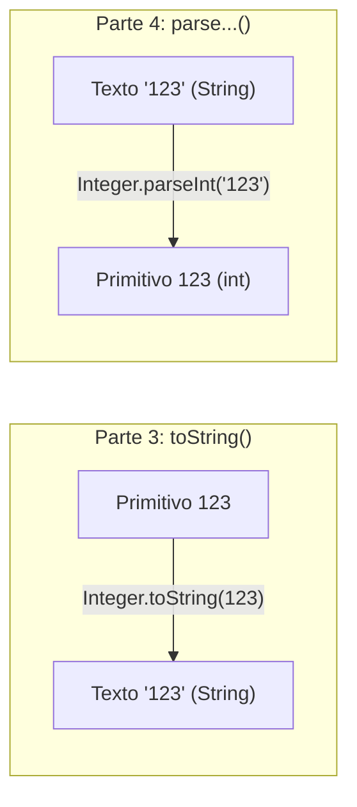
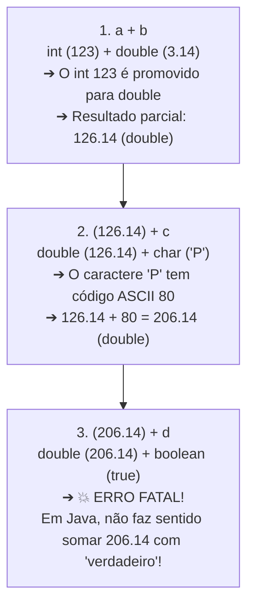

# Curso de Java — Capítulo 55 (Parte 4): Wrapper Classes 🎁
## Métodos de Conversão (*parse*), a Anatomia do Erro de Operador e Inspeção de Caracteres (*Character.isLetter*)

---

> [!IMPORTANT]
> **Para cópia no Google Docs:** Este documento analisa a quarta sequência de telas do **Capítulo 55 (Wrapper Classes)** do curso do Bro Code (timestamps `08:53:36` até `08:54:40`). Aqui, o professor ensina o caminho inverso do `toString()`: como extrair números primitivos a partir de textos usando os métodos **`parse`** (`Integer.parseInt`, `Double.parseDouble`, etc.). Em seguida, ele demonstra de propósito um **erro clássico de compilação** ao tentar somar esses primitivos, e finaliza apresentando os métodos de inspeção e validação da classe `Character` (`Character.isLetter`). Todas as telas, popups de erro e saídas de console foram descritos integralmente para cópia direta no seu Google Docs.

---

### Links Rápidos dos Arquivos do Projeto no seu Computador
* Arquivo Principal no Computador: [`Main.java`](file:///c:/Users/mickel%201/Downloads/JAVA%20APRENDER/Main.java)
* Pasta Raiz do Projeto: [`JAVA APRENDER`](file:///c:/Users/mickel%201/Downloads/JAVA%20APRENDER)
* Parte 1 (Conceito, Primitivos vs Wrappers e Depreciação do `new`): [`explicacao_wrapper_classes_definicao_os_dois_mundos_o_aviso_deprecated_e_os_4_tipos_capitulo55_parte1.md`](file:///C:/Users/mickel%201/.gemini/antigravity/brain/d1dae54d-8acc-4142-bb62-6703a22b9afc/explicacao_wrapper_classes_definicao_os_dois_mundos_o_aviso_deprecated_e_os_4_tipos_capitulo55_parte1.md)
* Parte 2 (Autoboxing, Unboxing e Conversões Automáticas): [`explicacao_wrapper_classes_autoboxing_unboxing_e_as_conversoes_automaticas_capitulo55_parte2.md`](file:///C:/Users/mickel%201/.gemini/antigravity/brain/d1dae54d-8acc-4142-bb62-6703a22b9afc/explicacao_wrapper_classes_autoboxing_unboxing_e_as_conversoes_automaticas_capitulo55_parte2.md)
* Parte 3 (Métodos Estáticos toString e Concatenação Textual): [`explicacao_wrapper_classes_metodos_utilitarios_estaticos_tostring_e_concatenacao_capitulo55_parte3.md`](file:///C:/Users/mickel%201/.gemini/antigravity/brain/d1dae54d-8acc-4142-bb62-6703a22b9afc/explicacao_wrapper_classes_metodos_utilitarios_estaticos_tostring_e_concatenacao_capitulo55_parte3.md)

---

## 1. Reconstituição Detalhada das 5 Telas da IDE IntelliJ IDEA

Abaixo está o registro cronológico exato do que aconteceu na tela do professor ao longo das 5 capturas:

```
+----------------------------------------------------------------------------------------------------+
|                                    SEQUÊNCIA DE TELAS NO VÍDEO                                      |
+----------------------------------------------------------------------------------------------------+
| IMAGEM 1: A Tentativa com os Métodos "parse" e o Sublinhado Vermelho (Timestamp 8:53:36).          |
|           • O professor digita quatro conversões a partir de texto (Strings):                      |
|                 int a = Integer.parseInt("123");                                                   |
|                 double b = Double.parseDouble("3.14");                                             |
|                 char c = "Pizza".charAt(0);                                                        |
|                 boolean d = Boolean.parseBoolean("true");                                          |
|           • Em seguida, mantém a linha: String x = a + b + c + d;                                  |
|           • A expressão "a + b + c + d" ganha um SUBLINHADO ONDULADO VERMELHO no editor.          |
|           • O cursor do mouse repousa sobre a linha e abre o balão de erro flutuante do IntelliJ:   |
|                 "Operator '+' cannot be applied to 'double', 'boolean'"                            |
|                                                                                                    |
| IMAGEM 2: A Falha na Compilação — Painel Build Output em Vermelho.                                 |
|           • O professor tenta compilar/executar o código clicando no Play ▶️.                       |
|           • O painel inferior se abre na aba "Build Output" acusando erro em vermelho:             |
|                 C:\Users\HP\IdeaProjects\MyFirstProject\src\Main.java:15:30                         |
|                 java: bad operand types for binary operator '+'                                    |
|                   first type:  double                                                              |
|                   second type: boolean                                                             |
|           • O professor explica por que isso ocorreu: agora a, b, c, d são primitivos reais,       |
|             e em Java é impossível somar número com booleano!                                      |
|                                                                                                    |
| IMAGEM 3: Mudando de Assunto — Métodos de Teste da Classe Character.                              |
|           • O professor limpa o método main e cria um novo teste nas linhas 10 e 12:               |
|                 char letter = 'b';                                                                 |
|                 System.out.println(Character.isLetter(letter));                                    |
|           • A variável "letter" na linha 10 aparece destacada com fundo roxo/cinza.                |
|           • Cursor posicionado logo após o método na linha 12.                                     |
|           • Uma lâmpada amarela 💡 surge na margem esquerda da linha 12.                           |
|                                                                                                    |
| IMAGEM 4: Executando o Teste com a Letra 'b' (Timestamp 8:54:31).                                  |
|           • O professor clica em Play ▶️. O painel inferior "Run" exibe em verde:                  |
|                 true                                                                               |
|           • O professor seleciona a palavra "true" com o mouse (destaque azul).                    |
|           • Abaixo aparece: "Process finished with exit code 0".                                   |
|           • Conclusão: 'b' é uma letra alfabética válida, logo Character.isLetter('b') dá true.   |
|                                                                                                    |
| IMAGEM 5: O Contra-Exemplo com o Símbolo '$' (Timestamp 8:54:40).                                 |
|           • O professor altera a linha 10 para: char letter = '$';                                 |
|           • Executa novamente o programa. O console do terminal exibe:                             |
|                 false                                                                              |
|           • Cursor piscando logo após a palavra "false".                                           |
|           • Conclusão: '$' é um símbolo de pontuação/moeda, e NÃO uma letra!                       |
+----------------------------------------------------------------------------------------------------+
```

---

## 2. O Que São os Métodos *parse*? (O Caminho Inverso do *toString*)

Na Parte 3 anterior, vimos como transformar um número em texto (`Integer.toString(123)` ➔ `"123"`).

Agora, o professor ensinou o **caminho inverso**: e se você tiver um texto vindo do teclado de um usuário (ex: `"123"` ou `"3.14"`) e precisar transformá-lo em um número de verdade para fazer contas?

> **A Palavra "Parse":** Em computação, *to parse* significa **analisar sintaticamente** ou **interpretar**. O método lê a String caractere por caractere e constrói o valor primitivo na memória.



### Tabela dos Métodos de Conversão (String ➔ Primitivo):

| Tipo Primitivo Desejado | Classe Wrapper | Método Chamado | Exemplo de Entrada | Valor Primitivo Resultante |
| :---: | :---: | :--- | :---: | :---: |
| `int` | `Integer` | `Integer.parseInt("123")` | `"123"` | `123` |
| `double` | `Double` | `Double.parseDouble("3.14")` | `"3.14"` | `3.14` |
| `boolean` | `Boolean` | `Boolean.parseBoolean("true")` | `"true"` | `true` |
| `char` | *(String)* | `"Pizza".charAt(0)` ⭐ | `"Pizza"` | `'P'` |

> [!NOTE]
> **Por que o `char` não tem `Character.parseChar()`?**
> Porque uma `String` é uma cadeia de vários caracteres. Para pegar um caractere específico de uma String, o Java usa o próprio método nativo de String chamado `.charAt(índice)`. O índice `0` pega a primeira letra (`'P'` de `"Pizza"`).

---

## 3. A Anatomia do Erro das Imagens 1 e 2: Por Que o Java Quebrou?

Na Imagem 1, o professor tentou executar:
```java
int a = Integer.parseInt("123");          // a = 123 (int)
double b = Double.parseDouble("3.14");    // b = 3.14 (double)
char c = "Pizza".charAt(0);               // c = 'P' (char, código ASCII 80)
boolean d = Boolean.parseBoolean("true"); // d = true (boolean)

String x = a + b + c + d; // ❌ ERRO DE COMPILAÇÃO!
```

O compilador barrou com a seguinte mensagem no painel vermelho:
```text
java: bad operand types for binary operator '+'
  first type:  double
  second type: boolean
```

### Por que o Java disse que o primeiro tipo é `double` e o segundo é `boolean`?

O Java avalia operações matemáticas com o operador `+` rigorosamente **da esquerda para a direita**:



1. **Primeira soma (`a + b`):** `123 + 3.14 = 126.14` (tipo `double`).
2. **Segunda soma (`126.14 + c`):** Todo `char` em Java é internamente um número da tabela ASCII. A letra `'P'` vale `80`. Logo, `126.14 + 80 = 206.14` (tipo `double`).
3. **Terceira soma (`206.14 + d`):** Agora o Java chega no `+ d`. O acumulado à esquerda é um **`double`** (`206.14`) e o valor à direita é um **`boolean`** (`true`).
4. **O Bloqueio:** O compilador olha para aquilo e diz: *"Eu não sei somar um número com um valor booleano verdadeiro/falso!"*. Por isso o erro exato emitido foi:
   `bad operand types for binary operator '+': first type: double, second type: boolean`.

> **Moral da História:** Na Parte 3 funcionou porque as 4 variáveis eram `String` (e com Strings o `+` concatena texto). Aqui na Parte 4 quebrou porque as variáveis eram primitivos reais, e o Java tentou fazer conta de somar!

---

## 4. O Canivete Suíço de `Character`: O Método `isLetter()`

Nas Imagens 3, 4 e 5, o professor encerra o capítulo mostrando outro exemplo de utilidade estática das Wrappers: **métodos de validação e inspeção de dados**.

```java
char letter = 'b';
System.out.println(Character.isLetter(letter)); // Imprime: true
```

```java
char letter = '$';
System.out.println(Character.isLetter(letter)); // Imprime: false
```

### Como funciona o `Character.isLetter()`?
* Ele recebe qualquer caractere primitivo (`char`).
* Ele analisa se aquele caractere pertence ao alfabeto (letras de `A` a `Z`, maiúsculas ou minúsculas).
* Se for letra (como `'b'`, `'A'`, `'z'`), devolve o booleano **`true`**.
* Se for número, pontuação ou símbolo especial (como `'$'`, `'@'`, `'7'`, `'#'`), devolve o booleano **`false`**.

### Outros Métodos Famosos da Classe `Character`:
* `Character.isDigit('5')` ➔ Retorna `true` se for um dígito numérico de 0 a 9.
* `Character.isUpperCase('A')` ➔ Retorna `true` se a letra for maiúscula.
* `Character.isLowerCase('b')` ➔ Retorna `true` se a letra for minúscula.
* `Character.toUpperCase('b')` ➔ Converte a letra `'b'` para maiúscula (`'B'`).

---

## 5. Código Atual no seu [`Main.java`](file:///c:/Users/mickel%201/Downloads/JAVA%20APRENDER/Main.java)

Abaixo está o código correspondente à **Imagem 5** (versão funcional do fechamento):

```java
public class Main {
    public static void main(String[] args) {

        // Wrapper classes = Allow primitive values (int, char, double, boolean)
        //                   to be used as objects. "Wrap them in an object"
        //                   Generally, don't wrap primitives unless you need an object.
        //                   Allows use of Collections Framework and static Utility Methods.

        char letter = '$';

        System.out.println(Character.isLetter(letter));
    }
}
```

---

## 6. Análise Detalhada Linha por Linha

| Linha | Código Exato | O que faz no computador? | Saída no Console? |
| :---: | :--- | :--- | :---: |
| **L1** | `public class Main {` | Declara a classe pública `Main`. | *(Nenhuma)* |
| **L2** | `public static void main(String[] args) {` | Método principal de execução. | *(Nenhuma)* |
| **L3** | *(linha em branco)* | Organização visual. | *(Nenhuma)* |
| **L4–L7** | `// Wrapper classes = ...` | Comentários conceituais sobre o propósito de Wrappers. | *(Nenhuma)* |
| **L8–L9** | *(linhas em branco)* | Separação visual. | *(Nenhuma)* |
| **L10** | `char letter = '$';` | Cria a variável primitiva `letter` do tipo `char` armazenando o símbolo monetário `'$'`. | *(Nenhuma)* |
| **L11** | *(linha em branco)* | Organização visual. | *(Nenhuma)* |
| **L12** | `System.out.println(Character.isLetter(letter));` | Chama o método estático `Character.isLetter('$')`. Como `'$'` não é letra, o método avalia para `false` e imprime o resultado na tela. | `false` |
| **L13** | `}` | Fim do método `main`. | *(Nenhuma)* |
| **L14** | `}` | Fim da classe `Main`. | *(Nenhuma)* |

---

## 7. Saídas Exatas no Terminal

### Caso 1: Na Imagem 4 (quando `letter = 'b'`):
```text
true

Process finished with exit code 0
```

### Caso 2: Na Imagem 5 (quando `letter = '$'`):
```text
false

Process finished with exit code 0
```

### Caso 3: Na Imagem 2 (ao tentar compilar o código do erro):
```text
C:\Users\HP\IdeaProjects\MyFirstProject\src\Main.java:15:30
java: bad operand types for binary operator '+'
  first type:  double
  second type: boolean
```
