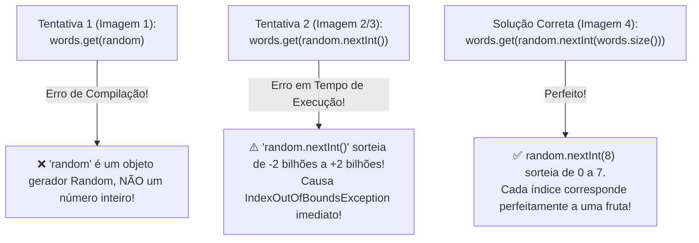

# Curso de Java Completo (Bro Code) — Capítulo 61: `⭐ hangman game 🕺` (Parte 13)
## Sorteando uma Palavra Secreta do Arquivo com `Random.nextInt(words.size())` e Limpeza com `.trim()`

> **Contexto no Vídeo**: No tempo **`10:09:45 / 12:00:00`**, o instrutor **Bro Code** dá um salto gigante no desenvolvimento do jogo da forca:
> 1. Ele adiciona a limpeza `.trim()` para evitar espaços em branco invisíveis lidos do arquivo `words.txt`.
> 2. Ele comenta temporariamente o loop do jogo com `/*` para testar **apenas a seleção da palavra secreta**.
> 3. Ele cria um gerador de números aleatórios (`Random random = new Random()`).
> 4. Ele comete didaticamente dois erros clássicos de iniciante ao tentar pegar uma palavra aleatória da lista (`words.get(random)` e `words.get(random.nextInt())`), explicando por que falham, até chegar na fórmula matemática perfeita: `words.get(random.nextInt(words.size()))`.
> 5. Ele roda o programa no console, que sorteia com sucesso a palavra **`lime`**, e abre a aba `words.txt` para comprovar de onde ela veio!

---

## 📸 Reconstituição Visual Completa das 5 Imagens (Para Google Docs)

Como você copiará este guia para o **Google Docs** e não terá as imagens físicas anexadas, abaixo está a reprodução textual e estrutural exata de cada uma das 5 telas do IntelliJ IDEA e do YouTube.

```
====================================================================================================
IMAGEM 1: Adição do .trim() e Erro de Tipo com 'words.get(random)'
====================================================================================================
Painel de Arquivos (Esquerda):
  MyFirstProject C:\Users\HP\...
  ├── .idea
  ├── out
  ├── src
  │   ├── .gitignore
  │   ├── MyFirstProject.iml
  └── words.txt

Abas Abertas: [Main.java*]  [words.txt]
Editor de Código (Linhas 19 a 39):
19:         while((line = reader.readLine()) != null){
20:             words.add(line.trim());
21:         }
22:     }
23:     catch(FileNotFoundException e){
24:         System.out.println("Could not find file");
25:     }
26:     catch(IOException e){
27:         System.out.println("Something went wrong");
28:     }
29: 
30:     Random random = new Random();
31: 
32:     String word = words.get(random);   <-- ⚠️ Ondulação vermelha embaixo de 'random'!
33: 
34:     /*                                 <-- Início do comentário em bloco
35: 
36:     Scanner scanner = new Scanner(System.in);
37:     ArrayList<Character> wordState = new ArrayList<>();
38:     int wrongGuesses = 0;
39: 
====================================================================================================
Diagnóstico Visual do Erro na Linha 32:
- O IntelliJ sublinha 'random' em vermelho porque o método .get() de um ArrayList EXIGE um número
  inteiro (int index). Passar o objeto gerador 'random' inteiro gera erro de compilação:
  "Required type: int, Provided: Random".
====================================================================================================
```

```
====================================================================================================
IMAGEM 2: Tentativa com 'random.nextInt()' e Linha do Tempo do YouTube
====================================================================================================
Barra de Vídeo do YouTube (Rodapé):
  [ ⏸ Pausa K ]  10:09:45 / 12:00:00    61.hangman game >

Editor de Código (Linha 32 modificada):
30:     Random random = new Random();
31: 
32:     String word = words.get(random.nextInt());   <-- Cursor piscando dentro dos parênteses

Análise do Autor:
- O autor substitui 'random' por 'random.nextInt()'. O erro de compilação desaparece,
  mas surge um perigo grave em tempo de execução: 'nextInt()' sem limites pode sortear
  qualquer número inteiro de -2 bilhões a +2 bilhões, estourando os limites da nossa lista!
====================================================================================================
```

```
====================================================================================================
IMAGEM 3: Zoom no Código Preparando o Limite Superior
====================================================================================================
Editor de Código (Linhas 22 a 43):
22:     }
23:     catch(FileNotFoundException e){
24:         System.out.println("Could not find file");
25:     }
26:     catch(IOException e){
27:         System.out.println("Something went wrong");
28:     }
29: 
30:     Random random = new Random();
31: 
32:     String word = words.get(random.nextInt());
33: 
34:     /*
35: 
36:     Scanner scanner = new Scanner(System.in);
37:     ArrayList<Character> wordState = new ArrayList<>();
38:     int wrongGuesses = 0;
39: 
40:     for(int i = 0; i < word.length(); i++){
41:         wordState.add('_');
42:     }

Análise:
- O autor mostra claramente que todo o resto do jogo antigo está comentado a partir da linha 34,
  permitindo focar exclusivamente no teste da geração aleatória da palavra.
====================================================================================================
```

```
====================================================================================================
IMAGEM 4: Código Final com 'words.size()', Execução e Saída no Console
====================================================================================================
Editor de Código (Linhas 32 a 38):
32:     String word = words.get(random.nextInt(words.size()));
33: 
34:     System.out.println(word);
35:     /*
36: 
37:     Scanner scanner = new Scanner(System.in);
38:     ArrayList<Character> wordState = new ArrayList<>();

Painel Inferior (Run Console):
  C:\Users\HP\.jdks\openjdk-23\bin\java.exe "-javaagent:C:\Program Files\JetBrains\IntelliJ..."
  lime

  Process finished with exit code 0

Cursor do Mouse:
- Posicionado sobre o botão "Rerun" (ícone de seta circular verde à esquerda do console),
  pronto para rodar o código várias vezes seguidas e demonstrar que a palavra muda aleatoriamente!
====================================================================================================
```

```
====================================================================================================
IMAGEM 5: Aba 'words.txt' Aberta para Conferência das 8 Palavras
====================================================================================================
Abas: [Main.java]  [words.txt*]

Conteúdo do arquivo words.txt (Linhas 1 a 8):
1: apple
2: orange
3: banana
4: coconut
5: pineapple
6: grape
7: lime       <-- A palavra exata sorteada e impressa no console da Imagem 4!
8: lemon

Ícone no centro: Botão gigante de Pausa (vídeo pausado pelo usuário).
====================================================================================================
```

---

## 🔬 O Código Completo do `Main.java` nesta Etapa

Abaixo está o arquivo exatamente como configurado pelo Bro Code nas imagens 1 a 4:

```java
1: import java.io.BufferedReader;
2: import java.io.FileNotFoundException;
3: import java.io.FileReader;
4: import java.io.IOException;
5: import java.util.ArrayList;
6: import java.util.Random;
7: import java.util.Scanner;
8: 
9: public class Main {
10:     public static void main(String[] args) {
11: 
12:         // JAVA HANGMAN GAME
13: 
14:         String filePath = "words.txt";
15:         ArrayList<String> words = new ArrayList<>();
16: 
17:         try(BufferedReader reader = new BufferedReader(new FileReader(filePath))){
18:             String line;
19:             while((line = reader.readLine()) != null){
20:                 words.add(line.trim());
21:             }
22:         }
23:         catch(FileNotFoundException e){
24:             System.out.println("Could not find file");
25:         }
26:         catch(IOException e){
27:             System.out.println("Something went wrong");
28:         }
29: 
30:         Random random = new Random();
31: 
32:         String word = words.get(random.nextInt(words.size()));
33: 
34:         System.out.println(word);
35: 
36:         /*
37:         Scanner scanner = new Scanner(System.in);
38:         ArrayList<Character> wordState = new ArrayList<>();
39:         int wrongGuesses = 0;
40: 
41:         for(int i = 0; i < word.length(); i++){
42:             wordState.add('_');
43:         }
44: 
45:         System.out.println("************************");
46:         System.out.println("Welcome to Java Hangman!");
47:         System.out.println("************************");
48: 
49:         while(wrongGuesses < 6){
50: 
51:             System.out.print(getHangmanArt(wrongGuesses));
52: 
53:             System.out.print("Word: ");
54: 
55:             for(char c : wordState){
56:                 System.out.print(c + " ");
57:             }
58:             System.out.println();
59: 
60:             System.out.print("Guess a letter: ");
61:             char guess = scanner.next().toLowerCase().charAt(0);
62: 
63:             if(word.indexOf(guess) >= 0){
64:                 System.out.println("Correct guess!\n");
65: 
66:                 for(int i = 0; i < word.length(); i++){
67:                     if(word.charAt(i) == guess){
68:                         wordState.set(i, guess);
69:                     }
70:                 }
71: 
72:                 if(!wordState.contains('_')){
73:                     System.out.print(getHangmanArt(wrongGuesses));
74:                     System.out.println("YOU WIN!");
75:                     System.out.println("The word was: " + word);
76:                     break;
77:                 }
78:             }
79:             else{
80:                 wrongGuesses++;
81:                 System.out.println("Wrong guess!\n");
82:             }
83:         }
84: 
85:         if(wrongGuesses >= 6){
86:             System.out.print(getHangmanArt(wrongGuesses));
87:             System.out.println("GAME OVER!");
88:             System.out.println("The word was: " + word);
89:         }
90: 
91:         scanner.close();
92:         */
93:     }
94: 
95:     static String getHangmanArt(int wrongGuesses){
96:         return switch(wrongGuesses){
97:             case 0 -> """
98:                       
99:                       
100:                       
101:                       """;
102:             case 1 -> """
103:                        o
104:                       
105:                       
106:                       """;
107:             case 2 -> """
108:                        o
109:                        |
110:                       
111:                       """;
112:             case 3 -> """
113:                        o
114:                       /|
115:                       
116:                       """;
117:             case 4 -> """
118:                        o
119:                       /|\\
120:                       
121:                       """;
122:             case 5 -> """
123:                        o
124:                       /|\\
125:                       /
126:                       """;
127:             case 6 -> """
128:                        o
129:                       /|\\
130:                       / \\
131:                       """;
132:             default -> "";
133:         };
134:     }
135: }
```

---

## 🔍 Explicação Linha por Linha ("Como se Fosse um Iniciante Amador")

Vamos dissecar as linhas modificadas e adicionadas nas imagens:

### Linha 1 a 7: Os `imports`
- `import java.io.BufferedReader;` e `FileReader;`: Nossas ferramentas para abrir e sugar o texto do disco rígido.
- `import java.io.FileNotFoundException;` e `IOException;`: As proteções contra erros de arquivo não encontrado ou corrompido.
- `import java.util.ArrayList;`: Nossa lista dinâmica que armazena as palavras na memória RAM.
- `import java.util.Random;` (**Novo e Importante!**): A classe geradora de números pseudo-aleatórios da biblioteca padrão do Java.
- `import java.util.Scanner;`: O leitor de teclado (está no arquivo, mas comentado temporariamente).
- *Console*: Nenhuma saída.

### Linhas 14 e 15: O Caminho e a Lista
- `String filePath = "words.txt";`: Diz onde o arquivo está (na pasta raiz do projeto).
- `ArrayList<String> words = new ArrayList<>();`: Cria o "carrinho de compras" vazio na memória RAM que vai receber as palavras.
- *Console*: Nenhuma saída.

### Linhas 17 a 19: O `try-with-resources` e a Leitura Linha a Linha
- `try(BufferedReader reader = new BufferedReader(new FileReader(filePath))){`: Abre o leitor de forma segura. Ao final do bloco `try`, o Java garante que fechará o arquivo automaticamente.
- `String line;`: Variável que guardará temporariamente a linha que acabou de ser lida.
- `while((line = reader.readLine()) != null){`: Loop que lê uma linha por vez. Quando chega ao fim do arquivo, `readLine()` retorna `null`, fazendo o loop parar.
- *Console*: Nenhuma saída.

### Linha 20: `words.add(line.trim());` ✂️ (NOVIDADE DA IMAGEM 1)
- **O que mudou?** Antes estava apenas `words.add(line);`. Agora o autor colocou `words.add(line.trim());`.
- **O que faz o método `.trim()`?**
  - "Trim" em inglês significa **aparar**, podar ou cortar rebarbas.
  - O método `.trim()` remove **todos os espaços em branco, quebras de linha invisíveis (`\r`, `\n`) e tabulações (`\t`)** que possam existir no início ou no fim da palavra lida do arquivo de texto!
- **Por que isso é fundamental para o Hangman?**
  - Se no arquivo `words.txt` você digitou sem querer `"apple "` (com um espaço no final), o jogo da forca ficaria impossível de ganhar, porque o jogador teria que adivinhar a letra `' '` (espaço)!
  - Além disso, no Windows, as linhas costumam terminar com os caracteres invisíveis `\r\n`. O `.trim()` corta essas sobras, garantindo que dentro da lista `words` entre apenas `"apple"` puro e limpo!
- *Console*: Nenhuma saída.

### Linhas 22 a 28: Tratamento de Exceções (`catch`)
- Se o arquivo sumir, cai em `FileNotFoundException` e imprime `"Could not find file"`.
- Se der pane de hardware ou leitura, cai em `IOException` e imprime `"Something went wrong"`.
- Como o arquivo `words.txt` existe e está perfeito, esses blocos são **ignorados**.
- *Console*: Nenhuma saída.

---

## 🎲 A Saga da Linha 30 a 32: Sorteando a Palavra Aleatória

Aqui está o coração didático desta aula. O autor faz o aluno entender o raciocínio matemático por trás do sorteio.



### Linha 30: `Random random = new Random();`
- Instancia a máquina de aleatoriedade do Java.
- Pense na variável `random` como um "dado de RPG mágico" que você pode rolar a qualquer momento para pedir um número imprevisível.
- *Console*: Nenhuma saída.

---

### 💥 O Erro 1 (Imagem 1): `String word = words.get(random);`
- **O que o autor tentou fazer?** Ele tentou passar o objeto `random` diretamente para o método `.get()`.
- **Por que o Java gritou em vermelho?**
  - O método de um ArrayList tem a assinatura: `public E get(int index)`.
  - Ele espera receber um número inteiro (`0`, `1`, `2`, etc.) que indica a **posição** da gaveta que você quer abrir.
  - `random` é a fábrica inteira de números, não um número `int`!
  - **Mensagem do IntelliJ**: `Incompatible types: Random cannot be converted to int`.

---

### ⚠️ O Perigo 2 (Imagens 2 e 3): `String word = words.get(random.nextInt());`
- **O que o autor tentou aqui?** Ele chamou o método `.nextInt()` do gerador `random`.
- **Por que agora compila?** Porque `random.nextInt()` retorna um `int` de verdade!
- **Por que o programa vai quebrar se você rodar assim?**
  - Sem passar parâmetros, `nextInt()` escolhe **qualquer** número inteiro de 32 bits: de `-2.147.483.648` até `+2.147.483.647`.
  - Se ele sortear o número `-45`: uma lista não tem índice negativo! 💥 `IndexOutOfBoundsException`.
  - Se ele sortear o número `999`: nossa lista só tem 8 palavras (índices de 0 a 7)! 💥 `IndexOutOfBoundsException`.
  - O programa simplesmente capotaria na largada!

---

### 🏆 A Solução Definitiva (Imagem 4): `String word = words.get(random.nextInt(words.size()));`
- **Como funciona o método sobrecarregado `nextInt(bound)` com limite?**
  - Quando você passa um número dentro dos parênteses do `nextInt(limite)`, o Java gera um número inteiro aleatório entre **`0` (inclusivo)** e **`limite` (exclusivo)**:
  $$\text{Intervalo sorteado} = [0, \text{limite} - 1]$$
- **O que é `words.size()`?**
  - Como temos 8 palavras no arquivo `words.txt`, `words.size()` vale exatamente `8`.
- **Portanto:**
  ```java
  random.nextInt(words.size())  // equivale a: random.nextInt(8)
  ```
  Isso gera **exclusivamente** os números:
  $$\{0, 1, 2, 3, 4, 5, 6, 7\}$$

---

## 🗺️ Mapeamento de Índices da Lista `words`

Veja como cada número sorteado se conecta com a linha do arquivo `words.txt` (Imagem 5):

| Linha no `words.txt` | Índice no `ArrayList` (`words.get(i)`) | Palavra Sorteada |
| :---: | :---: | :---: |
| **Linha 1** | `0` | `"apple"` |
| **Linha 2** | `1` | `"orange"` |
| **Linha 3** | `2` | `"banana"` |
| **Linha 4** | `3` | `"coconut"` |
| **Linha 5** | `4` | `"pineapple"` |
| **Linha 6** | `5` | `"grape"` |
| **Linha 7** | `6` | `"lime"` ⭐ *(Palavra sorteada na Imagem 4!)* |
| **Linha 8** | `7` | `"lemon"` |

> [!IMPORTANT]
> **Por que nunca dará erro de índice fora dos limites (*IndexOutOfBoundsException*)?**  
> Porque a nossa lista tem tamanho `8`, seus índices válidos vão de `0` a `7`. E a chamada `random.nextInt(8)` gera exatamente números de `0` a `7`! O casamento é perfeito!

---

### Linha 34: `System.out.println(word);` (Imagem 4)
- **O que faz**: Imprime no console a palavra que foi aleatoriamente selecionada para conferência.
- **Saída no Console da Imagem 4**:
  ```text
  lime
  ```
- **Por que saiu `lime`?**  
  Porque nessa execução específica do vídeo, o gerador `random.nextInt(8)` sorteou o número `6`. E na posição `6` do nosso `ArrayList` mora a palavra `"lime"`!
- Se o autor rodar de novo (clicando no botão *Rerun* da Imagem 4), o programa poderá imprimir `"banana"`, `"apple"`, `"orange"`, etc.

---

### Linha 36 a 92: `/* ... */` O Comentário em Bloco
- **Por que o autor comentou o resto do código?**
  - Esta é uma **técnica profissional de depuração (*debugging*)**:
  - Quando você cria uma funcionalidade nova e crítica (como ler de um arquivo e sortear uma palavra aleatória), você **isola** essa lógica e testa primeiro.
  - Assim, você não precisa ficar jogando o jogo inteiro da forca e digitando letras no teclado só para saber se a palavra foi lida e sorteada corretamente.
  - Depois de confirmar que o sorteio está 100% funcional, basta apagar o `/*` e o `*/` para o jogo completo voltar à vida!

---

## 🖥️ Saída Exata no Console do IntelliJ IDEA (Imagem 4)

Ao compilar e executar o código da Imagem 4, o console exibirá exatamente:

```text
lime

Process finished with exit code 0
```

*(Obs: Em execuções posteriores, qualquer uma das 8 frutas de `words.txt` poderá aparecer!)*

---

## 📋 Resumo Didático para Fixação

1. **`.trim()`**: Limpa sujeiras, espaços em branco acidentais e quebras de linha (`\r`, `\n`) do texto lido do arquivo.
2. **`Random random = new Random();`**: Constrói o gerador de aleatoriedade.
3. **`random.nextInt(words.size())`**: Sorteia um número de `0` até o tamanho da lista menos um, garantindo que o índice seja sempre válido.
4. **`words.get(...)`**: Pega a palavra guardada naquele índice sorteado e entrega para a variável `String word`.
5. **Isolamento com comentários `/* */`**: Permite testar partes novas do código rapidamente sem a distração do resto do programa.
