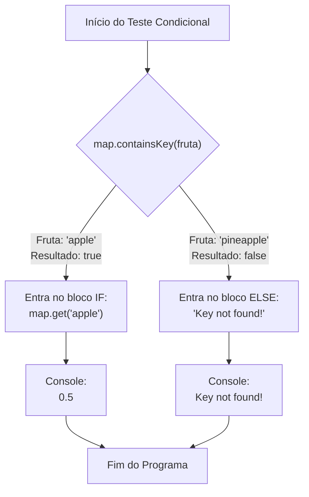

# Curso de Java — Bro Code (12 Horas)
## Capítulo 67: `hashmaps 🗺️` (Parte 6 — Busca Segura com `if / else` e `.containsKey()`)

---

> [!NOTE]
> **Contexto para o Google Docs**: Este documento contém a reconstituição textual completa das **5 telas** exibidas pelo instrutor Bro Code no vídeo (entre os minutos **10:59:00** e **10:59:25** de 12:00:00). Você não precisa das imagens originais: todos os painéis do IntelliJ IDEA, códigos, estruturas de controle `if / else`, digitações intermediárias e saídas do console foram reconstituídos em blocos de texto fiéis para o seu documento.

---

## 1. Reconstituição Textual das Telas do Vídeo (Google Docs Ready)

### Tela 1: O Autor Começa a Digitar a Estrutura `if` (Timestamp ~10:58:50)
```text
+--------------------------------------------------------------------------------------------------+
|  IntelliJ IDEA - MyFirstProject [Main.java]                                   Timestamp ~10:58:50|
+--------------------------------------------------------------------------------------------------+
| Project Tree      |  Main.java                                                                   |
| > .idea           |  18        //map.remove("apple");                                            |
| > out             |  19        //System.out.println(map.get("coconut"));                         |
| v src             |  20        //System.out.println(map.containsKey("pineapple"));               |
|   (c) Main        |  21                                                                          |
|   .gitignore      |  22        if(map.containsKey("apple")){                                     |
|                   |  23 💡         System.out.println();                                         |
|                   |  24        }                                                                 |
|                   |  25    }                                                                     |
|                   |  26 }                                                                        |
+--------------------------------------------------------------------------------------------------+
| O autor comenta a linha 20 (//map.containsKey) e inicia a construção de um bloco condicional:    |
| "Se o mapa contiver a chave 'apple', imprima algo...". O cursor está dentro do println().       |
+--------------------------------------------------------------------------------------------------+
```

---

### Tela 2: O Bloco Completo `if / else` com Mensagem de Erro Amigável (Timestamp ~10:59:00)
```text
+--------------------------------------------------------------------------------------------------+
|  IntelliJ IDEA - MyFirstProject [Main.java]                                   Timestamp ~10:59:00|
+--------------------------------------------------------------------------------------------------+
| Project Tree      |  Main.java                                                                   |
| > .idea           |  22        if(map.containsKey("apple")){                                     |
| > out             |  23            System.out.println(map.get("apple"));                         |
| v src             |  24        }                                                                 |
|   (c) Main        |  25        else{                                                             |
|   .gitignore      |  26            System.out.println("Key not found!");                         |
|                   |  27        }                                                                 |
|                   |  28    }                                                                     |
|                   |  29 }                                                                        |
+--------------------------------------------------------------------------------------------------+
| O código agora tem dois caminhos:                                                                |
| 1. Se a maçã existir, busca e imprime o seu preço com map.get("apple").                          |
| 2. Se a maçã NÃO existir (else), avisa educadamente: "Key not found!" (Chave não encontrada!).   |
+--------------------------------------------------------------------------------------------------+
```

---

### Tela 3: Executando o Caso Positivo (`"apple"` Existe ➔ `0.5`) (Timestamp: 10:59:04)
```text
+--------------------------------------------------------------------------------------------------+
|  Run / Execution Window (Console do IntelliJ)                                 Timestamp 10:59:04 |
+--------------------------------------------------------------------------------------------------+
|  C:\Users\HP\.jdks\openjdk-23\bin\java.exe ... Main                                              |
|                                                                                                  |
|  0.5                                                                                             |
|                                                                                                  |
|  Process finished with exit code 0                                                               |
+--------------------------------------------------------------------------------------------------+
| O autor clicou em Play ▶️. Como "apple" existe no mapa, a condição do if foi verdadeira (true)! |
| O programa entrou no bloco do if e imprimiu o preço da maçã: 0.5. O bloco else foi ignorado!    |
+--------------------------------------------------------------------------------------------------+
```

---

### Tela 4: Alterando o Código para Testar uma Fruta Inexistente (Timestamp: 10:59:16)
```text
+--------------------------------------------------------------------------------------------------+
|  IntelliJ IDEA - MyFirstProject [Main.java]                                   Timestamp 10:59:16 |
+--------------------------------------------------------------------------------------------------+
| Editor:                                                                                          |
|  22        if(map.containsKey("pineapple")){                                                     |
|  23            System.out.println(map.get(["pineapple"])); <-- "pineapple" SELECIONADO EM AZUL   |
|  24        }                                                                                     |
|  25        else{                                                                                 |
|  26            System.out.println("Key not found!");                                             |
|  27        }                                                                                     |
+--------------------------------------------------------------------------------------------------+
| O autor substitui "apple" por "pineapple" tanto no teste da linha 22 quanto no get() da linha 23.|
| Nota do YouTube: O player mostra o card "1:09:00 7.if statements" relembrando as aulas básicas!   |
+--------------------------------------------------------------------------------------------------+
```

---

### Tela 5: Executando o Caso Negativo (`"pineapple"` Não Existe ➔ `"Key not found!"`) (Timestamp: 10:59:25)
```text
+--------------------------------------------------------------------------------------------------+
|  Run / Execution Window (Console do IntelliJ)                                 Timestamp 10:59:25 |
+--------------------------------------------------------------------------------------------------+
|  C:\Users\HP\.jdks\openjdk-23\bin\java.exe ... Main                                              |
|                                                                                                  |
| [Key not found!] <-- Texto selecionado em azul no console pelo autor!                            |
|                                                                                                  |
|  Process finished with exit code 0                                                               |
+--------------------------------------------------------------------------------------------------+
| O autor rodou o código com "pineapple". Como abacaxi NÃO está no mapa, a condição deu FALSE!     |
| O Java pulou o bloco if e caiu direto no bloco else, imprimindo: "Key not found!".               |
+--------------------------------------------------------------------------------------------------+
```

---

## 2. O Código Completo do Arquivo `Main.java`

Aqui está o código exato presente no arquivo [`Main.java`](../../../src/main/java/com/mickaelgeronimo/mastery/core/concurrency/Main.java):

```java
import java.util.HashMap;

public class Main {
    public static void main(String[] args) {

        // HashMap = A data structure that stores key-value pairs
        //           Keys are unique, but Values can be duplicated
        //           Does not maintain any order, but is memory efficient
        //           HashMap<Key, Value>

        HashMap<String, Double> map = new HashMap<>();

        map.put("apple", 0.50);
        map.put("orange", 0.75);
        map.put("banana", 0.25);
        map.put("coconut", 1.00);

        //map.remove("apple");
        //System.out.println(map.get("coconut"));
        //System.out.println(map.containsKey("pineapple"));

        if(map.containsKey("pineapple")){
            System.out.println(map.get("pineapple"));
        }
        else{
            System.out.println("Key not found!");
        }

    }
}
```

---

## 3. Explicação Linha por Linha ("Como se fosse um iniciante amador leigo")

Abaixo está a análise minuciosa de cada linha de código, com analogias simples para quem está aprendendo a programar do zero:

### Linha 1: `import java.util.HashMap;`
- **O que faz**: Traz a biblioteca do `HashMap` para dentro do arquivo.
- **Linguagem de Leigo**: Pede emprestada a ferramenta de "tabela de busca" do almoxarifado do Java.
- **Saída no Console**: Nenhuma.

### Linha 3: `public class Main {`
- **O que faz**: Abertura da classe principal [`Main`](../../../src/main/java/com/mickaelgeronimo/mastery/core/concurrency/Main.java#L3).
- **Linguagem de Leigo**: A casa onde todas as nossas ordens moram.
- **Saída no Console**: Nenhuma.

### Linha 4: `public static void main(String[] args) {`
- **O que faz**: O método principal onde a execução tem início.
- **Linguagem de Leigo**: O interruptor que acende a luz do programa.
- **Saída no Console**: Nenhuma.

### Linhas 6 a 9: Os Comentários Teóricos
```java
// HashMap = A data structure that stores key-value pairs
//           Keys are unique, but Values can be duplicated
//           Does not maintain any order, but is memory efficient
//           HashMap<Key, Value>
```
- **O que faz**: Anotações do autor. O computador pula e ignora tudo que começa com `//`.
- **Saída no Console**: Nenhuma.

### Linha 11: `HashMap<String, Double> map = new HashMap<>();`
- **O que faz**: Cria o mapa na memória do computador.
  - Chave: `String` (o nome do item, ex: `"apple"`).
  - Valor: `Double` (o preço, ex: `0.50`).
- **Linguagem de Leigo**: Compra um caderno de preços novinho em folha.
- **Saída no Console**: Nenhuma.

### Linhas 13 a 16: O Cadastro dos 4 Produtos com `.put(...)`
```java
map.put("apple", 0.50);
map.put("orange", 0.75);
map.put("banana", 0.25);
map.put("coconut", 1.00);
```
- **O que faz**: Registra os 4 itens na tabela.
- **Linguagem de Leigo**: Cola 4 etiquetas com preços na vitrine.
- **Saída no Console**: Nenhuma.

---

### Linhas 18 a 20: O Histórico de Métodos Anteriores Comentados
```java
//map.remove("apple");
//System.out.println(map.get("coconut"));
//System.out.println(map.containsKey("pineapple"));
```
- **O que faz**: O autor colocou barras duplas `//` no início de cada uma dessas 3 linhas.
- **Por que ele fez isso?**
  1. A linha 18 apagaria a maçã (ele quer que ela continue na tabela).
  2. A linha 19 imprimiria `1.0` no console.
  3. A linha 20 imprimiria `false` no console.
  - Para não sujar a tela com coisas antigas, ele "silenciou" as três linhas.
- **Saída no Console**: Nenhuma.

---

### Linha 22: `if(map.containsKey("pineapple")){` (ou `"apple"`)
- **O que faz**: O comando `if` significa "SE". É um guarda de trânsito que faz uma pergunta de sim ou não.
- **A Pergunta**: `map.containsKey("pineapple")`
  - Se a fruta estiver no mapa, a resposta é `true` (SIM). O guarda deixa o computador entrar pelas chaves `{` da linha 22.
  - Se a fruta NÃO estiver no mapa, a resposta é `false` (NÃO). O guarda bloqueia a entrada e manda o computador direto para o `else`!
- **Linguagem de Leigo**: *"Guarda, tem abacaxi nessa loja?"* ➔ O mapa responde: *"Não, nunca vi abacaxi aqui"* (`false`).
- **Saída no Console**: Nenhuma (é apenas uma decisão mental do computador).

---

### Linha 23: `System.out.println(map.get("pineapple"));` (ou `"apple"`)
- **O que faz**: Só é executada se a condição do `if` tiver dado `true`!
  - No caso da `"apple"`: como a maçã existe, ele executa essa linha e busca o preço dela (`map.get("apple")`).
  - **Saída no console com `"apple"`**: `0.5`
  - No caso do `"pineapple"`: como abacaxi deu `false`, o computador **ignora e pula completamente** essa linha! Ele nem chega a tocar nela.

---

### Linha 24: `}`
- **O que faz**: Fecha o bloco de comandos do `if`.

---

### Linha 25: `else{`
- **O que faz**: A palavra `else` significa "SENÃO" ou "CASO CONTRÁRIO".
- **Como funciona**: O `else` é a rede de segurança. Se o guarda do `if` disse NÃO (`false`), o computador cai obrigatoriamente aqui dentro!
- **Linguagem de Leigo**: *"Já que não tem abacaxi, faça isso aqui em vez disso..."*.
- **Saída no Console**: Nenhuma.

---

### Linha 26: `System.out.println("Key not found!");`
- **O que faz**: Imprime uma mensagem de aviso elegante em inglês que significa: **"Chave não encontrada!"**.
- **Quando ela executa?**: Apenas quando a fruta pesquisada não existir no mapa!
- **Saída no console com `"pineapple"`**:
  ```text
  Key not found!
  ```

---

### Linhas 27 a 29: Fechamento dos Blocos
- Linha 27 fecha o `else`.
- Linha 28 fecha o método `main`.
- Linha 29 fecha a classe `Main`.
- **Saída no Console**: `Process finished with exit code 0`.

---

## 4. O Grande Segredo de Engenharia de Software: Por que Fazer Isso?

Por que o Bro Code não fez apenas `System.out.println(map.get("pineapple"));` diretamente?

### O que aconteceria sem o `if/else`?
Se você buscar diretamente um produto que não existe:
```java
System.out.println(map.get("pineapple"));
```
O console imprime:
```text
null
```

### O Perigo do `null`:
Imagine que você queira calcular o preço com 10% de imposto:
```java
Double preco = map.get("pineapple"); // preco recebe null!
Double precoFinal = preco * 1.10;    // CRASH! TENTOU MULTIPLICAR NULL!
```
O Java vai disparar o temido erro fatal:
💥 **`NullPointerException`** (O programa trava, a tela fecha e o usuário fica na mão!).

> [!IMPORTANT]
> **A Regra dos Bons Programadores**: Sempre que você não tiver 100% de certeza de que uma chave existe no mapa, use `.containsKey()` dentro de um `if/else` para garantir que o seu programa nunca trave e sempre dê uma mensagem amigável ao usuário!

---

## 5. Tabela Comparativa de Execução: `"apple"` vs `"pineapple"`

| Cenário | Teste da Linha 22 | Resultado do `containsKey` | Qual bloco executa? | O que sai no Console? |
| :--- | :--- | :---: | :---: | :--- |
| **Cenário 1 (Telas 2 e 3)** | `map.containsKey("apple")` | `true` | Bloco `if` (linha 23) | `0.5` |
| **Cenário 2 (Telas 4 e 5)** | `map.containsKey("pineapple")` | `false` | Bloco `else` (linha 26) | `Key not found!` |

---

## 6. Diagrama de Fluxo Visual: A Bifurcação do `if / else`



---

## 7. Checklist de Fixação Mental para Iniciantes

1. **O que é o `if`?** Uma estrutura que só executa o que está dentro das chaves `{ }` se a condição for `true`.
2. **O que é o `else`?** A alternativa que só executa se a condição do `if` tiver sido `false`.
3. **Por que o teste com `"apple"` deu `0.5`?** Porque a maçã está na tabela (linha 13), logo o `containsKey` respondeu `true` e o programa buscou seu valor.
4. **Por que o teste com `"pineapple"` deu `"Key not found!"`?** Porque o abacaxi não está na tabela, o `containsKey` respondeu `false`, o `if` foi pulado e o `else` executou o aviso.
5. **Por que isso é melhor do que apenas chamar `.get()`?** Porque evita que o programa devolva `null` e quebre mais tarde com erros fatais.
