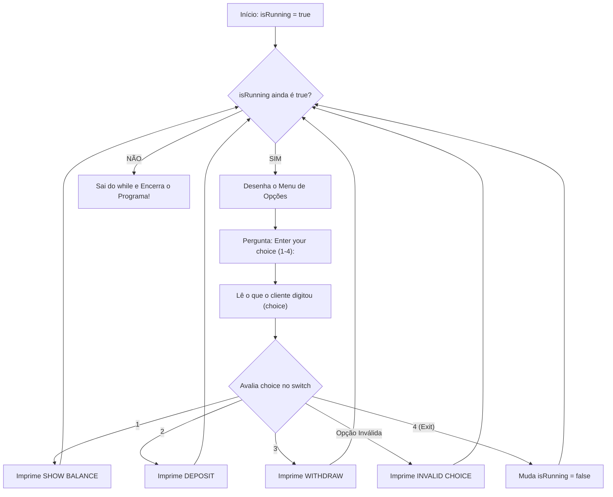

# 💰 Curso de Java para Iniciantes — Bro Code
## 📌 Capítulo 29: Programa Bancário (`banking program`) — Parte 3: O Teste do `default` e o Laço Contínuo com `while(isRunning)`
**Timestamps do vídeo:** `4:37:15` até `~4:38:30 / 12:00:00`  
**Tema:** O divisor de águas do projeto: transformando um script descartável em um **sistema contínuo de verdade**! O professor testa a opção inválida no console (`INVALID CHOICE`), constata que o programa fecha na cara do usuário, e então implementa o laço `while(isRunning)` que abraça o menu e o `switch`. Agora, o caixa eletrônico só fecha se o cliente escolher `4. Exit`.

---

## 🖼️ Contexto Visual dos 4 Prints (Para quem está lendo no Google Docs)

Se você copiou este arquivo para o seu Google Docs e não tem as imagens ao lado, veja o passo a passo exato do que aconteceu na tela do professor:

1. **Imagem 1 (Minuto 4:37:15 — Testando a Escolha Inválida `5` e o Encerramento Indesejado):**
   * O professor executa o programa da Parte 2 e digita `5` no console:
     ```text
     Enter your choice (1-4): 5
     INVALID CHOICE

     Process finished with exit code 0
     ```
   * O Java executou o `default` com perfeição, mas logo em seguida o programa **morreu** (`exit code 0`).
   * O professor usa essa cena para demonstrar aos alunos o grande problema: num banco de verdade, se você digitar uma opção errada (ou consultar o saldo), o caixa não pode desligar! Ele precisa te dar outra chance e voltar para o menu!

2. **Imagem 2 (Minuto 4:37:40 — O Início da Cirurgia: Criando o `while`):**
   * De volta ao editor, logo acima da moldura do menu (Linha 14), o autor digita:
     ```java
     while(isRunning){

     }
     ```
   * As chaves `{ }` do `while` ainda estão vazias, prontas para receber todo o bloco de código que precisa se repetir.

3. **Imagem 3 (Minuto 4:37:52 — O Menu e o Switch Abraçados pelo Loop):**
   * O autor recorta e cola o menu, a leitura do teclado e o `switch(choice)` para dentro do `while(isRunning)`.
   * A chave de abertura `{` fica na Linha 14 e a chave de fechamento `}` do `while` fica na **Linha 34**.
   * Todo o miolo (Linhas 15 a 33) ganhou recuo de indentação.
   * Na Linha 31, o `case 4 -> isRunning = false;` agora faz todo o sentido: ele é a alavanca que desliga o `while`!

4. **Imagem 4 (Minuto ~4:38:00 — O Teste Glorioso: O Caixa Eletrônico Não Desliga Mais!):**
   * O professor dá Play no programa atualizado.
   * O console exibe o menu e a pergunta: `Enter your choice (1-4): `.
   * O autor digita `1` e dá `Enter`.
   * O console imprime `SHOW BALANCE`.
   * **A MÁGICA ACONTECE:** Em vez de morrer, o programa reinicia o ciclo! O cabeçalho com asteriscos `*************** BANKING PROGRAM ***************` e todas as opções reaparecem automaticamente na tela!
   * Na linha de baixo, o cursor volta a piscar ao lado de `Enter your choice (1-4): `, pronto para o próximo comando do cliente!

---

## 🧠 A Lógica do Loop: Como o `while` e o `switch` Trabalham em Parceria

Pense no programa como um atendente de caixa eletrônico com um caderninho:



### O Segredo da Variável Bandeira (*Flag*):
* A variável `boolean isRunning = true;` funciona como a **chave de ignição do carro**.
* Enquanto ela valer `true`, a pergunta `while(isRunning)` responderá "SIM, continue rodando!" e voltará ao início do menu após cada operação.
* Quando o usuário digita `4`, o `case 4 -> isRunning = false;` gira a chave para desligar.
* O Java chega na chave de fechamento `}` (Linha 34), olha para o `while(isRunning)`, vê que agora `isRunning` vale `false` e finalmente sai do loop!

---

## 💻 Código Completo e Idêntico da Tela (`Main.java`)

```java
import java.util.Scanner;

public class Main {
    public static void main(String[] args) {

        // JAVA BANKING PROGRAM FOR BEGINNERS

        Scanner scanner = new Scanner(System.in);
        double balance;
        boolean isRunning = true;
        int choice;

        while(isRunning){

            System.out.println("***************");
            System.out.println("BANKING PROGRAM");
            System.out.println("***************");
            System.out.println("1. Show Balance");
            System.out.println("2. Deposit");
            System.out.println("3. Withdraw");
            System.out.println("4. Exit");
            System.out.println("***************");

            System.out.print("Enter your choice (1-4): ");
            choice = scanner.nextInt();

            switch(choice){
                case 1 -> System.out.println("SHOW BALANCE");
                case 2 -> System.out.println("DEPOSIT");
                case 3 -> System.out.println("WITHDRAW");
                case 4 -> isRunning = false;
                default -> System.out.println("INVALID CHOICE");
            }
        }

        // showBalance()

        // deposit()

        // withdraw()

        // EXIT MESSAGE
    }
}
```

---

## 🔍 Explicação Linha por Linha (Toda Linha Enumerada)

### **Linha 1:** `import java.util.Scanner;`
* **O que faz:** Importa o leitor de teclado do Java.
* **Console:** **Nada**.

---

### **Linha 2:** *(Linha em branco)*
* **Console:** **Nada**.

---

### **Linha 3:** `public class Main {`
* **O que faz:** Abre a classe principal `Main`.
* **Console:** **Nada**.

---

### **Linha 4:** `public static void main(String[] args) {`
* **O que faz:** Ponto de partida por onde a execução começa.
* **Console:** **Nada**.

---

### **Linha 5:** *(Linha em branco)*
* **Console:** **Nada**.

---

### **Linha 6:** `// JAVA BANKING PROGRAM FOR BEGINNERS`
* **O que faz:** Comentário de identificação do projeto.
* **Console:** **Nada**.

---

### **Linha 7:** *(Linha em branco)*
* **Console:** **Nada**.

---

### **Linhas 8 a 11:** *(Preparando as Ferramentas e Caixas de Memória)*
* **Linha 8:** `Scanner scanner = new Scanner(System.in);` $\rightarrow$ Constrói o leitor do teclado.
* **Linha 9:** `double balance;` $\rightarrow$ Cria a variável de saldo bancário.
* **Linha 10:** `boolean isRunning = true;` $\rightarrow$ Cria a chave geral do banco, ligada com `true`.
* **Linha 11:** `int choice;` $\rightarrow$ Cria a variável para armazenar o número digitado pelo cliente.
* **Console em todas elas:** **Nada**.

---

### **Linha 12:** *(Linha em branco)*
* **Console:** **Nada**.

---

### **Linha 13:** *(Linha em branco)*
* **Console:** **Nada**.

---

### **Linha 14:** `while(isRunning){`
* **O que faz:** **A ENTRADA DO LAÇO DE REPETIÇÃO.** O Java avalia a condição entre parênteses: `isRunning` é `true`? Como definimos como `true` na Linha 10, a resposta é SIM! O programa entra no bloco e executa tudo que estiver até a Linha 34.
* **Console:** **Nada**.

---

### **Linha 15:** *(Linha em branco de indentação)*
* **Console:** **Nada**.

---

### **Linhas 16 a 23:** *(Impressão do Menu a Cada Repetição)*
```java
System.out.println("***************");
System.out.println("BANKING PROGRAM");
System.out.println("***************");
System.out.println("1. Show Balance");
System.out.println("2. Deposit");
System.out.println("3. Withdraw");
System.out.println("4. Exit");
System.out.println("***************");
```
* **O que faz:** Desenha toda a caixa de opções com a moldura de asteriscos. Sempre que o loop reiniciar, esse menu é desenhado de novo!
* **Console:**
  ```text
  ***************
  BANKING PROGRAM
  ***************
  1. Show Balance
  2. Deposit
  3. Withdraw
  4. Exit
  ***************
  ```

---

### **Linha 24:** *(Linha em branco)*
* **Console:** **Nada**.

---

### **Linha 25:** `System.out.print("Enter your choice (1-4): ");`
* **O que faz:** Imprime o pedido da opção. Como usa `print` (sem `ln`), mantém o cursor na mesma linha.
* **Console:**
  ```text
  Enter your choice (1-4): 
  ```

---

### **Linha 26:** `choice = scanner.nextInt();`
* **O que faz:** Congela a execução esperando o usuário teclar um número e dar `Enter`. O número vai para `choice`.
* **Console:** O número digitado aparece na mesma linha.

---

### **Linha 27:** *(Linha em branco)*
* **Console:** **Nada**.

---

### **Linha 28:** `switch(choice){`
* **O que faz:** Abre o avaliador da escolha do usuário.
* **Console:** **Nada**.

---

### **Linha 29:** `    case 1 -> System.out.println("SHOW BALANCE");`
* **O que faz:** Se o usuário digitou `1`, imprime `"SHOW BALANCE"`.
* **Console (se digitou 1):** Imprime `SHOW BALANCE`.

---

### **Linha 30:** `    case 2 -> System.out.println("DEPOSIT");`
* **O que faz:** Se o usuário digitou `2`, imprime `"DEPOSIT"`.
* **Console (se digitou 2):** Imprime `DEPOSIT`.

---

### **Linha 31:** `    case 3 -> System.out.println("WITHDRAW");`
* **O que faz:** Se o usuário digitou `3`, imprime `"WITHDRAW"`.
* **Console (se digitou 3):** Imprime `WITHDRAW`.

---

### **Linha 32:** `    case 4 -> isRunning = false;`
* **O que faz:** Se o usuário digitou `4` (Exit), altera `isRunning` para `false`. **Isso desarma o loop!**
* **Console (se digitou 4):** **Nada**.

---

### **Linha 33:** `    default -> System.out.println("INVALID CHOICE");`
* **O que faz:** Se o usuário digitou qualquer número fora de 1 a 4 (ex: 5), imprime a mensagem de aviso. Mas graças ao `while`, o programa não vai morrer! Ele vai avisar que é inválido e mostrar o menu de novo!
* **Console (se digitou inválido):** Imprime `INVALID CHOICE`.

---

### **Linha 34:** `}` *(Fecha o switch)*
* **O que faz:** Encerra a seleção do `switch`.
* **Console:** **Nada**.

---

### **Linha 35:** `}` *(Fecha o while)*
* **O que faz:** **O PONTO DE RETORNO DO LOOP!**
  1. O Java bate nesta chave.
  2. Ele salta imediatamente de volta para a **Linha 14** (`while(isRunning)`).
  3. Pergunta de novo: `isRunning` ainda é `true`?
     * Se você digitou 1, 2, 3 ou 5: `isRunning` continua `true`! O ciclo recomeça, desenhando o menu novamente!
     * Se você digitou 4: `isRunning` agora é `false`! O Java não entra no loop e pula para a Linha 36!
* **Console:** **Nada**.

---

### **Linhas 36 a 41:** *(Comentários futuros de métodos e mensagem final)*
* `// showBalance()`, `// deposit()`, `// withdraw()`, `// EXIT MESSAGE`
* **Console:** **Nada**.

---

### **Linha 42:** `}`
* **O que faz:** Fecha o método `main`. Só é alcançado quando o usuário escolhe 4 e sai do `while`.
* **Console:** `Process finished with exit code 0`.

---

### **Linha 43:** `}`
* **O que faz:** Fecha a classe `Main`.
* **Console:** **Nada**.

---

## 📺 O que Aparece no Console Exatamente Como na Imagem 4:

Veja a sequência real registrada no teste do professor na Imagem 4:

```text
***************
BANKING PROGRAM
***************
1. Show Balance
2. Deposit
3. Withdraw
4. Exit
***************
Enter your choice (1-4): 1
SHOW BALANCE
***************
BANKING PROGRAM
***************
1. Show Balance
2. Deposit
3. Withdraw
4. Exit
***************
Enter your choice (1-4): █  <-- O menu voltou sozinho! Pronto para nova operação!
```

---

## 🏆 Resumo das Conquistas Deste Passo:

1. **O programa não morre mais após uma operação!** Agora ele atende o cliente quantas vezes ele quiser.
2. **Erros não derrubam o sistema:** Se o cliente errar a opção e digitar `9`, o console avisa `INVALID CHOICE` e imediatamente reapresenta o menu para ele tentar de novo!
3. **Saída controlada:** A única forma de encerrar o programa de forma elegante é apertando a opção `4`, que desliga a flag `isRunning = false;`.
