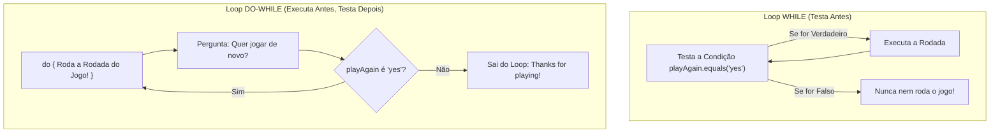

# ☕ Curso de Java — Capítulo 37: `⭐ rock paper scissors 🗿` (Parte 8)
## O Grande Final: O Loop `do-while`, a Pergunta `"Play again (yes/no): "` e a Mensagem de Despedida `"Thanks for playing!"`!

> **Baseado na aula do canal Bro Code (Minuto `6:13:00` a `6:13:45` de 12:00:00)**  
> **Tema:** O professor conclui o projeto definitivo de Pedra, Papel e Tesoura! Ele finalmente dá vida à variável `playAgain`, envelopa todas as jogadas dentro de uma estrutura de repetição **`do-while`**, pergunta ao usuário se ele deseja jogar novamente, sanitiza a resposta com `.toLowerCase()` e, quando o jogador decide parar digitando qualquer coisa diferente de `"yes"`, o Java encerra o loop educadamente com a mensagem `"Thanks for playing!"` e fecha o `Scanner`.

---

## 📌 Sumário
1. [Contexto Visual Minucioso das 5 Imagens (Para o Google Docs)](#1-contexto-visual-minucioso-das-5-imagens-para-o-google-docs)
2. [O que o Professor Fez Nesta Etapa e Por Quê](#2-o-que-o-professor-fez-nesta-etapa-e-por-quê)
3. [Por Que Usar o Loop `do-while` e Não um `while` Comum?](#3-por-que-usar-o-loop-do-while-e-não-um-while-comum)
4. [A Armadilha do Ponto e Vírgula `;` no `do-while`](#4-a-armadilha-do-ponto-e-vírgula--no-do-while)
5. [A Leitura da Resposta com `.toLowerCase()`](#5-a-leitura-da-resposta-com-tolowercase)
6. [O Código Java Completo, Numerado e Definitivo (52 Linhas)](#6-o-código-java-completo-numerado-e-definitivo-52-linhas)
7. [Explicação Linha por Linha Cirúrgica (Das Linhas 1 a 52)](#7-explicação-linha-por-linha-cirúrgica-das-linhas-1-a-52)
8. [Simulação de Uma Partida Real Completa no Console](#8-simulação-de-uma-partida-real-completa-no-console)
9. [Por Que o `scanner.close()` DEVE Ficar Fora do Loop?](#9-por-que-o-scannerclose-deve-ficar-fora-do-loop)
10. [Resumo das 6 Etapas do Projeto Pedra, Papel e Tesoura](#10-resumo-das-6-etapas-do-projeto-pedra-papel-e-tesoura)

---

## 1. Contexto Visual Minucioso das 5 Imagens (Para o Google Docs)

Para você que vai copiar este estudo diretamente para o seu **Google Docs**, aqui está a reconstituição minuciosa em texto de tudo o que acontece visualmente na IDE IntelliJ IDEA nas 5 telas enviadas:

### 📸 Imagem 1 (`media_1791245008350.png`): O Reencontro com `playAgain`
* **Na tela do editor:** O professor sobe a rolagem do editor até as linhas de declaração de variáveis.
* **O Destaque Azul:** A palavra `"yes"` da linha 15 está selecionada com uma caixinha azul:
  ```java
  15: String playAgain = "yes";
  ```
* **O Momento:** O professor chama a atenção dos alunos para essa variável criada no blueprint inicial: *"Lembram que criamos essa variável `playAgain` lá no comecinho? Agora é a hora em que ela finalmente vai trabalhar para controlar se o jogo continua ou para!"*.

---

### 📸 Imagem 2 (`media_1791245037156.png` — Minuto `6:13:08`): A Pergunta ao Jogador
* **Barra de tempo do vídeo:** `6:13:08 / 12:00:00` | Capítulo: `37. rock paper scissors >`.
* **A Seleção Azul (Linhas 36 a 42):** O professor selecionou um bloco de 7 linhas com fundo azul brilhante:
  ```java
  36: }
  37: else{
  38:     System.out.println("You lose!");
  39: }
  40: 
  41: System.out.print("Play again (yes/no): ");
  42: playAgain = scanner.nextLine().toLowerCase();
  ```
* **O que foi adicionado:** Logo após o encerramento do juiz de vitórias/derrotas, foram inseridas as linhas 41 e 42 para perguntar: `"Play again (yes/no): "` e capturar a resposta na variável `playAgain`.

---

### 📸 Imagem 3 (`media_1791245051024.png` — Minuto `6:13:25`): Preparando o Terreno do Loop
* **Barra de tempo do vídeo:** `6:13:25 / 12:00:00` (17 segundos depois).
* **A Seleção Azul (Linhas 38 a 46):** O professor arrastou a seleção mais para baixo, englobando desde a linha 38 (`System.out.println("You lose!");`) até a linha 46 (`playAgain = scanner.nextLine().toLowerCase();`).
* Abaixo da seleção, vemos os dois comentários originais do esqueleto:
  ```java
  // GOODBYE MESSAGE
  scanner.close();
  ```
* O professor está demonstrando onde termina o corpo da repetição antes de fechar a chave do `do-while`.

---

### 📸 Imagem 4 (`media_1791245064472.png` — Minuto `6:13:32`): O Início do Loop (`do{`)
* **Barra de tempo do vídeo:** `6:13:32 / 12:00:00` (7 segundos depois).
* **Na linha 17:** Surge a palavra-chave **`do{`**!
  ```java
  15: String playAgain = "yes";
  16: 
  17: do{
  18:     System.out.print("Enter your move (rock, paper, scissors): ");
  ```
* O professor colocou o `do{` exatamente antes do pedido de jogada do usuário, o que significa: *"Faça tudo o que está aqui dentro pelo menos uma vez antes de testar qualquer condição!"*. Todas as linhas de 18 a 44 foram indentadas para a direita, ficando dentro da "barriga" do `do`.

---

### 📸 Imagem 5 (`media_1791245103434.png`): O Fechamento com `while` e a Despedida
* **Na parte inferior do editor (Linhas 43 a 52):**
  ```java
  43: System.out.print("Play again (yes/no): ");
  44: playAgain = scanner.nextLine().toLowerCase();
  45: 
  46: }while(playAgain.equals("yes"));
  47: 
  48: System.out.println("Thanks for playing!");
  49: 
  50: scanner.close();
  51: }
  52: }
  ```
* **Linha 46:** A chave de fechamento do `do` unida à condição `while(playAgain.equals("yes"));` terminada com ponto e vírgula `;`.
* **Linha 48:** A linha com fundo cinza onde o cursor está posicionado:  
  👉 `System.out.println("Thanks for playing!");`
* **Linha 50:** `scanner.close();` — fechando os recursos do sistema operacional com chave de ouro!

---

## 2. O que o Professor Fez Nesta Etapa e Por Quê

Até a Parte 7, nosso jogo funcionava como um brinquedo descartável: você abria o programa, jogava uma única vez, e o programa fechava na sua cara. Para jogar de novo, era necessário clicar no botão "Play" verde da IDE.

O professor resolveu isso implementando as duas últimas etapas do blueprint:
1. **Etapa 5 (`// ASK TO PLAY AGAIN?`):** Envolveu todo o fluxo da rodada em um loop `do-while` e perguntou ao usuário `"Play again (yes/no): "`.
2. **Etapa 6 (`// GOODBYE MESSAGE`):** Quando o usuário digita `"no"` (ou qualquer coisa diferente de `"yes"`), o loop termina e o Java imprime a saudação educada: `"Thanks for playing!"`.

---

## 3. Por Que Usar o Loop `do-while` e Não um `while` Comum?

Existe uma diferença fundamental entre o `while` e o `do-while` na ciência da computação:



### A Metáfora do Parque de Diversões:
* **No `while` normal:** O guarda da montanha-russa te para na catraca e pergunta: *"Você quer andar de novo?"* antes mesmo de você ter entrado no parque! Isso não faz sentido.
* **No `do-while` (Faça-Enquanto):** Você entra, **anda na montanha-russa primeiro**, curte a viagem e, **só quando o carrinho para**, o atendente pergunta: *"Quer ir mais uma vez?"*.
* Em jogos, o `do-while` é perfeito porque **uma partida SEMPRE tem que acontecer antes de podermos perguntar se o jogador quer jogar outra rodada**!

---

## 4. A Armadilha do Ponto e Vírgula `;` no `do-while`

Preste muita atenção nesta regra de ouro do Java:

> [!WARNING]
> No `while` tradicional, **NUNCA** se coloca ponto e vírgula após os parênteses:  
> `while(condicao) { ... }`  $\rightarrow$ Sem ponto e vírgula!  
>  
> Mas no `do-while`, o ponto e vírgula ao final é **OBRIGATÓRIO**:  
> `do { ... } while(condicao);` $\rightarrow$ **TEM que ter `;`!**  
> Se você esquecer esse ponto e vírgula na linha 46, o código nem compila!

---

## 5. A Leitura da Resposta com `.toLowerCase()`

Observe com atenção a linha 44:
```java
playAgain = scanner.nextLine().toLowerCase();
```

* O método `scanner.nextLine()` lê tudo o que o usuário digitou no console e deu [Enter].
* O método `.toLowerCase()` converte imediatamente todo o texto para **letras minúsculas**.
* **Por que isso é genial?**
  * Se o jogador digitar: `"yes"`, vira `"yes"`.
  * Se o jogador digitar: `"YES"`, vira `"yes"`.
  * Se o jogador digitar: `"Yes"`, vira `"yes"`.
  * Se o jogador digitar: `"yEs"`, vira `"yes"`.
* Graças ao `.toLowerCase()`, a verificação `playAgain.equals("yes")` vai funcionar perfeitamente, não importa o quão desajeitado seja o jeito que o jogador digitou!

---

## 6. O Código Java Completo, Numerado e Definitivo (52 Linhas)

Aqui está o código 100% integral do arquivo [Main.java](../../../src/main/java/com/mickaelgeronimo/mastery/core/concurrency/Main.java), exatamente idêntico ao da tela do professor:

```java
1:  import java.util.Random;
2:  import java.util.Scanner;
3:  
4:  public class Main {
5:      public static void main(String[] args){
6:  
7:          // ROCK PAPER SCISSORS GAME
8:  
9:          Scanner scanner = new Scanner(System.in);
10:         Random random = new Random();
11: 
12:         String[] choices = {"rock", "paper", "scissors"};
13:         String playerChoice;
14:         String computerChoice;
15:         String playAgain = "yes";
16: 
17:         do{
18:             System.out.print("Enter your move (rock, paper, scissors): ");
19:             playerChoice = scanner.nextLine().toLowerCase();
20: 
21:             if(!playerChoice.equals("rock") &&
22:                !playerChoice.equals("paper") &&
23:                !playerChoice.equals("scissors")){
24:                 System.out.println("Invalid choice");
25:             }
26: 
27:             computerChoice = choices[random.nextInt(3)];
28:             System.out.println("Computer choice: " + computerChoice);
29: 
30:             if(playerChoice.equals(computerChoice)){
31:                 System.out.println("It's a tie!");
32:             }
33:             else if((playerChoice.equals("rock") && computerChoice.equals("scissors")) ||
34:                     (playerChoice.equals("paper") && computerChoice.equals("rock")) ||
35:                     (playerChoice.equals("scissors") && computerChoice.equals("paper"))){
36:                 System.out.println("You win!");
37:             }
38:             else{
39:                 System.out.println("You lose!");
40:             }
41: 
42:             System.out.print("Play again (yes/no): ");
43:             playAgain = scanner.nextLine().toLowerCase();
44: 
45:         }while(playAgain.equals("yes"));
46: 
47:         System.out.println("Thanks for playing!");
48: 
49:         scanner.close();
50:     }
51: }
```

---

## 7. Explicação Linha por Linha Cirúrgica (Das Linhas 1 a 52)

### Bloco A: Ferramental e Declarações (Fora do Loop)
* **Linhas 1-2 (`import ...`):** Importa as classes utilitárias `Random` (para o sorteio do computador) e `Scanner` (para a leitura do teclado).
* **Linhas 4-5:** Declaração da classe `Main` e do método de inicialização `public static void main(String[] args)`.
* **Linha 9 (`Scanner scanner = new Scanner(System.in);`):** Cria no Heap o objeto leitor conectado ao teclado do usuário.
* **Linha 10 (`Random random = new Random();`):** Cria no Heap a máquina geradora de números pseudoaleatórios.
* **Linha 12 (`String[] choices = {"rock", "paper", "scissors"};`):** Cria no Heap um array contendo os 3 movimentos válidos nos índices `0`, `1` e `2`.
* **Linhas 13-14 (`String playerChoice; String computerChoice;`):** Declara as variáveis na memória Stack que armazenarão as escolhas da rodada.
* **Linha 15 (`String playAgain = "yes";`):** Declara e inicializa a variável de controle do jogo com o valor `"yes"`.

---

### Bloco B: A Jaula da Rodada (Dentro do `do { ... }`)
* **Linha 17 (`do{`):** Abre a porteira da repetição. A JVM entra aqui obrigatoriamente na primeira execução.
* **Linhas 18-19:** Solicita o movimento do jogador (`Enter your move...`) e guarda o texto digitado em minúsculas na variável `playerChoice`.
* **Linhas 21-25:** **Validação defensiva:** Se o jogador digitou algo que não seja `"rock"`, nem `"paper"`, nem `"scissors"` (como `"gun"` ou uma palavra errada), avisa imediatamente `"Invalid choice"`.
* **Linha 27 (`computerChoice = choices[random.nextInt(3)];`):** O `random.nextInt(3)` sorteia um número entre `0`, `1` ou `2`. Esse número busca no array `choices` a jogada da máquina.
* **Linha 28:** Exibe no console a jogada que o computador escolheu (`Computer choice: ...`).
* **Linhas 30-32:** **Checagem de Empate:** Se `playerChoice.equals(computerChoice)` for verdadeiro, imprime `"It's a tie!"`.
* **Linhas 33-37:** **Checagem de Vitória do Humano:** Se bater com qualquer uma das 3 regras (Pedra vence Tesoura OU Papel vence Pedra OU Tesoura vence Papel), imprime `"You win!"`.
* **Linhas 38-40:** **Checagem de Derrota:** Se não deu empate e o humano não venceu, cai no `else` e imprime `"You lose!"`.
* **Linha 42 (`System.out.print("Play again (yes/no): ");`):** Pergunta na mesma linha se o usuário quer jogar mais uma partida.
* **Linha 43 (`playAgain = scanner.nextLine().toLowerCase();`):** Lê a resposta do usuário no console e converte para minúsculas.

---

### Bloco C: A Condição e a Despedida (Fim do Loop)
* **Linha 45 (`}while(playAgain.equals("yes"));`):**
  * A JVM compara: a String `playAgain` é igual a `"yes"`?
  * **Se for `"yes"`:** O Java dá um salto quântico de volta para a linha 17 (`do{`) e recomeça uma nova partida do zero!
  * **Se for `"no"` (ou qualquer outra palavra):** O Java rompe o loop e desce para a linha 47.
* **Linha 47 (`System.out.println("Thanks for playing!");`):** Exibe a calorosa mensagem de encerramento do jogo no console.
* **Linha 49 (`scanner.close();`):** Desliga o Scanner para evitar vazamento de memória (*resource leak*).

---

## 8. Simulação de Uma Partida Real Completa no Console

Abaixo está o rastreamento de uma sessão interativa completa com **duas rodadas**, exatamente como o usuário verá na tela:

```text
Enter your move (rock, paper, scissors): rock
Computer choice: scissors
You win!
Play again (yes/no): yes
Enter your move (rock, paper, scissors): paper
Computer choice: paper
It's a tie!
Play again (yes/no): no
Thanks for playing!

Process finished with exit code 0
```

### O que a CPU fez nessa sessão:
1. **1ª Rodada:** Usuário jogou `rock`, computador sorteou `scissors`. Caiu no `else if` $\rightarrow$ Imprimiu `You win!`.
2. **Pergunta 1:** `Play again (yes/no): ` $\rightarrow$ Usuário digitou `yes`.
3. **Teste do `while`:** `"yes".equals("yes")` é **VERDADEIRO (`true`)**! O loop reiniciou!
4. **2ª Rodada:** Usuário jogou `paper`, computador sorteou `paper`. Caiu no `if` $\rightarrow$ Imprimiu `It's a tie!`.
5. **Pergunta 2:** `Play again (yes/no): ` $\rightarrow$ Usuário digitou `no`.
6. **Teste do `while`:** `"no".equals("yes")` é **FALSO (`false`)**! O loop foi quebrado!
7. **Despedida:** Linha 47 disparou $\rightarrow$ `Thanks for playing!`. Fim da execução!

---

## 9. Por Que o `scanner.close()` DEVE Ficar Fora do Loop?

Este é um erro clássico que muitos iniciantes cometem:

> [!CAUTION]
> Se você colocar `scanner.close();` **dentro** do bloco `do { ... }`:  
> Na 1ª rodada tudo parece funcionar. Mas quando o jogador digita `"yes"`, o loop volta para o topo e tenta executar `scanner.nextLine()`.  
> Como o `Scanner` foi fechado na rodada anterior, o Java entra em pânico e explode o erro fatal:  
> **`java.util.NoSuchElementException: No line found`**!  
>  
> Por isso, **sempre feche o Scanner fora e após o encerramento definitivo de todos os loops**!

---

## 10. Resumo das 6 Etapas do Projeto Pedra, Papel e Tesoura

Parabéns! O projeto do Capítulo 37 foi 100% finalizado seguindo com perfeição o blueprint do professor:

| Etapa | O que foi planejado no início? | Onde está implementado no código final? |
| :---: | :--- | :--- |
| **1** | Declarar variáveis e ferramentas | Linhas 9 a 15 (`scanner`, `random`, `choices`, `playerChoice`, etc.) |
| **2** | Pegar a jogada do jogador e validar | Linhas 18 a 25 (`Enter your move...` e `if(!... && !...)`) |
| **3** | Gerar jogada aleatória do robô | Linhas 27 e 28 (`choices[random.nextInt(3)]`) |
| **4** | Checar condições de vitória e empate | Linhas 30 a 40 (`if`, `else if` unificado com `||` e `else`) |
| **5** | Perguntar se quer jogar novamente | Linhas 17, 42-45 (`do { ... } while(playAgain.equals("yes"));`) |
| **6** | Mensagem de despedida e fechar scanner | Linhas 47 e 49 (`Thanks for playing!` e `scanner.close()`) |
