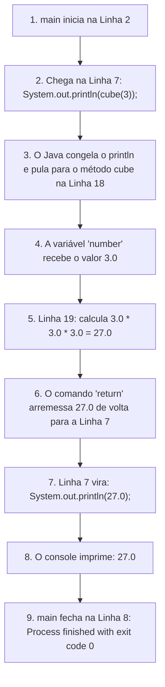

# 📞 Curso de Java para Iniciantes — Bro Code
## 📌 Capítulo 26: Métodos (`methods`) — Parte 14: Executando o Método `cube(3)` e Destacando o Resultado `27.0` no Console
**Tema:** Execução prática no IntelliJ IDEA, o botão verde de Run, a lâmpada amarela de sugestões da IDE e a comprovação matemática de $3^3 = 27.0$ selecionada no console.

---

## 🖼️ Contexto Visual dos Prints (Para quem está lendo no Google Docs)

Se você copiou este arquivo para o seu Google Docs e não tem os prints ao lado, aqui está a descrição detalhada do que o professor **Bro Code** fez na tela do computador:

1. **Imagem 1 (O Momento do Clique no Play):**
   * O código completo com os métodos `happyBirthday`, `square` e `cube` está pronto no editor.
   * O professor move o cursor do mouse até o canto superior direito da janela do IntelliJ IDEA e posiciona a setinha exatamente sobre o **ícone verde de Play** (botão de executar `Run 'Main'`).
   * **Detalhe curioso no editor:** Na linha 19 (`return number * number * number;`), repare que apareceu uma **pequena lâmpada amarela** 💡 no canto esquerdo (na calha dos números). Isso é o IntelliJ querendo dar uma dica de estilo (como sugerir usar `Math.pow`), mas o código não tem nenhum erro!

2. **Imagem 2 (O Console Aberto e o Destaque em `27.0`):**
   * O professor clicou no botão de Play.
   * A janela preta inferior (o Console / Run) subiu ocupando quase metade da tela para mostrar o programa rodando.
   * Na saída do console, aparece o número verde:
     ```text
     27.0
     ```
   * O professor clica e **arrasta o mouse sobre o número `27.0`**, deixando-o com um retângulo de seleção azul para chamar a atenção de quem está assistindo e provar: *"Vejam só, o cálculo de 3 ao cubo deu exatamente 27.0!"*.
   * Logo abaixo, vem a confirmação clássica:
     ```text
     Process finished with exit code 0
     ```

---

## 💡 O Que é Aquela Lâmpada Amarela 💡 na Linha 19?

Um iniciante em Java muitas vezes se assusta ao ver ícones aparecerem do lado dos números das linhas. Vamos esclarecer de vez:

* 🔴 **Círculo Vermelho ou Sublinhado Vermelho:** É **ERRO GRAVE** (erro de sintaxe). O código não compila nem roda até você consertar (como o ponto e vírgula que vimos na Parte 11).
* 🟡 **Lâmpada Amarela / Triângulo Amarelo:** É apenas um **AVISO / SUGESTÃO AMIGÁVEL** do IntelliJ IDEA. O código está 100% correto e roda sem problemas! A IDE só está dizendo: *"Ei, se você quiser, existe um jeito alternativo ou mais moderno de escrever isso (por exemplo, `Math.pow(number, 3)`), mas o seu jeito funciona perfeitamente!"*.

---

## 🧮 O Fluxo Completo de Execução: Como o `27.0` Foi Gerado

Acompanhe o caminho que a informação fez dentro do computador do professor:



---

## 💻 Código Completo e Idêntico ao da Tela (`Main.java`)

```java
public class Main {
    public static void main(String[] args){

        // method = a block of reusable code that is executed when called ()

        System.out.println(cube(3));
    }

    static void happyBirthday(String name, int age){
        System.out.printf("Happy birthday to %s!\n", name);
        System.out.printf("You are %d years old!\n", age);
    }

    static double square(double number) { return number * number; }

    static double cube(double number){
        return number * number * number;
    }
}
```

---

## 🔍 Explicação Linha por Linha (Toda Linha Enumerada)

Aqui está a análise completa linha por linha, mostrando exatamente o que ocorre na memória e o que sai no console:

### **Linha 1:** `public class Main {`
* **O que faz:** Abre a classe principal chamada `Main`.
* **Console:** **Nada**.

---

### **Linha 2:** `public static void main(String[] args){`
* **O que faz:** Ponto de partida obrigatório de todo programa Java. A JVM começa a ler as ordens a partir daqui.
* **Console:** **Nada**.

---

### **Linha 3:** *(Linha em branco)*
* **O que faz:** Apenas organiza o espaçamento visual.
* **Console:** **Nada**.

---

### **Linha 4:** `// method = a block of reusable code that is executed when called ()`
* **O que faz:** Comentário de estudo deixado pelo professor.
* **Console:** **Nada**.

---

### **Linhas 5 e 6:** *(Linhas em branco)*
* **O que faz:** Espaços em branco ignorados pelo compilador.
* **Console:** **Nada**.

---

### **Linha 7:** `System.out.println(cube(3));`
* **O que faz:** **A LINHA QUE DISPARA TUDO:**
  1. O Java vê `cube(3)` e pausa o `println`.
  2. Viaja até a **Linha 18** (método `cube`).
  3. Alimenta o parâmetro `number` com o valor `3`.
  4. Executa a multiplicação da **Linha 19** ($3 \times 3 \times 3 = 27.0$).
  5. O `return` devolve esse `27.0` para a Linha 7.
  6. O comando vira `System.out.println(27.0);`.
  7. O Java finalmente imprime `27.0` na janela preta do console e salta o cursor para a linha de baixo.
* **Console:** Imprime:
  ```text
  27.0
  ```

---

### **Linha 8:** `}`
* **O que faz:** Fecha o método `main`. Indica que todas as instruções principais do programa foram concluídas com sucesso.
* **Console:** O sistema encerra com `Process finished with exit code 0`.

---

### **Linhas 9 a 14:** `static void happyBirthday(String name, int age){ ... }`
* **O que faz:** É o método da aula anterior que canta parabéns. No vídeo do professor ele aparece recolhido como `{...}` para não ocupar espaço. Ele continua na memória, mas **não roda nesta execução** porque o `main` não chamou `happyBirthday`.
* **Console:** **Nada**.

---

### **Linha 15:** `static double square(double number) { return number * number; }`
* **O que faz:** O método que calcula o quadrado ($x \times x$), escrito de forma compacta em uma só linha. Também não é chamado nesta execução e fica adormecido.
* **Console:** **Nada**.

---

### **Linhas 16 e 17:** *(Linhas em branco)*
* **O que faz:** Organização visual.
* **Console:** **Nada**.

---

### **Linha 18:** `static double cube(double number){`
* **O que faz:** **A CABEÇA DO MÉTODO `cube`:**
  * `static`: para poder ser invocado direto pelo `main`.
  * `double`: o tipo de retorno obrigatório (número decimal).
  * `cube`: o nome que demos para a função.
  * `(double number)`: a variável receptora que recebeu o número `3.0`.
* **Console:** **Nada**.

---

### **Linha 19:** `return number * number * number;`
* **O que faz:** Realiza a multiplicação de três fatores ($3 \times 3 \times 3 = 27.0$). A instrução `return` pega o resultado e cospe imediatamente de volta para a Linha 7 do `main`, encerrando a execução deste método na hora.
* **Console:** **Nada** (o valor viaja invisível pela memória).

---

### **Linha 20:** `}`
* **O que faz:** Fecha o método `cube`.
* **Console:** **Nada**.

---

### **Linha 21:** `}`
* **O que faz:** Fecha a classe `Main`.
* **Console:** **Nada**.

---

## 📺 O que Sai no Console (Com o Destaque do Professor)

```text
27.0

Process finished with exit code 0
```

> **Por que o professor selecionou o `27.0` com o mouse na Imagem 2?**  
> Para deixar evidente para todos os alunos que o método `cube` funcionou perfeitamente: ele recebeu o valor `3`, fez o cálculo correto ($3 \times 3 \times 3$) e devolveu o resultado com ponto flutuante `27.0` graças ao tipo de retorno `double`!
