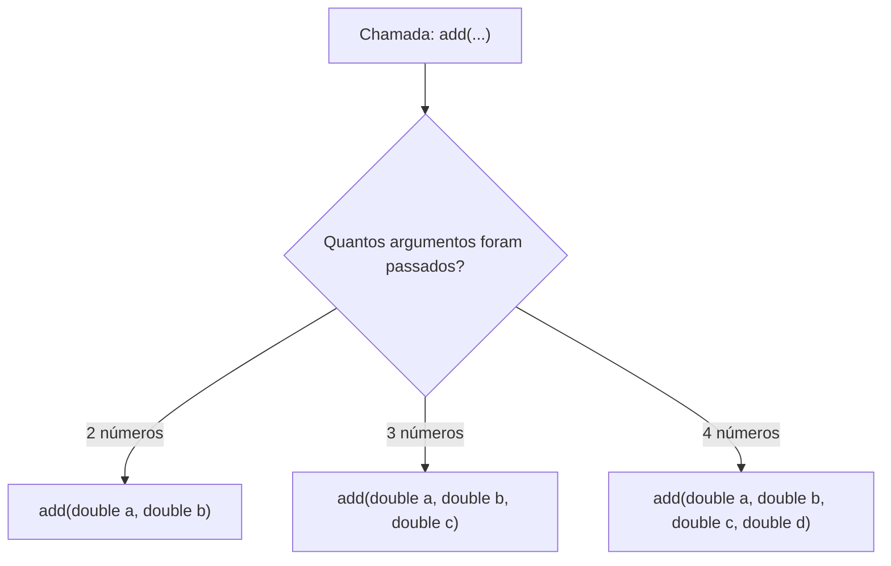

# 🍕 Curso de Java para Iniciantes — Bro Code
## 📌 Capítulo 27: Métodos Sobrecarregados (`overloaded methods`) — Parte 3: A Regra de Ouro (Erro `is already defined`), Versão de 4 Parâmetros e Saída `10.0`
**Timestamps do vídeo:** `4:22:03` até `4:22:xx / 12:00:00`  
**Tema:** A regra fundamental da sobrecarga: por que parâmetros repetidos geram o erro fatal `method is already defined in class Main`, a criação do 3º método sobrecarregado com 4 parâmetros (`a, b, c, d`), a chamada `add(1, 2, 3, 4)` e o resultado `10.0` no console.

---

## 🖼️ Contexto Visual dos 3 Prints (Para quem está lendo no Google Docs)

Se você copiou este material para o seu Google Docs e não tem as imagens em mãos, aqui está tudo o que o professor **Bro Code** fez na tela:

1. **Imagem 1 (Minuto 4:22:03 — O Erro Fatal do Método Duplicado):**
   * O professor cometeu um erro (proposital ou acidental enquanto digitava rápido) na Linha 15:
     ```java
     static double add(double a, double b){ // ❌ ERRO! Mesmos parâmetros da Linha 12!
         return a + b + c; // E aqui a variável 'c' nem existe!
     }
     ```
   * O compilador do Java bloqueou o programa e disparou em letras vermelhas na janela "Build Output":
     ```text
     java: method add(double,double) is already defined in class Main
     ```
   * **O que a tela nos ensina:** Você **NÃO PODE** criar dois métodos com o mesmo nome E os mesmos parâmetros! O Java se perde e não sabe qual escolher!

2. **Imagem 2 (Código Corrigido com 3 Versões de `add`):**
   * O professor corrige o erro e expande o programa para somar até 4 números!
   * Agora existem **três versões** do método `add` empilhadas no editor:
     1. `add(double a, double b)` $\rightarrow$ para 2 números.
     2. `add(double a, double b, double c)` $\rightarrow$ para 3 números.
     3. `add(double a, double b, double c, double d)` $\rightarrow$ para 4 números!
   * No `main` (Linha 10), ele chama a versão de 4 números:
     ```java
     System.out.println(add(1, 2, 3, 4));
     ```
   * O cursor do mouse está sobre o botão verde de **Play** (`Run 'Main'`).

3. **Imagem 3 (A Execução e o Resultado `10.0` no Console):**
   * O professor clicou no botão verde de Play.
   * O console abriu na parte inferior e exibiu em verde brilhante:
     ```text
     10.0
     ```
   * Isso comprova que $1.0 + 2.0 + 3.0 + 4.0 = 10.0$! O método de 4 parâmetros funcionou perfeitamente!

---

## 🚨 A Regra Sagrada: O Erro `method is already defined`

Preste muita atenção no erro da **Imagem 1**:
```text
java: method add(double,double) is already defined in class Main
```

### Por que isso deu erro?
Pense como se você fosse o Java:
* Você tem na sua gaveta um método chamado `add(double, double)`.
* De repente, alguém tenta colocar OUTRO método chamado `add(double, double)` com os mesmos tipos e quantidade de parâmetros.
* Se alguém no `main` chamar `add(5, 5)`, qual dos dois o Java deveria rodar? **Ele não tem como saber! É uma ambiguidade impossível!**

> [!CAUTION]
> **A Regra Inegociável da Sobrecarga:**
> Para dois métodos terem o **MESMO NOME**, a lista de parâmetros **DEVE SER DIFERENTE** (ou em quantidade de parâmetros, ou em tipos de dados)!  
> Você nunca pode ter duas assinaturas idênticas na mesma classe!

---

## 🍕 O Menu Completo da Nossa Calculadora `add`

Agora o nosso programa tem um "menu" completo para o usuário escolher quantos números quer somar:



---

## 💻 Código Completo e Corrigido da Imagem 2 (`Main.java`)

Copie este código para o seu IntelliJ IDEA:

```java
public class Main {
    public static void main(String[] args){

        // overloaded methods = methods that share the same name,
        //                      but different parameters
        //                      signature = name + parameters

        System.out.println(add(1, 2, 3, 4));
    }

    static double add(double a, double b){
        return a + b;
    }

    static double add(double a, double b, double c){
        return a + b + c;
    }

    static double add(double a, double b, double c, double d){
        return a + b + c + d;
    }
}
```

---

## 🔍 Explicação Linha por Linha (Toda Linha Enumerada)

### **Linha 1:** `public class Main {`
* **O que faz:** Abre a classe principal `Main`.
* **Console:** **Nada**.

---

### **Linha 2:** `public static void main(String[] args){`
* **O que faz:** Ponto de partida do programa.
* **Console:** **Nada**.

---

### **Linhas 3 a 9:** *(Linhas em branco e comentários conceituais)*
* **Linhas 5 a 7:** Anotações sobre métodos sobrecarregados e assinatura (`signature = name + parameters`). O computador ignora.
* **Console:** **Nada**.

---

### **Linha 10:** `System.out.println(add(1, 2, 3, 4));`
* **O que faz:** **A CHAMADA DE 4 NÚMEROS:**
  1. O compilador vê `add` com 4 argumentos (`1`, `2`, `3`, `4`).
  2. Ele procura qual dos três métodos tem 4 parâmetros.
  3. Ignora a Linha 12 (tem 2 parâmetros) e a Linha 15 (tem 3 parâmetros).
  4. Salta direto para a **Linha 18** (versão de 4 parâmetros).
  5. Entrega `1.0` para `a`, `2.0` para `b`, `3.0` para `c` e `4.0` para `d`.
  6. Na Linha 19, calcula $1.0 + 2.0 + 3.0 + 4.0 = 10.0$.
  7. O comando `return` devolve o valor `10.0` para o `println`.
  8. O `println` imprime o número `10.0` na tela preta do console.
* **Console:** Imprime:
  ```text
  10.0
  ```

---

### **Linha 11:** `}`
* **O que faz:** Fecha o método `main`. Fim do fluxo principal.
* **Console:** O sistema encerra com `Process finished with exit code 0`.

---

### **Linha 12:** `static double add(double a, double b){`
* **O que faz:** **VERSÃO 1 (2 Parâmetros):**
  * Feito para somar 2 números. Fica adormecido na memória (`no usages`).
* **Console:** **Nada**.

---

### **Linha 13:** `return a + b;`
* **O que faz:** Devolveria a soma de 2 números (não executado).
* **Console:** **Nada**.

---

### **Linha 14:** `}`
* **O que faz:** Fecha a Versão 1.
* **Console:** **Nada**.

---

### **Linha 15:** `static double add(double a, double b, double c){`
* **O que faz:** **VERSÃO 2 (3 Parâmetros):**
  * Feito para somar 3 números. Fica adormecido na memória (`no usages`).
* **Console:** **Nada**.

---

### **Linha 16:** `return a + b + c;`
* **O que faz:** Devolveria a soma de 3 números (não executado).
* **Console:** **Nada**.

---

### **Linha 17:** `}`
* **O que faz:** Fecha a Versão 2.
* **Console:** **Nada**.

---

### **Linha 18:** `static double add(double a, double b, double c, double d){`
* **O que faz:** **VERSÃO 3 (4 Parâmetros):**
  * `static`: chamado diretamente pelo `main`.
  * `double`: devolve um número decimal.
  * `add`: o mesmo nome das outras duas versões!
  * `(double a, double b, double c, double d)`: recebe 4 números decimais.
* **Console:** **Nada**.

---

### **Linha 19:** `return a + b + c + d;`
* **O que faz:** Realiza a soma de todos os 4 números ($1.0 + 2.0 + 3.0 + 4.0 = 10.0$) e o `return` arremessa o valor de volta para o `println`.
* **Console:** **Nada** (o trânsito do dado é interno pela memória).

---

### **Linha 20:** `}`
* **O que faz:** Fecha a Versão 3.
* **Console:** **Nada**.

---

### **Linha 21:** `}`
* **O que faz:** Fecha a classe `Main`.
* **Console:** **Nada**.

---

## 📺 O que Sai no Console ao Executar:

```text
10.0

Process finished with exit code 0
```

*(Sai `10.0` com ponto decimal porque o tipo de retorno declarado em todos os métodos foi `double`)*

---

## 📋 Tabela das 3 Assinaturas do Nosso Programa

| Versão | Nome | Lista de Parâmetros | Assinatura Oficial | Situação de Uso |
| :---: | :---: | :--- | :--- | :--- |
| **1** | `add` | `(double a, double b)` | `add(double, double)` | Para somar 2 números (ex: `add(5, 5)`) |
| **2** | `add` | `(double a, double b, double c)` | `add(double, double, double)` | Para somar 3 números (ex: `add(1, 2, 3)`) |
| **3** | `add` | `(double a, double b, double c, double d)` | `add(double, double, double, double)` | Para somar 4 números (ex: `add(1, 2, 3, 4)`) |
