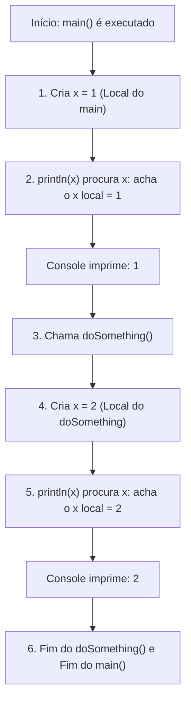

# 🏠 Curso de Java para Iniciantes — Bro Code
## 📌 Capítulo 28: Escopo de Variáveis (`variable scope`) — Parte 5: O Grande Confronto! `x=1` no Main, `x=2` no doSomething e `x=3` na Classe (Saída `1` e `2`)
**Timestamps do vídeo:** `4:29:48` até `4:29:52 / 12:00:00`  
**Tema:** O clímax do Capítulo 28: a convivência simultânea dos dois escopos! O que acontece quando temos `x = 3` na classe, `x = 1` no `main` e `x = 2` no `doSomething()`? A explicação do fluxo linha por linha e por que a tela preta imprimiu `1` e depois `2`, ignorando solenemente o `3`.

---

## 🖼️ Contexto Visual dos 3 Prints (Para quem está lendo no Google Docs)

Se você copiou este arquivo para o seu Google Docs e não tem as imagens ao lado, veja exatamente o cenário que o professor **Bro Code** montou para fechar o entendimento:

1. **Imagem 1 (Minuto 4:29:48 — O Cenário Completo Armado no Editor):**
   * O professor organiza o código com os 3 concorrentes ao mesmo tempo:
     * **Na Classe (Linha 4):** `static int x = 3; //CLASS no usages`
     * **No `main` (Linhas 8 a 12):**
       ```java
       int x = 1; //LOCAL
       System.out.println(x);
       doSomething();
       ```
     * **No `doSomething` (Linhas 16 a 18):**
       ```java
       int x = 2; //LOCAL
       System.out.println(x);
       ```
   * O cursor do mouse está no botão verde de **Play** (`Run 'Main'`).
   * Repare que a Linha 4 continua com a etiqueta cinza `no usages` (nenhum uso), nos dando uma pista prévia de que o `x = 3` vai ser ignorado!

2. **Imagem 2 (Minuto 4:29:52 — O Resultado Revelador no Console):**
   * O professor executa o programa.
   * A janela preta do console abre e imprime duas linhas em verde brilhante:
     ```text
     1
     2
     ```
   * Logo abaixo, o encerramento do programa: `Process finished with exit code 0`.

3. **Imagem 3 (Minuto ~4:29:55 — A Explicação com a Seleção Azul):**
   * Para explicar detalhadamente aos alunos o motivo de ter saído `1` e depois `2`, o professor clica e arrasta o mouse sobre as Linhas 8 a 12 de dentro do `main`, deixando todo o miolo do `main` com uma grande faixa azul de seleção.
   * Ele mostra visualmente: *"Vejam só: o `main` executou seu próprio código linha por linha. Imprimiu o seu `x` local (1), e depois chamou o `doSomething()`, que imprimiu o seu próprio `x` local (2)!"*.

---

## 🧠 A Análise do Duelo: Por Que Saiu `1` e `2` (e Não `3`)?

Este é o resumo supremo de tudo o que rege o escopo de variáveis no Java:



### 1. No Método `main`:
* O `main` tem a sua própria variável local: `int x = 1;`.
* Quando ele manda `System.out.println(x);`, ele nem olha para fora da janela! Ele usa o seu próprio `x = 1`.
* **Resultado:** Imprime `1`.

### 2. No Método `doSomething`:
* O `main` chama `doSomething()`.
* O `doSomething` tem a sua própria variável local: `int x = 2;`.
* Quando ele manda `System.out.println(x);`, ele também não olha para fora! Ele usa o seu próprio `x = 2`.
* **Resultado:** Imprime `2`.

### 3. E o que aconteceu com `static int x = 3` da Classe?
* Ele foi **sombreado (`shadowed`)** em ambos os métodos!
* Como os dois métodos já tinham uma variável local com o nome `x`, nenhum dos dois precisou recorrer à variável da classe!
* Por isso o IntelliJ mostrou `no usages` na Linha 4!

---

## 💻 Código Completo e Idêntico ao da Tela (`Main.java`)

Copie este código para o seu IntelliJ IDEA:

```java
public class Main {

    static int x = 3; // CLASS (ignorado por ambos, pois ambos têm x local)

    public static void main(String[] args){

        int x = 1; // LOCAL do main

        System.out.println(x);

        doSomething();
    }

    static void doSomething(){

        int x = 2; // LOCAL do doSomething

        System.out.println(x);
    }
}
```

---

## 🔍 Explicação Linha por Linha (Toda Linha Enumerada)

### **Linha 1:** `public class Main {`
* **O que faz:** Abre a classe principal `Main`.
* **Console:** **Nada**.

---

### **Linhas 2 e 3:** *(Linhas em branco)*
* **Console:** **Nada**.

---

### **Linha 4:** `static int x = 3; //CLASS`
* **O que faz:** Cria a variável de classe `x = 3`. Fica disponível na memória da classe, mas neste programa não é utilizada por ninguém (`no usages`).
* **Console:** **Nada**.

---

### **Linha 5:** *(Linha em branco)*
* **Console:** **Nada**.

---

### **Linha 6:** `public static void main(String[] args){`
* **O que faz:** Ponto de partida por onde o Java começa a rodar.
* **Console:** **Nada**.

---

### **Linha 7:** *(Linha em branco)*
* **Console:** **Nada**.

---

### **Linha 8:** `int x = 1; //LOCAL`
* **O que faz:** Cria a variável local `x` do método `main` e guarda o valor `1`.
* **Console:** **Nada**.

---

### **Linha 9:** *(Linha em branco)*
* **Console:** **Nada**.

---

### **Linha 10:** `System.out.println(x);`
* **O que faz:** O `main` busca a variável `x` no seu escopo local, encontra `1` e imprime na tela preta, pulando uma linha.
* **Console:** Imprime:
  ```text
  1
  ```

---

### **Linha 11:** *(Linha em branco)*
* **Console:** **Nada**.

---

### **Linha 12:** `doSomething();`
* **O que faz:** **A CHAMADA DO MÉTODO:**
  1. O `main` pausa a sua execução.
  2. O computador salta para a **Linha 14** (onde está o método `doSomething`).
* **Console:** **Nada** (o salto é interno).

---

### **Linha 13:** `}`
* **O que faz:** Fecha o método `main`. Quando o programa voltar de `doSomething`, ele chega aqui e finaliza.
* **Console:** O sistema encerra com `Process finished with exit code 0`.

---

### **Linha 14:** `static void doSomething(){`
* **O que faz:** Abre o método `doSomething`.
* **Console:** **Nada**.

---

### **Linha 15:** *(Linha em branco)*
* **Console:** **Nada**.

---

### **Linha 16:** `int x = 2; //LOCAL`
* **O que faz:** Cria uma nova variável local `x` exclusiva do método `doSomething` e guarda o valor `2`.
* **Console:** **Nada**.

---

### **Linha 17:** *(Linha em branco)*
* **Console:** **Nada**.

---

### **Linha 18:** `System.out.println(x);`
* **O que faz:** O `doSomething` busca a variável `x` no seu escopo local, encontra `2` e imprime na tela preta.
* **Console:** Imprime (na linha de baixo):
  ```text
  2
  ```

---

### **Linha 19:** `}`
* **O que faz:** Fecha o método `doSomething`. A variável local `x = 2` é destruída e o fluxo volta para o `main`.
* **Console:** **Nada**.

---

### **Linha 20:** `}`
* **O que faz:** Fecha a classe `Main`.
* **Console:** **Nada**.

---

## 📺 O que Sai no Console ao Executar:

```text
1
2

Process finished with exit code 0
```

---

## 🏆 As 3 Regras de Ouro do Escopo de Variáveis no Java

1. **Variáveis Locais são Privadas:**  
   O `x = 1` do `main` não interfere no `x = 2` do `doSomething()`. Cada método é um "quarto fechado".
2. **Prioridade Local Absoluta (Shadowing):**  
   Se um método tem a sua própria variável local com o nome `x`, ele **nunca** vai usar a variável de classe `static int x = 3`. O local sempre "faz sombra" no global.
3. **Variável de Classe é o Plano de Fundo:**  
   A variável de classe só é utilizada quando o método **NÃO TEM** uma variável local com aquele nome.
