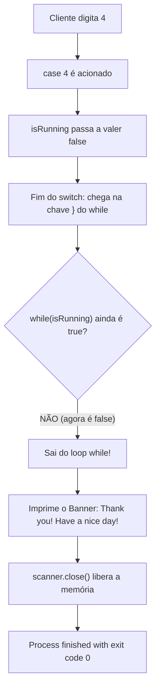

# 💰 Curso de Java para Iniciantes — Bro Code
## 📌 Capítulo 29: Programa Bancário (`banking program`) — Parte 17: A Execução ao Vivo da Opção 4 (`Exit`), o Desligamento do `while` e o Banner de Despedida!
**Timestamps do vídeo:** `4:51:15 / 12:00:00`  
**Tema:** O momento exato em que o cliente encerra o atendimento no caixa eletrônico! O professor Bro Code digita a opção `4` no console, demonstrando ao vivo o rompimento do laço `while(isRunning)`, a exibição do banner de despedida `"Thank you! Have a nice day!"` e o encerramento com sucesso do programa (`Process finished with exit code 0`).

---

## 🖼️ Contexto Visual do Print (Para quem está lendo no Google Docs)

Se você copiou este arquivo para o seu Google Docs e não tem a imagem ao lado, veja o cenário exato registrado na tela do professor:

1. **Na Parte Superior (O Editor de Código):**
   * Vemos o final do bloco `switch` e o fechamento do laço `while` entre as Linhas 31 e 35:
     ```java
     case 4 -> isRunning = false;
     default -> System.out.println("INVALID CHOICE");
     }
     }
     ```
   * A Linha 34 contém a chave de fechamento `}` do `while(isRunning)`.

2. **Na Parte Inferior (O Console com o Teste de Saída):**
   * O menu estava aberto na tela e o cursor pediu:
     ```text
     Enter your choice (1-4): 4
     ***************************
     Thank you! Have a nice day!
     ***************************

     Process finished with exit code 0
     ```
   * O professor digitou `4` e deu `Enter`.
   * Imediatamente, o laço de repetição foi quebrado e o banner de despedida foi impresso.
   * O professor usa o mouse para **selecionar a mensagem `"Thank you! Have a nice day!"` e a moldura inferior em azul**.
   * Ele mostra para a turma: o programa não "morreu de repente"; ele executou uma saída graciosa e limpa, fechando com código 0!

---

## 🧠 Entendendo o Desligamento Gracioso (*Graceful Shutdown*)

Na computação profissional, fechar um programa de qualquer jeito (como puxar o computador da tomada) é uma prática ruim. O professor ensina aqui o conceito de **Encerramento Gracioso**:



### Por Que a Mensagem de Despedida Não Apareceu Antes?
* Porque as Linhas 36, 37 e 38 estão **fora** do laço `while`.
* Enquanto você escolhia `1` (saldo), `2` (depósito) ou `3` (saque), o `isRunning` continuava sendo `true`, então o Java nunca conseguia escapar do loop para chegar nessas linhas!
* Somente quando você apertou `4`, o `isRunning` virou `false`, permitindo que o programa finalmente ultrapassasse a Linha 34 e chegasse ao agradecimento!

---

## 💻 Código Completo e Idêntico da Tela (`Main.java`)

```java
import java.util.Scanner;

public class Main {

    static Scanner scanner = new Scanner(System.in);

    public static void main(String[] args) {

        // JAVA BANKING PROGRAM FOR BEGINNERS

        double balance = 0;
        boolean isRunning = true;
        int choice;

        while(isRunning){

            System.out.println("***************");
            System.out.println("BANKING PROGRAM");
            System.out.println("***************");
            System.out.println("1. Show Balance");
            System.out.println("2. Deposit");
            System.out.println("3. Withdraw");
            System.out.println("4. Exit");
            System.out.println("***************");

            System.out.print("Enter your choice (1-4): ");
            choice = scanner.nextInt();

            switch(choice){
                case 1 -> showBalance(balance);
                case 2 -> balance += deposit();
                case 3 -> balance -= withdraw(balance);
                case 4 -> isRunning = false; // Desliga o loop!
                default -> System.out.println("INVALID CHOICE");
            }
        }

        // EXIT MESSAGE
        System.out.println("***************************");
        System.out.println("Thank you! Have a nice day!");
        System.out.println("***************************");

        scanner.close();
    }

    static void showBalance(double balance){
        System.out.println("***************");
        System.out.printf("$%.2f\n", balance);
    }

    static double deposit(){

        double amount;

        System.out.print("Enter an amount to be deposited: ");
        amount = scanner.nextDouble();

        if(amount < 0){
            System.out.println("Amount can't be negative");
            return 0;
        }
        else{
            return amount;
        }
    }

    static double withdraw(double balance){

        double amount;

        System.out.println("Enter amount to be withdrawn: ");
        amount = scanner.nextDouble();

        if(amount > balance){
            System.out.println("INSUFFICIENT FUNDS");
            return 0;
        }
        else if(amount < 0){
            System.out.println("Amount can't be negative");
            return 0;
        }
        else{
            return amount;
        }
    }
}
```

---

## 🔍 Explicação Linha por Linha do Encerramento

### **Linha 26:** `choice = scanner.nextInt();`
* **O que faz:** O usuário digita o número `4` e aperta `Enter`.
* **Console:** O número `4` aparece ao lado de `(1-4): `.

---

### **Linha 28:** `switch(choice){`
* **O que faz:** O Java compara `choice` (que vale `4`) e encontra o `case 4`.
* **Console:** **Nada**.

---

### **Linha 32:** `case 4 -> isRunning = false;`  *(⭐ A VIRADA DE CHAVE!)*
* **O que faz:** Altera o valor da variável booleana `isRunning` de `true` para `false`.
* **Console:** **Nada**.

---

### **Linha 34:** `}` *(Fecha o switch)*
* **Console:** **Nada**.

---

### **Linha 35:** `}` *(Fecha o while)*
* **O que faz:** O Java bate nesta chave e olha para o topo do loop (`while(isRunning)`).
* Como `isRunning` agora vale `false`, a repetição é **cancelada imediatamente** e o programa salta para a linha seguinte fora do loop (Linha 37)!
* **Console:** **Nada**.

---

### **Linha 37:** `System.out.println("***************************");`
* **O que faz:** Imprime a moldura superior de 27 asteriscos e pula para a linha de baixo.
* **Console:** Imprime:
  ```text
  ***************************
  ```

---

### **Linha 38:** `System.out.println("Thank you! Have a nice day!");`
* **O que faz:** Imprime a frase de agradecimento ao cliente.
* **Console:** Imprime:
  ```text
  Thank you! Have a nice day!
  ```

---

### **Linha 39:** `System.out.println("***************************");`
* **O que faz:** Imprime a moldura inferior de 27 asteriscos.
* **Console:** Imprime:
  ```text
  ***************************
  ```

---

### **Linha 41:** `scanner.close();`
* **O que faz:** Fecha o canal do teclado no sistema operacional, liberando os recursos da memória.
* **Console:** **Nada**.

---

### **Linha 42:** `}` *(Fecha o main)*
* **O que faz:** Encerra a execução do método `main`.
* **Console:** O sistema operacional finaliza a aplicação exibindo:
  ```text
  Process finished with exit code 0
  ```

---

## 📺 O que Aparece no Console Exatamente Como no Print:

```text
2. Deposit
3. Withdraw
4. Exit
***************
Enter your choice (1-4): 4
***************************
Thank you! Have a nice day!
***************************

Process finished with exit code 0
```

---

## 🏁 Encerramento Oficial do Capítulo 29 (Marca de 4:51:15)!

Com esta cena, o professor Bro Code finaliza com perfeição o **Capítulo 29: `banking program`**.  
Você viu a construção completa, desde o primeiro comentário de planejamento até o último ponto e vírgula da mensagem de despedida!
