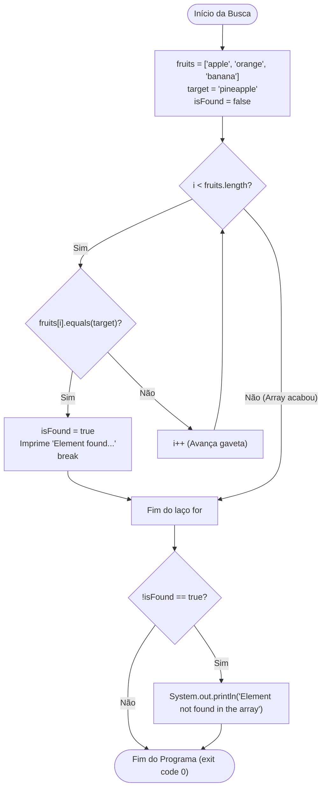

# ☕ Curso de Java — Capítulo 33: `search an array 🔎` (Parte 4 de 4)
## O Teste Negativo com Strings: Buscando `"pineapple"` e Validando o Elemento Inexistente

> **Baseado na aula do canal Bro Code (Minuto `5:26:28` de 12:00:00)**  
> **Tema:** O que acontece quando procuramos um texto que NÃO está dentro do vetor de Strings? Como a flag booleana `isFound` e o método `.equals()` trabalham juntos para evitar falhas silenciosas e imprimir `"Element not found in the array"`.

---

## 📌 Sumário
1. [Contexto Visual da Imagem (Para o Google Docs)](#1-contexto-visual-da-imagem-para-o-google-docs)
2. [O que Mudou em Relação à Parte 3? O Cenário do Abacaxi (`"pineapple"`)](#2-o-que-mudou-em-relação-à-parte-3-o-cenário-do-abacaxi-pineapple)
3. [O Código Java Completo e Definitivo](#3-o-código-java-completo-e-definitivo)
4. [Explicação Cirúrgica Linha por Linha](#4-explicação-cirúrgica-linha-por-linha)
5. [Teste de Mesa Passo a Passo: Por que `"pineapple"` Caiu no `if(!isFound)`?](#5-teste-de-mesa-passo-a-passo-por-que-pineapple-caiu-no-ifisfound)
6. [Diagrama de Fluxo das Decisões](#6-diagrama-de-fluxo-das-decisões)
7. [Console: Saída Exata e o que Significa](#7-console-saída-exata-e-o-que-significa)
8. [Comparativo Definitivo: Números (`int`) vs Textos (`String`) na Busca Linear](#8-comparativo-definitivo-números-int-vs-textos-string-na-busca-linear)
9. [Resumo das 4 Partes do Capítulo 33](#9-resumo-das-4-partes-do-capítulo-33)

---

## 1. Contexto Visual da Imagem (Para o Google Docs)

Para você que vai copiar este material para o **Google Docs**, aqui está o relato exato de tudo o que está visível na tela da IDE IntelliJ IDEA no minuto `5:26:28` do vídeo:

* **No Painel Superior do Editor de Código (`Main.java`):**
  * Na linha 5, ainda consta o array de números de exemplo: `int[] numbers = {1, 9, 2, 8, 3, 5, 4};`.
  * Na linha 6, está o array de frutas: `String[] fruits = {"apple", "orange", "banana"};`.
  * Na linha 7, **a grande novidade da aula:** o professor trocou o alvo para `String target = "pineapple";` *(abacaxi)*. Há um ícone de lâmpada amarela do IntelliJ à esquerda da linha 7.
  * Na linha 8, a sentinela booleana: `boolean isFound = false;`.
  * Nas linhas 10 a 13, o laço `for` clássico percorre o array `fruits` comparando cada fruta com `target` através de `fruits[i].equals(target)`.
  * As linhas 14 a 20 (que contêm o `break;` e a verificação `if(!isFound)`) estão ativas no código, logo abaixo da rolagem visível.

* **No Painel Inferior do Console (Terminal de Execução):**
  * O programa acabou de ser executado com o botão verde **Run**.
  * A linha de comando da JVM executou:  
    `C:\Users\HP\.jdks\openjdk-23\bin\java.exe ...`
  * O resultado impresso em texto verde é:  
    ```text
    Element not found in the array
    ```
  * Logo abaixo, a mensagem clássica de sucesso:  
    ```text
    Process finished with exit code 0
    ```

---

## 2. O que Mudou em Relação à Parte 3? O Cenário do Abacaxi (`"pineapple"`)

Na Parte 3 anterior, o professor tinha testado uma busca com **sucesso**:
* Alvo anterior: `target = "orange";`
* Como `"orange"` existia na gaveta `[1]`, o programa imprimiu:  
  `Element found at index: 1`.

Agora, o professor quis mostrar o **teste de fogo**:  
E se o usuário (ou o programa) procurar por uma fruta que **NÃO EXISTE** na cesta de frutas?
* O array `fruits` só tem 3 frutas: `"apple"`, `"orange"`, `"banana"`.
* O professor definiu: `target = "pineapple";` *(abacaxi)*.

### A Pergunta que Todo Aluno Amador Faz:
> *"Se o abacaxi não está na lista, o Java dá erro? O programa trava? Dá tela vermelha?"*

**Resposta:** Não! O Java não trava, desde que você tenha construído a proteção da flag booleana `isFound` que aprendemos na Parte 2! O laço `for` vai conferir maçã por maçã, laranja por laranja e banana por banana. Nenhuma delas é abacaxi. Ao final, a bandeira `isFound` continua abaixada (`false`), disparando com elegância a mensagem de aviso ao usuário: `"Element not found in the array"`.

---

## 3. O Código Java Completo e Definitivo

Abaixo está o código integral correspondente à execução desta imagem:

```java
public class Main {
    public static void main(String[] args) {

        int[] numbers = {1, 9, 2, 8, 3, 5, 4};
        String[] fruits = {"apple", "orange", "banana"};
        String target = "pineapple";
        boolean isFound = false;

        for (int i = 0; i < fruits.length; i++) {
            if (fruits[i].equals(target)) {
                System.out.println("Element found at index: " + i);
                isFound = true;
                break;
            }
        }

        if (!isFound) {
            System.out.println("Element not found in the array");
        }
    }
}
```

---

## 4. Explicação Cirúrgica Linha por Linha

Vamos acompanhar o caminho que a máquina faz ao executar este código, linha por linha:

---

### Linha 1: `public class Main {`
* **O que faz:** Abre a declaração da classe principal `Main`.
* **No console:** Nada é exibido.

---

### Linha 2: `public static void main(String[] args) {`
* **O que faz:** Ponto de entrada do programa. A JVM cria a área de memória (Stack) para o método `main`.
* **No console:** Nada é exibido.

---

### Linha 4: `int[] numbers = {1, 9, 2, 8, 3, 5, 4};`
* **O que faz:** Cria o array de inteiros da primeira parte da aula. Ele não é utilizado neste teste específico com frutas, mas o professor o manteve declarado no arquivo.
* **Na memória:** Um array de 7 posições de `int` é guardado na Heap.
* **No console:** Nada é exibido.

---

### Linha 5: `String[] fruits = {"apple", "orange", "banana"};`
* **O que faz:** Cria um array de textos (`String[]`) com 3 posições:
  * `fruits[0]` aponta para `"apple"`
  * `fruits[1]` aponta para `"orange"`
  * `fruits[2]` aponta para `"banana"`
* **Tamanho do vetor:** `fruits.length` vale `3`.
* **No console:** Nada é exibido.

---

### Linha 6: `String target = "pineapple";`
* **O que faz:** Define a fruta que queremos encontrar. Criamos uma variável do tipo `String` chamada `target` (alvo) guardando o texto `"pineapple"`.
* **Na memória:** A variável `target` na Stack aponta para o texto `"pineapple"` na Heap (*String Constant Pool*).
* **No console:** Nada é exibido.

---

### Linha 7: `boolean isFound = false;`
* **O que faz:** É a nossa **sentinela / bandeira de aviso**.
  * Começa com `false` (falso).
  * Significa: *"Até o presente momento, eu AINDA NÃO encontrei o abacaxi."*
* **Na memória:** Um valor booleano `false` é guardado na variável local `isFound`.
* **No console:** Nada é exibido.

---

### Linha 9: `for (int i = 0; i < fruits.length; i++) {`
* **O que faz:** Laço de repetição que vai vistoriar as gavetas do array:
  * `int i = 0`: Começa na gaveta 0.
  * `i < fruits.length`: Continua enquanto `i < 3` (ou seja, roda para `i = 0`, `i = 1` e `i = 2`).
  * `i++`: Avança para a próxima gaveta a cada ciclo.
* **No console:** Nada é exibido.

---

### Linha 10: `if (fruits[i].equals(target)) {`
* **O que faz:** O teste de comparação de conteúdo de texto!
  * **Atenção:** Em Java, NUNCA use `==` para comparar textos! Usa-se SEMPRE o método `.equals()`.
  * Ele pergunta: *"O texto dentro da gaveta `fruits[i]` tem as mesmas letras que a palavra dentro de `target`?"*
* **Comportamento nesta execução:**
  * Para `i = 0`: `"apple".equals("pineapple")` ➡️ **FALSO**.
  * Para `i = 1`: `"orange".equals("pineapple")` ➡️ **FALSO**.
  * Para `i = 2`: `"banana".equals("pineapple")` ➡️ **FALSO**.
* **Resultado:** Como sempre deu FALSO, o computador **NUNCA** entra dentro do `if`!
* **No console:** Nada é exibido.

---

### Linhas 11, 12 e 13: Dentro do `if` (Ignoradas!)
```java
System.out.println("Element found at index: " + i);
isFound = true;
break;
```
* **O que faz:** Como o `if` foi falso em todas as rodadas, estas 3 linhas são **completamente puladas**!
  * O `System.out.println` de elemento encontrado **NÃO** roda.
  * A variável `isFound` **NÃO** vira `true` (continua sendo `false`).
  * O comando `break;` **NÃO** é executado.
* **No console:** Absolutamente nada é exibido.

---

### Linha 15: Fim do Laço `for`
* **O que faz:** O laço tentou o índice `0`, o índice `1` e o índice `2`. Quando `i` tenta virar `3`, a condição `3 < 3` é falsa. O laço se encerra naturalmente após esgotar todo o array.
* **No console:** Nada é exibido.

---

### Linha 17: `if (!isFound) {`
* **O que faz:** A verificação pós-busca!
  * Lembra da exclamação `!`? Ela é o operador **NÃO** (*NOT*).
  * Como `isFound` permaneceu `false`, a expressão `!isFound` significa: `!false`, que vira **`true`**!
  * Tradução para o português: *"Se o elemento NÃO foi encontrado..."*.
  * Como a condição é verdadeira, o Java entra no bloco!
* **No console:** Nada é exibido ainda nesta linha.

---

### Linha 18: `System.out.println("Element not found in the array");`
* **O que faz:** Envia a mensagem de aviso para a tela do console.
* **No console:** Imprime com clareza:  
  `Element not found in the array`

---

### Linha 19: `}`
* **O que faz:** Fecha o bloco do `if (!isFound)`.

---

### Linhas 20 e 21: `}` e `}`
* **O que faz:** Fecham o método `main` e a classe `Main`. O programa finaliza com sucesso (`exit code 0`).

---

## 5. Teste de Mesa Passo a Passo: Por que `"pineapple"` Caiu no `if(!isFound)`?

Para não restar nenhuma dúvida sobre a mecânica interna, acompanhe o rastreamento ciclo por ciclo:

| Ciclo | Valor de `i` | Gaveta Atual (`fruits[i]`) | Comparação `.equals(target)` | Entrou no `if`? | Valor de `isFound` | Console Nesta Rodada |
| :---: | :---: | :---: | :---: | :---: | :---: | :---: |
| **Início** | — | — | — | — | **`false`** | *(vazio)* |
| **1ª Volta** | `0` | `"apple"` | `"apple".equals("pineapple")` ➡️ **false** | ❌ Não | `false` | *(vazio)* |
| **2ª Volta** | `1` | `"orange"` | `"orange".equals("pineapple")` ➡️ **false** | ❌ Não | `false` | *(vazio)* |
| **3ª Volta** | `2` | `"banana"` | `"banana".equals("pineapple")` ➡️ **false** | ❌ Não | `false` | *(vazio)* |
| **Pós-Loop** | — | Array esgotado | `if (!isFound)` ➡️ `!false` ➡️ **true** | ✅ Sim | `false` | **`Element not found in the array`** |

---

## 6. Diagrama de Fluxo das Decisões



---

## 7. Console: Saída Exata e o que Significa

Ao rodar esse código no IntelliJ IDEA, a janela do console exibe exatamente o seguinte:

```text
C:\Users\HP\.jdks\openjdk-23\bin\java.exe "-javaagent:C:\Program Files\JetBrains\IntelliJ IDEA..."
Element not found in the array

Process finished with exit code 0
```

### O que essa saída nos ensina:
1. **`Element not found in the array`**: O sistema avisou de forma amigável que a busca falhou em achar a palavra `"pineapple"`. O console não ficou mudo nem exibiu mensagens misteriosas.
2. **`Process finished with exit code 0`**: O código de saída **0** confirma que o programa funcionou com perfeição, sem exceções de erro (`ArrayIndexOutOfBoundsException` ou `NullPointerException`).

---

## 8. Comparativo Definitivo: Números (`int`) vs Textos (`String`) na Busca Linear

| Aspecto da Busca | Buscando Números Inteiros (`int[]`) | Buscando Textos (`String[]`) |
| :--- | :--- | :--- |
| **Operador de Comparação** | Usa o operador relacional `==`  <br>`if (numbers[i] == target)` | Usa o método `.equals()`  <br>`if (fruits[i].equals(target))` |
| **Por que essa diferença?** | `int` é tipo primitivo; armazena o valor numérico direto na Stack. | `String` é objeto; `==` compararia o endereço na Heap, não as letras do texto! |
| **Controle de Parada** | Comando `break;` ao achar o número. | Comando `break;` ao achar o texto. |
| **Controle de Não Encontrado** | Bandeira booleana: `boolean isFound = false;` | Idêntico: `boolean isFound = false;` |
| **Mensagem ao não encontrar** | `if (!isFound) System.out.println(...);` | `if (!isFound) System.out.println(...);` |

---

## 9. Resumo das 4 Partes do Capítulo 33

Com esta aula, você dominou os 4 pilares da **Busca Linear** em Java:

* **Parte 1:** A mecânica básica da busca linear com números inteiros (`target = 2`, `target = 1`), o papel do comando `break;` para economizar processamento e o bug do console silencioso quando o elemento não existia (`target = 7`).
* **Parte 2:** A cura do console silencioso através da sentinela booleana `boolean isFound = false;` e do teste final `if (!isFound)`.
* **Parte 3:** A transição para vetores de texto (`String[] fruits`), a regra sagrada do `.equals()` contra o `==`, e a busca bem-sucedida de `"orange"` no índice 1.
* **Parte 4 (Esta Aula):** A validação completa com `"pineapple"`, provando que o algoritmo trata com perfeição e segurança qualquer elemento inexistente no array de Strings.

---

*(Fim do guia do Capítulo 33 — Parte 4. Pronto para salvar e estudar no seu Google Docs!)*
