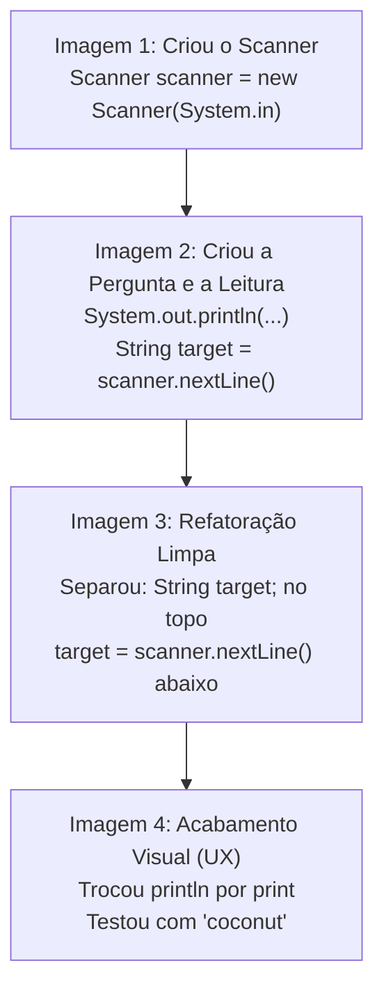

# ☕ Curso de Java — Capítulo 33: `search an array 🔎` (Parte 5 — Final)
## A Grande Evolução: Busca Interativa Dinâmica com `Scanner`, Refatoração de Código e a Diferença entre `print` e `println`

> **Baseado na aula do canal Bro Code (Minuto `5:27:00` a `5:28:10` de 12:00:00)**  
> **Tema:** Como transformar a busca de um valor fixo no código (*hardcoded*) em um programa interativo de verdade, onde o usuário digita no teclado a fruta que deseja buscar. Explicação dos 4 prints: a importação do Scanner, a separação de declaração vs atribuição, o ajuste fino de UX com `print` e os testes no console (`coconut` e `banana`).

---

## 📌 Sumário
1. [Contexto Visual Detalhado das 4 Telas (Para o Google Docs)](#1-contexto-visual-detalhado-das-4-telas-para-o-google-docs)
2. [O Grande Salto: De "Valor Fixo" para "Busca Interativa"](#2-o-grande-salto-de-valor-fixo-para-busca-interativa)
3. [Evolução Código por Código: O que o Professor Fez em Cada Imagem](#3-evolução-código-por-código-o-que-o-professor-fez-em-cada-imagem)
4. [A Diferença Crucial: Declaração (`String target;`) vs Atribuição (`target = ...`)](#4-a-diferença-crucial-declaração-string-target-vs-atribuição-target--)
5. [O Ajuste de Ouro de UX: `System.out.print` vs `System.out.println`](#5-o-ajuste-de-ouro-de-ux-systemoutprint-vs-systemoutprintln)
6. [O Código Java Completo, Numerado e Definitivo](#6-o-código-java-completo-numerado-e-definitivo)
7. [Explicação Cirúrgica Linha por Linha](#7-explicação-cirúrgica-linha-por-linha)
8. [Os Dois Cenários de Execução no Console (Com Teste de Mesa)](#8-os-dois-cenários-de-execução-no-console-com-teste-de-mesa)
   * [Cenário A: Usuário digita `coconut` (Elemento Não Encontrado)](#cenário-a-usuário-digita-coconut-elemento-não-encontrado)
   * [Cenário B: Usuário digita `banana` (Elemento Encontrado no Índice 2)](#cenário-b-usuário-digita-banana-elemento-encontrado-no-índice-2)
9. [Resumo Prático em Uma Tabela Mental](#9-resumo-prático-em-uma-tabela-mental)

---

## 1. Contexto Visual Detalhado das 4 Telas (Para o Google Docs)

Se você não estiver com as imagens abertas no Google Docs, aqui está a descrição minuciosa do que acontece na tela do IntelliJ IDEA do professor em cada um dos 4 momentos:

### 📸 Imagem 1: Inserindo o Scanner (`media_1791242455715.png`)
* **O que aparece:** O professor digita na linha 6:  
  `Scanner scanner = new Scanner(System.in);`
* **Detalhe visual:** A palavra `Scanner` aparece com letras vermelhas e um aviso de erro/alerta no canto superior direito (`0 1 2`). Isso acontece porque a classe `Scanner` não pertence ao pacote básico do Java (`java.lang`), necessitando ser importada do pacote `java.util.Scanner`.
* **O restante do código:** Mantém o array de frutas e o `target = "pineapple";` fixo da aula anterior.

---

### 📸 Imagem 2: Perguntando ao Usuário (`media_1791242474701.png` — Minuto `5:27:16`)
* **O que aparece:** O professor apaga a linha fixa `String target = "pineapple";` e escreve duas linhas novas:
  * Linha 11: `System.out.println("Enter a fruit to search for: ");`
  * Linha 12: `String target = scanner.nextLine();`
* **O que isso faz:** O programa agora imprime uma mensagem amigável na tela pedindo para o usuário digitar uma fruta, e o método `scanner.nextLine()` fica pausado esperando o usuário teclar algo e apertar `Enter`.

---

### 📸 Imagem 3: Organizando as Variáveis no Topo (`media_1791242484343.png`)
* **O que aparece:** O professor faz uma **refatoração** (limpeza e organização visual da estrutura):
  * Ele move a declaração da variável para a linha 11: `String target;` (ao lado de `boolean isFound = false;`).
  * Na linha 14, ele deixa apenas a leitura: `target = scanner.nextLine();`.
* **Por que ele fez isso?** É uma excelente prática de programação colocar todas as declarações de variáveis juntas no topo do método. Assim qualquer pessoa que abrir o arquivo sabe de imediato quais variáveis existem naquele programa.

---

### 📸 Imagem 4: O Toque de Mestre no `print` e o Teste com `coconut` (`media_1791242502045.png`)
* **O que aparece no editor:** Na linha 13, o professor apaga as duas letrinhas `ln` de `System.out.println` e deixa apenas:  
  `System.out.print("Enter a fruit to search for: ");`
* **O que aparece no console (embaixo):**
  * O prompt aparece na tela: `Enter a fruit to search for: `
  * Em azul claro, o professor digita no teclado: `coconut` *(coco)*.
  * O texto digitado ficou exatamente **ao lado** da pergunta, na mesma linha, porque o `print` não pulou linha!
  * O programa executa a busca e imprime em verde logo abaixo:  
    `Element not found in the array`
  * E encerra com `Process finished with exit code 0`.

---

## 2. O Grande Salto: De "Valor Fixo" para "Busca Interativa"

Até a Parte 4, nós estávamos fazendo o que os programadores chamam de **Hardcoding** (valores fixados no código-fonte):
```java
// O programador decidia a fruta antes do programa rodar:
String target = "orange";    // ou "pineapple"
```
Isso é útil para aprender a sintaxe, mas no **mundo real**, nenhum software funciona assim!
* No Google, você não abre uma página com a busca já decidida pelo programador; você **digita** o que quer procurar.
* Na Netflix, você digita o nome do filme.
* No Mercado Livre, você digita o produto.

Ao colocar o `Scanner`, o professor conecta o conceito de **Estruturas de Dados (Vetores)** com o conceito de **Entrada de Dados (I/O - Input/Output)**, transformando o programa em um utilitário real e interativo.

---

## 3. Evolução Código por Código: O que o Professor Fez em Cada Imagem

Acompanhe a linha do tempo do pensamento do professor:



---

## 4. A Diferença Crucial: Declaração (`String target;`) vs Atribuição (`target = ...`)

Na Imagem 3, o professor fez algo que confunde muitos iniciantes:

```java
// Na linha 11 ele fez:
String target;

// E na linha 14 ele fez:
target = scanner.nextLine();
```

Por que não fazer tudo junto como antes (`String target = scanner.nextLine();`)?

| Conceito | Código | O que significa na prática |
| :--- | :--- | :--- |
| **Declaração** | `String target;` | Você avisa ao Java: *"Reserve um espaço na memória chamado `target` que vai guardar um texto (`String`), mas ainda não sei que texto é esse."* |
| **Atribuição / Inicialização** | `target = scanner.nextLine();` | Você diz ao Java: *"Pegue o que o usuário acabou de digitar no teclado e guarde dentro daquele espaço `target` que já havíamos reservado."* |

> 💡 **Analogia da Gaveta:**  
> A **declaração** é você colar uma etiqueta na gaveta dizendo *"Aqui vai ficar a fruta procurada"*.  
> A **atribuição** é o momento em que você realmente abre a gaveta e coloca a fruta lá dentro.

---

## 5. O Ajuste de Ouro de UX: `System.out.print` vs `System.out.println`

Na Imagem 4, o professor alterou a linha 13 de `println` para `print`. Observe a diferença visual no console:

### Se usasse `System.out.println`:
O sufixo `ln` significa **Line** (Linha). Ele imprime a mensagem e joga o cursor para a linha de baixo:
```text
Enter a fruit to search for: 
coconut
```
*(Fica feio e desconexo; a resposta fica jogada na linha seguinte).*

### Como usou `System.out.print`:
O comando `print` comum imprime a mensagem e **mantém o cursor parado exatamente ao lado**:
```text
Enter a fruit to search for: coconut
```
*(Fica elegante, profissional e idêntico a um terminal de computador de verdade!).*

---

## 6. O Código Java Completo, Numerado e Definitivo

Abaixo está o arquivo `Main.java` integral, exatamente como finalizado na Imagem 4:

```java
import java.util.Scanner;

public class Main {
    public static void main(String[] args) {

        Scanner scanner = new Scanner(System.in);

        int[] numbers = {1, 9, 2, 8, 3, 5, 4};
        String[] fruits = {"apple", "orange", "banana"};
        boolean isFound = false;
        String target;

        System.out.print("Enter a fruit to search for: ");
        target = scanner.nextLine();

        for (int i = 0; i < fruits.length; i++) {
            if (fruits[i].equals(target)) {
                System.out.println("Element found at index: " + i);
                isFound = true;
                break;
            }
        }

        if (!isFound) {
            System.out.println("Element not found in the array");
        }

        scanner.close();
    }
}
```

---

## 7. Explicação Cirúrgica Linha por Linha

Vamos acompanhar a execução passo a passo da máquina:

---

### Linha 1: `import java.util.Scanner;`
* **O que faz:** Importa a ferramenta de leitura de teclado do pacote utilitário do Java. Sem isso, o Java não reconhece a palavra `Scanner` (como visto no erro da Imagem 1).
* **No console:** Nada é exibido.

---

### Linha 3: `public class Main {`
* **O que faz:** Declara a classe principal onde todo o nosso código reside.
* **No console:** Nada é exibido.

---

### Linha 4: `public static void main(String[] args) {`
* **O que faz:** Método principal que o computador executa ao iniciar.
* **No console:** Nada é exibido.

---

### Linha 6: `Scanner scanner = new Scanner(System.in);`
* **O que faz:** Cria o leitor de teclado. O parâmetro `System.in` conecta o objeto leitor ao teclado físico da sua máquina.
* **Na memória:** Um objeto do tipo `Scanner` é alocado na memória Heap.
* **No console:** Nada é exibido.

---

### Linha 8: `int[] numbers = {1, 9, 2, 8, 3, 5, 4};`
* **O que faz:** Vetor de números da primeira metade da aula (mantido no código pelo professor como histórico de estudo).
* **No console:** Nada é exibido.

---

### Linha 9: `String[] fruits = {"apple", "orange", "banana"};`
* **O que faz:** Cria o array de textos contendo 3 frutas:
  * Posição `0`: `"apple"` *(maçã)*
  * Posição `1`: `"orange"` *(laranja)*
  * Posição `2`: `"banana"` *(banana)*
* **Tamanho (`fruits.length`):** Vale `3`.
* **No console:** Nada é exibido.

---

### Linha 10: `boolean isFound = false;`
* **O que faz:** A sentinela de segurança. Começa como `false` porque a busca ainda nem começou.
* **No console:** Nada é exibido.

---

### Linha 11: `String target;`
* **O que faz:** Declara a variável `target` que guardará a fruta digitada pelo usuário, aguardando a leitura.
* **No console:** Nada é exibido.

---

### Linha 13: `System.out.print("Enter a fruit to search for: ");`
* **O que faz:** Imprime a pergunta na tela sem pular linha. O cursor fica piscando logo após o espaço depois dos dois pontos.
* **No console:** Exibe:  
  `Enter a fruit to search for: ` *(e aguarda o usuário)*.

---

### Linha 14: `target = scanner.nextLine();`
* **O que faz:** O programa **congela temporariamente** esperando o usuário digitar uma palavra no teclado e pressionar `Enter`.
* **O que o usuário digitou (na Imagem 4):** Digitou `coconut` e deu `Enter`.
* **Na memória:** A variável `target` recebe o texto `"coconut"`.
* **No console:** O texto `coconut` aparece ao lado da pergunta.

---

### Linha 16: `for (int i = 0; i < fruits.length; i++) {`
* **O que faz:** O laço de busca linear inicia. O contador `i` começa em `0` e vai até `2`.
* **No console:** Nada é exibido.

---

### Linha 17: `if (fruits[i].equals(target)) {`
* **O que faz:** Compara o conteúdo da fruta na posição `i` com o texto digitado em `target` usando `.equals()`.
* **No teste com `coconut`:**
  * `i = 0`: `"apple".equals("coconut")` ➡️ `false`.
  * `i = 1`: `"orange".equals("coconut")` ➡️ `false`.
  * `i = 2`: `"banana".equals("coconut")` ➡️ `false`.
* **Resultado:** Como nenhuma fruta combinou, o Java **nunca entra no `if`**!
* **No console:** Nada é exibido.

---

### Linhas 18 a 21: O Bloco do `if` (Pulado!)
```java
System.out.println("Element found at index: " + i);
isFound = true;
break;
```
* **O que faz:** Como o `if` deu falso em todas as gavetas, nenhuma dessas linhas roda. `isFound` permanece `false`.

---

### Linha 24: `if (!isFound) {`
* **O que faz:** Avalia a sentinela. Como `isFound` é `false`, `!false` vira `true`! O Java entra no bloco de aviso.
* **No console:** Nada é exibido ainda.

---

### Linha 25: `System.out.println("Element not found in the array");`
* **O que faz:** Imprime a mensagem de que a fruta não foi encontrada.
* **No console:** Exibe:  
  `Element not found in the array`

---

### Linha 28: `scanner.close();`
* **O que faz:** Fecha o leitor de teclado para liberar recursos do sistema operacional.
* **No console:** Nada é exibido.

---

### Linhas 29 e 30: `}` e `}`
* **O que faz:** Encerramento do método `main` e da classe `Main`. O programa termina com código 0.

---

## 8. Os Dois Cenários de Execução no Console (Com Teste de Mesa)

### Cenário A: Usuário digita `coconut` (Imagem 4)
* **Array existente:** `{"apple", "orange", "banana"}`
* **Entrada do usuário:** `coconut`

| Volta do Loop | Gaveta `fruits[i]` | Comparação `.equals("coconut")` | `isFound` | Console Nesta Rodada |
| :---: | :---: | :---: | :---: | :--- |
| `i = 0` | `"apple"` | ❌ `false` | `false` | *(nada)* |
| `i = 1` | `"orange"` | ❌ `false` | `false` | *(nada)* |
| `i = 2` | `"banana"` | ❌ `false` | `false` | *(nada)* |
| **Após o laço** | — | `if (!isFound)` é acionado | `false` | **`Element not found in the array`** |

#### Saída Exata no Console:
```text
Enter a fruit to search for: coconut
Element not found in the array

Process finished with exit code 0
```

---

### Cenário B: Usuário digita `banana` (Teste Sequencial do Vídeo)
* **Array existente:** `{"apple", "orange", "banana"}`
* **Entrada do usuário:** `banana`

| Volta do Loop | Gaveta `fruits[i]` | Comparação `.equals("banana")` | `isFound` | Ação Realizada |
| :---: | :---: | :---: | :---: | :--- |
| `i = 0` | `"apple"` | ❌ `false` | `false` | Segue para a próxima gaveta. |
| `i = 1` | `"orange"` | ❌ `false` | `false` | Segue para a próxima gaveta. |
| `i = 2` | `"banana"` | ✅ **`true`** | **`true`** | **Imprime `Element found at index: 2` e executa o `break;`!** |
| **Após o laço** | — | `if (!isFound)` é falso | `true` | Bloco de não encontrado é ignorado! |

#### Saída Exata no Console:
```text
Enter a fruit to search for: banana
Element found at index: 2

Process finished with exit code 0
```

---

## 9. Resumo Prático em Uma Tabela Mental

| Pergunta de Revisão | Resposta Direta |
| :--- | :--- |
| **Por que usamos `Scanner` aqui?** | Para permitir que o usuário decida interativamente qual fruta procurar pelo teclado. |
| **Por que separar `String target;` de `target = scanner.nextLine();`?** | Para manter as declarações de variáveis organizadas no topo do código. |
| **Qual a vantagem de `System.out.print` sobre `println` no prompt?** | O cursor do teclado fica na mesma linha da pergunta, deixando a interface limpa e bonita. |
| **Por que `coconut` deu `Element not found`?** | Porque o array só tem maçã, laranja e banana. Nenhuma combinação deu verdadeira no `.equals()`. |
| **Por que `banana` deu `index: 2`?** | Porque a contagem de gavetas em Java começa no 0: `apple` (0), `orange` (1), `banana` (2). |

---

*(Fim do guia do Capítulo 33 — Parte 5 / Final. Perfeito para o seu Google Docs!)*
