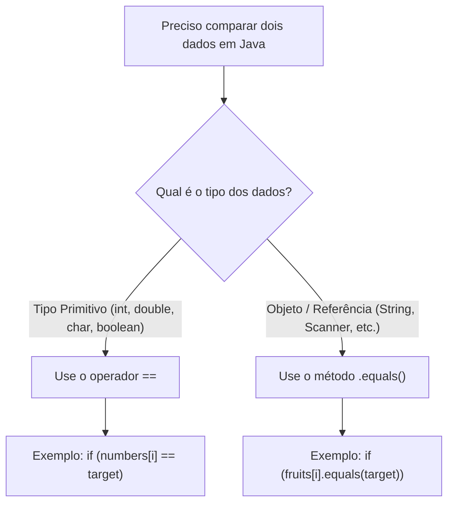

# 📘 APOSTILA COMPLETA E DEFINITIVA: CAPÍTULO 33
# `search an array 🔎` (Busca Linear em Vetores em Java)

> **Curso:** Java Full Course for free — Canal Bro Code  
> **Minutagem:** `5:22:00` a `5:28:10` de 12:00:00  
> **Nível:** Iniciante / Amador em Java (Explicação descomplicada e à prova de dúvidas)  
> **Objetivo:** Unificar as 5 partes do capítulo em um único guia completo definitivo pronto para cópia e estudo no Google Docs.

---

## 📑 Índice Geral da Apostila
1. [Visão Geral: O que é Busca Linear (*Linear Search*)?](#1-visão-geral-o-que-é-busca-linear-linear-search)
2. [Parte 1: A Busca Básica em Números e o Comando `break`](#2-parte-1-a-busca-básica-em-números-e-o-comando-break)
3. [Parte 2: A Sentinela Booleana `isFound` e a Cura do Console Mudo](#3-parte-2-a-sentinela-booleana-isfound-e-a-cura-do-console-mudo)
4. [Parte 3: Buscando Textos (`String[]`) e a Regra Sagrada do `.equals()`](#4-parte-3-buscando-textos-string-e-a-regra-sagrada-do-equals)
5. [Parte 4: O Teste com Elemento Inexistente Fixo (`"pineapple"`)](#5-parte-4-o-teste-com-elemento-inexistente-fixo-pineapple)
6. [Parte 5 (Clímax): Busca Dinâmica e Interativa com `Scanner`](#6-parte-5-clímax-busca-dinâmica-e-interativa-com-scanner)
7. [O Código-Fonte Completo, Numerado e Comentado](#7-o-código-fonte-completo-numerado-e-comentado)
8. [Diferença Crucial: Comparar Primitivos (`==`) vs Objetos (`.equals()`)](#8-diferença-crucial-comparar-primitivos--vs-objetos-equals)
9. [Tabela Resumo das Saídas de Console de Todos os Testes](#9-tabela-resumo-das-saídas-de-console-de-todos-os-testes)
10. [Checklist Mental do Aluno Para Provas e Entrevistas](#10-checklist-mental-do-aluno-para-provas-e-entrevistas)

---

## 1. Visão Geral: O que é Busca Linear (*Linear Search*)?

Imagine que você perdeu a sua chave de casa dentro de uma cômoda que tem várias gavetas enfileiradas. Você não sabe em qual gaveta ela está. O que você faz?
1. Você abre a **gaveta 0**. Não está lá? Fecha.
2. Abre a **gaveta 1**. Não está lá? Fecha.
3. Abre a **gaveta 2**. Achou a chave? Ótimo! Você para de abrir as outras gavetas e vai embora.
4. E se você abrir todas as gavetas até a última e a chave não estiver em nenhuma? Você precisa ter certeza e avisar: *"Procurei em tudo e a chave não está aqui!"*.

Essa estratégia simples de olhar **um por um, do primeiro até o último**, chama-se em ciência da computação de **Busca Linear** (*Linear Search*).

---

## 2. Parte 1: A Busca Básica em Números e o Comando `break`

No primeiro código do capítulo, o professor criou um array de números inteiros:
```java
int[] numbers = {1, 9, 2, 8, 3, 5, 4};
int target = 2; // target significa "alvo"
```

E montou o laço `for` com uma condição de igualdade `numbers[i] == target`:

```java
for (int i = 0; i < numbers.length; i++) {
    if (numbers[i] == target) {
        System.out.println("Element found at index: " + i);
        break; // Interrompe o laço imediatamente!
    }
}
```

### O que Aprendemos na Parte 1:
1. **O que é o índice (`i`)?** É o número da gaveta onde o elemento mora. No array acima, o número `2` está no índice `2`.
2. **Para que serve o comando `break;`?**  
   Assim que o elemento é encontrado, o `break;` força a saída imediata do laço `for`. Sem o `break;`, o computador continuaria verificando desnecessariamente o restante do array (`8`, `3`, `5`, `4`), desperdiçando tempo e memória.
3. **O Grande Defeito da Parte 1:**  
   Se você colocasse `target = 7;` (um número que não existe no array), o laço rodava do início ao fim e **NADA** aparecia no console! O usuário ficava olhando para uma tela preta vazia sem saber se o programa travou ou se o número apenas não existia.

---

## 3. Parte 2: A Sentinela Booleana `isFound` e a Cura do Console Mudo

Para consertar o defeito do console silencioso, o professor introduziu uma variável do tipo **`boolean`** chamada `isFound`:

```java
boolean isFound = false; // Começa como falso (ainda não achei)

for (int i = 0; i < numbers.length; i++) {
    if (numbers[i] == target) {
        System.out.println("Element found at index: " + i);
        isFound = true; // Levanta a bandeira: ACHEI!
        break;
    }
}

if (!isFound) { // Se a bandeira continuou abaixada...
    System.out.println("Element not found in the array");
}
```

### Por que a Sentinela Funciona Perfeitamente?
* **A Analogia da Bandeira:**  
  A variável `isFound` nasce abaixada (`false`). Se em algum momento o `if` encontrar o número, a bandeira sobe para `true`.
* **O Operador de Negação `!` (NOT):**  
  A expressão `!isFound` significa *"NÃO encontrado"*. Se `isFound` continuou `false`, `!false` vira `true`, fazendo o Java entrar no bloco de alerta e imprimir: `"Element not found in the array"`.

---

## 4. Parte 3: Buscando Textos (`String[]`) e a Regra Sagrada do `.equals()`

Na terceira parte, o professor quis provar que a busca funciona não apenas para números, mas também para textos. Ele criou um vetor de frutas:

```java
String[] fruits = {"apple", "orange", "banana"};
String target = "orange";
```

Mas aqui existe uma regra de ouro que separa os amadores dos programadores profissionais de Java:

```java
// ❌ NUNCA FAÇA ISSO COM TEXTOS EM JAVA:
if (fruits[i] == target) 

// ✅ FORMA CORRETA E PROFISSIONAL:
if (fruits[i].equals(target))
```

### Por que `==` Falha com Textos em Java?
* No Java, variáveis do tipo primitivo (`int`, `double`, `boolean`) guardam o valor diretamente na memória rápida (Stack). Então `1 == 1` compara os números diretamente.
* Mas `String` é um **Objeto**! As palavras ficam guardadas na memória Heap, e as variáveis guardam apenas o **endereço de memória** (o ponteiro).
* Se você usar `==`, o Java compara se os dois textos estão no mesmo endereço físico de memória.
* Quando você usa `.equals()`, o Java abre os dois textos e confere **letra por letra** para ver se o conteúdo é o mesmo!

Ao buscar `"orange"`, o programa encontrou a palavra no índice 1 e imprimiu:  
`Element found at index: 1`.

---

## 5. Parte 4: O Teste com Elemento Inexistente Fixo (`"pineapple"`)

No minuto `5:26:28`, o professor testou a busca de uma fruta que não estava no vetor:

```java
String target = "pineapple"; // Abacaxi não está na lista!
```

O laço `for` conferiu `"apple"`, `"orange"` e `"banana"`. Nenhuma foi igual a `"pineapple"`. O laço encerrou com `isFound = false`, e o comando `if (!isFound)` imprimiu no console:  
`Element not found in the array`.

---

## 6. Parte 5 (Clímax): Busca Dinâmica e Interativa com `Scanner`

Nas telas finais do capítulo (minuto `5:27:00` a `5:28:10`), o professor eliminou o valor fixo no código e transformou o algoritmo em um **programa interativo**:

### 1. Criando o Objeto Scanner:
```java
Scanner scanner = new Scanner(System.in);
```
*(Requer o `import java.util.Scanner;` na primeira linha do arquivo).*

### 2. Declaração vs Atribuição:
Para deixar o código limpo e elegante, ele separou a declaração da leitura:
```java
String target; // Declara a variável no bloco do topo

System.out.print("Enter a fruit to search for: "); // Faz a pergunta
target = scanner.nextLine(); // Atribui o texto digitado pelo teclado!
```

### 3. A Diferença Visual: `print` vs `println`:
* `System.out.println`: Joga o cursor para a linha de baixo.
* `System.out.print`: Deixa o cursor piscando **na mesma linha**, logo ao lado dos dois pontos, oferecendo uma experiência de terminal profissional.

---

## 7. O Código-Fonte Completo, Numerado e Comentado

Abaixo está o arquivo `Main.java` consolidado e definitivo:

```java
import java.util.Scanner;

public class Main {
    public static void main(String[] args) {

        // 1. Cria o leitor de teclado
        Scanner scanner = new Scanner(System.in);

        // 2. Arrays de dados (números da primeira aula e frutas)
        int[] numbers = {1, 9, 2, 8, 3, 5, 4};
        String[] fruits = {"apple", "orange", "banana"};

        // 3. Variáveis de controle
        boolean isFound = false;
        String target;

        // 4. Pergunta interativa para o usuário (na mesma linha com print)
        System.out.print("Enter a fruit to search for: ");
        target = scanner.nextLine();

        // 5. Laço de Busca Linear
        for (int i = 0; i < fruits.length; i++) {
            if (fruits[i].equals(target)) {
                System.out.println("Element found at index: " + i);
                isFound = true;
                break; // Para imediatamente ao encontrar!
            }
        }

        // 6. Alerta caso o elemento não exista no vetor
        if (!isFound) {
            System.out.println("Element not found in the array");
        }

        // 7. Boa prática: fechar o scanner
        scanner.close();
    }
}
```

---

## 8. Diferença Crucial: Comparar Primitivos (`==`) vs Objetos (`.equals()`)



---

## 9. Tabela Resumo das Saídas de Console de Todos os Testes

| Aula / Teste | Tipo | Vetor | Entrada / Alvo | Saída Exata no Console | Significado |
| :---: | :---: | :---: | :---: | :--- | :--- |
| **Parte 1 (A)** | `int` | `{1, 9, 2, 8, 3, 5, 4}` | `target = 2` | `Element found at index: 2` | Encontrou na gaveta 2 |
| **Parte 1 (B)** | `int` | `{1, 9, 2, 8, 3, 5, 4}` | `target = 1` | `Element found at index: 0` | Encontrou na gaveta 0 |
| **Parte 1 (C)** | `int` | `{1, 9, 2, 8, 3, 5, 4}` | `target = 7` | *(Console Vazio)* | Falha de feedback ao usuário |
| **Parte 2** | `int` | `{1, 9, 2, 8, 3, 5, 4}` | `target = 7` | `Element not found in the array` | Sentinela booleana corrigiu o bug |
| **Parte 3** | `String` | `{"apple", "orange", "banana"}` | `target = "orange"` | `Element found at index: 1` | Sucesso com `.equals()` |
| **Parte 4** | `String` | `{"apple", "orange", "banana"}` | `target = "pineapple"` | `Element not found in the array` | Não encontrado com valor fixo |
| **Parte 5 (A)** | `String` | `{"apple", "orange", "banana"}` | Usuário digitou: `coconut` | `Enter a fruit to search for: coconut`<br>`Element not found in the array` | Busca interativa inexistente |
| **Parte 5 (B)** | `String` | `{"apple", "orange", "banana"}` | Usuário digitou: `banana` | `Enter a fruit to search for: banana`<br>`Element found at index: 2` | Busca interativa bem-sucedida |

---

## 10. Checklist Mental do Aluno Para Provas e Entrevistas

Sempre que precisar programar uma **Busca Linear em Vetor**, siga estes 5 passos de ouro:

1. **Entrada de Dados**: Decida se o alvo vem de uma variável fixa ou do teclado via `scanner.nextLine()`.
2. **Crie a Sentinela (`boolean isFound = false`)**: Ela garante que o usuário receberá uma mensagem clara caso o item não exista.
3. **Use o comparador correto**:
   * Números (`int`, `double`): `numbers[i] == target`
   * Textos (`String`): `fruits[i].equals(target)`
4. **Coloque o `break;`**: Assim que encontrar, interrompa o laço para poupar memória e processamento.
5. **Trate o caso negativo (`if (!isFound)`)**: Nunca deixe o console em silêncio.

---
*(Fim da Apostila Completa do Capítulo 33. Todo o conhecimento de busca linear em vetores em Java consolidado com maestria!)*
