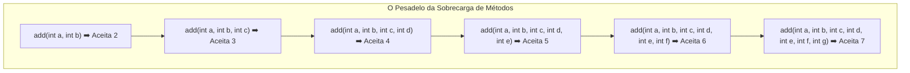

# ☕ Curso de Java — Capítulo 34: `varargs` (Parte 1)
## A Origem do Varargs: O Pesadelo dos Métodos Sobrecarregados (*Overloaded Methods*)

> **Baseado na aula do canal Bro Code (Minuto `5:28:21` a `5:28:49` de 12:00:00)**  
> **Tema:** O que motivou a criação do `varargs` no Java? Entendendo os 4 comentários conceituais do professor, a dor de cabeça da sobrecarga de métodos (*method overloading*) com a "escadinha do terror" de 6 métodos diferentes, e como o compilador do Java decide qual método chamar.

---

## 📌 Sumário
1. [Contexto Visual Detalhado das Duas Telas (Para o Google Docs)](#1-contexto-visual-detalhado-das-duas-telas-para-o-google-docs)
2. [O que é Sobrecarga de Métodos (*Overloaded Methods*)? (Explicação para Amadores)](#2-o-que-é-sobrecarga-de-métodos-overloaded-methods-explicação-para-amadores)
3. [Os 4 Comentários do Professor Dissecados Palavra por Palavra](#3-os-4-comentários-do-professor-dissecados-palavra-por-palavra)
4. [A Imagem 2 e a "Escadinha do Terror": 6 Métodos Repetitivos](#4-a-imagem-2-e-a-escadinha-do-terror-6-métodos-repetitivos)
5. [O Código Java Completo e Numerado da Imagem 2](#5-o-código-java-completo-e-numerado-da-imagem-2)
6. [Explicação Cirúrgica Linha por Linha](#6-explicação-cirúrgica-linha-por-linha)
7. [Como o Java Escolhe Qual Método Executar? (Resolução de Assinatura)](#7-como-o-java-escolhe-qual-método-executar-resolução-de-assinatura)
8. [O que Sai no Console Nesta Execução?](#8-o-que-sai-no-console-nesta-execução)
9. [A Pergunta que Prepara o Próximo Passo: Por que Isso é Inaceitável?](#9-a-pergunta-que-prepara-o-próximo-passo-por-que-isso-é-inaceitável)
10. [Resumo Prático em Uma Tabela Mental](#10-resumo-prático-em-uma-tabela-mental)

---

## 1. Contexto Visual Detalhado das Duas Telas (Para o Google Docs)

Para você que vai copiar este material diretamente para o seu **Google Docs**, aqui está o relatório visual minucioso de cada uma das duas imagens da aula:

### 📸 Imagem 1: A Teoria e a Seleção com o Mouse (`media_1791242566265.png` — Minuto `5:28:21`)
* **No topo do editor:**
  * O arquivo aberto é `Main.java`.
  * A classe `public class Main` e o método `public static void main(String[] args)` estão declarados.
  * Nas linhas 5 a 8, o professor digita 4 linhas de comentários explicando a definição de `varargs`.
* **O detalhe visual mais importante:**
  * O professor usa o mouse para **selecionar e pintar de azul** o seguinte trecho da linha 6:  
    `no need for overloaded methods` *(sem necessidade de métodos sobrecarregados)*.
  * Ele faz isso para pausar a aula e enfatizar: *"Guardem bem essa frase, porque agora eu vou mostrar o sofrimento que vocês passavam quando precisavam sobrecarregar métodos!"*.

---

### 📸 Imagem 2: A "Escadinha do Terror" dos Métodos Sobrecarregados (`media_1791242601917.png` — Minuto `5:28:49`)
* **Dentro do método `main` (Linha 10):**
  * O professor escreve a chamada:  
    `System.out.println(add(1, 2, 3));`
* **Abaixo do `main` (Linhas 13 a 37):**
  * O professor exibe nada menos do que **6 métodos diferentes**, todos com o mesmo nome (`add`), porém cada um aceitando uma quantidade diferente de parâmetros.
  * Os corpos dos métodos estão recolhidos com o recurso de dobrar código da IDE (`{...}`):
    * Linha 13: `static double add(int a, int b) {...}` (soma 2 números)
    * Linha 17: `static double add(int a, int b, int c) {...}` (soma 3 números)
    * Linha 21: `static double add(int a, int b, int c, int d) {...}` (soma 4 números)
    * Linha 25: `static double add(int a, int b, int c, int d, int e) {...}` (soma 5 números)
    * Linha 29: `static double add(int a, int b, int c, int d, int e, int f) {...}` (soma 6 números)
    * Linha 33: `static double add(int a, int b, int c, int d, int e, int f, int g) {...}` (soma 7 números)
* **O impacto visual:**
  * As linhas formam uma autêntica **escadinha visual**. O código fica enorme, poluído e cansativo só para fazer somas básicas!

---

## 2. O que é Sobrecarga de Métodos (*Overloaded Methods*)? (Explicação para Amadores)

Para entender por que o `varargs` é tão genial, você primeiro precisa entender o que é **Sobrecarga de Métodos** (*Method Overloading*).

### A Regra Fundamental dos Métodos em Java:
Em Java, você pode ter vários métodos com o **mesmo nome**, desde que eles tenham **parâmetros diferentes** (quantidade diferente de parâmetros ou tipos diferentes). Isso se chama *Sobrecarga*.

> 🧰 **A Metáfora da Chave de Fenda Multiuso:**  
> Imagine uma oficina que precisa apertar parafusos.  
> * Em vez de você ter **uma única ferramenta flexível**, imagine que para apertar 2 parafusos você precisa comprar a ferramenta modelo A.  
> * Para apertar 3 parafusos, você precisa fabricar a ferramenta modelo B.  
> * Para apertar 4 parafusos, você precisa forjar a ferramenta modelo C.  
> * Para apertar 7 parafusos, você precisa forjar a ferramenta modelo G.  
> Isso é um desperdício absurdo de tempo e energia! Você está criando 6 ferramentas quase idênticas que fazem a mesma coisa: somar!

---

## 3. Os 4 Comentários do Professor Dissecados Palavra por Palavra

Na Imagem 1, o professor escreveu 4 comentários essenciais nas linhas 5 a 8:

```java
// varargs = allow a method to accept a varying # of arguments
//           makes methods more flexible, no need for overloaded methods
//           java will pack the arguments into an array
//           ... (ellipsis)
```

Vamos dissecar cada termo em português claro:

1. **`varargs = allow a method to accept a varying # of arguments`**  
   * **Tradução:** *varargs = permite que um método aceite um número variável (#) de argumentos*.  
   * **O que significa:** O método não é mais "engessado". Ele aceita receber 1 número, 3 números, 10 números ou até nenhum número, sem chiar.

2. **`makes methods more flexible, no need for overloaded methods`** *(Trecho destacado em azul!)*  
   * **Tradução:** *torna os métodos mais flexíveis, sem necessidade de métodos sobrecarregados*.  
   * **O que significa:** Adeus àquela escadinha de 6 métodos repetitivos! Você escreve o método uma única vez e ele atende a todo mundo.

3. **`java will pack the arguments into an array`**  
   * **Tradução:** *o Java vai empacotar os argumentos em um array*.  
   * **O que significa:** O segredo dos bastidores da JVM! Quando você passa números soltos separados por vírgula (`1, 2, 3`), o Java secretamente cria um array na memória Heap e coloca os números lá dentro para você.

4. **`... (ellipsis)`**  
   * **Tradução:** *... (reticências)*.  
   * **O que significa:** Em inglês formal e na gramática de programação, os três pontinhos seguidos (`...`) chamam-se **ellipsis** (reticências). É o símbolo mágico que liga o superpoder do `varargs`.

---

## 4. A Imagem 2 e a "Escadinha do Terror": 6 Métodos Repetitivos

Olhe atentamente para o que o professor mostrou na Imagem 2:



### Por que os métodos estão com `{...}` na tela?
Na IDE IntelliJ IDEA, quando um método já está pronto e você não quer que o corpo dele ocupe espaço na tela, você clica na setinha de dobrar código no canto esquerdo. A IDE encolhe o método e mostra apenas `{...}`.  
Dentro de cada um deles, há um cálculo simples:
* No de 2: `return a + b;`
* No de 3: `return a + b + c;`
* No de 4: `return a + b + c + d;`
* ...e assim por diante!

---

## 5. O Código Java Completo e Numerado da Imagem 2

Abaixo está o código exatamente como configurado na tela da Imagem 2 (com o corpo expandido dos métodos para você ver como era por dentro):

```java
public class Main {
    public static void main(String[] args) {

        // varargs = allow a method to accept a varying # of arguments
        //           makes methods more flexible, no need for overloaded methods
        //           java will pack the arguments into an array
        //           ... (ellipsis)

        System.out.println(add(1, 2, 3));

    }

    static double add(int a, int b) {
        return a + b;
    }

    static double add(int a, int b, int c) {
        return a + b + c;
    }

    static double add(int a, int b, int c, int d) {
        return a + b + c + d;
    }

    static double add(int a, int b, int c, int d, int e) {
        return a + b + c + d + e;
    }

    static double add(int a, int b, int c, int d, int e, int f) {
        return a + b + c + d + e + f;
    }

    static double add(int a, int b, int c, int d, int e, int f, int g) {
        return a + b + c + d + e + f + g;
    }
}
```

---

## 6. Explicação Cirúrgica Linha por Linha

Vamos entender a anatomia deste arquivo:

---

### Linha 1 a 3: Declaração da Classe e Método `main`
```java
public class Main {
    public static void main(String[] args) {
```
* **O que faz:** Estrutura básica que inicializa o programa Java.
* **No console:** Nada é exibido.

---

### Linhas 5 a 8: Comentários
* **O que faz:** Anotações teóricas do professor. São ignoradas pelo compilador.
* **No console:** Nada é exibido.

---

### Linha 10: `System.out.println(add(1, 2, 3));`
* **O que faz:**  
  1. O programa chama o método `add` passando 3 argumentos inteiros: `1`, `2` e `3`.
  2. O compilador do Java vasculha a classe procurando um método chamado `add` que aceite exatamente **três números inteiros**.
  3. Ele encontra o método da linha 17 (`static double add(int a, int b, int c)`).
  4. O método calcula `1 + 2 + 3 = 6.0`.
  5. O comando `System.out.println` imprime o resultado `6.0` no console.
* **No console:** Imprime `6.0`.

---

### Linha 12: `}`
* **O que faz:** Fecha o método `main`.

---

### Linhas 13 a 36: A Família de Métodos Sobrecarregados
```java
static double add(int a, int b) { return a + b; }
static double add(int a, int b, int c) { return a + b + c; }
static double add(int a, int b, int c, int d) { return a + b + c + d; }
...
```
* **O que faz:** Cada método possui uma **assinatura diferente** (número diferente de parâmetros).
* **Por que o retorno é `double`?** O professor definiu o tipo de retorno como `double` para permitir maior precisão matemática (por isso o resultado sai com casa decimal: `6.0`).
* **No console:** Nada é exibido na declaração; eles só agem quando são chamados.

---

## 7. Como o Java Escolhe Qual Método Executar? (Resolução de Assinatura)

Quando você escreve `add(1, 2, 3)`, como o computador sabe qual dos 6 métodos deve rodar?

1. O compilador conta quantos argumentos você passou: **3 argumentos**.
2. Ele verifica os tipos: **3 números inteiros**.
3. Ele compara com a "carteira de identidade" de cada método:
   * `add(int, int)` ➡️ Rejeitado (só aceita 2).
   * `add(int, int, int)` ➡️ **MATCH PERFEITO! É esse aqui!**
   * `add(int, int, int, int)` ➡️ Rejeitado (espera 4).
4. O Java vincula a chamada diretamente ao método de 3 parâmetros. Isso se chama **Resolução de Sobrecarga em Tempo de Compilação**.

---

## 8. O que Sai no Console Nesta Execução?

Se você rodar o código da Imagem 2, o resultado exato na janela de execução é:

```text
6.0

Process finished with exit code 0
```

* **`6.0`**: A soma de `1 + 2 + 3 = 6`, formatada como número de ponto flutuante (`double`).
* **`Process finished with exit code 0`**: O programa executou perfeitamente e encerrou sem erros.

---

## 9. A Pergunta que Prepara o Próximo Passo: Por que Isso é Inaceitável?

O professor montou esse exemplo de propósito para fazer uma pergunta provocativa aos alunos:

> *"E se amanhã o seu chefe pedir para o programa somar 8 números? Você vai lá escrever o sétimo método? E se pedirem para somar 20 números? Você vai escrever 20 métodos? E se o usuário quiser somar 100 números?!"*

Seria uma loucura insustentável! É exatamente aqui que o professor diz:  
**"Esqueçam tudo isso! Vamos apagar esses 6 métodos e substituí-los por apenas UMA LINHA usando `varargs`!"**

---

## 10. Resumo Prático em Uma Tabela Mental

| Dúvida Comum | Resposta Clara e Objetiva |
| :--- | :--- |
| **O que é *Method Overloading*?** | Criar métodos com o mesmo nome, mas listas de parâmetros diferentes. |
| **Qual é o grande defeito disso para somas?** | Você tem que duplicar código e criar um método novo para cada quantidade de números. |
| **Por que o professor destacou `no need for overloaded methods`?** | Porque a grande missão do `varargs` é justamente aposentar essa duplicação de métodos! |
| **Qual o símbolo do `varargs`?** | As reticências `...` (*ellipsis*), que veremos logo a seguir com `int... numbers`. |
| **O que saiu no console da Imagem 2?** | `6.0` (o resultado da soma de `1 + 2 + 3`). |

---

*(Fim do guia do Capítulo 34 — Parte 1 / Fundamentos. O documento perfeito para o seu Google Docs para entender a razão histórica da criação do varargs!)*
