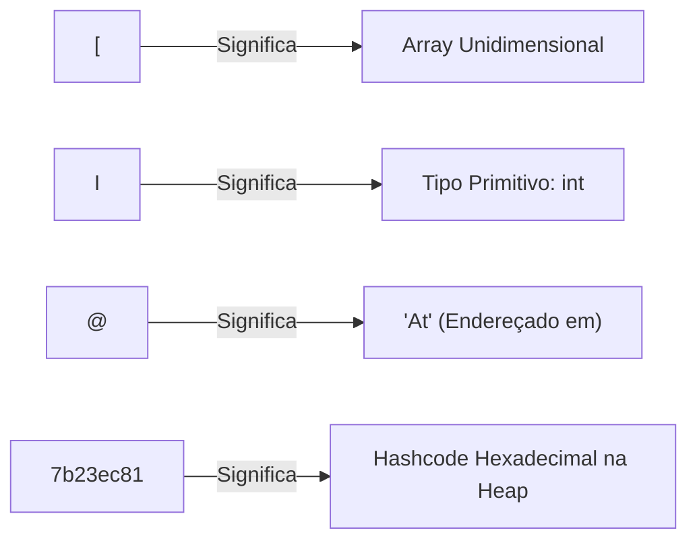
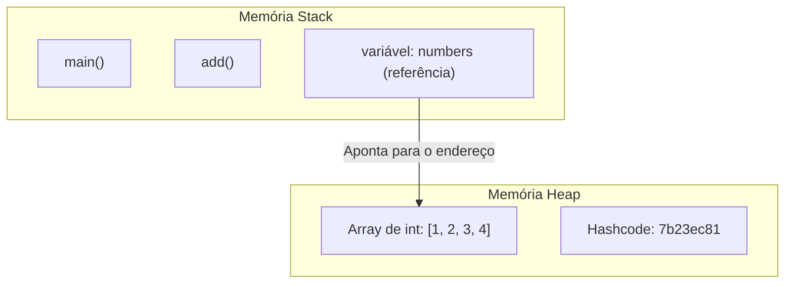

# ☕ Curso de Java — Capítulo 34: `varargs` (Parte 2)
## O Experimento Revelador: O Java Realmente Cria um Array? A Decodificação do Código `[I@7b23ec81`

> **Baseado na aula do canal Bro Code (Minuto `5:29:46` a `5:30:15` de 12:00:00)**  
> **Tema:** O professor apaga todos os 6 métodos sobrecarregados da aula anterior e cria um único método com as reticências: `int... numbers`. Para provar a teoria aos alunos, ele imprime a variável diretamente e o console exibe `[I@7b23ec81`. O que significa esse código misterioso? Por que ele mudou temporariamente para `void`?

---

## 📌 Sumário
1. [Contexto Visual das 3 Telas (Para o Google Docs)](#1-contexto-visual-das-3-telas-para-o-google-docs)
2. [O Experimento Científico do Professor](#2-o-experimento-científico-do-professor)
3. [Imagem 1: O Erro Didático de Compilação (*Missing Return Statement*)](#3-imagem-1-o-erro-didático-de-compilação-missing-return-statement)
4. [Imagem 2: Passando 4 Argumentos Soltos e Selecionando `numbers`](#4-imagem-2-passando-4-argumentos-soltos-e-selecionando-numbers)
5. [Imagem 3: A Mudança para `void` e o Grande Mistério do Console](#5-imagem-3-a-mudança-para-void-e-o-grande-mistério-do-console)
6. [Decodificação Cirúrgica: O que Significa `[I@7b23ec81`?](#6-decodificação-cirúrgica-o-que-significa-i7b23ec81)
7. [O Código Java Completo, Numerado e Comentado](#7-o-código-java-completo-numerado-e-comentado)
8. [Explicação Linha por Linha](#8-explicação-linha-por-linha)
9. [O que Aconteceu na Memória do Computador (Stack vs. Heap)?](#9-o-que-aconteceu-na-memória-do-computador-stack-vs-heap)
10. [Resumo Prático em Uma Tabela Mental](#10-resumo-prático-em-uma-tabela-mental)

---

## 1. Contexto Visual das 3 Telas (Para o Google Docs)

Para você que vai copiar este estudo diretamente para o **Google Docs**, aqui está o relatório visual exato de cada uma das 3 imagens enviadas:

### 📸 Imagem 1 (`media_1791242635519.png` — Minuto `5:29:46`)
* **No editor do IntelliJ IDEA:**
  * O professor apagou completamente os 6 métodos da escadinha da aula anterior!
  * Nas linhas 5 a 8, mantêm-se os 4 comentários teóricos sobre `varargs`.
  * Na linha 10, dentro do `main`, ele escreve apenas: `add();`.
  * Abaixo do `main` (linhas 13 a 15), ele cria o novo método:  
    `static int add(int... numbers) { System.out.println(numbers); }`
* **O detalhe do erro:**  
  Aparece uma ondinha avermelhada sob a palavra `add` e um aviso vermelho de erro no canto superior direito (`0 1 2`). Isso acontece porque o método prometeu retornar um número inteiro (`int`), mas não tem nenhuma instrução `return` dentro dele!

---

### 📸 Imagem 2 (`media_1791242642279.png` — Minuto `5:29:54`)
* **No método `main` (Linha 10):**  
  O professor altera a chamada para: `add(1, 2, 3, 4);`.
* **No método `add` (Linha 13):**  
  O professor usa o mouse para **selecionar e pintar de azul** a palavra `numbers` dentro de `(int... numbers)`.
* **O objetivo dele:**  
  Ele quer que os alunos foquem toda a atenção nessa palavra. Ele pergunta: *"O que vocês acham que é essa variável `numbers`? É um número só? São quatro números? Vamos descobrir!"*.

---

### 📸 Imagem 3 (`media_1791242678131.png`)
* **No editor:**  
  Para se livrar do erro vermelho sem precisar escrever o cálculo da soma ainda, o professor muda temporariamente o retorno do método de `int` para **`void`**:  
  `static void add(int... numbers) { System.out.println(numbers); }`  
  *(A palavra `void` significa "não retorna nada", então a IDE para de reclamar da falta de `return`!).*
* **No console (abaixo):**  
  O professor clica no Play e o programa roda com sucesso. O console imprime:  
  ```text
  [I@7b23ec81

  Process finished with exit code 0
  ```
* **O detalhe visual com o mouse:**  
  O professor **seleciona com o mouse o texto `[I@7b23ec81`** no console para mostrar aos alunos a prova definitiva do funcionamento interno do Java!

---

## 2. O Experimento Científico do Professor

Lembre-se do comentário número 3 que o professor escreveu na aula passada:
```java
// java will pack the arguments into an array
```
*(O Java vai empacotar os argumentos em um array)*.

Muitos professores apenas dizem isso da boca para fora, e o aluno tem que acreditar cegamente. Mas o Bro Code quis fazer um **teste prático**:
> *"Se o Java realmente transforma os números `1, 2, 3, 4` em um Array, o que acontece se eu mandar imprimir a variável `numbers` diretamente com `System.out.println(numbers)`?"*

O resultado foi exatamente o código `[I@7b23ec81`!

---

## 3. Imagem 1: O Erro Didático de Compilação (*Missing Return Statement*)

Na Imagem 1, o código estava assim:

```java
static int add(int... numbers) {
    System.out.println(numbers);
}
```

### Por que deu erro vermelho na tela?
Em Java, quando você declara um método com qualquer tipo que não seja `void` (como `int`, `double`, `String`), você está assinando um **contrato formal** com o compilador.
* Você prometeu: *"Eu, método `add`, garanto que vou devolver um número inteiro no final!"*.
* Mas dentro do método, você apenas fez um `System.out.println` e fechou as chaves `}`.
* O compilador do Java bloqueia a execução e dá o erro:  
  `java: missing return statement` *(Falta o comando de retorno!)*.

---

## 4. Imagem 2: Passando 4 Argumentos Soltos e Selecionando `numbers`

Na Imagem 2, o professor chamou:
```java
add(1, 2, 3, 4);
```

Perceba a beleza disso:
* Antes, com sobrecarga de métodos, você precisava de um método específico para 4 parâmetros: `add(int a, int b, int c, int d)`.
* Agora, com `int... numbers`, o método aceita os 4 números soltos separados por vírgula como se nada tivesse acontecido!
* As reticências `...` dizem ao Java: *"Pegue tudo o que vier aqui e guarde na variável `numbers`"*.

---

## 5. Imagem 3: A Mudança para `void` e o Grande Mistério do Console

Para poder rodar o código e ver o que o console diria sem o erro de compilação, o professor fez um truque esperto: trocou `int` por `void`:

```java
static void add(int... numbers) {
    System.out.println(numbers);
}
```

Ao rodar, o aluno iniciante espera ver no console algo como:
* `1 2 3 4`? ❌ Não!
* `{1, 2, 3, 4}`? ❌ Não!

O console imprimiu:
```text
[I@7b23ec81
```

---

## 6. Decodificação Cirúrgica: O que Significa `[I@7b23ec81`?

Esta é uma das perguntas clássicas em entrevistas de emprego e provas de certificação Java: **o que significa essa sequência de caracteres?**



Vamos dissecar pedaço por pedaço:

1. **O colchete `[`**:  
   No formato interno da Máquina Virtual Java (JVM), um colchete abrindo indica que o objeto é um **Array** (vetor).
2. **A letra `I` maiúscula**:  
   É o identificador oficial de tipo da JVM para o tipo primitivo **`int`** (inteiro).
   * Se fosse um array de números com ponto flutuante (`double...`), seria `[D`.
   * Se fosse um array de booleanos (`boolean...`), seria `[Z`.
   * Se fosse um array de textos (`String...`), seria `[Ljava.lang.String;`.
3. **O símbolo `@`**:  
   Vem do inglês *"at"* (que significa "em" ou "localizado em").
4. **O código hexadecimal `7b23ec81`**:  
   É o código de identidade em base 16 (*hash code*) que representa o endereço de referência onde esse array foi alocado dentro da memória **Heap** do seu computador!

> 🎯 **Conclusão:** Esse resultado bizarro é a maior glória do teste! Ele **prova cientificamente** que `numbers` é, sem sombra de dúvidas, um **ARRAY DE INTEIROS (`int[]`)** criado automaticamente pelo Java!

---

## 7. O Código Java Completo, Numerado e Comentado

Aqui está o código exato da Imagem 3 que produziu o resultado do console:

```java
public class Main {
    public static void main(String[] args) {

        // varargs = allow a method to accept a varying # of arguments
        //           makes methods more flexible, no need for overloaded methods
        //           java will pack the arguments into an array
        //           ... (ellipsis)

        add(1, 2, 3, 4);

    }

    static void add(int... numbers) {
        System.out.println(numbers);
    }
}
```

---

## 8. Explicação Linha por Linha

---

### Linhas 1 a 3: Estrutura Base
```java
public class Main {
    public static void main(String[] args) {
```
* **O que faz:** Inicialização padrão do programa Java.
* **No console:** Nada é exibido.

---

### Linhas 5 a 8: Os Comentários
* **O que faz:** Documentação em texto puro para os alunos.
* **No console:** Nada é exibido.

---

### Linha 10: `add(1, 2, 3, 4);`
* **O que o computador faz:**
  1. O compilador vê que o método `add` espera `int... numbers`.
  2. Ele pega os 4 números soltos (`1, 2, 3, 4`).
  3. Secretamente na memória Heap, o Java executa o equivalente a:  
     `int[] numbers = new int[]{1, 2, 3, 4};`.
  4. O Java transfere o controle da execução para o método `add`, entregando a referência desse array.
* **No console:** Nada é impresso nesta linha (a impressão ocorre dentro do método chamado).

---

### Linha 12: `}`
* **O que faz:** Fecha o método `main`.

---

### Linha 13: `static void add(int... numbers) {`
* **O que faz:**
  * `static`: Permite ser chamado pelo `main` sem criar instância.
  * `void`: Informa que o método não devolve nenhum valor (apenas executa ações).
  * `int... numbers`: O parâmetro `varargs`. Recebe uma quantidade indefinida de números inteiros empacotados em um array.
* **No console:** Nada é exibido.

---

### Linha 14: `System.out.println(numbers);`
* **O que faz:** Tenta imprimir o array diretamente no console.
* **Por que não mostra os números dentro dele?**  
  Em Java, objetos como Arrays não têm uma formatação visual bonita por padrão. Quando você passa um array diretamente para o `println`, ele chama o método padrão `toString()`, que monta a fórmula:  
  `TipoDoArray + "@" + EndereçoDeMemoria`.
* **No console:** Imprime exatamente:  
  `[I@7b23ec81`

---

### Linhas 15 e 16: `}` e `}`
* **O que faz:** Fecham o método `add` e a classe `Main`.
* **No console:** A IDE exibe a linha final:  
  `Process finished with exit code 0`.

---

## 9. O que Aconteceu na Memória do Computador (Stack vs. Heap)?



1. **Na Heap:** O Java cria o vetor com os 4 números: `[1, 2, 3, 4]`. Esse vetor ganha o registro hexadecimal `7b23ec81`.
2. **Na Stack:** A variável local `numbers` do método guarda apenas o ponteiro (o endereço) que aponta para esse vetor na Heap.
3. **No `println`:** Como o Java recebeu o ponteiro, ele imprimiu o endereço do ponteiro (`[I@7b23ec81`).

---

## 10. Resumo Prático em Uma Tabela Mental

| Ponto de Estudo | O que você deve responder |
| :--- | :--- |
| **Por que deu erro vermelho na Imagem 1?** | Porque o método declarou `static int`, prometendo devolver um inteiro, mas não tinha a palavra `return`. |
| **Por que o professor mudou para `void` na Imagem 3?** | Para fazer o código compilar de imediato e poder rodar o teste de impressão. |
| **O que o console imprimiu?** | `[I@7b23ec81`. |
| **O que significa `[`?** | Objeto do tipo Array (vetor). |
| **O que significa `I`?** | Elementos do tipo primitivo `int`. |
| **O que significa `@7b23ec81`?** | O endereço de identificação do objeto na memória Heap. |
| **Como faremos para somar esses números na próxima aula?** | Usando um laço `for` ou `for-each` para abrir as gavetas desse array, somar os itens e retornar o total! |

---

*(Fim do guia do Capítulo 34 — Parte 2. Pronto para cópia direta e formatação impecável no seu Google Docs!)*
