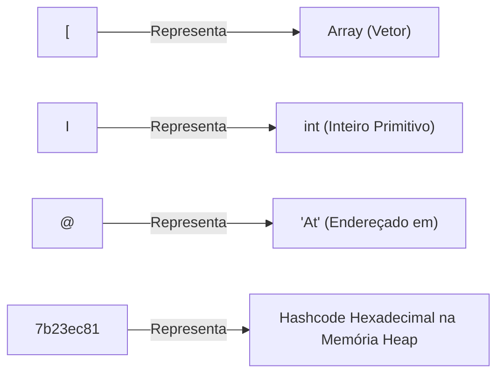

# 📘 APOSTILA COMPLETA E DEFINITIVA: CAPÍTULO 34
# `varargs` (Argumentos de Comprimento Variável em Java)

> **Curso:** Java Full Course for free — Canal Bro Code  
> **Minutagem:** `5:28:21` a `5:34:30` de 12:00:00  
> **Nível:** Iniciante / Amador em Java (Explicação descomplicada e à prova de dúvidas)  
> **Objetivo:** Unificar todo o Capítulo 34 em uma única apostila mestre completa, formatada para estudo e cópia direta no Google Docs.

---

## 📑 Índice Geral da Apostila
1. [Visão Geral: O que é `varargs` e Qual Problema Ele Veio Resolver?](#1-visão-geral-o-que-é-varargs-e-qual-problema-ele-veio-resolver)
2. [Parte 1: O Pesadelo dos Métodos Sobrecarregados (*Overloaded Methods*)](#2-parte-1-o-pesadelo-dos-métodos-sobrecarregados-overloaded-methods)
3. [Parte 2: Os 4 Comentários Teóricos do Bro Code Explicados](#3-parte-2-os-4-comentários-teóricos-do-bro-code-explicados)
4. [Parte 3: O Experimento do Array e o Mistério do `[I@7b23ec81`](#4-parte-3-o-experimento-do-array-e-o-mistério-do-i7b23ec81)
5. [Parte 4: O Método Somador `add` com `for-each` e Retorno `int`](#5-parte-4-o-método-somador-add-com-for-each-e-retorno-int)
6. [Parte 5: A Prova da Flexibilidade Extrema (4 Números vs. 6 Números)](#6-parte-5-a-prova-da-flexibilidade-extrema-4-números-vs-6-números)
7. [Parte 6: O Método `average` (Média), `.length` e o Fenômeno do `NaN`](#7-parte-6-o-método-average-média-length-e-o-fenômeno-do-nan)
8. [Parte 7: A Cura do `NaN` com a Cláusula de Guarda (`if == 0`) e a Saída `0.0`](#8-parte-7-a-cura-do-nan-com-a-cláusula-de-guarda-if--0-e-a-saída-00)
9. [O Código-Fonte Completo e Definitivo do Capítulo 34](#9-o-código-fonte-completo-e-definitivo-do-capítulo-34)
10. [As 3 Regras de Ouro do Varargs para Entrevistas de Emprego](#10-as-3-regras-de-ouro-do-varargs-para-entrevistas-de-emprego)
11. [Tabela Resumo das Saídas de Console de Todo o Capítulo](#11-tabela-resumo-das-saídas-de-console-de-todo-o-capítulo)
12. [A Ponte para o Próximo Capítulo: O que é `2D array`?](#12-a-ponte-para-o-próximo-capítulo-o-que-é-2d-array)

---

## 1. Visão Geral: O que é `varargs` e Qual Problema Ele Veio Resolver?

A palavra **`varargs`** é uma contração em inglês de:
* **`var`** = *Variable* (Quantidade variável).
* **`args`** = *Arguments* (Argumentos passados entre os parênteses de um método).
* **Tradução:** *Argumentos de Comprimento Variável*.

Antes do Java inventar o `varargs`, se você quisesse criar um método flexível para somar números ou calcular médias, você tinha apenas duas opções ruins:
1. Criar dezenas de métodos repetitivos (sobrecarga).
2. Obrigar o usuário a criar um Array manual com `new int[]{ ... }`.

Com o `varargs`, você simplesmente coloca **três pontinhos** (`...`) após o tipo (`int... numbers` ou `double... numbers`), e o método passa a aceitar **qualquer quantidade de parâmetros soltos** separados por vírgula!

---

## 2. Parte 1: O Pesadelo dos Métodos Sobrecarregados (*Overloaded Methods*)

No minuto `5:28:49`, o professor exibiu na tela a "escadinha do terror" com 6 métodos diferentes:

```java
static double add(int a, int b) { return a + b; }
static double add(int a, int b, int c) { return a + b + c; }
static double add(int a, int b, int c, int d) { return a + b + c + d; }
static double add(int a, int b, int c, int d, int e) { return a + b + c + d + e; }
static double add(int a, int b, int c, int d, int e, int f) { return a + b + c + d + e + f; }
static double add(int a, int b, int c, int d, int e, int f, int g) { return a + b + c + d + e + f + g; }
```

### Por que isso é um pesadelo para o programador?
* Para somar 2 números, usa o primeiro. Para somar 3, usa o segundo...
* E se o usuário quiser somar **20 números**? Você teria que escrever 20 métodos repetitivos!
* Isso gera código duplicado, difícil de ler e impossível de manter.

---

## 3. Parte 2: Os 4 Comentários Teóricos do Bro Code Explicados

Nas linhas 5 a 8 do arquivo `Main.java`, o professor escreveu as 4 regras fundamentais do `varargs`:

```java
// varargs = allow a method to accept a varying # of arguments
//           makes methods more flexible, no need for overloaded methods
//           java will pack the arguments into an array
//           ... (ellipsis)
```

1. **Permite número variável de argumentos:** Não há quantidade fixa de parâmetros.
2. **Torna os métodos mais flexíveis (sem sobrecarga):** Elimina a necessidade de métodos repetidos.
3. **O Java empacota os argumentos em um array:** O segredo da JVM! Quando você passa números soltos, o compilador aloca um Array real na memória Heap para você.
4. **`... (ellipsis)`:** O operador oficial do Java são as três reticências coladas no tipo de dado (`int...`).

---

## 4. Parte 3: O Experimento do Array e o Mistério do `[I@7b23ec81`

Para provar que o Java realmente cria um array, o professor chamou:
```java
add(1, 2, 3, 4);

static void add(int... numbers) {
    System.out.println(numbers);
}
```
O console imprimiu:
```text
[I@7b23ec81
```

### O que significa esse código estranho?


* **Não é erro!** É a certidão de nascimento do objeto na memória Heap, provando que a variável `numbers` é um **Array de verdade (`int[]`)**!

---

## 5. Parte 4: O Método Somador `add` com `for-each` e Retorno `int`

Como `numbers` é um array, para somar seus valores usamos o **padrão acumulador** com o laço **`for-each`**:

```java
static int add(int... numbers) {

    int sum = 0; // Cofrinho zerado

    for (int number : numbers) {
        sum += number; // Acumula cada elemento
    }

    return sum; // Devolve o total final
}
```

Ao chamar `System.out.println(add(1, 2, 3, 4));`:
* O laço soma: `1 + 2 + 3 + 4 = 10`.
* O console imprime em verde: **`10`**.

---

## 6. Parte 5: A Prova da Flexibilidade Extrema (4 Números vs. 6 Números)

No minuto `5:31:03`, o professor testou o limite da flexibilidade:

```java
System.out.println(add(1, 2, 3, 4, 5, 6));
```

* **Quantos métodos adicionais ele precisou criar?** ZERO!
* **Quantas linhas do método `add` precisaram mudar?** NENHUMA!
* **O que o Java fez?**  
  Criou um array de 6 posições na Heap, o laço somou $1+2+3+4+5+6 = 21$.
* **Saída no Console:** **`21`**.

---

## 7. Parte 6: O Método `average` (Média), `.length` e o Fenômeno do `NaN`

O professor elevou o nível criando o método de **Média Aritmética**:

```java
static double average(double... numbers) {

    double sum = 0;

    for (double number : numbers) {
        sum += number;
    }

    return sum / numbers.length;
}
```

* **Por que `double`?** Porque médias quase sempre resultam em números com casas decimais (ex: 3.5).
* **Por que `numbers.length`?** Porque o array do varargs nos dá o tamanho exato da quantidade de números passados.
* Ao chamar com 6 números: `average(1, 2, 3, 4, 5, 6)` ➡️ Imprime **`3.5`** ($\frac{21}{6}$).

### O Teste de Choque: `average()` Vazio
Quando o professor chamou `System.out.println(average());` sem nenhum argumento:
* O array tem tamanho zero: `numbers.length = 0`.
* A soma vale `0.0`.
* A conta final foi: $\frac{0.0}{0}$!
* **Saída no Console:** **`NaN`** (*Not a Number* / Não é um Número)!  
  *(Na norma IEEE 754 de números double, zero dividido por zero não quebra o sistema; gera a constante `NaN`).*

---

## 8. Parte 7: A Cura do `NaN` com a Cláusula de Guarda (`if == 0`) e a Saída `0.0`

Para blindar o código contra esse erro, o professor adicionou uma **Cláusula de Guarda** (*Guard Clause*):

```java
static double average(double... numbers) {

    double sum = 0;

    // Se o array estiver vazio, encerra na hora e retorna zero!
    if (numbers.length == 0) {
        return 0;
    }

    for (double number : numbers) {
        sum += number;
    }

    return sum / numbers.length;
}
```

* Ao chamar `average()` vazio:
  * O `if (numbers.length == 0)` é verdadeiro.
  * O comando `return 0;` encerra o método imediatamente!
  * O Java converte o `0` inteiro para `double` automaticamente.
* **Saída no Console:** **`0.0`** *(limpo, seguro e matematicamente elegante)*.

---

## 9. O Código-Fonte Completo e Definitivo do Capítulo 34

Abaixo está o arquivo `Main.java` consolidando tudo o que foi aprendido no capítulo:

```java
public class Main {
    public static void main(String[] args) {

        // varargs = allow a method to accept a varying # of arguments
        //           makes methods more flexible, no need for overloaded methods
        //           java will pack the arguments into an array
        //           ... (ellipsis)

        // Testes do somador add:
        // System.out.println(add(1, 2, 3, 4));          // 10
        // System.out.println(add(1, 2, 3, 4, 5, 6));    // 21

        // Testes da média average:
        // System.out.println(average(1, 2, 3, 4, 5, 6)); // 3.5
        System.out.println(average());                   // 0.0

    }

    // 1. Método somador usando varargs de inteiros
    static int add(int... numbers) {
        int sum = 0;
        for (int number : numbers) {
            sum += number;
        }
        return sum;
    }

    // 2. Método de média usando varargs de double e cláusula de guarda
    static double average(double... numbers) {
        double sum = 0;

        if (numbers.length == 0) {
            return 0;
        }

        for (double number : numbers) {
            sum += number;
        }

        return sum / numbers.length;
    }
}
```

---

## 10. As 3 Regras de Ouro do Varargs para Entrevistas de Emprego

1. **Apenas UM varargs por método:**  
   ❌ `void teste(int... a, String... b)` ➡️ Erro de compilação!  
   ✅ `void teste(int... a)` ➡️ Válido.
2. **O varargs DEVE ser o ÚLTIMO parâmetro da lista:**  
   ❌ `void exibir(int... numeros, String titulo)` ➡️ Erro!  
   ✅ `void exibir(String titulo, int... numeros)` ➡️ Válido.
3. **Varargs aceita zero argumentos:**  
   Se você chamar `metodo()`, o Java cria um array vazio de tamanho 0 (`new tipo[0]`).

---

## 11. Tabela Resumo das Saídas de Console de Todo o Capítulo

| Etapa da Aula | Código Chamado no `main` | O que Aconteceu nos Bastidores | Saída no Console | Código de Saída |
| :---: | :---: | :--- | :---: | :---: |
| **Parte 1** | `add(1, 2, 3)` | Chamou método sobrecarregado fixo | `6.0` | `exit code 0` |
| **Parte 2** | `add(1, 2, 3, 4)` | `println(numbers)` imprimiu a referência Heap | `[I@7b23ec81` | `exit code 0` |
| **Parte 3** | `System.out.println(add(1, 2, 3, 4))` | Somou 4 números com `for-each` | `10` | `exit code 0` |
| **Parte 4** | `System.out.println(add(1, 2, 3, 4, 5, 6))` | Somou 6 números no mesmo método | `21` | `exit code 0` |
| **Parte 6 (A)** | `System.out.println(average(1, 2, 3, 4, 5, 6))` | $\frac{21.0}{6}$ usando `numbers.length` | `3.5` | `exit code 0` |
| **Parte 6 (B)** | `System.out.println(average())` | Divisão $\frac{0.0}{0}$ sem cláusula de guarda | `NaN` | `exit code 0` |
| **Parte 7 e 8** | `System.out.println(average())` | Interceptado por `if (numbers.length == 0)` | `0.0` | `exit code 0` |

---

## 12. A Ponte para o Próximo Capítulo: O que é `2D array`?

No próximo capítulo, entraremos no fascinante universo dos **Vetores Bidimensionais (Matrizes)**:
```java
// 2D array = An array where each element is an array
//            Useful for storing a matrix of data
```
* Em vez de uma linha reta de gavetas, teremos **linhas e colunas** (uma grade ou tabela), essencial para criar jogos (jogo da velha, xadrez, batalha naval) e planilhas de dados!

---
*(Fim da Apostila Completa e Definitiva do Capítulo 34. Todo o conteúdo de varargs consolidado com perfeição para o seu Google Docs!)*
