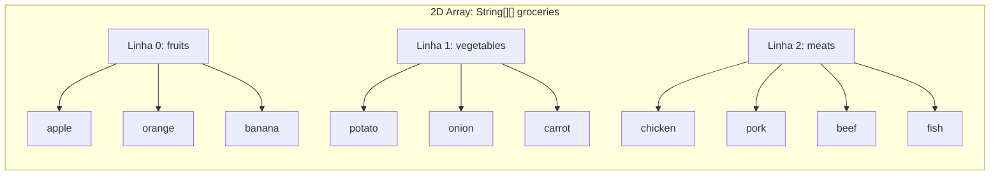

# ☕ Curso de Java — Capítulo 35: `2D arrays ⬜` (Parte 1)
## Entrando na Segunda Dimensão: Matrizes, Colchetes Duplos (`[][]`), Laços Aninhados e a Lista do Supermercado

> **Baseado na aula do canal Bro Code (Minuto `5:36:00` a `5:37:40` de 12:00:00)**  
> **Tema:** O que são `2D arrays` (vetores bidimensionais / matrizes)? Como criar um array cujos elementos são outros arrays (`groceries`), por que a sintaxe usa colchetes duplos `[][]`, o que significa a saída de referências `[Ljava.lang.String;@...` no console e como usar **laços aninhados** (*nested for-each*) para imprimir todos os alimentos na tela.

---

## 📌 Sumário
1. [Contexto Visual Detalhado das 5 Telas (Para o Google Docs)](#1-contexto-visual-detalhado-das-5-telas-para-o-google-docs)
2. [O que é um `2D array`? (A Teoria Explicada para Amadores)](#2-o-que-é-um-2d-array-a-teoria-explicada-para-amadores)
3. [A Metáfora da Lista de Supermercado Dividida em Sessões](#3-a-metáfora-da-lista-de-supermercado-dividida-em-sessões)
4. [A Sintaxe dos Colchetes Duplos: Por que `String[][]`?](#4-a-sintaxe-dos-colchetes-duplos-por-que-string)
5. [O Experimento da Imagem 3: Por que Imprimiu Três Códigos Estranhos?](#5-o-experimento-da-imagem-3-por-que-imprimiu-três-códigos-estranhos)
6. [O Poder dos Laços Aninhados (*Nested Loops* - Imagens 4 e 5)](#6-o-poder-dos-laços-aninhados-nested-loops---imagens-4-e-5)
7. [O Código Java Completo, Numerado e Definitivo](#7-o-código-java-completo-numerado-e-definitivo)
8. [Explicação Cirúrgica Linha por Linha](#8-explicação-cirúrgica-linha-por-linha)
9. [Teste de Mesa Passo a Passo: A Dança dos Laços na Memória](#9-teste-de-mesa-passo-a-passo-a-dança-dos-laços-na-memória)
10. [Resumo Prático em Uma Tabela Mental](#10-resumo-prático-em-uma-tabela-mental)

---

## 1. Contexto Visual Detalhado das 5 Telas (Para o Google Docs)

Para você que vai copiar este estudo diretamente para o **Google Docs**, aqui está a descrição minuciosa do que acontece na tela do IntelliJ IDEA do professor em cada uma das 5 imagens:

### 📸 Imagem 1: A Definição Teórica (`media_1791243016284.png`)
* **O que aparece:** A tela do editor começa limpa. Nas linhas 4 e 5, o professor escreve dois comentários conceituais:
  ```java
  // 2D array = An array where each element is an array
  //            Useful for storing a matrix of data
  ```
* **O destaque visual:** O professor **seleciona com o mouse a expressão `2D array`** em azul na linha 4 para enfatizar o início deste novo capítulo.

---

### 📸 Imagem 2: Criando os 3 Arrays e a Matriz `groceries` (`media_1791243060805.png` — Minuto `5:36:40`)
* **No editor:**
  * Linha 7: Cria o array de frutas: `String[] fruits = {"apple", "orange", "banana"};`.
  * Linha 8: Cria o array de vegetais: `String[] vegetables = {"potato", "onion", "carrot"};`.
  * Linha 9: Cria o array de carnes: `String[] meats = {"chicken", "pork", "beef", "fish"};`.
  * Linha 11: Cria o **2D array** com colchetes duplos agrupando os três vetores:  
    `String[][] groceries = {fruits, vegetables, meats};`.
  * Linha 13: Ele começa a esboçar um laço `for(){`.

---

### 📸 Imagem 3: O Experimento do Laço Simples e os Hashes (`media_1791243070943.png` — Minuto `5:37:11`)
* **No editor (Linhas 13 e 14):**
  * O professor escreve um laço `for-each` simples:
    ```java
    for(String[] foods : groceries){
        System.out.println(foods);
    }
    ```
* **No console (Painel Inferior):**
  * Ele clica em Run. O console imprime **três linhas misteriosas**:
    ```text
    [Ljava.lang.String;@7b23ec81
    [Ljava.lang.String;@6acbcfc0
    [Ljava.lang.String;@5f184fc6

    Process finished with exit code 0
    ```
* **O objetivo dele:** Provar aos alunos que a gaveta de `groceries` não guarda palavras soltas, ela **guarda arrays inteiros**!

---

### 📸 Imagem 4: Adicionando o Segundo Laço Aninhado (`media_1791243110009.png`)
* **No editor (Linhas 13 a 17):**
  * O professor adiciona um segundo `for-each` dentro do primeiro:
    ```java
    for(String[] foods : groceries){
        for(String food : foods){
            System.out.print(food + " ");
        }
    }
    ```
  * O laço de fora pega a cesta de alimentos (`foods`), e o laço de dentro pega cada comida individual (`food`) e imprime com um espaço ao lado.

---

### 📸 Imagem 5: A Saída Completa de Todos os Alimentos (`media_1791243119473.png`)
* **No console (Painel Inferior):**
  * O professor roda o código final.
  * O console imprime em verde todos os 10 alimentos em sequência contínua:
    ```text
    apple orange banana potato onion carrot chicken pork beef fish 

    Process finished with exit code 0
    ```
* **Conclusão da cena:** O programa conseguiu navegar por todas as gavetas internas e imprimir cada fruta, legume e carne com sucesso absoluto!

---

## 2. O que é um `2D array`? (A Teoria Explicada para Amadores)

Nos capítulos anteriores, nós trabalhamos apenas com **Arrays Unidimensionais (1D)**.
* Um array 1D é como uma **linha reta de gavetas**:
  ```text
  [ gaveta 0 | gaveta 1 | gaveta 2 ]
  ```
* Cada gaveta guarda um dado simples (um número `int` ou um texto `String`).

### E o que é um `2D array` (Array Bidimensional)?
Leia atentamente a definição escrita pelo professor na Imagem 1:
> **`2D array = An array where each element is an array`**  
> *(Um array onde cada elemento dentro dele é outro array!)*

É isso mesmo! É uma **gaveta que guarda outra cômoda inteira dentro dela**!  
Em matemática e computação, isso é chamado de **Matriz** (uma grade com **Linhas** e **Colunas**).

---

## 3. A Metáfora da Lista de Supermercado Dividida em Sessões

Para entender o exemplo do professor, imagine que você vai fazer compras no supermercado (`groceries`):



* Você não faz uma lista bagunçada misturando banana com frango. Você divide sua lista em **3 sessões organizadas**:
  1. Sessão 0: **Frutas** (`fruits`) ➡️ tem 3 itens.
  2. Sessão 1: **Vegetais** (`vegetables`) ➡️ tem 3 itens.
  3. Sessão 2: **Carnes** (`meats`) ➡️ tem 4 itens.
* O carrinho geral do supermercado (`groceries`) guarda essas 3 sessões!

---

## 4. A Sintaxe dos Colchetes Duplos: Por que `String[][]`?

Observe a linha 11 da Imagem 2:
```java
String[][] groceries = {fruits, vegetables, meats};
```

Por que tem dois pares de colchetes `[][]`?
* O **primeiro `[]`** representa as **Linhas** (qual das categorias você quer acessar: `0` para frutas, `1` para vegetais, `2` para carnes).
* O **segundo `[]`** representa as **Colunas** (qual item dentro daquela categoria você quer pegar).

### Exemplos Práticos de Coordenadas:
* `groceries[0][0]` ➡️ Linha 0 (frutas), Coluna 0: `"apple"`
* `groceries[0][1]` ➡️ Linha 0 (frutas), Coluna 1: `"orange"`
* `groceries[1][2]` ➡️ Linha 1 (vegetais), Coluna 2: `"carrot"`
* `groceries[2][3]` ➡️ Linha 2 (carnes), Coluna 3: `"fish"`

---

## 5. O Experimento da Imagem 3: Por que Imprimiu Três Códigos Estranhos?

Na Imagem 3, o professor fez este laço:
```java
for (String[] foods : groceries) {
    System.out.println(foods);
}
```
E o console imprimiu:
```text
[Ljava.lang.String;@7b23ec81
[Ljava.lang.String;@6acbcfc0
[Ljava.lang.String;@5f184fc6
```

### O que aconteceu aqui?
Lembra da aula de `varargs`? Quando você tenta imprimir um Array diretamente com `println`, o Java não imprime o conteúdo, ele imprime a **certidão de nascimento do objeto na memória Heap**:
* **`[`** = É um Array.
* **`Ljava.lang.String;`** = De objetos do tipo `String`.
* **`@`** = Localizado no endereço.
* **`7b23ec81`**, **`6acbcfc0`**, **`5f184fc6`** = São os 3 endereços de memória Heap dos 3 arrays (`fruits`, `vegetables` e `meats`)!

> 🎯 **A Conclusão do Professor:**  
> A variável `foods` não é uma palavra solta como `"apple"`. Ela é o **array inteiro de frutas**! Por isso, para ver o nome de cada comida, precisamos abrir esse array com **outro laço `for`**!

---

## 6. O Poder dos Laços Aninhados (*Nested Loops* - Imagens 4 e 5)

Para resolver esse problema, o professor colocou um **laço dentro do outro** (laço aninhado):

```java
for (String[] foods : groceries) {       // Laço Externo (Linhas)
    for (String food : foods) {          // Laço Interno (Colunas)
        System.out.print(food + " ");
    }
}
```

### A Mecânica da Dança dos Laços:
1. **O Laço de Fora (Externo):** Pega uma categoria por vez.
   * Na 1ª rodada: pega a cesta `fruits`.
   * Na 2ª rodada: pega a cesta `vegetables`.
   * Na 3ª rodada: pega a cesta `meats`.
2. **O Laço de Dentro (Interno):** Pega cada alimento individual que está dentro da cesta atual e imprime na tela com um espaço!
   * Quando a cesta atual é `fruits`, ele imprime `"apple "`, depois `"orange "`, depois `"banana "`.
   * Acabou a cesta de frutas? O laço interno termina. O laço externo avança para a cesta de vegetais!

---

## 7. O Código Java Completo, Numerado e Definitivo

Abaixo está o arquivo `Main.java` integral correspondente à execução final das Imagens 4 e 5:

```java
public class Main {
    public static void main(String[] args) {

        // 2D array = An array where each element is an array
        //            Useful for storing a matrix of data

        String[] fruits = {"apple", "orange", "banana"};
        String[] vegetables = {"potato", "onion", "carrot"};
        String[] meats = {"chicken", "pork", "beef", "fish"};

        String[][] groceries = {fruits, vegetables, meats};

        for (String[] foods : groceries) {
            for (String food : foods) {
                System.out.print(food + " ");
            }
        }
    }
}
```

---

## 8. Explicação Cirúrgica Linha por Linha

---

### Linhas 1 a 3: Estrutura Base
```java
public class Main {
    public static void main(String[] args) {
```
* **O que faz:** Inicializa a classe principal e o método `main`.
* **No console:** Nada é exibido.

---

### Linhas 4 e 5: Comentários Teóricos
* **O que faz:** Documentação explicando o que é um array 2D e matriz de dados.
* **No console:** Nada é exibido.

---

### Linha 7: `String[] fruits = {"apple", "orange", "banana"};`
* **O que faz:** Cria o primeiro vetor (1D) contendo 3 frutas.
* **Na memória:** Aloca um array de 3 posições na Heap.
* **No console:** Nada é exibido.

---

### Linha 8: `String[] vegetables = {"potato", "onion", "carrot"};`
* **O que faz:** Cria o segundo vetor (1D) contendo 3 legumes.
* **Na memória:** Aloca outro array na Heap.
* **No console:** Nada é exibido.

---

### Linha 9: `String[] meats = {"chicken", "pork", "beef", "fish"};`
* **O que faz:** Cria o terceiro vetor (1D) contendo 4 tipos de carne.
* **Na memória:** Aloca o terceiro array na Heap.
* **No console:** Nada é exibido.

---

### Linha 11: `String[][] groceries = {fruits, vegetables, meats};`
* **O que faz:** **Cria o Array Bidimensional (2D)!**
  * `groceries[0]` aponta para o array `fruits`.
  * `groceries[1]` aponta para o array `vegetables`.
  * `groceries[2]` aponta para o array `meats`.
* **Na memória:** Um array principal é alocado na Heap, guardando 3 ponteiros de referência para os arrays filhos.
* **No console:** Nada é exibido.

---

### Linha 13: `for (String[] foods : groceries) {`
* **O que faz:** **Laço Externo.** Percorre as linhas de `groceries`. Em cada ciclo, a variável temporária `foods` recebe um dos 3 arrays (`String[]`).
* **No console:** Nada é exibido.

---

### Linha 14: `for (String food : foods) {`
* **O que faz:** **Laço Interno.** Percorre os elementos individuais do array `foods` da vez. A variável `food` recebe uma única palavra (`String`).
* **No console:** Nada é exibido.

---

### Linha 15: `System.out.print(food + " ");`
* **O que faz:** Imprime o nome do alimento atual seguido de um espaço em branco, **sem quebrar linha** (`print` sem `ln`).
* **No console:** Vai cuspindo os alimentos lado a lado na tela.

---

### Linhas 16 e 17: `}` e `}`
* **O que faz:** Fecham o laço interno e o laço externo, respectivamente.

---

### Linhas 18 e 19: `}` e `}`
* **O que faz:** Fecham o método `main` e a classe `Main`. Fim do programa.

---

## 9. Teste de Mesa Passo a Passo: A Dança dos Laços na Memória

Acompanhe cada passo dos dois laços trabalhando em conjunto:

| Volta Externa (`foods`) | Volta Interna (`food`) | Alimento Sendo Impresso | O que Aparece no Console Acumulado |
| :---: | :---: | :---: | :--- |
| **1ª (`fruits`)** | 1ª | `"apple"` | `apple ` |
| **1ª (`fruits`)** | 2ª | `"orange"` | `apple orange ` |
| **1ª (`fruits`)** | 3ª | `"banana"` | `apple orange banana ` |
| *(Fim de fruits)* | — | — | *(O laço externo avança para vegetables)* |
| **2ª (`vegetables`)** | 1ª | `"potato"` | `apple orange banana potato ` |
| **2ª (`vegetables`)** | 2ª | `"onion"` | `apple orange banana potato onion ` |
| **2ª (`vegetables`)** | 3ª | `"carrot"` | `apple orange banana potato onion carrot ` |
| *(Fim de vegetables)* | — | — | *(O laço externo avança para meats)* |
| **3ª (`meats`)** | 1ª | `"chicken"` | `... chicken ` |
| **3ª (`meats`)** | 2ª | `"pork"` | `... chicken pork ` |
| **3ª (`meats`)** | 3ª | `"beef"` | `... chicken pork beef ` |
| **3ª (`meats`)** | 4ª | `"fish"` | `apple orange banana potato onion carrot chicken pork beef fish ` |

---

## 10. Resumo Prático em Uma Tabela Mental

| Pergunta para Fixação | Resposta Direta e Descomplicada |
| :--- | :--- |
| **O que é um 2D array?** | É um array de arrays (uma tabela/matriz com linhas e colunas). |
| **O que significa `String[][]`?** | O primeiro `[]` representa a linha (categoria); o segundo `[]` representa a coluna (item). |
| **Por que o laço simples imprimiu `[Ljava.lang.String;@...`?** | Porque cada linha de `groceries` é um Array de Strings, e imprimir um array direto mostra sua referência na memória. |
| **Por que precisamos de dois laços `for`?** | Um para percorrer as cestas (linhas) e outro para percorrer os itens de cada cesta (colunas). |
| **Qual foi a saída final no console?** | `apple orange banana potato onion carrot chicken pork beef fish ` com código de saída 0. |

---

*(Fim do guia do Capítulo 35 — Parte 1. Pronto para salvar, copiar e estudar no seu Google Docs!)*
