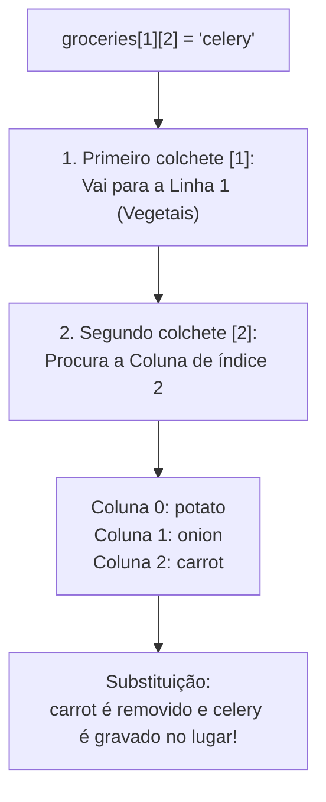
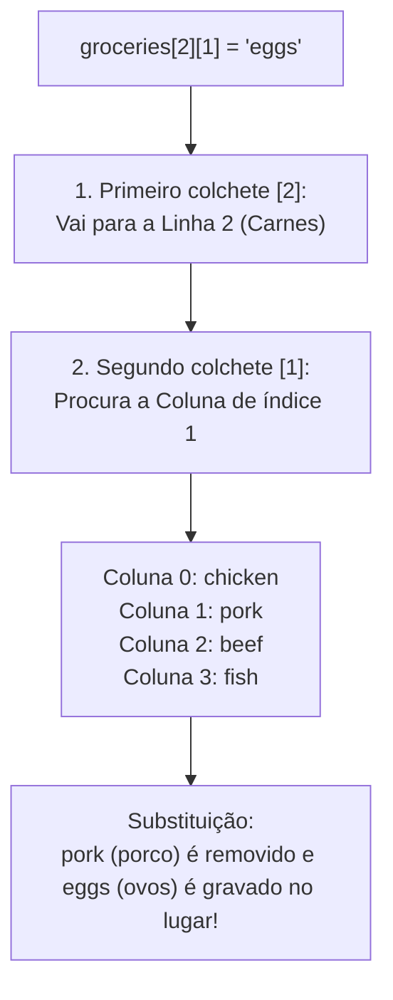

# ☕ Curso de Java — Capítulo 35: `2D arrays ⬜` (Parte 4)
## Dominando as Coordenadas: Trocando Cenoura por Aipo (`groceries[1][2] = "celery"`) e Porco por Ovos (`groceries[2][1] = "eggs"`)

> **Baseado na aula do canal Bro Code (Minuto `5:40:20` a `5:41:00` de 12:00:00)**  
> **Tema:** O professor coloca a teoria das coordenadas em prática, demonstrando que você pode alterar qualquer valor no meio da matriz sem afetar o resto. Ele realiza dois testes sucessivos: primeiro altera a Linha 1 Coluna 2 para `"celery"` *(aipo)*, e depois altera a Linha 2 Coluna 1 para `"eggs"` *(ovos)*.

---

## 📌 Sumário
1. [Contexto Visual Detalhado das Duas Telas (Para o Google Docs)](#1-contexto-visual-detalhado-das-duas-telas-para-o-google-docs)
2. [Por que o Professor Fez Mais Esses Dois Testes?](#2-por-que-o-professor-fez-mais-esses-dois-testes)
3. [Dissecação do Teste 1: `groceries[1][2] = "celery";`](#3-dissecação-do-teste-1-groceries12--celery)
4. [Dissecação do Teste 2: `groceries[2][1] = "eggs";`](#4-dissecação-do-teste-2-groceries21--eggs)
5. [O Código Java Completo, Numerado e Definitivo](#5-o-código-java-completo-numerado-e-definitivo)
6. [Explicação Cirúrgica Linha por Linha](#6-explicação-cirúrgica-linha-por-linha)
7. [Tabela Comparativa dos Dois Testes de Coordenadas](#7-tabela-comparativa-dos-dois-testes-de-coordenadas)
8. [O que Sai no Console em Cada Teste](#8-o-que-sai-no-console-em-cada-teste)
9. [Resumo Prático em Uma Tabela Mental](#9-resumo-prático-em-uma-tabela-mental)

---

## 1. Contexto Visual Detalhado das Duas Telas (Para o Google Docs)

Para você que vai copiar este estudo diretamente para o **Google Docs**, aqui está o relatório visual minucioso de tudo o que está visível na tela da IDE IntelliJ IDEA em ambas as imagens:

### 📸 Imagem 1: O Teste com `celery` (`media_1791243274809.png`)
* **No editor de código (`Main.java`):**
  * As linhas 7 a 9 continuam com a matriz literal `groceries`:
    * Linha 0: `{"apple", "orange", "banana"}`
    * Linha 1: `{"potato", "onion", "carrot"}`
    * Linha 2: `{"chicken", "pork", "beef", "fish"}`
  * Na linha 9, a palavra `"chicken"` está selecionada em azul.
  * **A linha de comando (Linha 11):**
    ```java
    groceries[1][2] = "celery";
    ```
  * O professor explica: *"Na aula passada nós mudamos a posição `[0][0]`. Agora vamos mudar um elemento bem no meio da matriz, na linha 1 coluna 2!"*.

---

### 📸 Imagem 2: O Teste com `eggs` (`media_1791243287625.png` — Minuto `5:40:47`)
* **No editor de código:**
  * O professor altera a linha 11 para:
    ```java
    groceries[2][1] = "eggs";
    ```
  * Há um ícone de lâmpada amarela do IntelliJ à esquerda da linha 11.
  * O cursor de texto pisca logo após a palavra `"eggs";`.
  * O laço duplo aninhado com `System.out.println();` permanece idêntico nas linhas 13 a 18.
* **O objetivo dele:**  
  Treinar o cérebro dos alunos a calcular mentalmente as coordenadas: *"Onde vai parar a palavra `eggs`? Qual comida vai sumir da lista?"*.

---

## 2. Por que o Professor Fez Mais Esses Dois Testes?

Na aula anterior, nós trocamos a maçã por abacaxi usando `groceries[0][0]`.  
Mas a posição `[0][0]` é muito fácil de achar (é o comecinho de tudo). Muitos alunos amadores se perdem quando precisam mexer em gavetas que estão **no meio da matriz** ou **em linhas com tamanhos diferentes**.

Ao fazer esses dois testes, o professor consolida a regra universal:
$$\text{groceries}[\text{Índice da Linha}][\text{Índice da Coluna}]$$

---

## 3. Dissecação do Teste 1: `groceries[1][2] = "celery";`

Vamos rastrear exatamente o que o computador faz quando lê essa instrução:



* **`"celery"`** significa **aipo / salsão** em inglês.
* A cenoura (`"carrot"`) que morava na Linha 1, Coluna 2 é despejada da memória Heap.
* A gaveta `[1][2]` agora aponta para `"celery"`.

---

## 4. Dissecação do Teste 2: `groceries[2][1] = "eggs";`

Agora veja o segundo teste realizado pelo professor:



* A carne de porco (`"pork"`) morava no índice `1` da Linha `2`.
* Ela é substituída por `"eggs"` *(ovos)*!
* A linha das carnes agora passa a ter: frango, ovos, boi e peixe!

---

## 5. O Código Java Completo, Numerado e Definitivo

Abaixo está o arquivo `Main.java` integral correspondente ao Teste 2 (Imagem 2):

```java
public class Main {
    public static void main(String[] args) {

        // 2D array = An array where each element is an array
        //            Useful for storing a matrix of data

        String[][] groceries = {{"apple", "orange", "banana"},
                                {"potato", "onion", "carrot"},
                                {"chicken", "pork", "beef", "fish"}};

        groceries[2][1] = "eggs";

        for (String[] foods : groceries) {
            for (String food : foods) {
                System.out.print(food + " ");
            }
            System.out.println();
        }
    }
}
```

---

## 6. Explicação Cirúrgica Linha por Linha

---

### Linhas 1 a 5: Estrutura Base e Comentários
* **O que faz:** Inicialização padrão do programa Java.
* **No console:** Nada é exibido.

---

### Linhas 7 a 9: A Matriz de Compras
```java
String[][] groceries = {{"apple", "orange", "banana"},
                        {"potato", "onion", "carrot"},
                        {"chicken", "pork", "beef", "fish"}};
```
* **O que faz:** Aloca na memória Heap a matriz com 3 linhas (frutas, legumes e carnes).
* **No console:** Nada é exibido.

---

### Linha 11: `groceries[2][1] = "eggs";`
* **O que faz:** Localiza a Linha 2 (carnes) e a Coluna 1 (segundo item). Substitui `"pork"` por `"eggs"`.
* **Na memória:** O ponteiro da posição `[2][1]` é atualizado para o texto `"eggs"`.
* **No console:** Nada é exibido nesta linha.

---

### Linhas 13 a 18: A Impressão Formatada com Laço Duplo
```java
for (String[] foods : groceries) {
    for (String food : foods) {
        System.out.print(food + " ");
    }
    System.out.println();
}
```
* **O que faz:**
  * Linha 13: O laço de fora percorre cada linha da matriz.
  * Linha 14: O laço de dentro percorre cada alimento daquela linha.
  * Linha 15: Imprime cada comida lado a lado com espaço.
  * Linha 17: Pula para a próxima linha da tela quando a categoria termina.

---

### Linhas 19 e 20: `}` e `}`
* **O que faz:** Encerram o método `main` e a classe `Main`. Fim da execução.

---

## 7. Tabela Comparativa dos Dois Testes de Coordenadas

| Propriedade | Teste 1 (Imagem 1) | Teste 2 (Imagem 2) |
| :--- | :---: | :---: |
| **Comando executado** | `groceries[1][2] = "celery";` | `groceries[2][1] = "eggs";` |
| **Linha afetada** | Linha 1 *(Vegetais)* | Linha 2 *(Carnes)* |
| **Coluna afetada** | Coluna 2 *(3º item)* | Coluna 1 *(2º item)* |
| **Elemento original** | `"carrot"` *(cenoura)* | `"pork"` *(porco)* |
| **Novo elemento** | `"celery"` *(aipo)* | `"eggs"` *(ovos)* |
| **Como ficou a linha** | `potato onion celery` | `chicken eggs beef fish` |

---

## 8. O que Sai no Console em Cada Teste

### Saída no Console com o Teste 1 (`celery`):
```text
apple orange banana 
potato onion celery 
chicken pork beef fish 

Process finished with exit code 0
```
*(Repare que a cenoura sumiu e virou celery na segunda linha).*

---

### Saída no Console com o Teste 2 (`eggs`):
```text
apple orange banana 
potato onion carrot 
chicken eggs beef fish 

Process finished with exit code 0
```
*(Repare que o porco sumiu e virou eggs na terceira linha).*

---

## 9. Resumo Prático em Uma Tabela Mental

| Dúvida de Iniciante | Resposta Rápida |
| :--- | :--- |
| **Por que a Coluna 2 é o terceiro elemento?** | Porque a contagem em Java começa no 0: Coluna 0 é o 1º, Coluna 1 é o 2º, Coluna 2 é o 3º! |
| **Por que a Coluna 1 é o segundo elemento?** | Porque o primeiro elemento é o índice 0. Logo, o índice 1 é o segundo. |
| **Posso acessar uma coluna que não existe (ex: `groceries[0][5]`)?** | 💥 **NÃO!** O Java vai travar com o erro clássico: `ArrayIndexOutOfBoundsException`! |
| **As outras gavetas foram alteradas?** | Não. Apenas a gaveta com a coordenada exata foi modificada. |

---

*(Fim do guia do Capítulo 35 — Parte 4. Pronto para salvar e copiar para o seu Google Docs!)*
