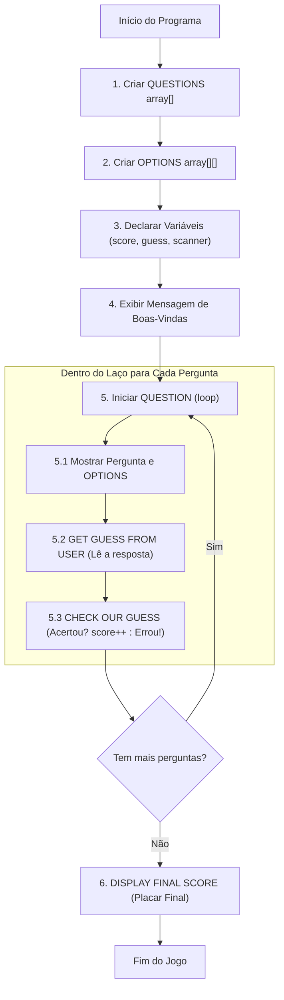

# ☕ Curso de Java — Capítulo 36: `⭐ quiz game 💯` (Parte 1)
## O Início do Grande Projeto Prático: O Esqueleto Arquitetural (*Blueprint*), Pseudocódigo e a Estrutura do Jogo de Perguntas e Respostas

> **Baseado na aula do canal Bro Code (Minuto `5:44:39` a `5:45:43` de 12:00:00)**  
> **Tema:** O professor inicia o **Capítulo 36**, um dos pontos altos do curso: a criação completa de um **Jogo de Quiz em Java** (*Java Quiz Game*). Antes de escrever uma única linha de código executável, o professor ensina a técnica mais valiosa da engenharia de software profissional: **planejar toda a arquitetura do programa usando comentários estruturados (pseudocódigo / esqueleto)**. Ele seleciona todas as etapas em azul para demonstrar o fluxo lógico completo do jogo!

---

## 📌 Sumário
1. [Contexto Visual Minucioso das Duas Telas (Para o Google Docs)](#1-contexto-visual-minucioso-das-duas-telas-para-o-google-docs)
2. [O que é o Projeto "Quiz Game" e Por que Ele é Tão Importante?](#2-o-que-é-o-projeto-quiz-game-e-por-que-ele-é-tão-importante)
3. [A Técnica dos Mestres: Por que Escrever Comentários ANTES do Código?](#3-a-técnica-dos-mestres-por-que-escrever-comentários-antes-do-código)
4. [A Anatomia do Esqueleto: Decodificando as 6 Grandes Etapas do Jogo](#4-a-anatomia-do-esqueleto-decodificando-as-6-grandes-etapas-do-jogo)
5. [O Código Java Completo, Numerado e Definitivo](#5-o-código-java-completo-numerado-e-definitivo)
6. [Explicação Cirúrgica Linha por Linha](#6-explicação-cirúrgica-linha-por-linha)
7. [Por que as Linhas 13, 14 e 15 Estão Recuadas (Indentadas)?](#7-por-que-as-linhas-13-14-e-15-estão-recuadas-indentadas)
8. [O que Sai no Console Neste Momento? (E Por Quê?)](#8-o-que-sai-no-console-neste-momento-e-por-quê)
9. [Mapa Visual do Fluxo do Jogo (Diagrama de Arquitetura)](#9-mapa-visual-do-fluxo-do-jogo-diagrama-de-arquitetura)
10. [Resumo Prático em Uma Tabela Mental](#10-resumo-prático-em-uma-tabela-mental)

---

## 1. Contexto Visual Minucioso das Duas Telas (Para o Google Docs)

Para você que vai copiar este estudo diretamente para o seu **Google Docs**, aqui está o relatório visual minucioso de tudo o que está visível na tela da IDE IntelliJ IDEA em ambas as imagens enviadas:

### 📸 Imagem 1 (`media_1791243453366.png` — Minuto `5:44:39`): A "Lousa Limpa"
* **Na barra de status do vídeo:** Marcador de tempo em `5:44:39 / 12:00:00`. O título do capítulo no YouTube avança para: `36. quiz game >`.
* **No editor de código (`Main.java`):**
  * O professor apagou todo o código anterior da matriz telefônica (`char[][] telephone`).
  * A estrutura básica da classe `Main` e do método `main` está vazia.
  * Na linha 6, ele escreve o título do projeto em caixa alta: `// JAVA QUIZ GAME`.
  * Na linha 7 há uma linha em branco com o ícone de lâmpada amarela da IDE.
  * O cursor de texto pisca sozinho na linha 8, pronto para começar a escrever o plano do jogo.

---

### 📸 Imagem 2 (`media_1791243461578.png` — Minuto `5:45:43`): O Esqueleto Completo Selecionado
* **Na barra de status do vídeo:** Marcador em `5:45:43 / 12:00:00`. Há um ícone semitransparente na tela ` < - 5 ` (mostrando que o vídeo foi retrocedido 5 segundos).
* **No editor de código (`Main.java`):**
  * O professor digitou todo o roteiro do programa, do início ao fim, em forma de comentários `//`.
  * **O Destaque Azul:** As linhas **8 a 16 estão completamente selecionadas em azul**, porque o professor arrastou o mouse sobre elas para destacar o plano geral para os alunos antes de começar a codificar cada pedaço!
  * O cursor de texto está parado no final da linha 16: `// DISPLAY FINAL SCORE|`.
  * As linhas 13, 14 e 15 possuem um espaço extra à esquerda (indentação intencional) para mostrar que farão parte do miolo de um laço de repetição.

---

## 2. O que é o Projeto "Quiz Game" e Por que Ele é Tão Importante?

Este projeto é o que chamamos na ciência da computação de **Projeto Integrador** (*Capstone Project*). Ele não foi colocado aqui por acaso: ele serve para juntar, em um único programa funcional e divertido, **tudo o que você aprendeu nos últimos 35 capítulos**:

1. **Variáveis e Tipos Primitivos:** Guardar a pontuação (`int score`) e a resposta do usuário (`char guess`).
2. **Arrays Unidimensionais (1D):** Guardar as perguntas em texto (`String[] questions`) e as respostas certas (`char[] answers`).
3. **Arrays Bidimensionais (2D / Matrizes):** Guardar as opções de múltipla escolha (`String[][] options`). Foi exatamente isso que você acabou de dominar no Capítulo 35!
4. **Entrada de Dados com `Scanner`:** Permitir que o jogador digite sua resposta no teclado (`A`, `B`, `C` ou `D`).
5. **Estruturas Condicionais (`if / else`):** Verificar se o jogador acertou ou errou a pergunta.
6. **Laços de Repetição (`for`):** Percorrer as perguntas uma por uma, sem precisar repetir código!
7. **Formatação de Saída:** Exibir cabeçalhos, opções organizadas e o placar final com porcentagem.

---

## 3. A Técnica dos Mestres: Por que Escrever Comentários ANTES do Código?

Imagine que você vai construir uma casa de dois andares com piscina. Você compraria os tijolos e começaria a assentar cimento na terra sem nenhum desenho? **Claro que não!** Primeiro você desenha a **planta baixa** no papel.

Na programação profissional é exatamente igual:
* Se um iniciante tenta escrever um jogo de quiz diretamente em Java sem planejar, ele se perde em 2 minutos: esquece de criar variáveis, não sabe onde fechar as chaves `}`, confunde os laços e o código vira um "espaguete" cheio de erros vermelhos.
* O professor Bro Code ensina a técnica do **Esqueleto Arquitetural (Pseudocódigo)**:
  1. Você escreve em português (ou inglês) o que o programa deve fazer em cada etapa, usando comentários `//`.
  2. O compilador do Java ignora os comentários, então o código não quebra.
  3. Depois, basta você ir embaixo de cada comentário e escrever apenas 2 ou 3 linhas de código Java para cumprir aquela meta!
  4. O que parecia um monstro assustador se transforma em 6 passos simples e fáceis!

---

## 4. A Anatomia do Esqueleto: Decodificando as 6 Grandes Etapas do Jogo

Vamos olhar de perto o que cada um dos 9 comentários selecionados em azul significa para a construção do jogo:

```java
// QUESTIONS array[]
// OPTIONS array[][]
// DECLARE VARIABLES
// WELCOME MESSAGE
// QUESTION (loop)
//      OPTIONS
//      GET GUESS FROM USER
//      CHECK OUR GUESS
// DISPLAY FINAL SCORE
```

### 1. `// QUESTIONS array[]` (Array de Perguntas)
* **O que será feito aqui:** Criaremos uma lista unidimensional de textos (`String[] questions`) para guardar as perguntas do quiz.
* **Exemplo real:**
  * Pergunta 0: *"Qual é o ano de criação do Java?"*
  * Pergunta 1: *"Qual empresa comprou a Sun Microsystems?"*
  * Pergunta 2: *"Qual é o tipo de dado para números inteiros?"*

---

### 2. `// OPTIONS array[][]` (Matriz 2D de Opções)
* **O que será feito aqui:** Aqui entra o **Capítulo 35 na veia**! Criaremos uma matriz bidimensional de textos (`String[][] options`).
* **Como funciona a relação:**
  * Para a Pergunta 0 $\rightarrow$ A Linha 0 da matriz terá 4 opções: `{"A. 1989", "B. 1995", "C. 2000", "D. 2010"}`.
  * Para a Pergunta 1 $\rightarrow$ A Linha 1 da matriz terá 4 opções: `{"A. Google", "B. Microsoft", "C. Oracle", "D. Apple"}`.
* Cada linha da matriz representa as opções daquela pergunta específica!

---

### 3. `// DECLARE VARIABLES` (Declaração de Variáveis de Controle)
* **O que será feito aqui:** Antes do jogo começar, precisamos preparar os "baldes" que guardarão as informações da partida:
  * `Scanner scanner`: A ferramenta que escuta o teclado.
  * `int score = 0`: O placar que começa zerado.
  * `char guess`: A letra que o jogador vai digitar ('A', 'B', 'C' ou 'D').
  * Um array com as respostas corretas (o gabarito oficial da prova): `char[] answers = {'B', 'C', ...}`.

---

### 4. `// WELCOME MESSAGE` (Mensagem de Boas-Vindas)
* **O que será feito aqui:** Um cabeçalho bonito no console para dar um ar profissional ao jogo:
  ```text
  ********************************
  Welcome to the Java Quiz Game!
  ********************************
  ```

---

### 5. `// QUESTION (loop)` (O Laço Principal do Jogo)
* **O que será feito aqui:** Um laço `for` que vai rodar pergunta por pergunta. Se tivermos 4 perguntas, ele repetirá 4 vezes.
* **Dentro do laço (os 3 passos indentados):**
  * `//      OPTIONS`: Exibe as 4 opções correspondentes à pergunta atual na tela.
  * `//      GET GUESS FROM USER`: Imprime `"Enter your guess (A, B, C, D): "` e lê a letra digitada pelo jogador.
  * `//      CHECK OUR GUESS`: Compara a letra que o jogador digitou com o gabarito oficial.
    * Se for igual: Exibe `"CORRECT!"` e soma ponto (`score++`).
    * Se for diferente: Exibe `"WRONG!"` e mostra qual era a certa.

---

### 6. `// DISPLAY FINAL SCORE` (Exibição do Placar Final)
* **O que será feito aqui:** O laço acabou, todas as perguntas foram respondidas.
* O jogo encerra exibindo a pontuação final (ex.: *"Você acertou 3 de 4 perguntas!"*) e a porcentagem de acertos.

---

## 5. O Código Java Completo, Numerado e Definitivo

Abaixo está o arquivo `Main.java` integral, exatamente como configurado na Imagem 2 do vídeo:

```java
1: 
2: public class Main {
3: 
4:     public static void main(String[] args) {
5: 
6:         // JAVA QUIZ GAME
7: 
8:         // QUESTIONS array[]
9:         // OPTIONS array[][]
10:        // DECLARE VARIABLES
11:        // WELCOME MESSAGE
12:        // QUESTION (loop)
13:        //      OPTIONS
14:        //      GET GUESS FROM USER
15:        //      CHECK OUR GUESS
16:        // DISPLAY FINAL SCORE
17:     }
18: }
```

---

## 6. Explicação Cirúrgica Linha por Linha

---

### Linhas 1 a 5: A Casca Fundamental do Programa
```java
1: 
2: public class Main {
3: 
4:     public static void main(String[] args) {
5: 
```
* **Linha 1:** Linha vazia inicial.
* **Linha 2:** Declara a classe principal `public class Main`. Lembre-se: em Java, todo o código precisa morar dentro de uma classe.
* **Linha 3:** Linha em branco para clareza visual.
* **Linha 4:** O método `public static void main(String[] args)`. É o motor de arranque do programa. A JVM procura essa linha exata para dar a partida.
* **Linha 5:** Linha em branco.
* **O que acontece na memória:** A JVM aloca o quadro de pilha (*Stack Frame*) do método `main`.
* **Saída no console:** Absolutamente nada.

---

### Linhas 6 e 7: O Título do Projeto
```java
6:         // JAVA QUIZ GAME
7: 
```
* **Linha 6:** Comentário de linha única (`//`). Indica o nome do projeto: *Java Quiz Game* (Jogo de Perguntas e Respostas em Java).
* **Linha 7:** Linha em branco com o ícone de lâmpada da IDE (sugestão contextual).
* **Saída no console:** Nenhuma.

---

### Linha 8: O Comentário do Array de Perguntas
```java
8:         // QUESTIONS array[]
```
* **O que significa:** Planejamento do array 1D que conterá os enunciados de cada pergunta.
* **Por que tem `array[]` com colchetes simples?** Para lembrar ao programador que aqui usaremos um array unidimensional simples (`String[]`).
* **Saída no console:** Nenhuma.

---

### Linha 9: O Comentário da Matriz de Opções
```java
9:         // OPTIONS array[][]
```
* **O que significa:** Planejamento da matriz 2D que conterá as 4 alternativas de múltipla escolha para cada pergunta.
* **Por que tem `array[][]` com colchetes duplos?** Para lembrar ao programador que aqui usaremos uma matriz bidimensional (`String[][]`), onde a Linha representa a Pergunta e a Coluna representa a Alternativa (A, B, C, D).
* **Saída no console:** Nenhuma.

---

### Linha 10: O Comentário das Variáveis de Controle
```java
10:        // DECLARE VARIABLES
```
* **O que significa:** O local onde serão criadas as variáveis de apoio: o placar (`score`), o leitor de teclado (`Scanner`) e a resposta dada pelo jogador (`guess`).
* **Saída no console:** Nenhuma.

---

### Linha 11: O Comentário da Mensagem de Boas-Vindas
```java
11:        // WELCOME MESSAGE
```
* **O que significa:** O local onde usaremos `System.out.println()` para dar as boas-vindas ao jogador antes da primeira pergunta aparecer.
* **Saída no console:** Nenhuma.

---

### Linha 12: O Comentário do Laço de Repetição das Perguntas
```java
12:        // QUESTION (loop)
```
* **O que significa:** O laço de repetição (provavelmente um `for (int i = 0; ...)`) que fará o jogo avançar pergunta por pergunta até o final.
* **Saída no console:** Nenhuma.

---

### Linhas 13, 14 e 15: As Três Ações Internas do Laço (Com Indentação)
```java
13:        //      OPTIONS
14:        //      GET GUESS FROM USER
15:        //      CHECK OUR GUESS
```
* **O que significa:**
  * **Linha 13:** Exibir as opções da pergunta atual.
  * **Linha 14:** Pedir e capturar o chute do jogador pelo teclado.
  * **Linha 15:** Conferir se o chute bate com a resposta correta e pontuar.
* **Por que estão recuadas com espaços à esquerda?** Porque na cabeça do programador, essas 3 tarefas acontecem **DENTRO** do laço `QUESTION (loop)`! A indentação visual serve como guia arquitetural.
* **Saída no console:** Nenhuma.

---

### Linha 16: O Comentário do Placar Final
```java
16:        // DISPLAY FINAL SCORE
```
* **O que significa:** A etapa final do programa, que é executada **depois que o laço termina**. Mostra o total de acertos e porcentagem.
* **Saída no console:** Nenhuma.

---

### Linhas 17 e 18: Fechamento das Chaves
```java
17:     }
18: }
```
* **Linha 17:** Fecha o corpo do método `main`.
* **Linha 18:** Fecha o corpo da classe `Main`.
* **Saída no console:** Nenhuma.

---

## 7. Por que as Linhas 13, 14 e 15 Estão Recuadas (Indentadas)?

Repare com atenção na diferença de posicionamento:

```text
Linha 12: // QUESTION (loop)
Linha 13: //      OPTIONS
Linha 14: //      GET GUESS FROM USER
Linha 15: //      CHECK OUR GUESS
Linha 16: // DISPLAY FINAL SCORE
```

* As linhas 8, 9, 10, 11, 12 e 16 começam na mesma coluna vertical.
* As linhas 13, 14 e 15 estão "empurradas" 6 espaços para a direita.
* **O Motivo:** Hierarquia lógica!
  * O `QUESTION (loop)` é o "Pai".
  * `OPTIONS`, `GET GUESS FROM USER` e `CHECK OUR GUESS` são os "Filhos" que vivem dentro dele. A cada pergunta nova, o computador deve:
    1. Mostrar as opções daquela pergunta;
    2. Esperar o chute do usuário;
    3. Conferir o acerto.
  * O `DISPLAY FINAL SCORE` não está recuado porque ele só acontece **uma única vez**, lá no final, quando o laço já acabou!

---

## 8. O que Sai no Console Neste Momento? (E Por Quê?)

Se você clicar no botão verde de Play (▶️) da IDE para rodar esse código exatamente como está na tela, o que vai aparecer no console?

```text
Process finished with exit code 0
```

### O Console Fica 100% Vazio! Por quê?
Porque **todas as linhas de instrução (6 a 16) começam com duas barras inclinadas `//`**.
* No mundo Java, `//` significa: *"Atenção compilador, finja que esta linha não existe! Isso aqui é só uma anotação de um ser humano para outro ser humano."*
* Como não há nenhuma instrução executável dentro do método `main`, o programa simplesmente inicia, não faz nada e encerra com código `0` (sucesso).

---

## 9. Mapa Visual do Fluxo do Jogo (Diagrama de Arquitetura)

Veja no diagrama abaixo como as 6 etapas planejadas pelo professor se conectam no fluxo do jogo:



---

## 10. Resumo Prático em Uma Tabela Mental

| Linha no Código | Comentário do Blueprint | O que Faremos em Java Aqui? | Ferramenta Utilizada |
| :---: | :--- | :--- | :---: |
| **8** | `// QUESTIONS array[]` | Guardar a lista de perguntas em texto. | `String[]` (Array 1D) |
| **9** | `// OPTIONS array[][]` | Guardar as 4 alternativas de cada pergunta. | `String[][]` (Matriz 2D) |
| **10** | `// DECLARE VARIABLES` | Criar o placar, a resposta do jogador e o gabarito. | `int`, `char`, `Scanner` |
| **11** | `// WELCOME MESSAGE` | Mostrar o título estilizado na tela. | `System.out.println()` |
| **12** | `// QUESTION (loop)` | Repetir o ciclo para cada pergunta da prova. | `for (int i = 0; ...)` |
| **13** | `//      OPTIONS` | Mostrar as opções A, B, C, D da pergunta atual. | Laço ou `println()` |
| **14** | `//      GET GUESS FROM USER` | Ler a letra digitada pelo usuário no teclado. | `scanner.next().charAt(0)` |
| **15** | `//      CHECK OUR GUESS` | Testar se a letra é igual ao gabarito. | `if (guess == answers[i])` |
| **16** | `// DISPLAY FINAL SCORE` | Mostrar a nota final e fechar o scanner. | `System.out.println()` e `.close()` |
