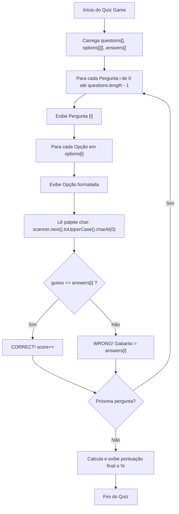

# 💯 Capítulo 36: Java Quiz Game (Jogo de Perguntas e Respostas Integrador)

> **Módulo Pedagógico:** Trilha de Fundamentos em Java e Arquitetura de Software  
> **Referência:** Bro Code — *Java Full Course for free* (Capítulo 36)

---

## 🧭 Visão Geral

O **Java Quiz Game** é o grande **Projeto Integrador (*Capstone Project*)** de toda a primeira metade do curso. Ele unifica, em uma arquitetura limpa e funcional, os seguintes conceitos:
- **Planejamento Arquitetural (*Blueprint / Pseudocódigo*)** antes de escrever código executável
- Vetores unidimensionais para banco de perguntas (`String[] questions`) e gabarito oficial (`char[] answers`)
- Matrizes bidimensionais para as alternativas de múltipla escolha (`String[][] options`)
- Entrada de dados com `Scanner` e tratamento de caracteres maiúsculos via `Character.toUpperCase(scanner.next().charAt(0))`
- Laços aninhados (*Nested Loops*): laço externo para iterar as perguntas e laço interno para exibir as opções
- Verificação condicional de acerto (`guess == answers[i]`), somatório de pontuação e cálculo percentual final

---

## 🗂️ Estrutura de Aulas e Documentos

| Arquivo | Título / Tema Principal |
| :--- | :--- |
| [01_planejamento_esqueleto.md](file:///c:/Users/mickel%201/Downloads/JAVA%20APRENDER/docs/curriculum/capitulo_36_quiz_game/01_planejamento_esqueleto.md) | A técnica profissional de planejamento com comentários e esqueleto do jogo. |
| [02_dados_e_variaveis.md](file:///c:/Users/mickel%201/Downloads/JAVA%20APRENDER/docs/curriculum/capitulo_36_quiz_game/02_dados_e_variaveis.md) | Modelagem de perguntas, gabarito e alternativas de múltipla escolha em matriz 2D. |
| [03_boas_vindas_e_scanner_close.md](file:///c:/Users/mickel%201/Downloads/JAVA%20APRENDER/docs/curriculum/capitulo_36_quiz_game/03_boas_vindas_e_scanner_close.md) | Mensagem de boas-vindas e gerenciamento do ciclo de vida de recursos de entrada. |
| [04_laco_perguntas.md](file:///c:/Users/mickel%201/Downloads/JAVA%20APRENDER/docs/curriculum/capitulo_36_quiz_game/04_laco_perguntas.md) | O laço externo de iteração pelas questões do exame. |
| [05_laco_aninhado_opcoes.md](file:///c:/Users/mickel%201/Downloads/JAVA%20APRENDER/docs/curriculum/capitulo_36_quiz_game/05_laco_aninhado_opcoes.md) | O laço interno para renderizar as opções `A`, `B`, `C` e `D` de cada pergunta. |
| [06_interacao_usuario_e_validacao.md](file:///c:/Users/mickel%201/Downloads/JAVA%20APRENDER/docs/curriculum/capitulo_36_quiz_game/06_interacao_usuario_e_validacao.md) | Captura do palpite do usuário, sanitização com `toUpperCase()` e comparação com o gabarito. |
| [07_pontuacao_e_placar_final.md](file:///c:/Users/mickel%201/Downloads/JAVA%20APRENDER/docs/curriculum/capitulo_36_quiz_game/07_pontuacao_e_placar_final.md) | Exibição do placar final, cálculo percentual e encerramento com chave de ouro. |
| [README.md](file:///c:/Users/mickel%201/Downloads/JAVA%20APRENDER/docs/curriculum/capitulo_36_quiz_game/README.md) | Sumário executivo e guia do projeto integrador. |

---

## 🏛️ Fluxo Arquitetural do Quiz Game

---

## 💻 Código-Fonte e Testes no Projeto
- Motor de Avaliação e Regras de Negócio: [`QuizGameEngine.java`](file:///c:/Users/mickel%201/Downloads/JAVA%20APRENDER/src/main/java/com/mickaelgeronimo/mastery/core/games/QuizGameEngine.java)
- CLI Interativa de Jogo: [`QuizGameCLI.java`](file:///c:/Users/mickel%201/Downloads/JAVA%20APRENDER/src/main/java/com/mickaelgeronimo/mastery/core/games/QuizGameCLI.java)
- Suíte de Testes Automatizados: [`QuizGameTest.java`](file:///c:/Users/mickel%201/Downloads/JAVA%20APRENDER/src/test/java/com/mickaelgeronimo/mastery/core/QuizGameTest.java)
