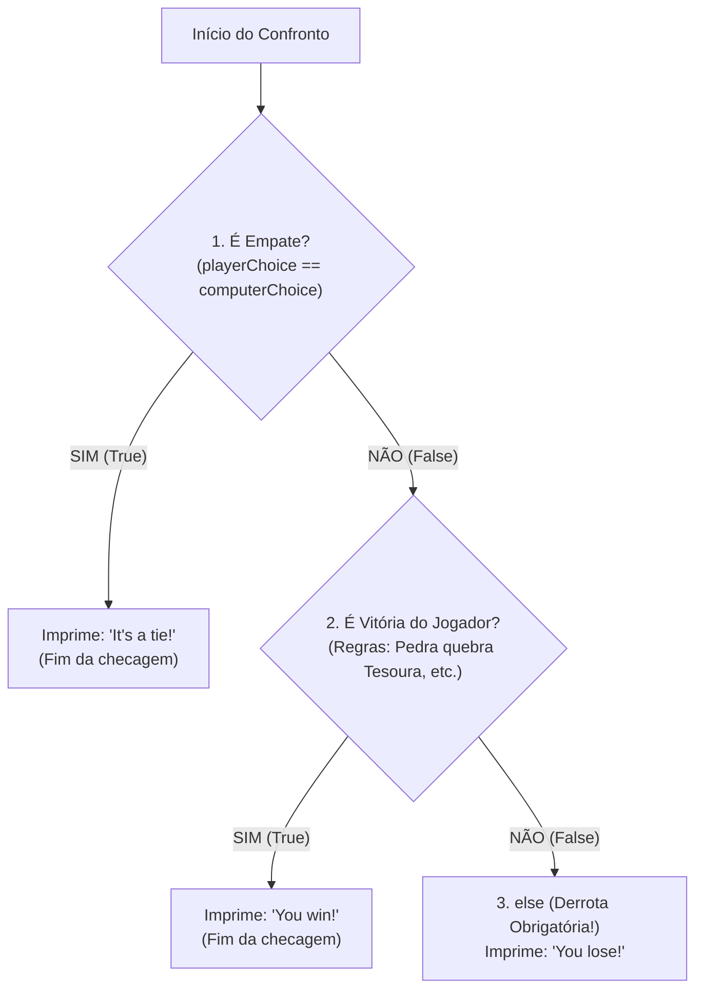

# ☕ Curso de Java — Capítulo 37: `⭐ rock paper scissors 🗿` (Parte 5)
## O Andaime do Juiz: A Estruturação do `if - else if - else`, os 3 Desfechos do Jogo e o Mistério dos Parênteses Vermelhos Vazios `()`

> **Baseado na aula do canal Bro Code (Minuto `6:07:52` de 12:00:00)**  
> **Tema:** O professor inicia a implementação do bloco `// CHECK WIN CONDITIONS`. Em vez de tentar escrever de cabeça condições gigantes e confusas cheias de operadores lógicos, ele ensina a técnica profissional do **Andaime Sintático (*Scaffolding*)**: primeiro monta a estrutura dos três caminhos de desfecho do jogo (`It's a tie!`, `You win!` e `You lose!`) deixando os parênteses vazios temporariamente. Ele explica por que o IntelliJ avisa erros vermelhos nesse momento e prepara o terreno para preencher a lógica!

---

## 📌 Sumário
1. [Contexto Visual Minucioso da Tela (Para o Google Docs)](#1-contexto-visual-minucioso-da-tela-para-o-google-docs)
2. [O que o Professor Adicionou e Explicou Neste Momento](#2-o-que-o-professor-adicionou-e-explicou-neste-momento)
3. [A Técnica do Andaime (*Scaffolding*): Pensar no Destino Antes do Caminho](#3-a-técnica-do-andaime-scaffolding-pensar-no-destino-antes-do-caminho)
4. [Por que Existem Linhas Vermelhas Dentro dos Parênteses `if()` e `else if()`?](#4-por-que-existem-linhas-vermelhas-dentro-dos-parênteses-if-e-else-if)
5. [A Estrutura dos 3 Caminhos Mutuamente Exclusivos](#5-a-estrutura-dos-3-caminhos-mutuamente-exclusivos)
6. [O Código Java Completo, Numerado e Definitivo](#6-o-código-java-completo-numerado-e-definitivo)
7. [Explicação Cirúrgica Linha por Linha](#7-explicação-cirúrgica-linha-por-linha)
8. [O que Acontece se Você Tentar Executar o Código Agora? (Erro de Compilação)](#8-o-que-acontece-se-você-tentar-executar-o-código-agora-erro-de-compilação)
9. [O que o Professor Vai Preencher no Próximo Segundo do Vídeo](#9-o-que-o-professor-vai-preencher-no-próximo-segundo-do-vídeo)
10. [Resumo Prático em Uma Tabela Mental](#10-resumo-prático-em-uma-tabela-mental)

---

## 1. Contexto Visual Minucioso da Tela (Para o Google Docs)

Para você que vai copiar este estudo diretamente para o seu **Google Docs**, aqui está o relatório visual minucioso de tudo o que está visível na tela da IDE IntelliJ IDEA no print enviado (`media_1791244866844.png` — minuto `6:07:52`):

* **Barra de status do vídeo:** `6:07:52 / 12:00:00` | Capítulo: `37. rock paper scissors >`.
* **No editor de código (`Main.java`):**
  * Abaixo da linha 27 (`System.out.println("Computer choice: " + computerChoice);`), o comentário `// CHECK WIN CONDITIONS` foi substituído pelo esqueleto da estrutura condicional:
    * **Linha 29:** `if(){` $\rightarrow$ há uma cobrinha ondulada **vermelha** sob os parênteses `()`.
    * **Linha 30:** `    System.out.println("It's a tie!");`
    * **Linha 31:** `}`
    * **Linha 32:** `else if(){` $\rightarrow$ há outra cobrinha ondulada **vermelha** sob os parênteses `()`.
    * **Linha 33:** `    System.out.println("You win!");`
    * **Linha 34:** `}`
    * **Linha 35:** `else{`
    * **Linha 36:** `    System.out.println();` $\rightarrow$ o cursor de texto pisca exatamente dentro dos parênteses vazios `()`.
    * **Linha 37:** `}`
  * Abaixo da linha 37, continuam os comentários:
    * Linha 39: `// ASK TO PLAY AGAIN?`
    * Linha 40: `// GOODBYE MESSAGE`
* **No canto superior direito da IDE:**
  * Há um indicador de inspeção exibindo um ícone vermelho com o número **`2`** e um ícone amarelo com o número **`2`**, avisando que o arquivo contém **2 erros de compilação ativos** (os dois parênteses vazios!).

---

## 2. O que o Professor Adicionou e Explicou Neste Momento

Nesta tela, o professor faz uma demonstração de **como um programador experiente pensa**:
* Se você tentar escrever a regra completa de vitória do Pedra, Papel e Tesoura logo de primeira:
  `((player.equals("rock") && computer.equals("scissors")) || ...)`
  Você gasta uma energia mental enorme, erra chaves, confunde parênteses e fica estressado.
* O professor ensina a fazer o **"Esqueleto da Decisão"**:
  1. Primeiro, ele escreve os três destinos possíveis:
     * Caminho 1: Empate (`"It's a tie!"`)
     * Caminho 2: Vitória (`"You win!"`)
     * Caminho 3: Derrota (ele está digitando `"You lose!"` na linha 36!)
  2. Ele deixa os parênteses de teste `()` vazios por alguns segundos.
  3. Depois que a estrutura visual está pronta e bonita, ele volta e preenche as condições com calma!

---

## 3. A Técnica do Andaime (*Scaffolding*): Pensar no Destino Antes do Caminho

Pense na construção de uma ponte:
* Você não joga o concreto no rio e torce para virar uma ponte.
* Primeiro, os engenheiros montam o **andaime de madeira e ferro**.
* O andaime serve de molde e suporte.
* Depois que o molde está firme, você preenche com o cimento!

Na programação, escrever:
```java
if () {
    // Destino 1
}
else if () {
    // Destino 2
}
else {
    // Destino 3
}
```
é exatamente o andaime! Você define para onde o programa vai antes mesmo de escrever as fórmulas lógicas.

---

## 4. Por que Existem Linhas Vermelhas Dentro dos Parênteses `if()` e `else if()`?

Na imagem, você vê claramente as cobrinhas vermelhas em `if()` e `else if()`, e o contador `2` erros no topo da IDE.

### A Regra Gramatical Sagrada do Java:
* Em Java, o comando `if` **exige obrigatoriamente uma expressão booleana** dentro dos parênteses.
* Uma expressão booleana é algo que resulta em `true` ou `false` (ex.: `x > 10`, `idade >= 18`, `nome.equals("Ana")`).
* Deixar os parênteses completamente vazios `if ()` é uma **falha de sintaxe grave**!
* O compilador do Java olha para os parênteses vazios e grita:  
  🔴 **`error: expression expected`** *(Tradução: "Eu estava esperando uma expressão aqui dentro e não encontrei nada!")*.
* O professor sabe perfeitamente disso! Ele deixou vazio apenas por 10 segundos enquanto digitava a estrutura básica, e vai preenchê-los na tela seguinte.

---

## 5. A Estrutura dos 3 Caminhos Mutuamente Exclusivos

Por que usamos `if`, `else if` e `else` encadeados, e não três `if` separados?



### A Vantagem do Encadeamento:
* Os três resultados são **mutuamente exclusivos** (é impossível você empatar e ganhar na mesma rodada!).
* Se a primeira condição for verdadeira (deu empate), o Java **ignora completamente** o `else if` e o `else`, economizando processamento e evitando bugs bizarros!

---

## 6. O Código Java Completo, Numerado e Definitivo

Abaixo está o arquivo `Main.java` integral, exatamente como se encontra na tela do professor:

```java
1:  import java.util.Random;
2:  import java.util.Scanner;
3:  
4:  public class Main {
5:      public static void main(String[] args){
6:  
7:          // ROCK PAPER SCISSORS GAME
8:  
9:          Scanner scanner = new Scanner(System.in);
10:         Random random = new Random();
11: 
12:         String[] choices = {"rock", "paper", "scissors"};
13:         String playerChoice;
14:         String computerChoice;
15:         String playAgain = "yes";
16: 
17:         System.out.print("Enter your move (rock, paper, scissors): ");
18:         playerChoice = scanner.nextLine().toLowerCase();
19: 
20:         if(!playerChoice.equals("rock") &&
21:            !playerChoice.equals("paper") &&
22:            !playerChoice.equals("scissors")){
23:             System.out.println("Invalid choice");
24:         }
25: 
26:         computerChoice = choices[random.nextInt(3)];
27:         System.out.println("Computer choice: " + computerChoice);
28: 
29:         if(){
30:             System.out.println("It's a tie!");
31:         }
32:         else if(){
33:             System.out.println("You win!");
34:         }
35:         else{
36:             System.out.println();
37:         }
38: 
39:         // ASK TO PLAY AGAIN?
40:         // GOODBYE MESSAGE
41: 
42:         scanner.close();
43:     }
44: }
```

---

## 7. Explicação Cirúrgica Linha por Linha

---

### Linhas 29 a 31: O Rascunho do Empate
```java
29:         if(){
30:             System.out.println("It's a tie!");
31:         }
```
* **Linha 29:** O início do teste. A condição ainda não foi digitada (por isso o sublinhado vermelho).
* **Linha 30:** O prêmio desse bloco: se a condição for verdadeira, avisa no console: *"It's a tie!"* *(É um empate!)*.
* **Linha 31:** Fecha o bloco do `if`.

---

### Linhas 32 a 34: O Rascunho da Vitória do Jogador
```java
32:         else if(){
33:             System.out.println("You win!");
34:         }
```
* **Linha 32:** Caso não tenha sido empate, o Java vem testar se o humano venceu a máquina. Também está esperando a condição ser preenchida.
* **Linha 33:** O prêmio: imprime *"You win!"* *(Você venceu!)*.
* **Linha 34:** Fecha o bloco do `else if`.

---

### Linhas 35 a 37: O Rascunho da Derrota
```java
35:         else{
36:             System.out.println();
37:         }
```
* **Linha 35:** O `else` final (*"Senão"*). Se não foi empate e não foi vitória do jogador, só sobrou uma possibilidade no universo: o computador venceu!
* **Linha 36:** O cursor pisca dentro dos parênteses. O professor está prestes a digitar `"You lose!"` aqui dentro!
* **Linha 37:** Fecha o bloco do `else`.

---

## 8. O que Acontece se Você Tentar Executar o Código Agora? (Erro de Compilação)

Se neste exato segundo você clicar no botão verde de Run (▶️), o programa **NÃO VAI RODAR**!

O compilador do Java interrompe o processo imediatamente e cospe no console o seguinte erro em vermelho:

```text
java: expression expected
    if(){
       ^
java: expression expected
    else if(){
            ^
2 errors
```

### O que Isso Significa?
* O compilador encontrou parênteses vazios onde era obrigatório ter uma pergunta lógica.
* O Java só roda programas que possuem sintaxe 100% perfeita.
* Por isso o professor não clica em Run agora: ele primeiro terminará de preencher o código!

---

## 9. O que o Professor Vai Preencher no Próximo Segundo do Vídeo

Para matar a sua curiosidade, veja o que entrará dentro de cada parêntese vazio:

1. **Na Linha 29 (O Empate):**  
   Entrará: `playerChoice.equals(computerChoice)`  
   *(Se o texto que você escolheu for igual ao que a máquina escolheu!)*
2. **Na Linha 32 (A Vitória do Humano):**  
   Entrarão as 3 combinações vitoriosas conectadas com `||` (OU):  
   `(playerChoice.equals("rock") && computerChoice.equals("scissors")) ||`  
   `(playerChoice.equals("paper") && computerChoice.equals("rock")) ||`  
   `(playerChoice.equals("scissors") && computerChoice.equals("paper"))`
3. **Na Linha 36 (A Derrota):**  
   Entrará a frase: `"You lose!"`.

---

## 10. Resumo Prático em Uma Tabela Mental

| Bloco Condicional | Mensagem Associada | Qual Condição Será Colocada? | Status na Imagem |
| :---: | :--- | :--- | :---: |
| **`if()`** | `"It's a tie!"` | `playerChoice.equals(computerChoice)` | 🔴 Vermelho (Vazio) |
| **`else if()`** | `"You win!"` | As 3 combinações de vitória do humano | 🔴 Vermelho (Vazio) |
| **`else`** | *(Em digitação)* | Nenhuma (É a sobra automática de derrota) | ✍️ Cursor no `println()` |
| **Aviso `2 2`** | Topo da IDE | Avisa que faltam as expressões booleanas | Ajuda da IDE |
