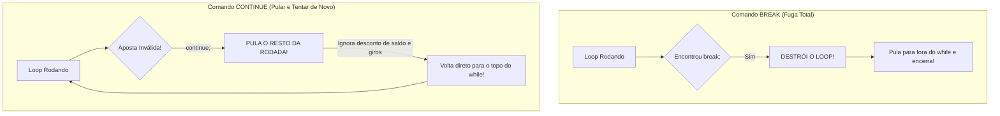

# ☕ Curso de Java — Capítulo 38: `⭐ slot machine 🎰` (Parte 2)
## O Coração Financeiro do Cassino: O Loop `while(balance > 0)`, a Proteção contra Trapaças, o Comando Mágico `continue` e o Operador `-=`!

> **Baseado na aula do canal Bro Code (Minuto `6:21:41` a `6:22:15` de 12:00:00)**  
> **Tema:** O professor programa o motor de apostas e segurança do cassino! Ele cria o loop principal `while(balance > 0)` para que o jogo continue enquanto o jogador tiver dinheiro, lê o valor da aposta com `scanner.nextInt()`, implementa duas barreiras defensivas rigorosas (saldo insuficiente e aposta menor ou igual a zero), introduz a poderosa palavra-chave `continue` para reiniciar a rodada imediatamente sem travar o jogo, desconta a aposta com o operador composto `balance -= bet` e faz um teste de sanidade imprimindo o saldo restante!

---

## 📌 Sumário
1. [Contexto Visual Minucioso das 3 Imagens (Para o Google Docs)](#1-contexto-visual-minucioso-das-3-imagens-para-o-google-docs)
2. [O que o Professor Construiu e Explicou Nesta Etapa](#2-o-que-o-professor-construiu-e-explicou-nesta-etapa)
3. [O Grande Segredo do Comando `continue` (Diferença entre `break` e `continue`)](#3-o-grande-segredo-do-comando-continue-diferença-entre-break-e-continue)
4. [As Duas Barreiras de Segurança da Aposta](#4-as-duas-barreiras-de-segurança-da-aposta)
5. [O Operador Composto `-=` (Aritmética Elegante em Java)](#5-o-operador-composto---aritmética-elegante-em-java)
6. [O Código Java Completo, Numerado e Atualizado](#6-o-código-java-completo-numerado-e-atualizado)
7. [Explicação Linha por Linha Cirúrgica](#7-explicação-linha-por-linha-cirúrgica)
8. [Simulação de Teste de Mesa com os 3 Tipos de Aposta](#8-simulação-de-teste-de-mesa-com-os-3-tipos-de-aposta)
9. [Por Que o Professor Colocou `System.out.println("$" + balance)` Provisório?](#9-por-que-o-professor-colocou-systemoutprintln-balance-provisório)
10. [Tabela Mental Resumida e Próximos Passos](#10-tabela-mental-resumida-e-próximos-passos)

---

## 1. Contexto Visual Minucioso das 3 Imagens (Para o Google Docs)

Para você que vai copiar este estudo diretamente para o seu **Google Docs**, aqui está o relatório visual minucioso de tudo o que está visível na tela da IDE IntelliJ IDEA nas 3 imagens enviadas:

### 📸 Imagem 1 (`media_1791245290023.png` — Minuto `6:21:41`): A Construção do Loop e a Primeira Barreira
* **Barra de tempo do vídeo:** `6:21:41 / 12:00:00` | Capítulo: `38.slot machine >`.
* **No editor de código (`Main.java`):**
  * O professor substituiu o comentário `// PLAY IF BALANCE > 0` pelo comando:
    ```java
    while(balance > 0){
        System.out.println("Current balance: $" + balance);
        System.out.print("Place your bet amount: ");
        bet = scanner.nextInt();
    ```
  * Em seguida, programou o primeiro `if`:
    ```java
    if(bet > balance){
        System.out.println("INSUFFICIENT FUNDS");
        continue;
    }
    ```
  * Na linha 28 e 29, vemos o professor digitando ao vivo:
    ```java
    else if(bet <= 0){
        System.out.println("Bet must b");
    ```
  * O cursor do mouse está piscando dentro das aspas, na letra `b` de `"Bet must b"`, prestes a completar a frase.
  * Abaixo, vemos os comentários preservados do esqueleto: `// SUBTRACT BET FROM BALANCE`, `// SPIN ROW`, `// PRINT ROW`, `// GET PAYOUT`.

---

### 📸 Imagem 2 (`media_1791245313133.png`): O Fechamento das Validações e o Desconto do Saldo
* **No editor de código:**
  * O professor completou a linha 29:
    ```java
    else if(bet <= 0){
        System.out.println("Bet must be greater than 0");
        continue;
    }
    ```
  * Adicionou o bloco `else` para quando a aposta for válida:
    ```java
    else{
        balance -= bet;
    }
    ```
  * O cursor do mouse está piscando na linha 34, logo após o fechamento da chave `}` do `else`.

---

### 📸 Imagem 3 (`media_1791245321170.png`): O Teste de Sanidade Provisório e o Botão Play
* **Barra de tempo do vídeo:** A linha de reprodução avançou mais alguns segundos.
* **A Linha Adicionada (Linha 34):**
  ```java
  System.out.println("$" + balance);
  ```
* **O Efeito Visual do IntelliJ IDEA:**
  * O cursor está na palavra `balance` da linha 34.
  * O IntelliJ automaticamente iluminou com **caixas cinzas suaves** todas as aparições da palavra `balance` no arquivo:
    * Na linha 20: `("Current balance: $" + balance);`
    * Na linha 24: `if(bet > balance){`
    * Na linha 33: `balance -= bet;`
    * Na linha 34: `System.out.println("$" + balance);`
* **O Cursor no Botão Play:** No canto superior direito da tela, a setinha do mouse está pairando exatamente sobre o **ícone de Play verde** (o triângulo de Run), pronta para compilar e testar se a matemática das apostas está funcionando!

---

## 2. O que o Professor Construiu e Explicou Nesta Etapa

Neste trecho da aula, o professor constrói a **Lógica de Negócio Financeira** da máquina:

1. **A Condição de Vida do Jogo (`while(balance > 0)`):**  
   Um jogador de cassino só pode puxar a alavanca se tiver pelo menos **$1** no bolso. Se o saldo chegar a **$0** (ou ficar negativo), o loop é interrompido imediatamente e o jogador não aposta mais!
2. **Exibição do Saldo Atual:**  
   Mostra ao jogador quanto dinheiro ele ainda tem: `"Current balance: $100"`.
3. **Coleta da Aposta:**  
   Pede o valor com `System.out.print("Place your bet amount: ")` e lê como número inteiro com `bet = scanner.nextInt()`.
4. **As Barreiras de Defesa com `continue`:**  
   Bloqueia quem tenta apostar mais do que tem ou valores inválidos como zero e números negativos.
5. **A Cobrança da Aposta:**  
   Se passou nas duas defesas, desconta o valor com `balance -= bet;`.

---

## 3. O Grande Segredo do Comando `continue` (Diferença entre `break` e `continue`)

Esta é uma das perguntas mais cobradas em entrevistas de emprego e provas de Java: **qual a diferença entre `break` e `continue`?**



### Analogia para Iniciantes:
* **O `break` é o Alarme de Incêndio:** Se o alarme tocar, todo mundo evacua o prédio imediatamente. O evento acabou, fim de papo.
* **O `continue` é o "Passe a Vez no Banco Imobiliário":** Você cometeu um erro ou tirou uma carta ruim. Você não foi expulso do jogo; apenas a sua rodada atual foi cancelada e o jogo volta ao começo para você tentar de novo!

> [!TIP]
> Quando o jogador digita uma aposta absurda (como apostar $500 tendo apenas $100), nós **NÃO queremos fechar o jogo** (o que o `break` faria).  
> Nós queremos apenas dizer *"Amigão, você não tem esse dinheiro, tente outro valor!"* e voltar para o topo do `while`. É exatamente isso que o **`continue;`** faz!

---

## 4. As Duas Barreiras de Segurança da Aposta

### Barreira 1: O Jogador Caloteiro (`bet > balance`)
```java
if(bet > balance){
    System.out.println("INSUFFICIENT FUNDS");
    continue;
}
```
* **Situação:** Seu saldo é $100 e você tenta apostar $200.
* **O que acontece:** O Java detecta que `200 > 100` é `true`. Imprime em letras garrafais `"INSUFFICIENT FUNDS"` (*Fundos Insuficientes*).
* O comando `continue;` faz a CPU ignorar qualquer desconto de saldo e saltar de volta para o início do `while`, mantendo seus $100 intactos.

---

### Barreira 2: O Jogador Espertinho / Trapaceiro (`bet <= 0`)
```java
else if(bet <= 0){
    System.out.println("Bet must be greater than 0");
    continue;
}
```
* **Situação:** O jogador tenta apostar `$0` (para girar a roleta de graça) ou pior: tenta apostar `-$50`.
* **Por que valores negativos seriam uma catástrofe?**  
  Na matemática: $\text{saldo} - (-\text{aposta}) = \text{saldo} + \text{aposta}$!  
  Se o jogador apostasse `-$50`, a máquina subtrairia um número negativo e somaria $50 na conta dele de graça!
* **A Solução do Professor:** O teste `bet <= 0` bloqueia qualquer valor menor ou igual a zero, exibe `"Bet must be greater than 0"` e usa `continue;` para recomeçar.

---

## 5. O Operador Composto `-=` (Aritmética Elegante em Java)

Na linha 33, o professor escreveu:
```java
balance -= bet;
```

Para um iniciante amador, isso pode parecer estranho. Mas é apenas um atalho super comum em programação:

$$\text{balance} \ -= \ \text{bet} \quad \iff \quad \text{balance} = \text{balance} - \text{bet}$$

* **Como ler:** *"Pegue o valor atual de `balance`, subtraia o valor de `bet` e guarde o resultado de volta dentro de `balance`"*.
* **Exemplo Prático:**
  * Antes: `balance = 100`
  * Aposta: `bet = 20`
  * Execução de `balance -= bet;`: $100 - 20 = 80$.
  * Novo valor na memória Stack: `balance = 80`.

---

## 6. O Código Java Completo, Numerado e Atualizado

Aqui está o arquivo [Main.java](../../../src/main/java/com/mickaelgeronimo/mastery/core/concurrency/Main.java) com todo o código até a Imagem 3:

```java
1:  import java.util.Scanner;
2:  
3:  public class Main {
4:      public static void main(String[] args){
5:  
6:          // JAVA SLOT MACHINE
7:  
8:          // DECLARE VARIABLES
9:          Scanner scanner = new Scanner(System.in);
10:         int balance = 100;
11:         int bet;
12:         int payout;
13:         String[] row;
14: 
15:         // DISPLAY WELCOME MESSAGE
16:         System.out.println("*************************");
17:         System.out.println("  Welcome to Java Slots  ");
18:         System.out.println("Symbols: 🍒 🍉 🍋 🔔 ⭐ ");
19:         System.out.println("*************************");
20: 
21:         // PLAY IF BALANCE > 0
22:         while(balance > 0){
23:             System.out.println("Current balance: $" + balance);
24:             System.out.print("Place your bet amount: ");
25:             bet = scanner.nextInt();
26: 
27:             // VERIFY IF BET > BALANCE
28:             if(bet > balance){
29:                 System.out.println("INSUFFICIENT FUNDS");
30:                 continue;
31:             }
32:             // VERIFY IF BET > 0
33:             else if(bet <= 0){
34:                 System.out.println("Bet must be greater than 0");
35:                 continue;
36:             }
37:             // SUBTRACT BET FROM BALANCE
38:             else{
39:                 balance -= bet;
40:             }
41: 
42:             System.out.println("$" + balance);
43: 
44:             // SPIN ROW
45:             // PRINT ROW
46:             // GET PAYOUT
47:             // ASK TO PLAY AGAIN
48:         }
49: 
50:         // DISPLAY EXIT MESSAGE
51: 
52:         scanner.close();
53:     }
54: }
```

---

## 7. Explicação Linha por Linha Cirúrgica

---

### Linha 22: O Guardião do Cassino
```java
22:         while(balance > 0){
```
* **O que faz:** Avalia se o saldo do jogador é estritamente maior que zero.
* Se `balance` for `100`, o Java entra no loop. Se o saldo for `0`, o Java encerra o jogo e pula para a linha 50.

---

### Linhas 23 a 25: Exibição do Saldo e Leitura da Aposta
```java
23:             System.out.println("Current balance: $" + balance);
24:             System.out.print("Place your bet amount: ");
25:             bet = scanner.nextInt();
```
* **Linha 23:** Imprime na tela o saldo atual: `Current balance: $100`.
* **Linha 24:** Usa `print` (sem pular linha) para que o cursor do teclado fique ao lado da pergunta.
* **Linha 25:** Pausa a execução e espera o usuário digitar um número inteiro no teclado e apertar [Enter], guardando o valor em `bet`.

---

### Linhas 28 a 31: Checagem de Fundos Insuficientes
```java
28:             if(bet > balance){
29:                 System.out.println("INSUFFICIENT FUNDS");
30:                 continue;
31:             }
```
* **O que faz:** Se o valor apostado for maior do que o dinheiro que o jogador tem, imprime `"INSUFFICIENT FUNDS"` e executa `continue;`.
* O `continue;` interrompe imediatamente a rodada atual e pula de volta para a linha 22, sem descontar um centavo da conta!

---

### Linhas 33 a 36: Checagem de Apostas Menores ou Iguais a Zero
```java
33:             else if(bet <= 0){
34:                 System.out.println("Bet must be greater than 0");
35:                 continue;
36:             }
```
* **O que faz:** Se o jogador tentou apostar `0` ou um número negativo como `-50`, imprime `"Bet must be greater than 0"` e aciona o `continue;`.
* Mais uma vez, o loop reinicia com segurança.

---

### Linhas 38 a 40: A Cobrança Legítima
```java
38:             else{
39:                 balance -= bet;
40:             }
```
* **O que faz:** Se a aposta passou nos dois testes (ou seja, é um valor positivo e cabe no saldo do jogador), ela é cobrada da carteira com `balance -= bet;`.

---

### Linha 42: O Teste de Sanidade Provisório
```java
42:             System.out.println("$" + balance);
```
* **O que faz:** Imprime o novo saldo após a subtração para confirmar com os próprios olhos que a conta bancária do jogador diminuiu corretamente.

---

## 8. Simulação de Teste de Mesa com os 3 Tipos de Aposta

Imagine que você está rodando o programa com $100 de saldo inicial:

### Cenário 1: Tentativa de Calote ($150)
1. Console exibe: `Current balance: $100`
2. Pergunta: `Place your bet amount: ` $\rightarrow$ Usuário digita `150`
3. Teste 1: `150 > 100`? **VERDADEIRO (`true`)**!
4. Imprime: `INSUFFICIENT FUNDS`
5. Dispara `continue;` $\rightarrow$ Pula a subtração e volta ao topo!
6. Saldo permanece: **$100**.

---

### Cenário 2: Tentativa de Trapaça ($0 ou -$20)
1. Console exibe: `Current balance: $100`
2. Pergunta: `Place your bet amount: ` $\rightarrow$ Usuário digita `-20`
3. Teste 1: `-20 > 100`? Falso.
4. Teste 2: `-20 <= 0`? **VERDADEIRO (`true`)**!
5. Imprime: `Bet must be greater than 0`
6. Dispara `continue;` $\rightarrow$ Pula a subtração e volta ao topo!
7. Saldo permanece: **$100**.

---

### Cenário 3: Aposta Válida ($25)
1. Console exibe: `Current balance: $100`
2. Pergunta: `Place your bet amount: ` $\rightarrow$ Usuário digita `25`
3. Teste 1: `25 > 100`? Falso.
4. Teste 2: `25 <= 0`? Falso.
5. Bloco `else` roda: `balance = 100 - 25` $\rightarrow$ Novo saldo é **75**!
6. Linha 42 roda: Imprime `$75`!

---

## 9. Por Que o Professor Colocou `System.out.println("$" + balance)` Provisório?

Na Imagem 3, vemos a linha 34 (no nosso código linha 42):
```java
System.out.println("$" + balance);
```

### O Hábito de Ouro do Bom Programador:
* O programador novato escreve 200 linhas de código sem testar nenhuma vez e, quando dá Play, o programa explode em 50 erros diferentes.
* O professor Bro Code ensina o método profissional: **escreva um bloco pequeno, coloque um `println` de teste para ver o valor com seus próprios olhos e rode o código!**
* Assim que tiver certeza de que a subtração funciona perfeitamente, essa linha provisória será substituída pela mecânica de girar a roleta (`// SPIN ROW`)!

---

## 10. Tabela Mental Resumida e Próximos Passos

| Situação | Aposta (`bet`) | O que o Java Faz? | Efeito no Saldo |
| :---: | :---: | :--- | :---: |
| **Maior que o saldo** | `$150` | Imprime `"INSUFFICIENT FUNDS"` e dá `continue;` | Não muda ($100) |
| **Zero ou Negativo** | `$0` ou `-$50` | Imprime `"Bet must be greater than 0"` e dá `continue;` | Não muda ($100) |
| **Válida** | `$20` | Executa `balance -= bet;` | Diminui ($80) |

### O que vem a seguir:
Na próxima etapa, o professor vai rodar esse teste no console e começará a programar a etapa mais divertida do cassino: **`// SPIN ROW`**, sorteando os símbolos 🍒, 🍉, 🍋, 🔔 e ⭐ aleatoriamente nos 3 rolos!
