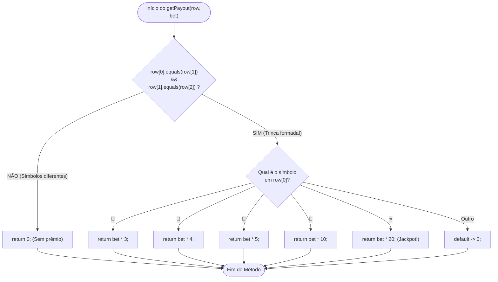

# 🎰 Capítulo 38: Slot Machine em Java — Parte 8
## 🎨 Moldura Visual no `printRow` e o Cérebro Financeiro: Método `getPayout()` com Enhanced Switch Expression

> **Arquivo de Estudo:** `Main.java`  
> **Timestamp do Vídeo:** `6:32:11` até `6:35:09` / `12:00:00`  
> **Canal:** Bro Code — *Java Full Course for free*  
> **Objetivo:** Explicar para um iniciante absoluto cada detalhe visual e conceitual das 4 telas apresentadas pelo professor: a criação da moldura estética de asteriscos na saída da roleta, o recolhimento de código (*code folding*) na IDE, e a implementação do método `getPayout()`, responsável por checar se houve trinca vencedora usando a propriedade transitiva e calculando os prêmios com a sintaxe moderna do **Enhanced Switch Expression** (`->`).

---

## 📸 Reconstituição Visual Completa das 4 Imagens (Sem Precisar do Vídeo)

Se você estiver lendo este material no Google Docs ou impresso, aqui está a descrição minuciosa do que aconteceu na tela do Bro Code em cada um dos 4 momentos:

```
+---------------------------------------------------------------------------------------------------+
| MOMENTO 1 (6:32:11): Moldura no printRow() e Teste no Terminal                                    |
+---------------------------------------------------------------------------------------------------+
| NA JANELA DO CÓDIGO (IntelliJ IDEA):                                                              |
| Bro Code edita o método printRow(String[] row). Agora ele tem 3 linhas:                          |
|   1. System.out.println("*************************");  (teto de asteriscos)                       |
|   2. System.out.println(" " + String.join(" | ", row)); (os emojis separados por barras)          |
|   3. System.out.println("*************************");  (chão de asteriscos)                       |
|                                                                                                   |
| NO TERMINAL INTEGRADO (Console em Execução):                                                      |
| *************************                                                                         |
|   Welcome to Java Slots                                                                           |
| Symbols: 🍒 🍉 🍋 🔔 ⭐                                                                           |
| *************************                                                                         |
| Current balance: $100                                                                             |
| Enter your bet amount: 10                                                                         |
| Spinning...                                                                                       |
| *************************                                                                         |
|  🍉 | ⭐ | ⭐                                                                                     |
| *************************                                                                         |
| Current balance: $90                                                                              |
| Enter your bet amount:                                                                            |
| (O professor seleciona com o mouse a segunda estrela ⭐, destacando-a em azul)                     |
+---------------------------------------------------------------------------------------------------+
```

```
+---------------------------------------------------------------------------------------------------+
| MOMENTO 2 (6:32:46): Recolhendo Código (Code Folding) e Início do Passo 16                        |
+---------------------------------------------------------------------------------------------------+
| O que Bro Code faz:                                                                              |
| 1. Ele clica na setinha/sinal de menos (-) na margem esquerda da linha 74 onde fica printRow.     |
| 2. O método inteiro se fecha em uma única linha cinza:                                            |
|    static void printRow(String[] row){...}                                                        |
| 3. Logo abaixo, ele digita a assinatura do próximo método:                                       |
|    static int getPayout(String[] row, int bet){                                                   |
|        if (row[0].equals(row[1]))                                                                 |
|    }                                                                                              |
+---------------------------------------------------------------------------------------------------+
```

```
+---------------------------------------------------------------------------------------------------+
| MOMENTO 3 (6:32:58): Demonstração de Outro Giro no Console com a Moldura                          |
+---------------------------------------------------------------------------------------------------+
| NO TERMINAL:                                                                                      |
| O programa roda novamente para testar a consistência visual:                                      |
| Spinning...                                                                                       |
| *************************                                                                         |
|  ⭐ | 🍋 | ⭐                                                                                     |
| *************************                                                                         |
| Current balance: $90                                                                              |
| Enter your bet amount:                                                                            |
| Observação: O jogador tirou duas estrelas e um limão no meio. O visual está perfeitamente         |
| alinhado dentro dos 25 asteriscos!                                                                |
+---------------------------------------------------------------------------------------------------+
```

```
+---------------------------------------------------------------------------------------------------+
| MOMENTO 4 (6:35:09): O Método getPayout() Completo com Enhanced Switch                            |
+---------------------------------------------------------------------------------------------------+
| Bro Code completa o cérebro matemático de premiação:                                              |
|                                                                                                   |
|    static int getPayout(String[] row, int bet){                                                   |
|                                                                                                   |
|        if(row[0].equals(row[1]) && row[1].equals(row[2])){                                       |
|            return switch(row[0]){                                                                 |
|                case "🍒" -> bet * 3;                                                              |
|                case "🍉" -> bet * 4;                                                              |
|                case "🍋" -> bet * 5;                                                              |
|                case "🔔" -> bet * 10;                                                             |
|                case "⭐" -> bet * 20;                                                             |
|                default -> 0;                                                                      |
|            };                                                                                     |
|        }                                                                                          |
|                                                                                                   |
|        return 0;                                                                                  |
|    }                                                                                              |
+---------------------------------------------------------------------------------------------------+
```

---

## 🧠 Conceitos Explicados "Para Quem Nunca Programou na Vida"

### 1. Por que colocar asteriscos antes e depois do `printRow()`?
Na Parte 7, quando chamávamos `printRow(row)`, o terminal mostrava apenas:
```text
Spinning...
 🍉 | ⭐ | ⭐
Current balance: $90
```
Ficava visualmente colado, parecendo um erro ou texto desorganizado.  
Em jogos de terminal (CLI — *Command Line Interface*), **a estética importa muito**.  
Ao colocar 25 asteriscos em cima e 25 asteriscos embaixo, criamos uma **moldura retangular** (uma "janelinha de vidro") idêntica à que existe nas máquinas caça-níqueis de verdade:

```text
*************************  <-- Teto da máquina
 🍉 | ⭐ | ⭐              <-- Os 3 cilindros girando
*************************  <-- Base da máquina
```
O usuário bate o olho e identifica imediatamente que aquele bloco é o resultado do sorteio!

---

### 2. O que é "Code Folding" (Recolhimento de Código) no IntelliJ IDEA?
No Momento 2, você vê que o método `spinRow()` e o método `printRow()` encolheram e viraram:
```java
static String[] spinRow(){...}
static void printRow(String[] row){...}
```
* **O que aconteceu? O código foi apagado?**  
  **NÃO!** Isso é um recurso visual de produtividade da IDE chamado **Code Folding** (dobradura de código).
* **Por que fazer isso?**  
  Conforme seu arquivo vai crescendo (já estamos com quase 100 linhas), você perde muito tempo rolando a rodinha do mouse para cima e para baixo. Como o método `spinRow` e o método `printRow` já foram testados, aprovados e estão funcionando 100%, você clica no botãozinho de diminuir `[-]` ao lado da chave para "guardar a roupa na gaveta". O código continua lá, funcionando normalmente, mas não polui sua visão enquanto você foca no próximo método!

---

### 3. Anatomia do Método `getPayout`: Quem é ele e o que ele faz?

```java
static int getPayout(String[] row, int bet)
```

Vamos dissecar cada palavra dessa assinatura como um cirurgião:
1. `static`: Significa que o método pertence à classe `Main`. Ele pode ser chamado diretamente de dentro do `main` sem precisarmos criar um objeto (`new Main()`).
2. `int`: **O Tipo de Retorno**. Este método é uma função matemática. Ele promete à máquina: *"Se você me chamar, eu vou fazer meus cálculos e vou te devolver de presente um número inteiro (`int`), que representa a quantia em dólares do prêmio que o jogador ganhou!"*.
3. `getPayout`: O nome da função ("Obter Pagamento / Obter Prêmio").
4. `(String[] row, int bet)`: **Os Parâmetros (Entradas da Fábrica)**.
   * `String[] row`: O método precisa ver a cartela que acabou de ser sorteada (o vetor com os 3 emojis).
   * `int bet`: O método precisa saber quanto o jogador apostou, pois o prêmio é proporcional à aposta (quem aposta \$10 ganha mais do que quem aposta \$1).

---

### 4. O Teste da Vitória Tripla: A Propriedade Transitiva da Igualdade

Como o computador sabe que o jogador acertou os 3 símbolos iguais?

Bro Code escreveu:
```java
if(row[0].equals(row[1]) && row[1].equals(row[2]))
```

#### Por que isso funciona? A Lógica da Matemática:
Imagine 3 pessoas numa fila: Alice (`row[0]`), Bruno (`row[1]`) e Carlos (`row[2]`).
* Perguntamos: *"Alice tem a mesma altura que Bruno?"* $\rightarrow$ `row[0].equals(row[1])`
* Se SIM, perguntamos: *"E Bruno tem a mesma altura que Carlos?"* $\rightarrow$ `row[1].equals(row[2])`
* Se Alice é igual a Bruno, E Bruno é igual a Carlos... **obrigatoriamente Alice tem a mesma altura que Carlos!**
* Essa é a famosa **Propriedade Transitiva**:
  $$\text{Se } A = B \quad \text{e} \quad B = C \implies A = C$$
Portanto, comparando apenas duas vezes com o operador `&&` (E lógico), temos certeza matemática de que **todos os 3 elementos são idênticos**!

#### ⚠️ Por que NÃO podemos usar `==` e DEVEMOS usar `.equals()`?
Em Java, tipos de texto (`String`) são **Objetos armazenados na memória Heap**.  
* Se você escrever `row[0] == row[1]`, o Java não vai ler o emoji! Ele vai comparar o **endereço hexadecimal de memória** de onde as Strings foram alocadas.
* O método `.equals()` entra dentro do objeto e compara o conteúdo caractere por caractere: *"A figurinha na gaveta 0 é uma cereja 🍒 e a figurinha na gaveta 1 também é uma cereja 🍒? Sim!"*.

---

### 5. O que é o Moderno **Enhanced Switch Expression** (`->`)?

Aqui está uma das partes mais bonitas e modernas do Java (introduzido oficialmente a partir do Java 14):

```java
return switch(row[0]){
    case "🍒" -> bet * 3;
    case "🍉" -> bet * 4;
    case "🍋" -> bet * 5;
    case "🔔" -> bet * 10;
    case "⭐" -> bet * 20;
    default -> 0;
};
```

#### Comparação: O jeito velho vs O jeito novo moderno

| Critério | Switch Antigo (Java 7 / 8) | Enhanced Switch Moderno (Bro Code) |
| :--- | :--- | :--- |
| **Sintaxe do Caso** | `case "🍒":` | `case "🍒" ->` (seta compacta) |
| **Comando `break;`** | Obrigatório em cada linha! Se esquecer, o código "escorrega" (*fall-through bug*). | **Eliminado!** A seta executa apenas aquela linha e já sai. |
| **Poder de Retorno** | É uma instrução (*statement*). Você precisava criar uma variável temporária ou dar `return` em cada case. | É uma **expressão** (*expression*). O bloco inteiro produz um valor que pode ser retornado diretamente com `return switch(...)`. |
| **Ponto e Vírgula Final** | Não tinha ponto e vírgula na chave `}`. | **Tem ponto e vírgula `};`** porque fecha a instrução de `return`! |

#### Por que olhamos apenas para `row[0]` no switch?
Pense comigo: Se já passamos pelo `if` que comprovou que `row[0]`, `row[1]` e `row[2]` são exatamente o mesmo símbolo, tanto faz olhar para `row[0]`, `row[1]` ou `row[2]`! Olhar para `row[0]` já nos diz qual é o símbolo da trinca.

---

### 6. Tabela Oficial de Pagamentos (Payout Multipliers)

| Símbolo | Nome | Multiplicador | Exemplo com Aposta de \$10 | Exemplo com Aposta de \$50 |
| :---: | :---: | :---: | :---: | :---: |
| 🍒 | Três Cerejas | **3x** a aposta | Ganha \$30 | Ganha \$150 |
| 🍉 | Três Melancias | **4x** a aposta | Ganha \$40 | Ganha \$200 |
| 🍋 | Três Limões | **5x** a aposta | Ganha \$50 | Ganha \$250 |
| 🔔 | Três Sinos | **10x** a aposta | Ganha \$100 | Ganha \$500 |
| ⭐ | Três Estrelas (**JACKPOT!**) | **20x** a aposta | Ganha \$200 | Ganha \$1.000 |
| Qualquer outra mistura | Derrota / Sem Trinca | **0x** | Ganha \$0 | Ganha \$0 |

---

### 7. E se o jogador NÃO acertar 3 símbolos iguais? (O `return 0;` salvador)

Observe as últimas linhas do método:
```java
        if(row[0].equals(row[1]) && row[1].equals(row[2])){
            return switch(row[0]){ ... };
        }

        return 0;
    }
```
Imagine que a roleta sorteou `⭐ | 🍋 | ⭐` (como no Momento 3):
1. O Java testa: `row[0].equals(row[1])` $\rightarrow$ *"Estrela é igual a Limão?"* $\rightarrow$ **FALSE!**
2. Por ter um `&&`, o Java nem perde tempo testando a segunda parte (isso se chama **avaliação de curto-circuito**).
3. O `if` inteiro é ignorado!
4. O ponteiro de execução pula para a linha 92: `return 0;`.
5. O método devolve **0** para quem chamou. O prêmio é zero dólares!

---

## 🗺️ Fluxograma Lógico da Decisão de Pagamento



---

## 💾 Modelo Mental de Memória (Stack & Heap)

```text
========================================================================================
MEMÓRIA STACK (PILHA DE EXECUÇÃO)            MEMÓRIA HEAP (OBJETOS DINÂMICOS)
========================================================================================
[Quadro do Método: getPayout]
  bet = 10                                   String[] row:
  row ------------------------------------>  [0] = Endereço Heap do Emoji "⭐"
                                             [1] = Endereço Heap do Emoji "⭐"
  row[0].equals(row[1]) -> true              [2] = Endereço Heap do Emoji "⭐"
  row[1].equals(row[2]) -> true
  
  Entra no Switch:
  Avalia row[0] ("⭐"):
  Calcula: bet * 20 = 10 * 20 = 200
  Retorna: 200 para a main!
========================================================================================
```

---

## 🔍 Análise Linha por Linha de Todo o Código Novo

Abaixo está a análise detalhada das alterações feitas no `Main.java`:

### Bloco A: A Moldura no Método `printRow`

```java
73:     static void printRow(String[] row){
74:         System.out.println("*************************");
75:         System.out.println(" " + String.join(" | ", row));
76:         System.out.println("*************************");
77:     }
```

* **Linha 73 (`static void printRow(String[] row){`):**  
  * O que faz: Declara o método estático que não retorna valor (`void`) e recebe o array de 3 posições `row`.  
  * O que sai no console: Nada.
* **Linha 74 (`System.out.println("*************************");`):**  
  * O que faz: Imprime uma linha superior com 25 asteriscos e pula para a próxima linha (`println`). Cria a tampa da moldura.  
  * O que sai no console: `*************************`
* **Linha 75 (`System.out.println(" " + String.join(" | ", row));`):**  
  * O que faz: Adiciona um espaço de recuo à esquerda e une os 3 emojis usando o separador `" | "`.  
  * O que sai no console: Exemplo: ` 🍉 | ⭐ | ⭐`
* **Linha 76 (`System.out.println("*************************");`):**  
  * O que faz: Imprime a linha inferior com 25 asteriscos e pula a linha. Fecha a caixa da moldura.  
  * O que sai no console: `*************************`
* **Linha 77 (`}`):**  
  * O que faz: Encerra o corpo do método `printRow`.  
  * O que sai no console: Nada.

---

### Bloco B: O Método de Premiação `getPayout`

```java
79:     static int getPayout(String[] row, int bet){
80: 
81:         if(row[0].equals(row[1]) && row[1].equals(row[2])){
82:             return switch(row[0]){
83:                 case "🍒" -> bet * 3;
84:                 case "🍉" -> bet * 4;
85:                 case "🍋" -> bet * 5;
86:                 case "🔔" -> bet * 10;
87:                 case "⭐" -> bet * 20;
88:                 default -> 0;
89:             };
90:         }
91: 
92:         return 0;
93:     }
```

* **Linha 79 (`static int getPayout(String[] row, int bet){`):**  
  * O que faz: Cria o método estático que calcula e devolve um número inteiro (`int`). Recebe os 3 emojis da rodada (`row`) e o valor que o jogador apostou (`bet`).  
  * O que sai no console: Nada.
* **Linha 80 (Linha em branco):**  
  * O que faz: Melhora a legibilidade do código.  
  * O que sai no console: Nada.
* **Linha 81 (`if(row[0].equals(row[1]) && row[1].equals(row[2])){`):**  
  * O que faz: Compara o primeiro emoji com o segundo E o segundo com o terceiro usando `.equals()`. Se ambos forem verdadeiros, significa que os 3 emojis são rigorosamente iguais (trinca premiada!).  
  * O que sai no console: Nada.
* **Linha 82 (`return switch(row[0]){`):**  
  * O que faz: Inicia a expressão `switch` moderna avaliando o texto contido em `row[0]`, e já coloca a palavra-chave `return` na frente para devolver o resultado imediatamente para quem chamou o método.  
  * O que sai no console: Nada.
* **Linha 83 (`case "🍒" -> bet * 3;`):**  
  * O que faz: Se o símbolo for cereja, multiplica a aposta por 3. A seta (`->`) substitui os antigos dois pontos e o comando `break;`.  
  * O que sai no console: Nada.
* **Linha 84 (`case "🍉" -> bet * 4;`):**  
  * O que faz: Se for melancia, multiplica a aposta por 4.  
  * O que sai no console: Nada.
* **Linha 85 (`case "🍋" -> bet * 5;`):**  
  * O que faz: Se for limão, multiplica a aposta por 5.  
  * O que sai no console: Nada.
* **Linha 86 (`case "🔔" -> bet * 10;`):**  
  * O que faz: Se for sino, multiplica a aposta por 10.  
  * O que sai no console: Nada.
* **Linha 87 (`case "⭐" -> bet * 20;`):**  
  * O que faz: Se for estrela, multiplica a aposta por 20 (prêmio máximo!).  
  * O que sai no console: Nada.
* **Linha 88 (`default -> 0;`):**  
  * O que faz: Cláusula de segurança obrigatória em switch expressions. Se por algum motivo surgir um emoji não cadastrado, o prêmio devolvido é 0.  
  * O que sai no console: Nada.
* **Linha 89 (`};`):**  
  * O que faz: Fecha o bloco do `switch`. O ponto e vírgula `;` é obrigatório aqui porque ele finaliza a instrução `return switch(...) ;`.  
  * O que sai no console: Nada.
* **Linha 90 (`}`):**  
  * O que faz: Fecha o bloco do `if`.  
  * O que sai no console: Nada.
* **Linha 91 (Linha em branco):**  
  * O que faz: Espaçamento para clareza visual.  
  * O que sai no console: Nada.
* **Linha 92 (`return 0;`):**  
  * O que faz: É o caminho de fuga padrão. Se o `if` da linha 81 foi falso (ou seja, os 3 símbolos não eram iguais), o programa ignora o switch e chega nesta linha, devolvendo 0 dólares de prêmio.  
  * O que sai no console: Nada.
* **Linha 93 (`}`):**  
  * O que faz: Fecha a chave do método `getPayout`.  
  * O que sai no console: Nada.

---

## 📜 Código-Fonte Completo e Atualizado (`Main.java`)

```java
import java.util.Random;
import java.util.Scanner;

public class Main {
    public static void main(String[] args){

        // JAVA SLOT MACHINE

        // DECLARE VARIABLES
        Scanner scanner = new Scanner(System.in);
        int balance = 100;
        int bet;
        int payout;
        String[] row;

        // DISPLAY WELCOME MESSAGE
        System.out.println("*************************");
        System.out.println("  Welcome to Java Slots  ");
        System.out.println("Symbols: 🍒 🍉 🍋 🔔 ⭐ ");
        System.out.println("*************************");

        // PLAY IF BALANCE > 0
        while(balance > 0){
            System.out.println("Current balance: $" + balance);
            System.out.print("Place your bet amount: ");
            bet = scanner.nextInt();

            // VERIFY IF BET > BALANCE
            if(bet > balance){
                System.out.println("INSUFFICIENT FUNDS");
                continue;
            }
            // VERIFY IF BET > 0
            else if(bet <= 0){
                System.out.println("Bet must be greater than 0");
                continue;
            }
            // SUBTRACT BET FROM BALANCE
            else{
                balance -= bet;
            }

            System.out.println("Spinning...");

            // SPIN ROW
            row = spinRow();

            // PRINT ROW
            printRow(row);

            // GET PAYOUT
            // ASK TO PLAY AGAIN
        }

        // DISPLAY EXIT MESSAGE

        scanner.close();
    }

    static String[] spinRow(){

        String[] symbols = {"🍒", "🍉", "🍋", "🔔", "⭐"};
        String[] row = new String[3];
        Random random = new Random();

        for(int i = 0; i < 3; i++){
            row[i] = symbols[random.nextInt(symbols.length)];
        }

        return row;
    }

    static void printRow(String[] row){
        System.out.println("*************************");
        System.out.println(" " + String.join(" | ", row));
        System.out.println("*************************");
    }

    static int getPayout(String[] row, int bet){

        if(row[0].equals(row[1]) && row[1].equals(row[2])){
            return switch(row[0]){
                case "🍒" -> bet * 3;
                case "🍉" -> bet * 4;
                case "🍋" -> bet * 5;
                case "🔔" -> bet * 10;
                case "⭐" -> bet * 20;
                default -> 0;
            };
        }

        return 0;
    }
}
```

---

## ❓ Perguntas Frequentes de Iniciantes (Dúvidas Cruciais)

### 1. Se o método `getPayout()` já está pronto, por que nos testes do Bro Code o saldo ainda não aumentou quando ele tirou símbolos?
**Resposta:** Porque nós criamos a "calculadora de prêmios" lá embaixo no arquivo, mas **ainda não a ligamos dentro do `main`**!  
Observe que na linha 51 do `main` ainda está escrito o comentário:
```java
// GET PAYOUT
```
No próximo passo do vídeo, o Bro Code vai finalmente chamar:
```java
payout = getPayout(row, bet);
if(payout > 0){
    System.out.println("YOU WON $" + payout);
    balance += payout;
}
```
Por isso, nos Momento 1 e 3, o saldo apenas diminuiu de \$100 para \$90. A máquina ainda não creditou os ganhos!

---

### 2. E se o jogador tirar dois símbolos iguais e um diferente (ex: `⭐ | ⭐ | 🍋`)? Ele não ganha nada?
**Resposta:** No código escrito pelo Bro Code até o momento `6:35:09`, a regra exige que os **três símbolos sejam idênticos** (`row[0].equals(row[1]) && row[1].equals(row[2])`). Se tirar apenas 2 símbolos iguais, a condição é falsa e o método devolve `0`.  
*(Nota: Mais adiante, Bro Code pode expandir as regras para premiar pares ou manter simples como uma máquina clássica de 3 tambores).*

---

### 3. Por que no final da chave do switch tem um ponto e vírgula `};`? Chaves `{}` não costumam dispensar ponto e vírgula?
**Resposta:** Chaves de blocos de controle normais (como `if(){}`, `for(){}`, `while(){}`) realmente **não** usam ponto e vírgula.  
Porém, aqui o `switch` está sendo usado como uma **expressão** (ele produz um valor) dentro de um comando `return`.  
A regra do Java é: **todo comando de declaração ou retorno termina com ponto e vírgula!**  
Pense como se fosse uma equação matemática:
```java
return (expressao);
```
Como a "expressão" é o bloco inteiro do switch, o ponto e vírgula vai logo após a chave de fechamento: `};`.
