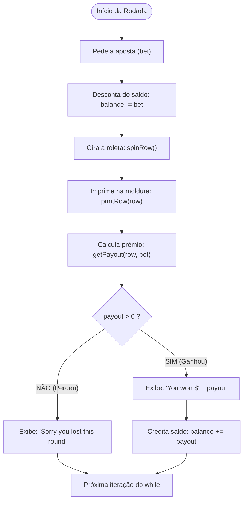

# 🎰 Capítulo 38: Slot Machine em Java — Parte 9
## 💰 Ligando o Motor Financeiro na `main`, Teste Real de Vitória no Console e a Regra do Par de Símbolos

> **Arquivo de Estudo:** `Main.java`  
> **Timestamp do Vídeo:** `6:35:54` até `6:38:xx` / `12:00:00`  
> **Canal:** Bro Code — *Java Full Course for free*  
> **Objetivo:** Explicar para um iniciante absoluto cada detalhe das 5 novas telas do vídeo: como o método `getPayout` é conectado à função principal (`main`), como o saldo (`balance`) é acrescido quando há vitória, o tratamento da derrota com a mensagem amigável no `else`, a demonstração real no terminal ganhando \$3 com três cerejas (`🍒 | 🍒 | 🍒`), e a criação da regra de premiação intermediária para **2 símbolos iguais (par)** com novos multiplicadores.

---

## 📸 Reconstituição Visual Completa das 5 Imagens (Sem Precisar do Vídeo)

Se você estiver lendo este material no Google Docs ou impresso, aqui está a descrição minuciosa do que aconteceu na tela do Bro Code em cada um dos 5 momentos:

```
+---------------------------------------------------------------------------------------------------+
| MOMENTO 1 (6:35:54): Conectando getPayout() e Adicionando Vitória no main                         |
+---------------------------------------------------------------------------------------------------+
| NA JANELA DO CÓDIGO (IntelliJ IDEA):                                                              |
| Dentro do loop while(balance > 0), logo abaixo de printRow(row), Bro Code digita:                 |
|                                                                                                   |
| 40: payout = getPayout(row, bet);                                                                 |
| 41:                                                                                               |
| 42: if(payout > 0){                                                                               |
| 43:     System.out.println("You won $" + payout);                                                 |
| 44:     balance += payout;                                                                        |
| 45: }                                                                                             |
|                                                                                                   |
| Observação Visual: Na linha 44, enquanto o professor digita "balance += payout;", o IntelliJ      |
| exibe um leve sublinhado ondulado vermelho temporário antes de ele colocar o ponto e vírgula.     |
+---------------------------------------------------------------------------------------------------+
```

```
+---------------------------------------------------------------------------------------------------+
| MOMENTO 2 (6:36:00): Adicionando a Mensagem de Derrota no else                                    |
+---------------------------------------------------------------------------------------------------+
| Logo após o fechamento da chave do if(payout > 0), Bro Code adiciona o bloco alternativo:         |
|                                                                                                   |
| 45: }                                                                                             |
| 46: else{                                                                                         |
| 47:     System.out.println("Sorry you lost this round");                                          |
| 48: }                                                                                             |
|                                                                                                   |
| Observação Visual: Aparece o ícone de uma lâmpada amarela do IntelliJ na margem da linha 47       |
| e o cursor do mouse pisca logo após a aspa final de "Sorry you lost this round".                  |
+---------------------------------------------------------------------------------------------------+
```

```
+---------------------------------------------------------------------------------------------------+
| MOMENTO 3 (6:36:38): Teste Prático ao Vivo no Console (Com Vitória Real!)                         |
+---------------------------------------------------------------------------------------------------+
| O terminal integrado ocupa a tela toda com texto verde sobre fundo escuro:                        |
|                                                                                                   |
| [RODADA 1 - DERROTA]:                                                                             |
| Place your bet amount: 1                                                                          |
| Spinning...                                                                                       |
| *************************                                                                         |
|  🍒 | 🍋 | 🔔                                                                                     |
| *************************                                                                         |
| Sorry you lost this round                                                                         |
| Current balance: $84                                                                              |
|                                                                                                   |
| [RODADA 2 - VITÓRIA COM 3 CEREJAS!]:                                                              |
| Place your bet amount: 1                                                                          |
| Spinning...                                                                                       |
| *************************                                                                         |
|  🍒 | 🍒 | 🍒                                                                                     |
| *************************                                                                         |
| You won $3                                                                                        |
| Current balance: $86                                                                              |
| Place your bet amount:                                                                            |
|                                                                                                   |
| Observação Visual: Bro Code usa o cursor do mouse para selecionar em azul a trinca                |
| "🍒 | 🍒 | 🍒" no terminal, comemorando e comprovando que a premiação funcionou perfeitamente!    |
+---------------------------------------------------------------------------------------------------+
```

```
+---------------------------------------------------------------------------------------------------+
| MOMENTO 4 (6:37:xx): Criando a Premiação para 2 Símbolos Iguais (O Par)                           |
+---------------------------------------------------------------------------------------------------+
| Bro Code desce até o método getPayout(String[] row, int bet).                                     |
| Ele duplica o bloco do if da trinca para criar uma segunda chance de ganho:                      |
|                                                                                                   |
| 85: else if(row[0].equals(row[1]) && row[1].equals(row[2])){                                      |
|                                                                                                   |
| Observação Visual: Bro Code seleciona com o mouse a parte "&& row[1].equals(row[2])"              |
| destacando-a em azul para apagá-la, pois para um par basta comparar os dois primeiros símbolos!   |
+---------------------------------------------------------------------------------------------------+
```

```
+---------------------------------------------------------------------------------------------------+
| MOMENTO 5 (6:38:xx): Tabela de Multiplicadores do Par Concluída                                   |
+---------------------------------------------------------------------------------------------------+
| Bro Code ajusta os multiplicadores do Enhanced Switch para o caso de acertar 2 símbolos:         |
|                                                                                                   |
| 85: else if(row[0].equals(row[1])){                                                               |
| 86:     return switch(row[0]){                                                                    |
| 87:         case "🍒" -> bet * 2;                                                                 |
| 88:         case "🍉" -> bet * 3;                                                                 |
| 89:         case "🍋" -> bet * 4;                                                                 |
| 90:         case "🔔" -> bet * 5;                                                                 |
| 91:         case "⭐" -> bet * 10;                                                                |
| 92:         default -> 0;                                                                         |
| 93:     };                                                                                        |
| 94: }                                                                                             |
|                                                                                                   |
| Observação Visual: O método agora tem uma cascata elegante: primeiro testa 3 símbolos iguais,     |
| depois testa 2 símbolos iguais, e se nenhum bater, cai no "return 0;" na linha 96.                |
+---------------------------------------------------------------------------------------------------+
```

---

## 🧠 Explicação Didática Extrema (Para Leigos Absolutos)

### 1. A Metáfora da Calculadora do Cassino: Conectando `getPayout` na `main`

Na Parte 8, nós construímos o método `getPayout` lá no fim do arquivo. Mas pense nele como uma **calculadora de prêmios guardada na gaveta**: se você não ligar a calculadora e não digitar os números nela, ela não serve de nada!

Na Linha 52, Bro Code faz a conexão:
```java
payout = getPayout(row, bet);
```
* **O que acontece aqui?**
  1. A `main` chama a função `getPayout`.
  2. Entrega para ela duas informações: a cartela sorteada (`row`) e quanto o jogador apostou (`bet`).
  3. A função faz todas as contas e joga de volta um número inteiro.
  4. O operador `=` pega esse número retornado e guarda dentro da variável `payout`.

---

### 2. O `if (payout > 0)` e o Operador `+=` (Creditando a Vitória)

```java
if(payout > 0){
    System.out.println("You won $" + payout);
    balance += payout;
}
```

* **Por que testamos `payout > 0`?**  
  Se o jogador acertou uma combinação premiada, `payout` será um valor positivo (\$3, \$10, \$20, etc.). Se ele não acertou nada, o método devolve `0`.  
  Logo, se `payout > 0`, é festa! O jogador ganhou!
* **A Mensagem:** Mostra no console com entusiasmo: `"You won $" + payout`.
* **O Operador de Atribuição Composta (`+=`):**  
  `balance += payout;` é um atalho elegante para:
  $$\text{balance} = \text{balance} + \text{payout};$$
  Ou seja: *"Pegue o saldo atual que o jogador tem e adicione o prêmio que ele acabou de ganhar!"*.

---

### 3. O Bloco `else`: Por que NÃO subtraímos nada quando o jogador perde?

```java
else{
    System.out.println("Sorry you lost this round");
}
```

> **🚨 Dúvida Número 1 de Todo Iniciante:**  
> *"Professor, se o jogador perdeu a rodada, por que aqui no `else` a gente não escreveu `balance -= bet;` para tirar o dinheiro dele?"*

**Resposta Genial:**  
Porque o dinheiro **já foi retirado do saldo lá no começo da rodada!**  
Lembre-se da linha 40 do código:
```java
// SUBTRACT BET FROM BALANCE
else{
    balance -= bet;
}
```
Pense numa máquina caça-níqueis de verdade num cassino de Las Vegas:  
1. Você coloca a moeda de \$1 na ranhura da máquina $\rightarrow$ O dinheiro **sai da sua carteira na mesma hora** (`balance -= bet`).
2. Você aperta o botão e a máquina gira (`spinRow`).
3. Se você ganhar: a máquina cospe moedas de volta para você (`balance += payout`).
4. Se você perder: a máquina simplesmente não cospe nada e diz *"Que pena, tente de novo!"*. **Ela não precisa meter a mão no seu bolso de novo, porque a moeda já estava dentro dela!**

---

### 4. A Matemática Real da Demonstração no Console (Momento 3)

Vamos dissecar a matemática exata que aconteceu na tela do Bro Code durante o teste:

#### Rodada 1 (Derrota):
* Saldo antes da aposta: **\$85**
* O jogador aposta: **\$1**
* O Java desconta a aposta: $\$85 - \$1 = \mathbf{\$84}$
* A máquina sorteia: `🍒 | 🍋 | 🔔` (símbolos todos misturados)
* O método `getPayout` avalia e devolve: `0`
* O `if(payout > 0)` é falso $\rightarrow$ Executa o `else`
* Console imprime: `Sorry you lost this round`
* Saldo final da rodada: **\$84**

#### Rodada 2 (Vitória Tripla!):
* Saldo antes da aposta: **\$84**
* O jogador aposta: **\$1**
* O Java desconta a aposta: $\$84 - \$1 = \mathbf{\$83}$
* A máquina sorteia: `🍒 | 🍒 | 🍒` (Três cerejas idênticas!)
* O método `getPayout` entra no `if` da trinca:
  $$\text{Multiplicador da Cereja} = 3 \implies 1 \times 3 = \mathbf{\$3}$$
* A variável `payout` recebe **3**.
* O `if(payout > 0)` é verdadeiro!
* Console imprime: `You won $3`
* O Java credita o prêmio no saldo:
  $$\text{balance} = \$83 + \$3 = \mathbf{\$86}$$
* No início da próxima rodada, o console imprime com precisão:  
  `Current balance: $86`! Tudo bateu no centavo!

---

### 5. A Regra do Par: Por que Premiar 2 Símbolos Iguais?

Nas máquinas de verdade, tirar 3 símbolos idênticos é estatisticamente raro. Se o jogador perder 20 vezes seguidas, ele fica frustrado e fecha o jogo.  
Para manter a diversão, os cassinos criam **prêmios menores de consolação** quando você acerta 2 símbolos iguais!

Bro Code adicionou:
```java
else if(row[0].equals(row[1])){
    return switch(row[0]){
        case "🍒" -> bet * 2;
        case "🍉" -> bet * 3;
        case "🍋" -> bet * 4;
        case "🔔" -> bet * 5;
        case "⭐" -> bet * 10;
        default -> 0;
    };
}
```

#### ⚠️ ATENÇÃO MÁXIMA: Por que a Trinca DEVE vir ANTES do Par?
Observe a ordem dos blocos:
```
1º IF:      Checa 3 símbolos iguais: row[0] == row[1] && row[1] == row[2]
2º ELSE IF: Checa 2 símbolos iguais: row[0] == row[1]
3º FINAL:   Devolve 0 (nenhum acerto)
```

**E se invertêssemos a ordem?**  
Se você colocasse o teste de 2 símbolos primeiro:
1. Imagine que o jogador tirou `⭐ | ⭐ | ⭐` (Jackpot de 20x!).
2. O Java testaria primeiro: `row[0].equals(row[1])` (A primeira estrela é igual à segunda?).
3. O Java diria: *"SIM! É igual!"*.
4. O Java pagaria o prêmio de **par** (10x a aposta) e sairia da função imediatamente!
5. O jogador ganharia metade do prêmio que merecia e ficaria revoltado!

> **Regra de Ouro da Programação:**  
> **Sempre teste a condição mais rigorosa, específica e difícil primeiro!** As condições mais fáceis e gerais ficam sempre nos `else if` posteriores.

---

### 6. Tabela Comparativa de Multiplicadores: Trinca vs Par

| Símbolo | Nome do Símbolo | Prêmio por 3 Iguais (Trinca) | Prêmio por 2 Iguais (Par) |
| :---: | :---: | :---: | :---: |
| 🍒 | Cerejas | **3x** a aposta | **2x** a aposta |
| 🍉 | Melancias | **4x** a aposta | **3x** a aposta |
| 🍋 | Limões | **5x** a aposta | **4x** a aposta |
| 🔔 | Sinos | **10x** a aposta | **5x** a aposta |
| ⭐ | Estrelas | **20x** a aposta (**Jackpot!**) | **10x** a aposta |

---

## 🗺️ Fluxograma Lógico da Rodada Completa



---

## 🔍 Análise Linha por Linha de Todo o Código Novo

### Bloco A: Na Função Principal (`main`)

```java
51:             // GET PAYOUT
52:             payout = getPayout(row, bet);
53: 
54:             if(payout > 0){
55:                 System.out.println("You won $" + payout);
56:                 balance += payout;
57:             }
58:             else{
59:                 System.out.println("Sorry you lost this round");
60:             }
```

* **Linha 51 (`// GET PAYOUT`):**  
  * O que faz: Comentário descritivo indicando a etapa do algoritmo.  
  * No console: Nada.
* **Linha 52 (`payout = getPayout(row, bet);`):**  
  * O que faz: Executa o método `getPayout` enviando a linha sorteada `row` e o valor `bet`. O prêmio calculado é armazenado na variável inteira `payout`.  
  * No console: Nada.
* **Linha 53 (Linha em branco):**  
  * O que faz: Organização visual.  
  * No console: Nada.
* **Linha 54 (`if(payout > 0){`):**  
  * O que faz: Verifica se o valor de `payout` é estritamente maior que zero (ou seja, se houve premiação).  
  * No console: Nada.
* **Linha 55 (`System.out.println("You won $" + payout);`):**  
  * O que faz: Executada apenas em caso de vitória. Imprime a mensagem de parabéns com o valor ganho.  
  * No console: Exemplo: `You won $3`
* **Linha 56 (`balance += payout;`):**  
  * O que faz: Soma o prêmio ao saldo do jogador (`balance = balance + payout`).  
  * No console: Nada.
* **Linha 57 (`}`):**  
  * O que faz: Fecha o bloco do `if`.  
  * No console: Nada.
* **Linha 58 (`else{`):**  
  * O que faz: Caso `payout` seja 0 (derrota), desvia o fluxo para este bloco.  
  * No console: Nada.
* **Linha 59 (`System.out.println("Sorry you lost this round");`):**  
  * O que faz: Imprime a mensagem informando que o jogador perdeu a aposta daquela rodada.  
  * No console: `Sorry you lost this round`
* **Linha 60 (`}`):**  
  * O que faz: Fecha o bloco do `else`.  
  * No console: Nada.

---

### Bloco B: No Método `getPayout` (A Regra do Par)

```java
101:         else if(row[0].equals(row[1])){
102:             return switch(row[0]){
103:                 case "🍒" -> bet * 2;
104:                 case "🍉" -> bet * 3;
105:                 case "🍋" -> bet * 4;
106:                 case "🔔" -> bet * 5;
107:                 case "⭐" -> bet * 10;
108:                 default -> 0;
109:             };
110:         }
```

* **Linha 101 (`else if(row[0].equals(row[1])){`):**  
  * O que faz: Se a checagem anterior de 3 símbolos falhou, o Java testa se pelo menos os dois primeiros símbolos (`row[0]` e `row[1]`) são idênticos.  
  * No console: Nada.
* **Linha 102 (`return switch(row[0]){`):**  
  * O que faz: Inicia a expressão switch para calcular e retornar o prêmio do par baseado no símbolo repetido.  
  * No console: Nada.
* **Linha 103 (`case "🍒" -> bet * 2;`):**  
  * O que faz: Par de cerejas paga o dobro da aposta (2x).  
  * No console: Nada.
* **Linha 104 (`case "🍉" -> bet * 3;`):**  
  * O que faz: Par de melancias paga o triplo da aposta (3x).  
  * No console: Nada.
* **Linha 105 (`case "🍋" -> bet * 4;`):**  
  * O que faz: Par de limões paga 4 vezes a aposta (4x).  
  * No console: Nada.
* **Linha 106 (`case "🔔" -> bet * 5;`):**  
  * O que faz: Par de sinos paga 5 vezes a aposta (5x).  
  * No console: Nada.
* **Linha 107 (`case "⭐" -> bet * 10;`):**  
  * O que faz: Par de estrelas paga 10 vezes a aposta (10x).  
  * No console: Nada.
* **Linha 108 (`default -> 0;`):**  
  * O que faz: Caso seguro para símbolos não previstos. Devolve 0.  
  * No console: Nada.
* **Linha 109 (`};`):**  
  * O que faz: Finaliza a expressão switch com ponto e vírgula obrigatório.  
  * No console: Nada.
* **Linha 110 (`}`):**  
  * O que faz: Fecha o bloco do `else if`.  
  * No console: Nada.

---

## 📜 Código-Fonte Completo e Atualizado (`Main.java`)

```java
import java.util.Random;
import java.util.Scanner;

public class Main {
    public static void main(String[] args){

        // JAVA SLOT MACHINE

        // DECLARE VARIABLES
        Scanner scanner = new Scanner(System.in);
        int balance = 100;
        int bet;
        int payout;
        String[] row;

        // DISPLAY WELCOME MESSAGE
        System.out.println("*************************");
        System.out.println("  Welcome to Java Slots  ");
        System.out.println("Symbols: 🍒 🍉 🍋 🔔 ⭐ ");
        System.out.println("*************************");

        // PLAY IF BALANCE > 0
        while(balance > 0){
            System.out.println("Current balance: $" + balance);
            System.out.print("Place your bet amount: ");
            bet = scanner.nextInt();

            // VERIFY IF BET > BALANCE
            if(bet > balance){
                System.out.println("INSUFFICIENT FUNDS");
                continue;
            }
            // VERIFY IF BET > 0
            else if(bet <= 0){
                System.out.println("Bet must be greater than 0");
                continue;
            }
            // SUBTRACT BET FROM BALANCE
            else{
                balance -= bet;
            }

            System.out.println("Spinning...");

            // SPIN ROW
            row = spinRow();

            // PRINT ROW
            printRow(row);

            // GET PAYOUT
            payout = getPayout(row, bet);

            if(payout > 0){
                System.out.println("You won $" + payout);
                balance += payout;
            }
            else{
                System.out.println("Sorry you lost this round");
            }

            // ASK TO PLAY AGAIN
        }

        // DISPLAY EXIT MESSAGE

        scanner.close();
    }

    static String[] spinRow(){

        String[] symbols = {"🍒", "🍉", "🍋", "🔔", "⭐"};
        String[] row = new String[3];
        Random random = new Random();

        for(int i = 0; i < 3; i++){
            row[i] = symbols[random.nextInt(symbols.length)];
        }

        return row;
    }

    static void printRow(String[] row){
        System.out.println("*************************");
        System.out.println(" " + String.join(" | ", row));
        System.out.println("*************************");
    }

    static int getPayout(String[] row, int bet){

        if(row[0].equals(row[1]) && row[1].equals(row[2])){
            return switch(row[0]){
                case "🍒" -> bet * 3;
                case "🍉" -> bet * 4;
                case "🍋" -> bet * 5;
                case "🔔" -> bet * 10;
                case "⭐" -> bet * 20;
                default -> 0;
            };
        }
        else if(row[0].equals(row[1])){
            return switch(row[0]){
                case "🍒" -> bet * 2;
                case "🍉" -> bet * 3;
                case "🍋" -> bet * 4;
                case "🔔" -> bet * 5;
                case "⭐" -> bet * 10;
                default -> 0;
            };
        }

        return 0;
    }
}
```

---

## ❓ Perguntas Frequentes de Iniciantes (Dúvidas Cruciais)

### 1. E se os dois símbolos iguais forem os dois últimos (por exemplo: `🍋 | ⭐ | ⭐`)?
**Resposta:**  
Neste exato momento do vídeo (Momento 5 — `6:38:xx`), a linha 101 testa estritamente `else if(row[0].equals(row[1]))`, o que significa que o par só é reconhecido se estiver nas **duas primeiras posições** (como numa linha de pagamento tradicional da esquerda para a direita).  
Nos próximos passos, o professor pode expandir a checagem usando o operador OU (`||`) para cobrir `row[1].equals(row[2])`, permitindo pares em qualquer lado da roleta!

---

### 2. Se o jogador ganhar \$3 na rodada, por que o saldo dele subiu apenas \$2 em relação à rodada anterior (\$84 para \$86)?
**Resposta:**  
Porque para jogar aquela rodada, ele **pagou \$1 de aposta primeiro**!  
* Ele tinha \$84.
* Pagou \$1 $\rightarrow$ ficou com \$83.
* A máquina pagou \$3 $\rightarrow$ $\$83 + \$3 = \$86$.  
O lucro líquido real dele foi de $\$3 - \$1 = \mathbf{\$2}$. O computador faz exatamente essa matemática perfeita!
