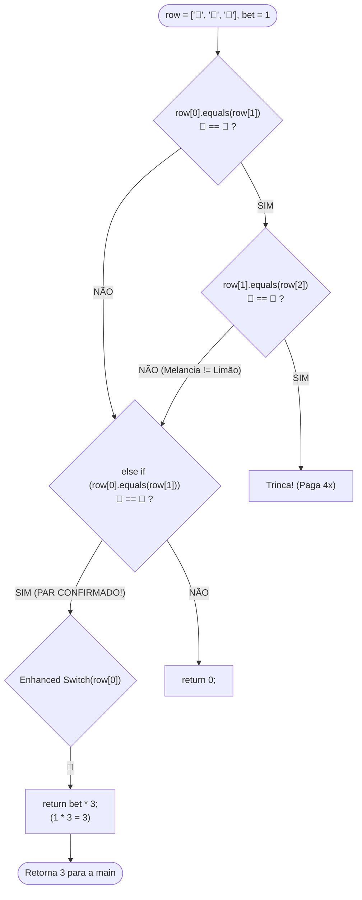

# 🎰 Capítulo 38: Slot Machine em Java — Parte 10
## 🍉 Teste ao Vivo no Console: A "Prova dos 9" do Par de Símbolos (`🍉 | 🍉 | 🍋`) e Matemática de Pagamento

> **Arquivo de Estudo:** `Main.java`  
> **Timestamp do Vídeo:** `6:38:15` / `12:00:00`  
> **Canal:** Bro Code — *Java Full Course for free*  
> **Objetivo:** Explicar para um iniciante absoluto cada detalhe da tela do teste prático no terminal: como o computador processa uma rodada de derrota e uma rodada de vitória com par de melancias, a matemática minuciosa do saldo (`balance`), o porquê da seleção azul do mouse do professor, e o rastreamento completo de variáveis na memória.

---

## 📸 Reconstituição Visual Completa da Imagem (Sem Precisar do Vídeo)

Se você estiver lendo este material no Google Docs ou impresso, aqui está a descrição exata de tudo o que aparece na tela do Bro Code no timestamp `6:38:15`:

```
+---------------------------------------------------------------------------------------------------+
| TELA DO INTELLIJ IDEA (Timestamp 6:38:15)                                                         |
+---------------------------------------------------------------------------------------------------+
| TOPO DA JANELA DE CÓDIGO (Linha 101 visível):                                                     |
|   101: case "⭐" -> bet * 10;                                                                     |
|                                                                                                   |
| TERMINAL INTEGRADO (Console em Execução em Tela Quase Cheia - Texto Verde):                       |
|                                                                                                   |
| [PRIMEIRA RODADA - DERROTA COMPLETA]:                                                             |
| Place your bet amount: 1                                                                          |
| Spinning...                                                                                       |
| *************************                                                                         |
|  🍋 | ⭐ | 🍒                                                                                     |
| *************************                                                                         |
| Sorry you lost this round                                                                         |
| Current balance: $99                                                                              |
|                                                                                                   |
| [SEGUNDA RODADA - VITÓRIA COM PAR DE MELANCIAS]:                                                  |
| Place your bet amount: 1                                                                          |
| Spinning...                                                                                       |
| *************************                                                                         |
|  🍉 | 🍉 | 🍋                                                                                     |
| *************************                                                                         |
| You won $3                                                                                        |
| Current balance: $101                                                                             |
| Place your bet amount:                                                                            |
|                                                                                                   |
| DETALHE VISUAL CRUCIAL DO PROFESSOR:                                                              |
| Bro Code usou o mouse para clicar e arrastar uma seleção azul brilhante cobrindo exatamente       |
| os dois primeiros emojis: [ 🍉 | 🍉 ].                                                            |
| Ele faz isso para mostrar ao aluno: "Vejam! As duas primeiras posições são melancias iguais!      |
| Nosso 'else if(row[0].equals(row[1]))' funcionou perfeitamente e pagou 3x a aposta!".            |
+---------------------------------------------------------------------------------------------------+
```

---

## 🧠 Explicação Didática Extrema (Para Leigos Absolutos)

### 1. O que é a "Prova dos 9" na Programação?
Em desenvolvimento de software, **escrever código é apenas 50% do trabalho; os outros 50% são testar!**  
Na Parte 9, nós digitamos a regra do par (`else if(row[0].equals(row[1]))`) e a tabela de multiplicadores.  
Agora, o Bro Code roda o jogo no terminal para colocar o código à prova. Ele quer ver com os próprios olhos:
1. O que acontece quando os símbolos vêm todos misturados?
2. O que acontece quando vêm 2 símbolos iguais seguidos?
3. O saldo bancário do jogador está sendo calculado com precisão matemática?

---

### 2. O Rastreamento Mental Passo a Passo da Rodada 1 (Derrota)

Veja como a JVM (a máquina virtual do Java) executou a primeira rodada:

```text
Saldo Inicial: $100
```

1. **Entrada da Aposta:**  
   O console exibiu `Place your bet amount: `.  
   Bro Code digitou `1` e apertou ENTER.  
   A variável `bet` recebeu o valor `1`.
2. **Desconto Imediato:**  
   Linha 40: `balance -= bet;` $\rightarrow 100 - 1 = \mathbf{99}$.  
   *(O dólar da aposta já saiu da carteira do jogador!)*
3. **O Giro da Roleta:**  
   Linha 43: imprime `Spinning...`.  
   Linha 46: `row = spinRow();` $\rightarrow$ O sorteador aleatório gerou:
   * `row[0]` = `"🍋"` (Limão)
   * `row[1]` = `"⭐"` (Estrela)
   * `row[2]` = `"🍒"` (Cereja)
4. **Moldura na Tela:**  
   Linha 49: `printRow(row);` desenha a caixa de 25 asteriscos com os 3 emojis dentro:
   ```text
   *************************
    🍋 | ⭐ | 🍒
   *************************
   ```
5. **Cálculo do Prêmio (`getPayout`):**  
   * Teste 1 (Trinca): `"🍋".equals("⭐")` $\rightarrow$ **FALSE!** (Não é trinca).
   * Teste 2 (Par): `"🍋".equals("⭐")` $\rightarrow$ **FALSE!** (Não é par).
   * Caminho final: pula direto para `return 0;`.
   * A variável `payout` recebe `0`.
6. **Decisão no `main`:**  
   * `if(payout > 0)` é falso (0 não é maior que 0).
   * Cai no `else`: imprime `Sorry you lost this round`.
7. **Reinício do Loop `while`:**  
   * O `while(balance > 0)` testa: $99 > 0$? Sim!
   * Imprime: `Current balance: $99`.

---

### 3. O Rastreamento Mental Passo a Passo da Rodada 2 (Vitória do Par de Melancias)

Agora vem o momento mágico do teste! Acompanhe cada micropasso:

```text
Saldo Inicial da Rodada: $99
```

1. **Entrada da Aposta:**  
   Bro Code digita `1` novamente.  
   `bet` = `1`.
2. **Desconto da Aposta:**  
   `balance -= bet;` $\rightarrow 99 - 1 = \mathbf{98}$.  
   *(Neste microssegundo, o jogador tem \$98 na conta).*
3. **O Giro da Roleta:**  
   `spinRow()` sorteia:
   * `row[0]` = `"🍉"` (Melancia)
   * `row[1]` = `"🍉"` (Melancia)
   * `row[2]` = `"🍋"` (Limão)
4. **Moldura na Tela:**  
   ```text
   *************************
    🍉 | 🍉 | 🍋
   *************************
   ```
5. **Entrando no Método `getPayout(row, bet)`:**
   * **Checagem da Trinca (Linha 91):**  
     `if(row[0].equals(row[1]) && row[1].equals(row[2]))`  
     * `row[0].equals(row[1])`: `"🍉".equals("🍉")` $\rightarrow$ **TRUE!**  
     * `row[1].equals(row[2])`: `"🍉".equals("🍋")` $\rightarrow$ **FALSE!**  
     * Como tem um operador `&&` (E), basta um ser falso para a trinca inteira ser rejeitada!  
     * O Java pula o primeiro switch e vai para a linha 101.
   * **Checagem do Par (Linha 101):**  
     `else if(row[0].equals(row[1]))`  
     * `"🍉".equals("🍉")` $\rightarrow$ **TRUE! TEMOS UM PAR!**  
     * O Java entra no segundo switch!
   * **Execução do Enhanced Switch:**  
     O switch olha para `row[0]` (que é `"🍉"`):  
     ```java
     case "🍉" -> bet * 3;
     ```
     Como `bet` vale `1`, a conta é:
     $$\text{Prêmio} = 1 \times 3 = \mathbf{3}$$
     O switch retorna imediatamente o valor `3`.
6. **Retorno à `main`:**  
   * `payout` recebe `3`.
   * Linha 54: `if(payout > 0)` $\rightarrow 3 > 0$? **SIM!**
   * Linha 55: Imprime no console:  
     `You won $3`
   * Linha 56: `balance += payout;`  
     $$\text{Novo Saldo} = 98 + 3 = \mathbf{101}$$
7. **Próxima Rodada:**  
   * O loop recomeça e imprime:  
     `Current balance: $101`  
     `Place your bet amount: `

---

### 4. A Matemática Financeira Completa (Por que terminou com \$101?)

Vamos fazer a contabilidade do jogador desde o início do programa até o final desta imagem:

| Momento | Ação | Saldo Antes | Movimentação | Saldo Depois | Explicação |
| :---: | :--- | :---: | :---: | :---: | :--- |
| **Início** | Saldo Inicial | - | +$100 | **$100** | Saldo padrão da máquina. |
| **Rodada 1** | Apostou $1 | $100 | -$1 | **$99** | Aposta descontada. |
| **Rodada 1** | Perdeu (`🍋 ⭐ 🍒`) | $99 | +$0 | **$99** | Payout = 0. Saldo se mantém em $99. |
| **Rodada 2** | Apostou $1 | $99 | -$1 | **$98** | Aposta descontada antes do giro. |
| **Rodada 2** | Ganhou (`🍉 🍉 🍋`) | $98 | +$3 | **$101** | Payout = $3 (3x a aposta de $1). |

$$\text{Balanço Final} = \$100 - \$1 + \$0 - \$1 + \$3 = \mathbf{\$101}$$
* O jogador investiu um total de **\$2** em duas rodadas.
* Teve um retorno bruto de **\$3**.
* O **lucro líquido real** foi de **+\$1** (terminou com \$101, um dólar a mais do que começou!).

---

### 5. Por que o Bro Code Selecionou as Melancias com o Mouse?

No terminal do IntelliJ, quando você clica e arrasta o cursor sobre o texto, o texto fica com um fundo azul retangular.  
O professor fez isso de propósito para chamar a atenção visual dos alunos:
* Ele quis mostrar: *"Olhem aqui na tela: `🍉 | 🍉`. O código não ligou para o limão no final. Ele viu que os dois primeiros símbolos são iguaizinhos, disparou a regra do par e multiplicou a aposta por 3!"*.

---

## 🗺️ Diagrama de Decisão da Rodada 2 no `getPayout`



---

## 🔍 Tabela Detalhada: Cada Linha do Console e sua Origem no Código Java

| Linha do Console no Terminal | Origem no Arquivo `Main.java` | Explicação do Iniciante |
| :--- | :--- | :--- |
| `Place your bet amount: 1` | Linhas 25 e 26: `System.out.print(...)` e `scanner.nextInt()` | Pede a aposta e lê o número digitado pelo usuário. |
| `Spinning...` | Linha 43: `System.out.println("Spinning...");` | Mensagem de suspense enquanto os tambores giram. |
| `*************************` | Linha 84: `printRow` (teto) | Borda decorativa superior de 25 asteriscos. |
| ` 🍉 \| 🍉 \| 🍋` | Linha 85: `printRow` (conteúdo) | Os 3 elementos do array sorteado unidos por barras verticais. |
| `*************************` | Linha 86: `printRow` (chão) | Borda decorativa inferior de 25 asteriscos. |
| `You won $3` | Linha 55: `System.out.println("You won $" + payout);` | Imprime a comemoração com o valor devolvido pelo `getPayout`. |
| `Current balance: $101` | Linha 24: `System.out.println("Current balance: $" + balance);` | O loop `while` recomeça e exibe o novo saldo atualizado. |
| `Place your bet amount: ` | Linha 25: `System.out.print("Place your bet amount: ");` | O jogo fica aguardando a entrada da próxima rodada. |

---

## ❓ Perguntas Frequentes de Iniciantes (Dúvidas Cruciais)

### 1. E se o sorteio tivesse sido `🍋 | 🍉 | 🍉` (o limão primeiro e as duas melancias no final)? A máquina teria pago os \$3?
**Resposta:**  
Com o código **exatamente como está escrito até este momento** (`6:38:15`), **NÃO pagaria!**  
Porque a condição escrita na linha 101 foi:
```java
else if(row[0].equals(row[1]))
```
O Java só comparou a posição 0 (`"🍋"`) com a posição 1 (`"🍉"`). Como limão não é igual a melancia, deu falso e caiu no `return 0;`!  
*Nas próximas aulas ou refatorações, você verá como programadores adicionam o operador OU (`|| row[1].equals(row[2])`) para que pares em qualquer posição sejam premiados!*

---

### 2. O que aconteceria se o jogador apostasse \$10 em vez de \$1 nessa rodada das melancias?
**Resposta:**  
A conta seria:
$$\text{payout} = \text{bet} \times 3 = 10 \times 3 = \mathbf{\$30}$$
* Saldo antes do giro: $\$99 - \$10 = \$89$.
* Prêmio ganho: $+\$30$.
* Saldo final: $\$89 + \$30 = \mathbf{\$119}$!  
O prêmio cresce proporcionalmente ao risco que o jogador assume!
