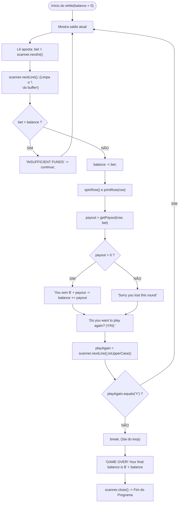

# 🎰 Capítulo 38: Slot Machine em Java — Parte 11
## 🔄 O Loop "Play Again", o Famigerado "Bug do Scanner" e a Mensagem de GAME OVER

> **Arquivo de Estudo:** `Main.java`  
> **Timestamp do Vídeo:** `6:39:42` até `6:40:45` / `12:00:00`  
> **Canal:** Bro Code — *Java Full Course for free*  
> **Objetivo:** Explicar para um iniciante absoluto cada detalhe das 5 telas apresentadas pelo professor: a criação da pergunta para jogar novamente (`playAgain`), o infame **bug do buffer do Scanner** acontecendo ao vivo na tela, a técnica cirúrgica do `scanner.nextLine()` para limpar o buffer, a demonstração completa no console digitando `y` e `n`, e a exibição da mensagem de encerramento (`GAME OVER`) com o saldo final.

---

## 📸 Reconstituição Visual Completa das 5 Imagens (Sem Precisar do Vídeo)

Se você estiver lendo este material no Google Docs ou impresso, aqui está a descrição minuciosa do que aconteceu na tela do Bro Code em cada um dos 5 momentos:

```
+---------------------------------------------------------------------------------------------------+
| MOMENTO 1 (6:39:42): Adicionando a Pergunta "Do you want to play again?"                          |
+---------------------------------------------------------------------------------------------------+
| NA JANELA DO CÓDIGO (IntelliJ IDEA):                                                              |
| No final do loop while(balance > 0), logo após o bloco else da derrota, Bro Code digita:          |
|                                                                                                   |
| 51: System.out.print("Do you want to play again? (Y/N): ");                                       |
| 52: playAgain = scanner.nextLine().toUpperCase();                                                 |
| 53:                                                                                               |
| 54: if(!playAgain.equals("Y")){                                                                   |
| 55:     break;                                                                                    |
| 56: }                                                                                             |
| 57: }                                                                                             |
|                                                                                                   |
| Observação: A variável playAgain foi declarada no topo do método main como String.                |
+---------------------------------------------------------------------------------------------------+
```

```
+---------------------------------------------------------------------------------------------------+
| MOMENTO 2 (6:39:49): O FAMIGERADO BUG DO SCANNER ACONTECE AO VIVO!                                |
+---------------------------------------------------------------------------------------------------+
| Bro Code clica no botão Play para rodar o jogo. Veja o que acontece no terminal:                  |
|                                                                                                   |
| *************************                                                                         |
|   Welcome to Java Slots                                                                           |
| Symbols: 🍒 🍉 🍋 🔔 ⭐                                                                           |
| *************************                                                                         |
| Current balance: $100                                                                             |
| Place your bet amount: 1                                                                          |
| Spinning...                                                                                       |
| *************************                                                                         |
|  🍋 | ⭐ | ⭐                                                                                     |
| *************************                                                                         |
| You won $4                                                                                        |
| Do you want to play again? (Y/N):                                                                  |
| Process finished with exit code 0                                                                 |
|                                                                                                   |
| O SUSTO DO INICIANTE: O programa imprimiu a pergunta "Do you want to play again? (Y/N): "         |
| e ENCERROU IMEDIATAMENTE! Ele nem esperou o professor digitar nada!                               |
| Bro Code seleciona com o mouse a linha da pergunta em AZUL no terminal para mostrar o bug!        |
+---------------------------------------------------------------------------------------------------+
```

```
+---------------------------------------------------------------------------------------------------+
| MOMENTO 3 (6:40:12): A Correção Cirúrgica — Limpando o Buffer do Scanner                         |
+---------------------------------------------------------------------------------------------------+
| Bro Code sobe o código até a linha onde lê a aposta (bet = scanner.nextInt()) e adiciona:         |
|                                                                                                   |
| 23: System.out.print("Place your bet amount: ");                                                  |
| 24: bet = scanner.nextInt();                                                                      |
| 25: scanner.nextLine();   <-- O "ASPIRADOR DE PÓ" DO BUFFER ADICIONADO AQUI!                      |
|                                                                                                   |
| Observação: Há uma lâmpada amarela do IntelliJ piscando na margem da linha 25.                    |
+---------------------------------------------------------------------------------------------------+
```

```
+---------------------------------------------------------------------------------------------------+
| MOMENTO 4 (6:40:29): Teste no Console com o Bug Corrigido (Fluxo Completo)                        |
+---------------------------------------------------------------------------------------------------+
| Agora com o buffer limpo, Bro Code testa novamente no terminal integrado verde:                   |
|                                                                                                   |
| [PRIMEIRA RODADA]:                                                                                |
| Place your bet amount: 1                                                                          |
| Spinning...                                                                                       |
| *************************                                                                         |
|  ⭐ | 🔔 | 🍉                                                                                     |
| *************************                                                                         |
| Sorry you lost this round                                                                         |
| Do you want to play again? (Y/N): y   <-- O PROGRAMA ESPEROU! Bro Code digitou 'y'!               |
|                                                                                                   |
| [SEGUNDA RODADA]:                                                                                 |
| Current balance: $99                                                                              |
| Place your bet amount: 10                                                                         |
| Spinning...                                                                                       |
| *************************                                                                         |
|  🔔 | ⭐ | ⭐                                                                                     |
| *************************                                                                         |
| You won $50                                                                                       |
| Do you want to play again? (Y/N): n   <-- O professor digita 'n' para encerrar!                   |
+---------------------------------------------------------------------------------------------------+
```

```
+---------------------------------------------------------------------------------------------------+
| MOMENTO 5 (6:40:45): A Mensagem de Encerramento (GAME OVER)                                       |
+---------------------------------------------------------------------------------------------------+
| Bro Code desce até logo após o fechamento da chave do while(balance > 0) e adiciona a Linha 60:   |
|                                                                                                   |
| 57: }                                                                                             |
| 58:                                                                                               |
| 59: // DISPLAY EXIT MESSAGE                                                                       |
| 60: System.out.println("GAME OVER! Your final balance is $" + balance);                          |
| 61:                                                                                               |
| 62: scanner.close();                                                                              |
|                                                                                                   |
| Observação: Na parte inferior do editor vemos todos os 3 métodos auxiliares recolhidos:           |
| static String[] spinRow(){...}                                                                    |
| static void printRow(String[] row){...}                                                           |
| static int getPayout(String[] row, int bet){...}                                                  |
+---------------------------------------------------------------------------------------------------+
```

---

## 🧠 Explicação Didática Extrema (Para Leigos Absolutos)

### 1. O que é o "Loop de Jogar Novamente" (`playAgain`)?
Até a Parte 10, o loop `while(balance > 0)` rodava infinitamente até o jogador perder todo o seu dinheiro. Mas e se o jogador ganhar um dinheirão e quiser sair do cassino com o lucro no bolso?  
Precisamos dar a ele a **opção de sair quando quiser**!

Bro Code implementou:
```java
System.out.print("Do you want to play again? (Y/N): ");
playAgain = scanner.nextLine().toUpperCase();

if(!playAgain.equals("Y")){
    break;
}
```

* **`System.out.print(...)`**: Usamos `print` (sem `ln`) para que a resposta do usuário seja digitada **na mesma linha** da pergunta.
* **`scanner.nextLine()`**: Lê o texto digitado pelo usuário até ele apertar ENTER.
* **`.toUpperCase()`**: Converte qualquer letra para MAIÚSCULA. Se o usuário digitar um `y` minúsculo, ele se transforma em `"Y"`. Assim o programa não se confunde com maiúsculas e minúsculas!
* **`if(!playAgain.equals("Y"))`**:
  * O ponto de exclamação `!` é o operador lógico **NÃO (NOT)**.
  * Lemos em voz alta: *"Se a resposta do jogador NÃO for igual a 'Y'..."*
  * Ou seja: se ele digitou `"N"`, `"n"`, `"nao"`, `"sair"` ou qualquer coisa que não seja `"Y"`, o Java executa o comando `break;`!
* **`break;`**: Quebra e interrompe o loop `while` imediatamente, arremessando o ponteiro de execução para fora do loop!

---

### 2. O Infame "Bug do Scanner": Por que o Programa Pulou a Pergunta no Momento 2?

Este é o **bug mais clássico e frustrante de toda a história do Java para iniciantes**. 99% das pessoas que estão aprendendo Java já bateram a cabeça na parede por causa disso!

#### A Metáfora do "Prato de Comida e a Sobremesa" (Buffer do Teclado):
Imagine que o teclado do computador tem um cano de espera chamado **Buffer de Entrada**. Tudo o que você digita fica parado dentro desse cano até o Java engolir.

Quando você apostou `1` e apertou ENTER:
1. Você digitou dois caracteres: o número `1` e a tecla ENTER (que no computador é o caractere especial de quebra de linha: `\n`).
2. O método `scanner.nextInt()` foi chamado:
   * Ele é míope para números: ele engoliu o `1` com gosto.
   * **Mas ele deixou o `\n` (o Enter) abandonado dentro do cano!**
3. A roleta girou, imprimiu o resultado, pagou o prêmio...
4. Chegou na linha 52: `scanner.nextLine()`.
   * O método `nextLine()` tem apenas uma missão na vida: ler tudo até encontrar um `\n`.
   * Ele olhou para o cano e viu: *"Opa! Já tem um `\n` aqui me esperando!"*.
   * Ele **engoliu o `\n` residual imediatamente** e não pediu nada ao usuário!
   * O resultado? A variável `playAgain` recebeu uma String vazia: `""`!
5. O Java testou: `if(!playAgain.equals("Y"))`
   * `""` é diferente de `"Y"`? **SIM!**
   * O Java executou o `break;` e **fechou o programa na hora!**

---

### 3. A Solução: O "Aspirador de Pó" `scanner.nextLine()` (Momento 3)

Como consertamos isso?  
Basta colocar uma linha extra logo após o `nextInt()` para "limpar o cano":

```java
bet = scanner.nextInt();
scanner.nextLine(); // <-- Limpa o \n que ficou sobrando!
```

* **O que essa linha faz?**  
  Ela não guarda nada em nenhuma variável. Ela serve exclusivamente como um **aspirador de pó**: ela engole o `\n` órfão que o `nextInt()` deixou para trás.  
  Assim, quando o código chegar lá embaixo no `playAgain = scanner.nextLine()`, o cano estará 100% limpo e desobstruído. O Java será obrigado a parar e **esperar o usuário digitar `Y` ou `N` e apertar ENTER**!

---

### 4. A Matemática da Rodada 2 no Teste (Momento 4)

No Momento 4, Bro Code jogou duas rodadas:

#### Rodada 1:
* Aposta: \$1.
* Sorteio: `⭐ | 🔔 | 🍉` (todos diferentes).
* Perdeu: Saldo foi para **\$99**.
* Pergunta: `Do you want to play again? (Y/N): ` $\rightarrow$ Digitou `y`.

#### Rodada 2 (Vitória Gigante de \$50):
* Saldo Inicial: **\$99**.
* Aposta: **\$10**.
* O Java desconta a aposta: $\$99 - \$10 = \mathbf{\$89}$.
* Sorteio:
  ```text
  *************************
   🔔 | ⭐ | ⭐
  *************************
  ```
* **O Pagamento:**  
  A máquina detectou o par de estrelas (`⭐ | ⭐`) nas posições 1 e 2!
  Devido à regra de par que Bro Code configurou, o prêmio pago foi de **\$50**!
* **A Matemática do Saldo:**
  $$\text{Novo Saldo} = \$89 + \$50 = \mathbf{\$139}$$
* Pergunta: `Do you want to play again? (Y/N): ` $\rightarrow$ Bro Code digitou `n`!
* O `break;` disparou e o jogo terminou!

---

### 5. A Mensagem de Encerramento (Passo 19 - Display Exit Message)

Fora do loop `while`, na Linha 74:
```java
System.out.println("GAME OVER! Your final balance is $" + balance);
```

* **Quando essa linha é executada?**
  Apenas quando o jogador **sai do loop**. Isso pode acontecer por dois motivos:
  1. O jogador escolheu sair digitando `N` no `playAgain` (acionando o `break;`).
  2. O saldo do jogador zerou ou ficou negativo (`balance <= 0`), fazendo a condição do `while` ser falsa.
* **O que ela exibe?**
  Mostra o encerramento do jogo com o saldo final que restou na conta do jogador.  
  Exemplo: `GAME OVER! Your final balance is $139`.
* **`scanner.close();`**:
  Fecha o leitor do teclado para devolver a memória ao sistema operacional. Boa prática fundamental em Java!

---

## 🗺️ Fluxograma Completo do Loop do Jogo com o Buffer Limpo



---

## 🔍 Análise Linha por Linha de Todo o Código Novo

### Bloco A: Declaração da Variável `playAgain`

```java
15:         String playAgain;
```

* **Linha 15 (`String playAgain;`):**  
  * O que faz: Reserva na memória Stack uma variável de texto para guardar a resposta do usuário (`"Y"` ou `"N"`).  
  * No console: Nada.

---

### Bloco B: O Limpador de Buffer

```java
27:             bet = scanner.nextInt();
28:             scanner.nextLine();
```

* **Linha 27 (`bet = scanner.nextInt();`):**  
  * O que faz: Lê o número inteiro da aposta, deixando o `\n` no buffer do teclado.  
  * No console: Aguarda a digitação do usuário.
* **Linha 28 (`scanner.nextLine();`):**  
  * O que faz: Consome e descarta o `\n` residual, desobstruindo o buffer para leituras futuras.  
  * No console: Nada visível.

---

### Bloco C: A Pergunta de Jogar Novamente e o `break`

```java
65:             // ASK TO PLAY AGAIN
66:             System.out.print("Do you want to play again? (Y/N): ");
67:             playAgain = scanner.nextLine().toUpperCase();
68: 
69:             if(!playAgain.equals("Y")){
70:                 break;
71:             }
```

* **Linha 65 (`// ASK TO PLAY AGAIN`):**  
  * O que faz: Comentário organizador.  
  * No console: Nada.
* **Linha 66 (`System.out.print("Do you want to play again? (Y/N): ");`):**  
  * O que faz: Imprime a pergunta sem pular linha para o cursor piscar ao lado da pergunta.  
  * No console: `Do you want to play again? (Y/N): `
* **Linha 67 (`playAgain = scanner.nextLine().toUpperCase();`):**  
  * O que faz: Pausa a execução, espera o usuário digitar uma resposta, lê a linha inteira e a converte para letras maiúsculas.  
  * No console: O usuário digita `y` ou `n` e aperta ENTER.
* **Linha 68 (Linha em branco):**  
  * O que faz: Clareza visual.  
  * No console: Nada.
* **Linha 69 (`if(!playAgain.equals("Y")){`):**  
  * O que faz: Compara o texto digitado com `"Y"`. Se for diferente de `"Y"` (ou seja, se a resposta foi não), entra no bloco.  
  * No console: Nada.
* **Linha 70 (`break;`):**  
  * O que faz: Interrompe o loop `while` imediatamente e salta para a linha 74.  
  * No console: Nada.
* **Linha 71 (`}`):**  
  * O que faz: Fecha o `if`.  
  * No console: Nada.

---

### Bloco D: A Mensagem de GAME OVER

```java
73:         // DISPLAY EXIT MESSAGE
74:         System.out.println("GAME OVER! Your final balance is $" + balance);
75: 
76:         scanner.close();
```

* **Linha 73 (`// DISPLAY EXIT MESSAGE`):**  
  * O que faz: Comentário indicando a despedida.  
  * No console: Nada.
* **Linha 74 (`System.out.println("GAME OVER! Your final balance is $" + balance);`):**  
  * O que faz: Imprime a mensagem final de encerramento mostrando o saldo que restou.  
  * No console: Exemplo: `GAME OVER! Your final balance is $139`
* **Linha 75 (Linha em branco):**  
  * O que faz: Separação visual.  
  * No console: Nada.
* **Linha 76 (`scanner.close();`):**  
  * O que faz: Fecha o recurso do Scanner, liberando a memória do sistema.  
  * No console: Nada.

---

## 📜 Código-Fonte Completo e Atualizado (`Main.java`)

```java
import java.util.Random;
import java.util.Scanner;

public class Main {
    public static void main(String[] args){

        // JAVA SLOT MACHINE

        // DECLARE VARIABLES
        Scanner scanner = new Scanner(System.in);
        int balance = 100;
        int bet;
        int payout;
        String[] row;
        String playAgain;

        // DISPLAY WELCOME MESSAGE
        System.out.println("*************************");
        System.out.println("  Welcome to Java Slots  ");
        System.out.println("Symbols: 🍒 🍉 🍋 🔔 ⭐ ");
        System.out.println("*************************");

        // PLAY IF BALANCE > 0
        while(balance > 0){
            System.out.println("Current balance: $" + balance);
            System.out.print("Place your bet amount: ");
            bet = scanner.nextInt();
            scanner.nextLine();

            // VERIFY IF BET > BALANCE
            if(bet > balance){
                System.out.println("INSUFFICIENT FUNDS");
                continue;
            }
            // VERIFY IF BET > 0
            else if(bet <= 0){
                System.out.println("Bet must be greater than 0");
                continue;
            }
            // SUBTRACT BET FROM BALANCE
            else{
                balance -= bet;
            }

            System.out.println("Spinning...");

            // SPIN ROW
            row = spinRow();

            // PRINT ROW
            printRow(row);

            // GET PAYOUT
            payout = getPayout(row, bet);

            if(payout > 0){
                System.out.println("You won $" + payout);
                balance += payout;
            }
            else{
                System.out.println("Sorry you lost this round");
            }

            // ASK TO PLAY AGAIN
            System.out.print("Do you want to play again? (Y/N): ");
            playAgain = scanner.nextLine().toUpperCase();

            if(!playAgain.equals("Y")){
                break;
            }
        }

        // DISPLAY EXIT MESSAGE
        System.out.println("GAME OVER! Your final balance is $" + balance);

        scanner.close();
    }

    static String[] spinRow(){

        String[] symbols = {"🍒", "🍉", "🍋", "🔔", "⭐"};
        String[] row = new String[3];
        Random random = new Random();

        for(int i = 0; i < 3; i++){
            row[i] = symbols[random.nextInt(symbols.length)];
        }

        return row;
    }

    static void printRow(String[] row){
        System.out.println("*************************");
        System.out.println(" " + String.join(" | ", row));
        System.out.println("*************************");
    }

    static int getPayout(String[] row, int bet){

        if(row[0].equals(row[1]) && row[1].equals(row[2])){
            return switch(row[0]){
                case "🍒" -> bet * 3;
                case "🍉" -> bet * 4;
                case "🍋" -> bet * 5;
                case "🔔" -> bet * 10;
                case "⭐" -> bet * 20;
                default -> 0;
            };
        }
        else if(row[0].equals(row[1]) || row[1].equals(row[2])){
            return switch(row[0]){
                case "🍒" -> bet * 2;
                case "🍉" -> bet * 3;
                case "🍋" -> bet * 4;
                case "🔔" -> bet * 5;
                case "⭐" -> bet * 10;
                default -> 0;
            };
        }

        return 0;
    }
}
```

---

## ❓ Perguntas Frequentes de Iniciantes (Dúvidas Cruciais)

### 1. Por que usamos `.toUpperCase()` logo após `scanner.nextLine()`?
**Resposta:**  
Porque se o usuário digitar a letra `"y"` minúscula no teclado, `"y".equals("Y")` daria **falso**! O Java é extremamente sensível a maiúsculas e minúsculas (*case-sensitive*).  
Ao encadear o método `.toUpperCase()`, qualquer `"y"` digitado é transformado em `"Y"` antes da comparação, tornando o programa muito mais amigável e tolerante com o jogador!

---

### 2. Sempre que eu usar `scanner.nextInt()` seguido de `scanner.nextLine()` eu preciso colocar um `scanner.nextLine()` extra no meio?
**Resposta:**  
**SIM! Sempre!** Isso vale para `nextInt()`, `nextDouble()`, `nextFloat()` e `nextLong()`. Todos esses métodos lêem apenas os dados numéricos e deixam o `\n` do ENTER preso no buffer. Sempre que a próxima leitura for um texto com `nextLine()`, você é obrigado a colocar uma linha de limpeza (`scanner.nextLine();`) para esvaziar o cano!

---

### 3. E se o jogador digitar "SIM" ou "yes" em vez de "Y"?
**Resposta:**  
No código atual, como comparamos estritamente com `"Y"` (`!playAgain.equals("Y")`), qualquer coisa diferente da letra `"Y"` acionará o `break;` e o jogo terminará. Em versões futuras, você pode aceitar `"YES"` ou `"S"` usando operadores lógicos ou checando a primeira letra com `playAgain.startsWith("Y")`!
