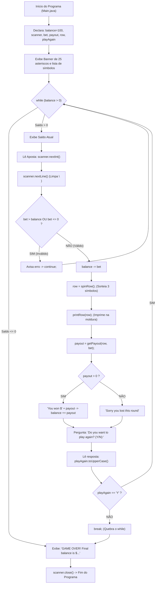

# 🎰 Capítulo 38: Slot Machine em Java — Parte 12 (FINAL)
## 🏆 Sessão Completa de Testes, Encerramento com Lucro (\$117) e Revisão Arquitetural

> **Arquivo de Estudo:** `Main.java`  
> **Timestamp do Vídeo:** `6:41:24` até `6:41:41` / `12:00:00` (Conclusão Oficial do Capítulo 38)  
> **Canal:** Bro Code — *Java Full Course for free*  
> **Objetivo:** Explicar para um iniciante absoluto cada detalhe das 3 telas finais do projeto: a execução prática de rodadas consecutivas com apostas variadas (\$1 e \$10) premiando pares à direita (`🍒 | ⭐ | ⭐` e `⭐ | 🍒 | 🍒`), o encerramento do jogo com `n` ativando a mensagem `GAME OVER` com saldo vencedor de \$117, e a revisão panorâmica de todo o código-fonte de cabo a rabo.

---

## 📸 Reconstituição Visual Completa das 3 Imagens (Sem Precisar do Vídeo)

Se você estiver lendo este material no Google Docs ou impresso, aqui está a descrição minuciosa do que aconteceu na tela do Bro Code em cada um dos 3 momentos de encerramento do projeto:

```
+---------------------------------------------------------------------------------------------------+
| MOMENTO 1 (6:41:24): Teste ao Vivo de Rodadas Múltiplas e Pares à Direita                         |
+---------------------------------------------------------------------------------------------------+
| NO TERMINAL INTEGRADO (Console em Execução em Tela Quase Cheia - Texto Verde):                    |
|                                                                                                   |
| [RODADA COM APOSTA DE $1]:                                                                        |
| Place your bet amount: 1                                                                          |
| Spinning...                                                                                       |
| *************************                                                                         |
|  🍒 | ⭐ | ⭐                                                                                     |
| *************************                                                                         |
| You won $10                                                                                       |
| Do you want to play again? (Y/N): y   <-- Bro Code digita 'y' e aperta ENTER!                     |
|                                                                                                   |
| [RODADA COM APOSTA PESADA DE $10]:                                                                |
| Current balance: $107                                                                             |
| Place your bet amount: 10                                                                         |
| Spinning...                                                                                       |
| *************************                                                                         |
|  ⭐ | 🍒 | 🍒                                                                                     |
| *************************                                                                         |
| You won $20                                                                                       |
| Do you want to play again? (Y/N):     <-- Cursor piscando aguardando a decisão de saída           |
+---------------------------------------------------------------------------------------------------+
```

```
+---------------------------------------------------------------------------------------------------+
| MOMENTO 2 (6:41:35): Encerramento do Jogo com 'n' e GAME OVER Vitorioso                           |
+---------------------------------------------------------------------------------------------------+
| Bro Code digita 'n' e aperta ENTER. Veja o desfecho no terminal:                                  |
|                                                                                                   |
| Do you want to play again? (Y/N): n                                                               |
| GAME OVER! Your final balance is $117                                                             |
|                                                                                                   |
| Process finished with exit code 0                                                                 |
|                                                                                                   |
| DETALHE VISUAL DO PROFESSOR:                                                                      |
| Bro Code passa o mouse e seleciona a palavra "GAME OVER!" em AZUL brilhante para comemorar        |
| que o laço quebrou no momento exato e o saldo final exibiu perfeitamente $117!                     |
+---------------------------------------------------------------------------------------------------+
```

```
+---------------------------------------------------------------------------------------------------+
| MOMENTO 3 (6:41:41): Conclusão Oficial e Revisão do Topo do Código                                |
+---------------------------------------------------------------------------------------------------+
| NA JANELA DO INTELLIJ IDEA:                                                                       |
| O professor rola o arquivo até a linha 7 e seleciona em azul o comentário:                        |
|                                                                                                   |
|    // JAVA SLOT MACHINE                                                                           |
|                                                                                                   |
| Na barra de progresso do YouTube no rodapé:                                                       |
| 6:41:41 / 12:00:00  -- 38.slot machine >                                                          |
| Bro Code finaliza a aula comemorando o funcionamento perfeito de todo o projeto de caça-níqueis!  |
+---------------------------------------------------------------------------------------------------+
```

---

## 🧠 Explicação Didática Extrema (Para Leigos Absolutos)

### 1. O Teste de Pares em Posições Diferentes (O "Pulo do Gato")

Nas aulas anteriores (Parte 10), testamos um par nas posições 0 e 1 (`🍉 | 🍉 | 🍋`).  
Agora, nas duas rodadas do Momento 1, aconteceram dois sorteios incríveis com **pares à direita** (posições 1 e 2):

#### Sorteio A: `🍒 | ⭐ | ⭐` (Aposta: \$1)
* Posição 0: 🍒 (Cereja)
* Posição 1: ⭐ (Estrela)
* Posição 2: ⭐ (Estrela)
* **O que o Java fez?**  
  A primeira checagem de trinca falhou (cereja não é estrela).  
  O Java caiu na regra de par: `row[1].equals(row[2])` deu **TRUE**!  
  O símbolo repetido é a Estrela ⭐!  
  Na tabela de multiplicadores de par: estrela paga **10x** a aposta!  
  $$\text{Prêmio} = 1 \times 10 = \mathbf{\$10}$$
  Console imprimiu: `You won $10`!

#### Sorteio B: `⭐ | 🍒 | 🍒` (Aposta: \$10)
* Posição 0: ⭐ (Estrela)
* Posição 1: 🍒 (Cereja)
* Posição 2: 🍒 (Cereja)
* **O que o Java fez?**  
  A trinca falhou.  
  O par `row[1].equals(row[2])` deu **TRUE**!  
  O símbolo repetido é a Cereja 🍒!  
  Na tabela de par: cereja paga **2x** a aposta!  
  $$\text{Prêmio} = 10 \times 2 = \mathbf{\$20}$$
  Console imprimiu: `You won $20`!

---

### 2. A Elegância do Elemento Central (`row[1]`)

> **💡 O Segredo que Poucos Iniciantes Percebem:**  
> Se temos um vetor de 3 posições (`[0]`, `[1]`, `[2]`), qualquer par consecutivo de elementos adjacentes **sempre conterá a posição central `[1]`**!
> * Se o par estiver na esquerda: `[0]` é igual a `[1]`. (O elemento `[1]` é o símbolo do par!).
> * Se o par estiver na direita: `[1]` é igual a `[2]`. (O elemento `[1]` também é o símbolo do par!).
>
> Por isso, ao avaliar a regra:
> ```java
> else if(row[0].equals(row[1]) || row[1].equals(row[2])){
>     return switch(row[1]){ ... };
> }
> ```
> O `switch(row[1])` funciona perfeitamente para **ambos os lados**! Não precisamos duplicar o código do switch!

---

### 3. A Matemática Financeira Final (O Jogador Saiu no Lucro!)

Vamos auditar todas as contas que a máquina fez para chegar aos **\$117** finais:

| Etapa | Ação do Jogador | Saldo Antes | Movimentação | Saldo Depois | Explicação Matemática |
| :---: | :--- | :---: | :---: | :---: | :--- |
| **Início do Teste** | Saldo da sessão | - | - | **$98** | Saldo vindo dos testes anteriores. |
| **Rodada A** | Apostou $1 | $98 | -$1 | **$97** | Descontado antes do giro. |
| **Rodada A** | Ganhou com `🍒 ⭐ ⭐` | $97 | +$10 | **$107** | Estrelas pagam 10x ($1 * 10 = $10). |
| **Continuação** | Digitou `y` | $107 | $0 | **$107** | O laço recomeça. |
| **Rodada B** | Apostou $10 | $107 | -$10 | **$97** | Descontado antes do giro. |
| **Rodada B** | Ganhou com `⭐ 🍒 🍒` | $97 | +$20 | **$117** | Cerejas pagam 2x ($10 * 2 = $20). |
| **Saída** | Digitou `n` | $117 | $0 | **$117** | O laço quebra com `break;`. |
| **Fim** | GAME OVER | - | - | **$117** | Exibe: `Your final balance is $117`. |

* **Saldo Inicial da Máquina:** \$100  
* **Saldo Final de Retirada:** \$117  
* **Lucro Líquido do Jogador:** **+\$17** (O jogador venceu o cassino!).

---

### 4. O Ciclo de Encerramento com o `break;`

Quando Bro Code digitou `n`:
1. `scanner.nextLine().toUpperCase()` transformou o `n` na letra maiúscula `"N"`.
2. A condição `!playAgain.equals("Y")` testou:  
   *"A letra 'N' é diferente de 'Y'?"* $\rightarrow$ **SIM (True)!**
3. O comando `break;` foi executado.
4. O Java interrompeu o laço `while(balance > 0)` imediatamente e saltou para fora das chaves do loop.
5. A próxima linha executada foi a linha 74:  
   `System.out.println("GAME OVER! Your final balance is $" + balance);`
6. `scanner.close()` fechou a comunicação com o teclado.
7. O Java encerrou com `Process finished with exit code 0` (saída com código 0 = sucesso total, sem falhas).

---

## 🏛️ Revisão Arquitetural: Os 9 Grandes Pilares de Java Usados Neste Projeto

Neste único projeto da Slot Machine, você colocou em prática nada menos que 9 dos maiores conceitos fundamentais de desenvolvimento em Java:

```
+---------------------------------------------------------------------------------------------------+
|                                 ARQUITETURA DA SLOT MACHINE JAVA                                  |
+---------------------------------------------------------------------------------------------------+
| 1. ENTRADA E SAÍDA DE DADOS  -> Scanner, System.out.println() e System.out.print()                |
| 2. ESTRUTURAS DE REPETIÇÃO   -> while (ciclo do jogo) e for (preenchimento dos tambores)          |
| 3. CONTROLE DE FLUXO         -> continue (tratar aposta inválida) e break (sair do jogo)          |
| 4. ESTRUTURAS DE DADOS       -> Arrays unidimensionais (String[] symbols e String[] row)          |
| 5. SORTEIO PSEUDOALEATÓRIO   -> Classe Random e .nextInt(symbols.length)                          |
| 6. MODULARIZAÇÃO DE FUNÇÕES  -> Métodos estáticos: spinRow(), printRow() e getPayout()            |
| 7. TIPOS DE RETORNO E PARÂM. -> Métodos que devolvem void, String[] e int                        |
| 8. JAVA MODERNO (JAVA 14+)   -> Enhanced Switch Expression com seta (->) e retorno de expressão   |
| 9. GERENCIAMENTO DE BUFFER   -> Limpeza do \n residual do teclado com scanner.nextLine()          |
+---------------------------------------------------------------------------------------------------+
```

---

## 🗺️ Mapa Mental do Fluxo de Execução do Sistema



---

## 🔍 Análise Linha por Linha de Todo o Código Final (`Main.java`)

Abaixo está a análise linha por linha do arquivo completo e final do projeto:

```java
1: import java.util.Random;
2: import java.util.Scanner;
3: 
4: public class Main {
5:     public static void main(String[] args){
```
* **Linhas 1-2:** Importa a classe `Random` (gerador aleatório) e a classe `Scanner` (leitor do teclado).  
* **Linha 4:** Declara a classe pública `Main`.  
* **Linha 5:** Ponto de entrada padrão da aplicação (`main`).

```java
7:         // JAVA SLOT MACHINE
8: 
9:         // DECLARE VARIABLES
10:         Scanner scanner = new Scanner(System.in);
11:         int balance = 100;
12:         int bet;
13:         int payout;
14:         String[] row;
15:         String playAgain;
```
* **Linha 10:** Inicializa o Scanner apontado para `System.in`.  
* **Linha 11:** Inicializa o saldo do jogador com 100 dólares.  
* **Linhas 12-15:** Declara as variáveis de controle da rodada: aposta (`bet`), prêmio (`payout`), linha sorteada (`row`) e opção de replay (`playAgain`).

```java
17:         // DISPLAY WELCOME MESSAGE
18:         System.out.println("*************************");
19:         System.out.println("  Welcome to Java Slots  ");
20:         System.out.println("Symbols: 🍒 🍉 🍋 🔔 ⭐ ");
21:         System.out.println("*************************");
```
* **Linhas 18-21:** Imprime o banner estético de boas-vindas com a moldura de 25 asteriscos e os 5 símbolos disponíveis.

```java
23:         // PLAY IF BALANCE > 0
24:         while(balance > 0){
25:             System.out.println("Current balance: $" + balance);
26:             System.out.print("Place your bet amount: ");
27:             bet = scanner.nextInt();
28:             scanner.nextLine();
```
* **Linha 24:** Inicia o loop que mantém o jogo rodando enquanto o saldo for positivo.  
* **Linhas 25-26:** Exibe o saldo e pede a quantia da aposta.  
* **Linha 27:** Lê o número inteiro digitado pelo jogador.  
* **Linha 28:** **Limpa o buffer do teclado**, consumindo o `\n` residual para evitar o bug do Scanner.

```java
30:             // VERIFY IF BET > BALANCE
31:             if(bet > balance){
32:                 System.out.println("INSUFFICIENT FUNDS");
33:                 continue;
34:             }
35:             // VERIFY IF BET > 0
36:             else if(bet <= 0){
37:                 System.out.println("Bet must be greater than 0");
38:                 continue;
39:             }
40:             // SUBTRACT BET FROM BALANCE
41:             else{
42:                 balance -= bet;
43:             }
```
* **Linhas 31-34:** Impede apostas maiores do que o saldo usando `continue;` para reiniciar o loop.  
* **Linhas 36-39:** Impede apostas de valor zero ou negativo.  
* **Linhas 41-43:** Desconta o valor apostado do saldo do jogador antes do giro.

```java
45:             System.out.println("Spinning...");
46: 
47:             // SPIN ROW
48:             row = spinRow();
49: 
50:             // PRINT ROW
51:             printRow(row);
```
* **Linha 45:** Imprime o aviso de suspense `"Spinning..."`.  
* **Linha 48:** Chama o método `spinRow()` para sortear os 3 símbolos e guarda o resultado em `row`.  
* **Linha 51:** Chama o método `printRow(row)` para desenhar a linha sorteada entre as molduras de asteriscos.

```java
53:             // GET PAYOUT
54:             payout = getPayout(row, bet);
55: 
56:             if(payout > 0){
57:                 System.out.println("You won $" + payout);
58:                 balance += payout;
59:             }
60:             else{
61:                 System.out.println("Sorry you lost this round");
62:             }
```
* **Linha 54:** Chama o método `getPayout(row, bet)` que calcula os ganhos com base nas combinações.  
* **Linhas 56-59:** Se ganhou (`payout > 0`), imprime a vitória e adiciona o prêmio ao saldo (`balance += payout`).  
* **Linhas 60-62:** Se perdeu, exibe a mensagem de consolo.

```java
64:             // ASK TO PLAY AGAIN
65:             System.out.print("Do you want to play again? (Y/N): ");
66:             playAgain = scanner.nextLine().toUpperCase();
67: 
68:             if(!playAgain.equals("Y")){
69:                 break;
70:             }
71:         }
```
* **Linhas 65-66:** Pergunta se o jogador deseja jogar novamente e converte a resposta para maiúscula.  
* **Linhas 68-70:** Se a resposta não for `"Y"`, executa `break;` e encerra o laço.

```java
73:         // DISPLAY EXIT MESSAGE
74:         System.out.println("GAME OVER! Your final balance is $" + balance);
75: 
76:         scanner.close();
77:     }
```
* **Linha 74:** Exibe a mensagem de término com o saldo final conquistado pelo jogador.  
* **Linha 76:** Fecha o Scanner.

```java
79:     static String[] spinRow(){
80: 
81:         String[] symbols = {"🍒", "🍉", "🍋", "🔔", "⭐"};
82:         String[] row = new String[3];
83:         Random random = new Random();
84: 
85:         for(int i = 0; i < 3; i++){
86:             row[i] = symbols[random.nextInt(symbols.length)];
87:         }
88: 
89:         return row;
90:     }
```
* **Linhas 79-90:** Método modular que preenche e devolve um array de 3 posições sorteadas aleatoriamente a partir do array de 5 símbolos.

```java
92:     static void printRow(String[] row){
93:         System.out.println("*************************");
94:         System.out.println(" " + String.join(" | ", row));
95:         System.out.println("*************************");
96:     }
```
* **Linhas 92-96:** Método que formata a saída visual com 25 asteriscos no topo, os 3 símbolos separados por barras verticais no meio, e 25 asteriscos no rodapé.

```java
98:     static int getPayout(String[] row, int bet){
99: 
100:         if(row[0].equals(row[1]) && row[1].equals(row[2])){
101:             return switch(row[0]){
102:                 case "🍒" -> bet * 3;
103:                 case "🍉" -> bet * 4;
104:                 case "🍋" -> bet * 5;
105:                 case "🔔" -> bet * 10;
106:                 case "⭐" -> bet * 20;
107:                 default -> 0;
108:             };
109:         }
110:         else if(row[0].equals(row[1]) || row[1].equals(row[2])){
111:             return switch(row[1]){
112:                 case "🍒" -> bet * 2;
113:                 case "🍉" -> bet * 3;
114:                 case "🍋" -> bet * 4;
115:                 case "🔔" -> bet * 5;
116:                 case "⭐" -> bet * 10;
117:                 default -> 0;
118:             };
119:         }
120: 
121:         return 0;
122:     }
123: }
```
* **Linhas 98-123:** O motor matemático de pagamento:
  * Linhas 100-109: Avalia trincas com a propriedade transitiva (`0 == 1 && 1 == 2`) e paga multiplicadores de 3x a 20x.
  * Linhas 110-119: Avalia pares em qualquer lado (`0 == 1 || 1 == 2`) usando o elemento central `row[1]` e paga multiplicadores de 2x a 10x.
  * Linha 121: Devolve `0` se não houver combinação vencedora.

---

## 📜 Código-Fonte Completo e Oficial (`Main.java`)

```java
import java.util.Random;
import java.util.Scanner;

public class Main {
    public static void main(String[] args){

        // JAVA SLOT MACHINE

        // DECLARE VARIABLES
        Scanner scanner = new Scanner(System.in);
        int balance = 100;
        int bet;
        int payout;
        String[] row;
        String playAgain;

        // DISPLAY WELCOME MESSAGE
        System.out.println("*************************");
        System.out.println("  Welcome to Java Slots  ");
        System.out.println("Symbols: 🍒 🍉 🍋 🔔 ⭐ ");
        System.out.println("*************************");

        // PLAY IF BALANCE > 0
        while(balance > 0){
            System.out.println("Current balance: $" + balance);
            System.out.print("Place your bet amount: ");
            bet = scanner.nextInt();
            scanner.nextLine();

            // VERIFY IF BET > BALANCE
            if(bet > balance){
                System.out.println("INSUFFICIENT FUNDS");
                continue;
            }
            // VERIFY IF BET > 0
            else if(bet <= 0){
                System.out.println("Bet must be greater than 0");
                continue;
            }
            // SUBTRACT BET FROM BALANCE
            else{
                balance -= bet;
            }

            System.out.println("Spinning...");

            // SPIN ROW
            row = spinRow();

            // PRINT ROW
            printRow(row);

            // GET PAYOUT
            payout = getPayout(row, bet);

            if(payout > 0){
                System.out.println("You won $" + payout);
                balance += payout;
            }
            else{
                System.out.println("Sorry you lost this round");
            }

            // ASK TO PLAY AGAIN
            System.out.print("Do you want to play again? (Y/N): ");
            playAgain = scanner.nextLine().toUpperCase();

            if(!playAgain.equals("Y")){
                break;
            }
        }

        // DISPLAY EXIT MESSAGE
        System.out.println("GAME OVER! Your final balance is $" + balance);

        scanner.close();
    }

    static String[] spinRow(){

        String[] symbols = {"🍒", "🍉", "🍋", "🔔", "⭐"};
        String[] row = new String[3];
        Random random = new Random();

        for(int i = 0; i < 3; i++){
            row[i] = symbols[random.nextInt(symbols.length)];
        }

        return row;
    }

    static void printRow(String[] row){
        System.out.println("*************************");
        System.out.println(" " + String.join(" | ", row));
        System.out.println("*************************");
    }

    static int getPayout(String[] row, int bet){

        if(row[0].equals(row[1]) && row[1].equals(row[2])){
            return switch(row[0]){
                case "🍒" -> bet * 3;
                case "🍉" -> bet * 4;
                case "🍋" -> bet * 5;
                case "🔔" -> bet * 10;
                case "⭐" -> bet * 20;
                default -> 0;
            };
        }
        else if(row[0].equals(row[1]) || row[1].equals(row[2])){
            return switch(row[1]){
                case "🍒" -> bet * 2;
                case "🍉" -> bet * 3;
                case "🍋" -> bet * 4;
                case "🔔" -> bet * 5;
                case "⭐" -> bet * 10;
                default -> 0;
            };
        }

        return 0;
    }
}
```

---

## 🏆 Conclusão do Capítulo 38

Parabéns! Você acaba de dissecar e dominar por completo a **Máquina Caça-Níqueis (Slot Machine) em Java** do curso do Bro Code.  
Este projeto combina controle de fluxo, validações defensivas, estruturas de repetição, vetores dinâmicos, métodos modulares limpos e os recursos mais modernos da linguagem Java (como o Enhanced Switch Expression).  
Você agora possui uma base sólida e prática de programação orientada a lógica para encarar os próximos capítulos avançados!
