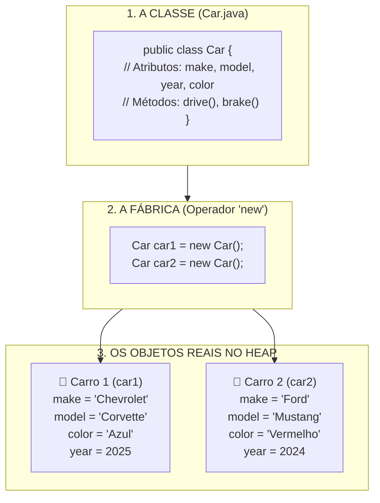

# 🧱 Capítulo 39: Programação Orientada a Objetos (OOP) em Java — Parte 1
## 🚗 O Despertar da OOP: O que é um Objeto, a Planta Baixa (Classe) vs o Carro Real (Objeto) e a Memória Stack vs Heap

> **Arquivos de Estudo:** `Main.java` e `Car.java`  
> **Timestamp do Vídeo:** `6:41:50` até `6:42:52` / `12:00:00`  
> **Canal:** Bro Code — *Java Full Course for free*  
> **Objetivo:** Explicar para um iniciante absoluto cada detalhe das 4 primeiras telas do Capítulo 39: a definição formal de **Objeto**, a analogia de objetos do cotidiano (iPhone, Caneca de Café e Microfone), a diferença física entre **Classe (Planta Técnica / Blueprint)** e **Objeto (Instância Real)**, e o modelo de memória interna do computador dividida entre **Stack (Pilha)** e **Heap (Monte)**.

---

## 📸 Reconstituição Visual Completa das 4 Imagens (Sem Precisar do Vídeo)

Se você estiver lendo este material no Google Docs ou impresso, aqui está a descrição minuciosa do que aconteceu na tela do Bro Code em cada um dos 4 momentos de abertura do capítulo:

```
+---------------------------------------------------------------------------------------------------+
| MOMENTO 1 (6:41:50): A Definição em Três Linhas no IntelliJ IDEA                                  |
+---------------------------------------------------------------------------------------------------+
| NA JANELA DO CÓDIGO (Main.java limpo para o novo capítulo):                                       |
|                                                                                                   |
| 1: public class Main {                                                                            |
| 2:     public static void main(String[] args) {                                                   |
| 3:                                                                                                |
| 4:         // Object = An entity that holds data (attributes)                                     |
| 5:         //          and can perform actions (methods)                                          |
| 6:         //          It is a reference data type                                                |
| 7:                                                                                                |
| 8:     }                                                                                          |
| 9: }                                                                                              |
|                                                                                                   |
| DETALHE VISUAL DO PROFESSOR:                                                                      |
| Bro Code passa o mouse e seleciona com destaque AZUL a palavra "Object" na linha 4.              |
+---------------------------------------------------------------------------------------------------+
```

```
+---------------------------------------------------------------------------------------------------+
| MOMENTO 2 (6:42:05): Objetos do Mundo Real (A Metáfora Visual)                                    |
+---------------------------------------------------------------------------------------------------+
| O que Bro Code faz:                                                                              |
| Ele coloca 3 imagens fotográficas reais sobrepostas na tela para ensinar o que é um objeto:      |
|                                                                                                   |
|   1. À ESQUERDA: Um iPhone moderno (smartphone roxo/preto).                                       |
|   2. AO CENTRO: Uma pessoa segurando uma Caneca Gigante cheia de café fumegante.                  |
|   3. À DIREITA: Um microfone profissional Blue Yeti azul metálico sobre uma base de mesa.         |
|                                                                                                   |
| DETALHE NA INTERFACE DA IDE (Abas e Arquivos):                                                    |
| No topo das abas do editor aparecem: [Main.java] e [Car.java]!                                    |
| Na árvore de arquivos à esquerda (pasta src), já existem dois arquivos: "Car" e "Main".          |
| Bro Code já preparou o arquivo da nossa primeira classe personalizada: Car.java!                 |
+---------------------------------------------------------------------------------------------------+
```

```
+---------------------------------------------------------------------------------------------------+
| MOMENTO 3 (6:42:25): O Diagrama de Memória (Stack vs Heap)                                        |
+---------------------------------------------------------------------------------------------------+
| Bro Code seleciona em azul a expressão "holds data" na linha 4 e sobrepõe um diagrama técnico     |
| de arquitetura de memória do computador:                                                          |
|                                                                                                   |
|        +-----------------------------------+  <-- High address (Endereços Altos de Memória)       |
|        |               STACK               |  (Pilha de Execução - Vermelho)                      |
|        |                 |                 |  (Cresce para baixo: seta para baixo ↓)             |
|        +-----------------v-----------------+                                                      |
|        |                                   |                                                      |
|        |         (Memória Livre)           |                                                      |
|        |                                   |                                                      |
|        +-----------------^-----------------+                                                      |
|        |                 |                 |  (Cresce para cima: seta para cima ↑)               |
|        |               HEAP                |  (Monte de Alocação Dinâmica - Azul Ciano)          |
|        +-----------------------------------+                                                      |
|        |          Uninitialized data       |                                                      |
|        +-----------------------------------+                                                      |
|        |           Initialized data        |                                                      |
|        +-----------------------------------+                                                      |
|        |                 Text              |  <-- Low address (Código binário do programa)        |
|        +-----------------------------------+                                                      |
|                                                                                                   |
| O professor explica: "It is a reference data type" -> Objetos não cabem na Stack! Eles vivem     |
| no Heap, e a nossa variável guarda apenas uma "etiqueta/ponteiro" que aponta para lá!            |
+---------------------------------------------------------------------------------------------------+
```

```
+---------------------------------------------------------------------------------------------------+
| MOMENTO 4 (6:42:52): A Planta Baixa do Carro (Class = Blueprint)                                 |
+---------------------------------------------------------------------------------------------------+
| Bro Code clica duas vezes e seleciona a palavra-chave "class" na linha 1 em AZUL.                 |
| Ele sobrepõe na tela a imagem de um BLUEPRINT TÉCNICO AZUL DE UM CARRO:                           |
|                                                                                                   |
| +-----------------------------------------------------------------------------------------------+ |
| |                                 BLUEPRINT / PLANTA BAIXA TÉCNICA                              | |
| |   [Vista Lateral do Carro com cotas L e W]        [Vista Frontal com altura H e largura X]    | |
| |                                                                                               | |
| |   [Vista Superior do Carro com teto e capô]       [Vista Traseira com largura Y e base Z]     | |
| +-----------------------------------------------------------------------------------------------+ |
|                                                                                                   |
| A analogia máxima de Bro Code:                                                                    |
| "A Classe é o papel azul, o desenho, a receita. Você não pode dirigir o desenho do carro!        |
| O Objeto é o carro de metal e rodas construído no mundo real a partir daquele desenho!"           |
+---------------------------------------------------------------------------------------------------+
```

---

## 🧠 Explicação Didática Extrema (Para Leigos Absolutos)

### 1. O que é "Programação Orientada a Objetos" (OOP) e por que ela existe?

Até o Capítulo 38, estávamos programando no estilo **Procedural**:
* Tínhamos um método `main`, criávamos variáveis soltas (`int balance`, `int bet`, `String[] row`) e chamávamos funções soltas (`spinRow()`, `printRow()`).
* Isso funciona muito bem para programas pequenos de 50 a 100 linhas.
* Mas imagine se você estivesse programando o sistema de um banco real (como Nubank ou Itaú), ou um jogo gigante como GTA ou Minecraft:
  * Como você organizaria 500 mil linhas de código se tivesse que deixar tudo solto? Seria um caos absoluto!

Para resolver isso, os cientistas da computação olharam para o mundo real e pensaram:  
> *"Como os seres humanos entendem o universo? Nós não pensamos em variáveis soltas. Nós enxergamos **OBJETOS**!"*

Na sua mesa agora:
* Você vê uma **garrafa de água** (um objeto).
* Você vê um **computador** (um objeto).
* Você vê uma **caneta** (um objeto).

A **Programação Orientada a Objetos (OOP)** é a arte de programar modelando o software com base em coisas do mundo real!

---

### 2. Os Três Pilares da Definição de um Objeto (Linhas 4 a 6)

Bro Code resumiu a essência de um objeto em uma frase magistral:
```java
// Object = An entity that holds data (attributes)
//          and can perform actions (methods)
//          It is a reference data type
```

Vamos dissecar cada uma dessas 3 partes fundamentais:

#### Pilar 1: "Holds Data (Attributes)" — O que o objeto TEM ou É
São as **características, propriedades ou estado** do objeto. Em Java, atributos são simplesmente **variáveis** que moram dentro do objeto.
* Exemplo: Um carro tem cor (`color = "vermelho"`), ano de fabricação (`year = 2024`), velocidade atual (`speed = 0`) e preço (`price = 50000.00`).

#### Pilar 2: "Can Perform Actions (Methods)" — O que o objeto FAZ
São os **comportamentos, ações ou verbos** que o objeto é capaz de realizar. Em Java, ações são simplesmente **métodos (funções)** pertencentes ao objeto.
* Exemplo: Um carro pode `drive()` (acelerar/dirigir), `brake()` (frear), e `honk()` (buzinar).

#### Pilar 3: "It is a Reference Data Type" — Onde ele vive na memória
Um objeto não é um tipo primitivo minúsculo como um `int` ou um `boolean`. Ele é grande e complexo! Por isso, ele é um **tipo por referência** (ele vive no **Heap**, e a nossa variável guarda apenas o endereço dele).

---

### 3. A Metáfora dos Objetos do Dia a Dia (iPhone, Caneca e Microfone)

Observe como tudo o que o Bro Code mostrou na tela no Momento 2 se encaixa perfeitamente na regra dos **Atributos (Dados)** + **Métodos (Ações)**:

| Objeto Real | Atributos (O que ele TEM / Dados) | Métodos (O que ele FAZ / Ações) |
| :--- | :--- | :--- |
| **📱 iPhone** | • `model = "iPhone 14"`<br>• `color = "Roxo"`<br>• `battery = 85`<br>• `isOn = true` | • `makeCall()` (fazer ligação)<br>• `takePhoto()` (tirar foto)<br>• `playRingtone()` (tocar alarme) |
| **☕ Caneca de Café** | • `capacity = 500` (ml)<br>• `color = "Branca"`<br>• `isFull = true`<br>• `temperature = 75.5` | • `fill()` (encher)<br>• `drink()` (beber)<br>• `spill()` (derramar)<br>• `wash()` (lavar) |
| **🎙️ Microfone Yeti** | • `brand = "Blue"`<br>• `color = "Azul metálico"`<br>• `isMuted = false`<br>• `gain = 6` | • `recordAudio()` (gravar áudio)<br>• `mute()` (mutar som)<br>• `adjustGain()` (mudar volume) |

Percebe como o Java reflete exatamente a nossa realidade? Tudo tem propriedades e comportamentos!

---

### 4. A Grande Diferença: **Classe (Class)** vs **Objeto (Object)**

Esta é a dúvida mais comum de quem está começando a aprender OOP. Bro Code explicou com a imagem do **Blueprint (Planta Baixa do Carro)**:

```
+---------------------------------------------------------------------------------------------------+
|                        CLASSE (CLASS)                 vs              OBJETO (OBJECT)             |
+---------------------------------------------------------------------------------------------------+
| Definição:   A Planta Baixa / O Projeto / O Molde     | Definição:   O Carro Real / A Construção  |
| Natureza:    Abstrata (apenas no papel / no código)   | Natureza:    Concreta (existe de verdade) |
| Existência:  Você escreve UMA ÚNICA VEZ (Car.java)    | Existência:  Pode criar QUANTOS QUISER!   |
| Na Garagem:  Você NÃO PODE dirigir a planta de papel! | Na Garagem:  Você liga o motor e acelera! |
| Na Memória:  Não ocupa espaço dinâmico de dados       | Na Memória:  Ocupa espaço real no Heap!   |
+---------------------------------------------------------------------------------------------------+
```

#### A Analogia da Fôrma de Bolo:
* A **Classe** é a fôrma de metal em formato de coração. Você não come a fôrma de metal!
* O **Objeto** é o bolo de chocolate quentinho que saiu de dentro daquela fôrma. Você pode usar a mesma fôrma para assar 50 bolos de sabores diferentes!
* No nosso projeto Java:
  * O arquivo [`Car.java`](../../../src/main/java/com/mickaelgeronimo/mastery/core/oop/Car.java) será a **Classe** (o molde do carro).
  * No arquivo [`Main.java`](../../../src/main/java/com/mickaelgeronimo/mastery/core/concurrency/Main.java), nós vamos usar a palavra-chave `new` para fabricar os **Carros Reais** (os objetos)!

---

### 5. O que Significa a Palavra "Instância" (*Instance*)?
Quando programadores experientes dizem:
> *"Criei uma **instância** da classe Car!"*

Não se assuste com a palavra chique!  
**Instanciar** significa simplesmente **"dar vida"**, **"construir no mundo real"** ou **"fabricar um objeto a partir do molde"**.  
* Dizer: *"Criei um objeto Car"* e dizer *"Criei uma instância de Car"* é **exatamente a mesma coisa!**

---

### 6. Como a Memória do Computador Funciona: Stack (Pilha) vs Heap (Monte)

No Momento 3, o Bro Code exibiu o diagrama de arquitetura de memória do sistema operacional. Vamos entender isso de forma cristalina:

```text
========================================================================================
MEMÓRIA STACK (PILHA DE EXECUÇÃO)            MEMÓRIA HEAP (MONTE DINÂMICO)
========================================================================================
- Rápida, organizada e temporária.           - Gigante, dinâmica e flexível.
- Guarda variáveis locais e tipos            - Guarda TODOS OS OBJETOS criados com 'new'.
  primitivos (int, double, boolean).
- Guarda o "endereço" de onde o              - Aqui nasce o Carro Real com seus dados:
  objeto mora no Heap!                         [make = "Chevrolet", model = "Corvette"]

[Variável 'car1' na Stack]
  Endereço: 0x4A1F ------------------------>  Objeto Car real alocado no endereço 0x4A1F
========================================================================================
```

#### A Metáfora do "Post-it e o Galpão":
* Imagine que você aluga um galpão imenso na cidade (a memória **Heap**).
* Lá dentro, você guarda um carro importado novinho (o **Objeto**).
* No seu bolso (a memória **Stack**), você não carrega o carro de duas toneladas! Você carrega apenas um pedaço de papel (um **Post-it**) onde está escrito o endereço do galpão: *"Rua das Flores, Box 42"*.
* Esse papelzinho com o endereço é a sua **Variável de Referência**!
* Quando você escreve no código `car1.drive()`, o Java olha o endereço no papelzinho, vai até o galpão no Heap, liga o carro e manda ele andar!

---

## 🗺️ Diagrama Visual: Da Planta Técnica (Classe) ao Objeto na Memória



---

## 🔍 Análise Linha por Linha do Código Inicial

Abaixo está a análise linha por linha do arquivo [`Main.java`](../../../src/main/java/com/mickaelgeronimo/mastery/core/concurrency/Main.java):

```java
1: public class Main {
2:     public static void main(String[] args) {
3: 
4:         // Object = An entity that holds data (attributes)
5:         //          and can perform actions (methods)
6:         //          It is a reference data type
7: 
8:     }
9: }
```

* **Linha 1 (`public class Main {`):**  
  * O que faz: Declara a classe principal do programa chamada `Main`. A palavra-chave `class` indica que este arquivo é uma "planta".  
  * No console: Nada.
* **Linha 2 (`public static void main(String[] args) {`):**  
  * O que faz: É a porta de entrada onde o computador inicia a execução do código Java.  
  * No console: Nada.
* **Linha 3 (Linha em branco):**  
  * O que faz: Organização visual.  
  * No console: Nada.
* **Linha 4 (`// Object = An entity that holds data (attributes)`):**  
  * O que faz: Comentário explicando que um Objeto é uma entidade que armazena dados através de atributos (variáveis internas).  
  * No console: Nada (comentários são ignorados pelo compilador).
* **Linha 5 (`//          and can perform actions (methods)`):**  
  * O que faz: Comentário explicando que o Objeto é capaz de executar ações através de métodos (funções internas).  
  * No console: Nada.
* **Linha 6 (`//          It is a reference data type`):**  
  * O que faz: Comentário explicando que o Objeto é um tipo por referência, alocado no Heap e apontado por uma variável na Stack.  
  * No console: Nada.
* **Linha 7 (Linha em branco):**  
  * O que faz: Clareza visual.  
  * No console: Nada.
* **Linha 8 (`}`):**  
  * O que faz: Fecha o bloco do método `main`.  
  * No console: Nada.
* **Linha 9 (`}`):**  
  * O que faz: Fecha a classe `Main`.  
  * No console: Nada.

---

### E o arquivo `Car.java`?

```java
1: public class Car {
2: 
3: }
```
* **Linha 1 (`public class Car {`):**  
  * O que faz: Cria o molde da nossa classe de carros. Todo carro que criarmos no futuro obedecerá às regras que escrevermos dentro deste arquivo.  
  * No console: Nada.
* **Linha 3 (`}`):**  
  * O que faz: Fecha a classe `Car`.

---

## 📜 Código-Fonte Atual dos Arquivos do Projeto

### Arquivo 1: [`Main.java`](../../../src/main/java/com/mickaelgeronimo/mastery/core/concurrency/Main.java)
```java
public class Main {
    public static void main(String[] args) {

        // Object = An entity that holds data (attributes)
        //          and can perform actions (methods)
        //          It is a reference data type

    }
}
```

### Arquivo 2: [`Car.java`](../../../src/main/java/com/mickaelgeronimo/mastery/core/oop/Car.java)
```java
public class Car {

}
```

---

## ❓ Perguntas Frequentes de Iniciantes (Dúvidas Cruciais)

### 1. Se eu compilar e rodar o programa agora, vai aparecer alguma coisa no terminal?
**Resposta:**  
**NÃO!** O terminal ficará completamente em branco e terminará com `Process finished with exit code 0`.  
Isso é 100% normal, porque até este momento nós só escrevemos a definição teórica e criamos o molde vazio da classe `Car`. Nos próximos minutos da aula, Bro Code vai preencher `Car.java` com atributos e métodos, e instanciá-lo em `Main.java` usando `System.out.println()` para vermos a mágica acontecer no console!

---

### 2. Por que o Bro Code criou um arquivo separado chamado `Car.java` em vez de escrever a classe dentro do `Main.java`?
**Resposta:**  
Por **organização e convenção oficial da linguagem Java**!  
Em Java, a regra padrão é: **uma classe pública por arquivo**, e o nome do arquivo deve ser exatamente idêntico ao nome da classe (com `.java` no fim).  
Separar em arquivos diferentes permite que vários programadores trabalhem no mesmo projeto ao mesmo tempo sem bagunçar o código dos colegas!

---

### 3. Já usamos Objetos antes nos capítulos anteriores sem saber?
**Resposta:**  
**SIM, COM CERTEZA!** Desde o Capítulo 1 você já estava usando Orientação a Objetos:
* Quando você escreveu `Scanner scanner = new Scanner(System.in);`, você criou um **Objeto** da classe `Scanner` usando o operador `new`!
* Quando você escreveu `Random random = new Random();`, você criou um **Objeto** da classe `Random`!
* Quando você escreveu `String nome = "Bro";`, `String` em Java é uma **Classe**, e `nome` é um objeto cheio de métodos como `.length()`, `.toUpperCase()`, `.equals()`!  
A única diferença é que agora, no Capítulo 39, **você aprenderá a criar as suas próprias classes personalizadas do zero!**
