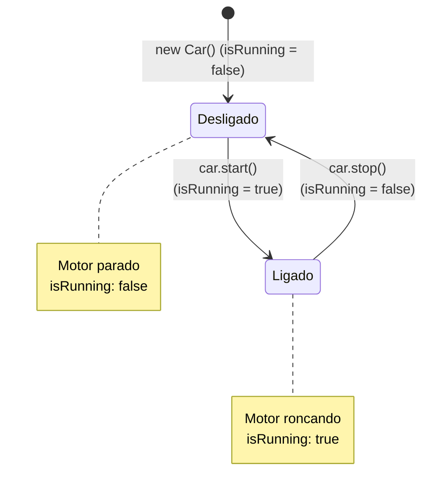

# 🧱 Capítulo 39: Programação Orientada a Objetos (OOP) em Java — Parte 5
## 🏎️ Dando Vida ao Objeto: Métodos de Instância (`start` e `stop`), Ações e a Alternância de Estado

> **Arquivos de Estudo:** `Car.java` e `Main.java`  
> **Timestamp do Vídeo:** `6:47:38` até `6:48:56` / `12:00:00`  
> **Canal:** Bro Code — *Java Full Course for free*  
> **Objetivo:** Explicar para um iniciante absoluto cada detalhe das 5 telas do vídeo: como criar os primeiros **Métodos de Instância** (`start()` e `stop()`) dentro da classe `Car.java`, por que eles **não** usam a palavra `static`, como acionar essas ações no `Main.java` usando o operador ponto, e como o ciclo completo de ligar e desligar o motor altera dinamicamente o estado da variável `isRunning` gerando a sequência clássica no console: `false` $\rightarrow$ `You start the engine` $\rightarrow$ `true` $\rightarrow$ `You stop the engine` $\rightarrow$ `false`.

---

## 📸 Reconstituição Visual Completa das 5 Imagens (Sem Precisar do Vídeo)

Se você estiver lendo este material no Google Docs ou impresso, aqui está a descrição minuciosa do que aconteceu na tela do Bro Code em cada um dos 5 momentos da aula:

```
+---------------------------------------------------------------------------------------------------+
| MOMENTO 1 (6:47:38): Criando o Primeiro Método em Car.java (start)                                |
+---------------------------------------------------------------------------------------------------+
| NA JANELA DO CÓDIGO (Aba Car.java ativa):                                                         |
| Abaixo dos 5 atributos, Bro Code adiciona a primeira AÇÃO que o carro pode executar:             |
|                                                                                                   |
|  9:     void start(){                                                                             |
| 10:         System.out.println("You start the engine");                                           |
| 11:     }                                                                                         |
|                                                                                                   |
| Observação Visual: Repare que o método NÃO tem a palavra-chave "static"! Ele é "void start()".    |
| O cursor do teclado pisca na linha 12 preparando o próximo método.                                |
+---------------------------------------------------------------------------------------------------+
```

```
+---------------------------------------------------------------------------------------------------+
| MOMENTO 2 (6:48:00): Chamando a Ação no Main.java (car.start())                                   |
+---------------------------------------------------------------------------------------------------+
| NA JANELA DO CÓDIGO (Aba Main.java ativa):                                                        |
| Bro Code limpa as impressões antigas de atributos e digita a chamada do método:                   |
|                                                                                                   |
|  9:         Car car = new Car();                                                                  |
| 10:                                                                                               |
| 11:         car.start();                                                                          |
| 12:                                                                                               |
|                                                                                                   |
| Observação Visual: O cursor do mouse vai até o botão verde de Play no canto superior direito      |
| para demonstrar o carro executando sua ação pela primeira vez!                                    |
+---------------------------------------------------------------------------------------------------+
```

```
+---------------------------------------------------------------------------------------------------+
| MOMENTO 3 (6:48:15): Criando o Método stop() e Testando Ambos no Terminal                         |
+---------------------------------------------------------------------------------------------------+
| Bro Code adiciona o método stop() em Car.java e chama car.stop() no Main.java.                    |
| Veja a saída do console no terminal verde:                                                        |
|                                                                                                   |
| You start the engine                                                                              |
| You stop the engine                                                                               |
|                                                                                                   |
| Process finished with exit code 0                                                                 |
|                                                                                                   |
| DETALHE VISUAL DO PROFESSOR:                                                                      |
| Bro Code passa o mouse e seleciona com destaque AZUL a frase "You stop the engine".                |
+---------------------------------------------------------------------------------------------------+
```

```
+---------------------------------------------------------------------------------------------------+
| MOMENTO 4 (6:48:40): Monitorando o Estado de isRunning no Editor                                  |
+---------------------------------------------------------------------------------------------------+
| Bro Code estrutura um teste definitivo no Main.java para provar que os métodos afetam o estado:  |
|                                                                                                   |
|  8:         Car car = new Car();                                                                  |
|  9:                                                                                               |
| 10:                                                                                               |
| 11:         System.out.println(car.isRunning);                                                    |
| 12:         car.start();                                                                          |
| 13:                                                                                               |
| 14:         car.stop();                                                                           |
|                                                                                                   |
| O professor prepara impressões de "car.isRunning" intercaladas antes e depois de cada ação!       |
+---------------------------------------------------------------------------------------------------+
```

```
+---------------------------------------------------------------------------------------------------+
| MOMENTO 5 (6:48:56): A Sinfonia Completa da Orientação a Objetos no Terminal                      |
+---------------------------------------------------------------------------------------------------+
| O terminal integrado ocupa a tela exibindo a sequência perfeita de 5 linhas:                     |
|                                                                                                   |
| false                                                                                             |
| You start the engine                                                                              |
| true                                                                                              |
| You stop the engine                                                                               |
| false                                                                                             |
|                                                                                                   |
| Process finished with exit code 0                                                                 |
|                                                                                                   |
| O professor comemora: "Vejam que perfeição! O carro começa desligado (false). Nós chamamos       |
| car.start(), o motor liga e vira true. Nós chamamos car.stop(), o motor desliga e volta a ser     |
| false! O método controla o próprio estado do objeto!".                                            |
+---------------------------------------------------------------------------------------------------+
```

---

## 🧠 Explicação Didática Extrema (Para Leigos Absolutos)

### 1. O que é um "Método" na Orientação a Objetos?

Se os **Atributos** são os **Substantivos** (as coisas que o objeto *TEM* ou *É*, como marca, cor e ano), os **Métodos** são os **Verbos** (as coisas que o objeto *FAZ*, suas ações e comportamentos).

Pense num carro real estacionado na sua garagem:
* Ele tem quatro rodas e um motor (atributos).
* Mas um carro parado é inútil se ele não fizer nada!
* Você precisa poder:
  * **Ligar o motor** $\rightarrow$ Método `start()`
  * **Dirigir** $\rightarrow$ Método `drive()`
  * **Frear** $\rightarrow$ Método `brake()`
  * **Desligar o motor** $\rightarrow$ Método `stop()`

---

### 2. Por que os Métodos NÃO usam a palavra `static` aqui?

> **🚨 A Pergunta que Todo Iniciante Faz:**  
> *"Professor, em todos os capítulos anteriores nós sempre escrevíamos `static void nomeDoMetodo()`. Por que agora em `Car.java` nós escrevemos apenas `void start()` SEM o `static`?"*

**A Resposta que Vai Mudar Sua Mente:**
* **`static` significa "Da Classe Inteira":** Pertence ao molde geral, compartilhado por todos, sem precisar criar um objeto.
* **Sem `static` significa "Método de Instância" (Do Objeto Específico):**  
  Pertence àquela cópia física individual que foi construída no Heap com `new`!

#### A Analogia dos Três Carros no Estacionamento:
Imagine que você tem 3 carros no estacionamento:
1. Um Mustang azul (`car1`)
2. Um Corvette vermelho (`car2`)
3. Uma Ferrari preta (`car3`)

Se você pegar a chave do Mustang e apertar o botão de ligar:
```java
car1.start();
```
* **Qual carro vai ligar o motor?**  
  **Apenas o Mustang (`car1`)!**
* A Ferrari e o Corvette continuam frios e desligados com o motor em silêncio!
* Se o método fosse `static`, ligar o Mustang ligaria os motores de todos os carros do planeta ao mesmo tempo! Como cada carro tem seu próprio motor independente, o método `start()` **NÃO PODE SER STATIC**!

---

### 3. A Diferença entre o "Jeito Tosco" (Parte 4) e o "Jeito Profissional OOP" (Parte 5)

Compare como ligamos o carro na aula passada versus como ligamos agora:

```
+---------------------------------------------------------------------------------------------------+
| JEITO TOSCO (Parte 4 - Acesso Direto):        | JEITO ELEGANTE OOP (Parte 5 - Encapsulamento):    |
+---------------------------------------------------------------------------------------------------+
| car.isRunning = true;                         | car.start();                                      |
|                                               |                                                   |
| Metáfora:                                     | Metáfora:                                         |
| Você abre o capô com um alicate e encosta os  | Você senta no banco do motorista e aperta o       |
| fios da bateria na marra. O motor liga, mas   | botão "Start/Stop Engine".                        |
| não avisa ninguém e quebra a segurança.       | O próprio carro se encarrega de ligar o motor,    |
|                                               | acender o painel e avisar: "You start the engine"!|
+---------------------------------------------------------------------------------------------------+
```

Na boa Orientação a Objetos, **nós pedimos para o objeto fazer as coisas através de métodos**, em vez de invadir as variáveis dele com a mão!

---

### 4. A Sinfonia das 5 Linhas no Console (Momento 5 Desvendado)

Veja a autópsia exata da execução no terminal no Momento 5:

```text
Linha 1 do Console: false
Linha 2 do Console: You start the engine
Linha 3 do Console: true
Linha 4 do Console: You stop the engine
Linha 5 do Console: false
```

Vamos rastrear o computador segundo a segundo:

1. **`Car car = new Car();`**  
   O carro nasce na memória Heap. O molde `Car.java` diz que `isRunning` começa como `false`.
2. **`System.out.println(car.isRunning);`**  
   O Java lê a gaveta: o motor está desligado.  
   $\rightarrow$ Imprime: **`false`**
3. **`car.start();`**  
   O Java vai até o objeto `car` e executa o método `start()`:
   * Linha 10 do `Car.java`: `isRunning = true;` (Muda o estado interno para ligado!).
   * Linha 11 do `Car.java`: `System.out.println("You start the engine");`  
   $\rightarrow$ Imprime: **`You start the engine`**
4. **`System.out.println(car.isRunning);`**  
   O Java lê a gaveta novamente: a gaveta agora contém `true`!  
   $\rightarrow$ Imprime: **`true`**
5. **`car.stop();`**  
   O Java executa o método `stop()`:
   * Linha 15 do `Car.java`: `isRunning = false;` (Muda o estado interno para desligado!).
   * Linha 16 do `Car.java`: `System.out.println("You stop the engine");`  
   $\rightarrow$ Imprime: **`You stop the engine`**
6. **`System.out.println(car.isRunning);`**  
   O Java lê a gaveta final: ela voltou a conter `false`!  
   $\rightarrow$ Imprime: **`false`**

---

## 🗺️ Diagrama de Estados do Carro (State Machine)



---

## 🔍 Análise Linha por Linha de Todo o Código

### Arquivo 1: [`Car.java`](../../../src/main/java/com/mickaelgeronimo/mastery/core/oop/Car.java)

```java
 1: public class Car {
 2: 
 3:     String make = "Ford";
 4:     String model = "Mustang";
 5:     int year = 2025;
 6:     double price = 58000.99;
 7:     boolean isRunning = false;
 8: 
 9:     void start(){
10:         isRunning = true;
11:         System.out.println("You start the engine");
12:     }
13: 
14:     void stop(){
15:         isRunning = false;
16:         System.out.println("You stop the engine");
17:     }
18: }
```

* **Linhas 3-7:** Declaração dos 5 atributos do carro.  
  * No console: Nada.
* **Linha 9 (`void start(){`):**  
  * O que faz: Declara o método de instância `start`. Retorna `void` (não devolve valor matemático, apenas executa uma tarefa).  
  * No console: Nada.
* **Linha 10 (`isRunning = true;`):**  
  * O que faz: Altera a variável interna `isRunning` do carro para `true`.  
  * No console: Nada.
* **Linha 11 (`System.out.println("You start the engine");`):**  
  * O que faz: Imprime no console a mensagem avisando que o motor ligou.  
  * No console: `You start the engine` (quando o método é chamado).
* **Linha 12 (`}`):** Fecha o método `start`.  
* **Linha 14 (`void stop(){`):**  
  * O que faz: Declara o método de instância `stop`.  
  * No console: Nada.
* **Linha 15 (`isRunning = false;`):**  
  * O que faz: Altera a variável interna `isRunning` do carro para `false`.  
  * No console: Nada.
* **Linha 16 (`System.out.println("You stop the engine");`):**  
  * O que faz: Imprime no console a mensagem avisando que o motor desligou.  
  * No console: `You stop the engine` (quando o método é chamado).
* **Linha 17 (`}`):** Fecha o método `stop`.  
* **Linha 18 (`}`):** Fecha a classe `Car`.

---

### Arquivo 2: [`Main.java`](../../../src/main/java/com/mickaelgeronimo/mastery/core/concurrency/Main.java)

```java
 1: public class Main {
 2:     public static void main(String[] args) {
 3: 
 4:         // Object = An entity that holds data (attributes)
 5:         //          and can perform actions (methods)
 6:         //          It is a reference data type
 7: 
 8:         Car car = new Car();
 9: 
10:         System.out.println(car.isRunning);
11:         car.start();
12:         System.out.println(car.isRunning);
13:         car.stop();
14:         System.out.println(car.isRunning);
15:     }
16: }
```

* **Linha 8 (`Car car = new Car();`):** Fabrica o objeto `car` no Heap.  
* **Linha 10 (`System.out.println(car.isRunning);`):** Lê o valor inicial de fábrica.  
  * No console: `false`
* **Linha 11 (`car.start();`):** Aciona o método `start()` do objeto `car`.  
  * No console: `You start the engine`
* **Linha 12 (`System.out.println(car.isRunning);`):** Lê o estado modificado pelo método.  
  * No console: `true`
* **Linha 13 (`car.stop();`):** Aciona o método `stop()` do objeto `car`.  
  * No console: `You stop the engine`
* **Linha 14 (`System.out.println(car.isRunning);`):** Lê o estado restaurado para desligado.  
  * No console: `false`
* **Linhas 15-16:** Fechamento do `main` e da classe.

---

## 📜 Código-Fonte Completo e Atualizado dos Arquivos

### Arquivo 1: [`Car.java`](../../../src/main/java/com/mickaelgeronimo/mastery/core/oop/Car.java)
```java
public class Car {

    String make = "Ford";
    String model = "Mustang";
    int year = 2025;
    double price = 58000.99;
    boolean isRunning = false;

    void start(){
        isRunning = true;
        System.out.println("You start the engine");
    }

    void stop(){
        isRunning = false;
        System.out.println("You stop the engine");
    }
}
```

### Arquivo 2: [`Main.java`](../../../src/main/java/com/mickaelgeronimo/mastery/core/concurrency/Main.java)
```java
public class Main {
    public static void main(String[] args) {

        // Object = An entity that holds data (attributes)
        //          and can perform actions (methods)
        //          It is a reference data type

        Car car = new Car();

        System.out.println(car.isRunning);
        car.start();
        System.out.println(car.isRunning);
        car.stop();
        System.out.println(car.isRunning);
    }
}
```

---

## ❓ Perguntas Frequentes de Iniciantes (Dúvidas Cruciais)

### 1. Por que usamos parênteses `()` em `car.start()` e NÃO usamos parênteses em `car.isRunning`?
**Resposta (Regra de Ouro do Java):**  
* **Atributo = Variável = NÃO tem parênteses!** (É apenas um dado guardado: `car.model`, `car.price`).
* **Método = Ação/Função = SEMPRE tem parênteses `()`!** Os parênteses indicam uma **ordem de execução** (e podem receber parâmetros no futuro, como `car.drive(100)` para andar 100 km).

---

### 2. E se eu criar dois carros diferentes (`car1` e `car2`) e chamar `car1.start()`, o `car2` vai ligar?
**Resposta:**  
**NÃO!** O `car2` continuará com `isRunning = false`!  
Cada objeto alocado no Heap é uma ilha isolada e independente de memória. As ações executadas em `car1` só alteram os dados de `car1`!
