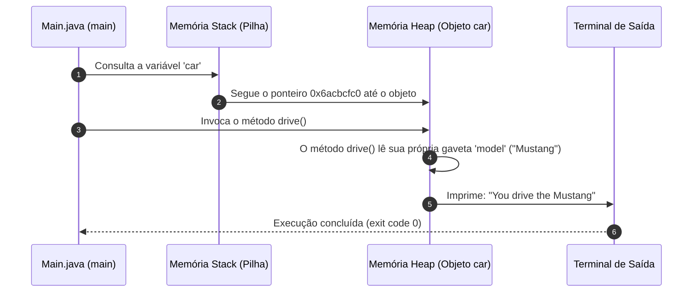

# 🧱 Capítulo 39: Programação Orientada a Objetos (OOP) em Java — Parte 6
## 🛣️ Ações Personalizadas: Métodos `drive()` e `brake()`, Concatenação de Atributos Internos (`model`) e Execução no `Main.java`

> **Arquivos de Estudo:** `Car.java` e `Main.java`  
> **Timestamp do Vídeo:** `6:49:15` até `6:50:00` / `12:00:00`  
> **Canal:** Bro Code — *Java Full Course for free*  
> **Objetivo:** Explicar para um iniciante absoluto cada detalhe das 4 telas do vídeo: como criar métodos que conversam diretamente com as variáveis da própria classe (`drive()` e `brake()`), por que dentro de `Car.java` podemos usar `model` diretamente sem precisar de `car.model`, a resolução do erro de compilação temporário ao digitar o operador de concatenação (`+`), e a execução de `car.drive()` no `Main.java` imprimindo `"You drive the Mustang"`.

---

## 📸 Reconstituição Visual Completa das 4 Imagens (Sem Precisar do Vídeo)

Se você estiver lendo este material no Google Docs ou impresso, aqui está a descrição minuciosa do que aconteceu na tela do Bro Code em cada um dos 4 momentos da aula:

```
+---------------------------------------------------------------------------------------------------+
| MOMENTO 1 (6:49:15): Preparando Novos Métodos em Car.java                                         |
+---------------------------------------------------------------------------------------------------+
| NA JANELA DO CÓDIGO (Aba Car.java ativa):                                                         |
| Bro Code posiciona o cursor após a chave de fechamento do método stop() na Linha 16:              |
|                                                                                                   |
| 13:     void stop(){                                                                              |
| 14:         isRunning = false;                                                                    |
| 15:         System.out.println("You stop the engine");                                            |
| 16:     }                                                                                         |
| 17:                                                                                               |
| 18: }                                                                                             |
|                                                                                                   |
| O professor se prepara para criar mais duas ações realistas para o automóvel: acelerar e frear!    |
+---------------------------------------------------------------------------------------------------+
```

```
+---------------------------------------------------------------------------------------------------+
| MOMENTO 2 (6:49:30): O Erro de Sintaxe Temporário ao Concatenar                                   |
+---------------------------------------------------------------------------------------------------+
| Bro Code começa a digitar o método drive():                                                       |
|                                                                                                   |
| 18:     void drive(){                                                                             |
| 19:         System.out.println("You drive the " + );                                              |
| 20:     }                                                                                         |
|                                                                                                   |
| DETALHE VISUAL DO COMPILADOR:                                                                     |
| Na Linha 19, surge um sublinhado ondulado VERMELHO logo após o sinal de mais: [ + ); ].          |
| O IntelliJ avisa que a instrução está incompleta: colocamos o operador de soma/concatenação (+),  |
| mas ainda não dissemos o que deve ser colado ao texto!                                            |
+---------------------------------------------------------------------------------------------------+
```

```
+---------------------------------------------------------------------------------------------------+
| MOMENTO 3 (6:49:45): Os Métodos drive() e brake() Concluídos em Car.java                          |
+---------------------------------------------------------------------------------------------------+
| Bro Code completa a expressão adicionando o atributo "model" e cria o método brake() idêntico:   |
|                                                                                                   |
| 18:     void drive(){                                                                             |
| 19:         System.out.println("You drive the " + model);                                         |
| 20:     }                                                                                         |
| 21:                                                                                               |
| 22:     void brake(){                                                                             |
| 23:         System.out.println("You brake the " + model);                                         |
| 24:     }                                                                                         |
| 25: }                                                                                             |
|                                                                                                   |
| O sublinhado vermelho desaparece! O IntelliJ reconhece "model" na cor roxa/itálica, indicando    |
| que ele encontrou a variável de instância declarada no topo da classe!                            |
+---------------------------------------------------------------------------------------------------+
```

```
+---------------------------------------------------------------------------------------------------+
| MOMENTO 4 (6:50:00): Chamando car.drive() no Main.java                                            |
+---------------------------------------------------------------------------------------------------+
| Bro Code troca para a aba Main.java e escreve:                                                    |
|                                                                                                   |
|  8:         Car car = new Car();                                                                  |
|  9:                                                                                               |
| 10:                                                                                               |
| 11:         car.drive();                                                                          |
| 12:     }                                                                                         |
| 13: }                                                                                             |
|                                                                                                   |
| Observação Visual: O cursor do mouse se posiciona sobre o botão verde de Run (Play)               |
| no canto superior direito para disparar a execução do novo método!                                |
+---------------------------------------------------------------------------------------------------+
```

---

## 🧠 Explicação Didática Extrema (Para Leigos Absolutos)

### 1. O que Há de Especial nos Métodos `drive()` e `brake()`?

Na Parte 5, os métodos `start()` e `stop()` imprimiam mensagens fixas e genéricas:  
`"You start the engine"` e `"You stop the engine"`.  
Qualquer carro do mundo poderia dizer isso!

Agora, em `drive()` e `brake()`, o Bro Code fez algo muito mais inteligente e poderoso:  
**O método conversa diretamente com os atributos do próprio objeto!**

```java
void drive(){
    System.out.println("You drive the " + model);
}
```

O carro agora tem **consciência da sua própria identidade**:
* Ele não diz apenas *"Você dirige o carro"*.
* Ele olha para a sua gaveta interna `model`, descobre que ele é um **Mustang**, e avisa com orgulho:  
  **`You drive the Mustang`**!

---

### 2. A Pergunta de Ouro: Por que dentro de `Car.java` escrevemos `+ model` e NÃO `+ car.model`?

> **🚨 A Maior Dúvida de Quem Está Começando a Programar em Java:**  
> *"Professor, no `Main.java` nós éramos obrigados a escrever `car.model` com o ponto. Por que aqui dentro de `Car.java` nós escrevemos apenas `model` sozinho sem ponto nenhum?"*

**A Analogia da "Sua Casa" vs "A Casa do Vizinho":**

#### Caso A: No `Main.java` (Você está na rua / fora do objeto)
No arquivo `Main.java`, você está no método `main`, do lado de fora. Na garagem podem existir dezenas de carros diferentes (`car1`, `car2`, `car3`).  
Se você gritar apenas `model`, o Java vai ficar perdido: *"De qual carro você está falando? Do carro 1, do carro 2 ou do carro 3?"*.  
Por isso, você é **obrigado a especificar o dono**: `car.model` (o modelo **deste** carro!).

#### Caso B: Em `Car.java` (Você está DENTRO da casa do próprio carro)
No arquivo `Car.java`, o método `drive()` e a variável `model` moram **debaixo do mesmo teto** (dentro das chaves `{}` da mesma classe)!  
Eles são vizinhos de quarto. O método `drive()` não precisa de intermediários; ele enxerga o atributo `model` diretamente pelo nome!

```text
+-------------------------------------------------------+
|                    CLASSE Car.java                    |
|                                                       |
|   String model = "Mustang";  <-- [Atributo da Casa]   |
|                                                       |
|   void drive(){                                       |
|       println("..." + model); <-- [Enxerga direto!]   |
|   }                                                   |
+-------------------------------------------------------+
```

*(Nota técnica: Escrever `model` dentro da classe é um atalho que a linguagem Java nos dá para `this.model`, que significa literalmente "o atributo model **deste** objeto").*

---

### 3. A Dinâmica da Memória: E se mudarmos o modelo antes de dirigir?

Veja como a Orientação a Objetos é dinâmica e viva. Se você fizer o seguinte teste no `Main.java`:

```java
Car car = new Car();

car.drive();             // Imprime: You drive the Mustang

car.model = "Corvette";  // Mudamos a gaveta model!

car.drive();             // Imprime: You drive the Corvette
```

* O método `drive()` não tem o texto `"Mustang"` gravado em pedra no seu código.
* Ele consulta a gaveta `model` em **tempo real** no momento exato em que é chamado!  
* Se você alterar o modelo para `"Fusca"`, o próximo `car.drive()` imprimirá `"You drive the Fusca"`.

---

### 4. O Ciclo Completo de Ações de um Automóvel

Agora a nossa classe `Car` possui um conjunto completo e realista de 4 ações:

| Método em `Car.java` | O que ele Faz na Memória | O que ele Imprime no Console |
| :--- | :--- | :--- |
| `car.start();` | Muda `isRunning = true` | `You start the engine` |
| `car.drive();` | Lê o atributo `model` | `You drive the Mustang` |
| `car.brake();` | Lê o atributo `model` | `You brake the Mustang` |
| `car.stop();` | Muda `isRunning = false` | `You stop the engine` |

---

## 🗺️ Diagrama de Fluxo da Chamada `car.drive()`



---

## 🔍 Análise Linha por Linha de Todo o Código

### Arquivo 1: [`Car.java`](../../../src/main/java/com/mickaelgeronimo/mastery/core/oop/Car.java)

```java
18:     void drive(){
19:         System.out.println("You drive the " + model);
20:     }
21: 
22:     void brake(){
23:         System.out.println("You brake the " + model);
24:     }
```

* **Linha 18 (`void drive(){`):**  
  * O que faz: Declara o método público de instância chamado `drive`. Retorno `void` (não devolve número ou texto, apenas executa).  
  * No console: Nada.
* **Linha 19 (`System.out.println("You drive the " + model);`):**  
  * O que faz: Concatena o texto fixo `"You drive the "` com o conteúdo da variável de instância `model` (`"Mustang"`) e imprime na tela com quebra de linha.  
  * No console: `You drive the Mustang` (quando chamado).
* **Linha 20 (`}`):** Fecha o corpo do método `drive`.  
* **Linha 22 (`void brake(){`):**  
  * O que faz: Declara o método público de instância chamado `brake` (frear).  
  * No console: Nada.
* **Linha 23 (`System.out.println("You brake the " + model);`):**  
  * O que faz: Concatena o texto fixo `"You brake the "` com o atributo `model` e imprime na tela.  
  * No console: `You brake the Mustang` (quando chamado).
* **Linha 24 (`}`):** Fecha o corpo do método `brake`.

---

### Arquivo 2: [`Main.java`](../../../src/main/java/com/mickaelgeronimo/mastery/core/concurrency/Main.java)

```java
 8:         Car car = new Car();
 9: 
10:         car.drive();
```

* **Linha 8 (`Car car = new Car();`):**  
  * O que faz: Constrói a instância real do carro no Heap e guarda sua referência na variável `car`.  
  * No console: Nada visível.
* **Linha 9 (Linha em branco):** Separação visual.  
* **Linha 10 (`car.drive();`):**  
  * O que faz: Usa o operador ponto (`.`) para acionar o método `drive()` do objeto `car`.  
  * No console: `You drive the Mustang`

---

## 📜 Código-Fonte Completo e Atualizado dos Arquivos

### Arquivo 1: [`Car.java`](../../../src/main/java/com/mickaelgeronimo/mastery/core/oop/Car.java)
```java
public class Car {

    String make = "Ford";
    String model = "Mustang";
    int year = 2025;
    double price = 58000.99;
    boolean isRunning = false;

    void start(){
        isRunning = true;
        System.out.println("You start the engine");
    }

    void stop(){
        isRunning = false;
        System.out.println("You stop the engine");
    }

    void drive(){
        System.out.println("You drive the " + model);
    }

    void brake(){
        System.out.println("You brake the " + model);
    }
}
```

### Arquivo 2: [`Main.java`](../../../src/main/java/com/mickaelgeronimo/mastery/core/concurrency/Main.java)
```java
public class Main {
    public static void main(String[] args) {

        // Object = An entity that holds data (attributes)
        //          and can perform actions (methods)
        //          It is a reference data type

        Car car = new Car();

        car.drive();
    }
}
```

---

## ❓ Perguntas Frequentes de Iniciantes (Dúvidas Cruciais)

### 1. E se eu quiser que ele fale o ano e a marca também no `drive()`?
**Resposta:**  
Basta concatenar os outros atributos que moram na mesma classe!
```java
void drive(){
    System.out.println("You drive the " + year + " " + make + " " + model);
}
```
E quando você chamar `car.drive();`, o console imprimirá:
```text
You drive the 2025 Ford Mustang
```

---

### 2. O que aconteceria se eu tentasse frear o carro chamando `car.brake()`?
**Resposta:**  
Ele executaria a linha 23 do `Car.java` e o console imprimiria com perfeição:
```text
You brake the Mustang
```

---

### 3. Por que o IntelliJ deu aquele sublinhado vermelho na Imagem 2?
**Resposta:**  
Porque em Java o operador de soma/concatenação `+` é um **operador binário** (ele exige obrigatoriamente um termo à esquerda e um termo à direita). Quando o professor escreveu `"You drive the " + );`, faltava o operando da direita! Assim que ele digitou a palavra `model`, a sintaxe ficou completa e o erro desapareceu imediatamente.
