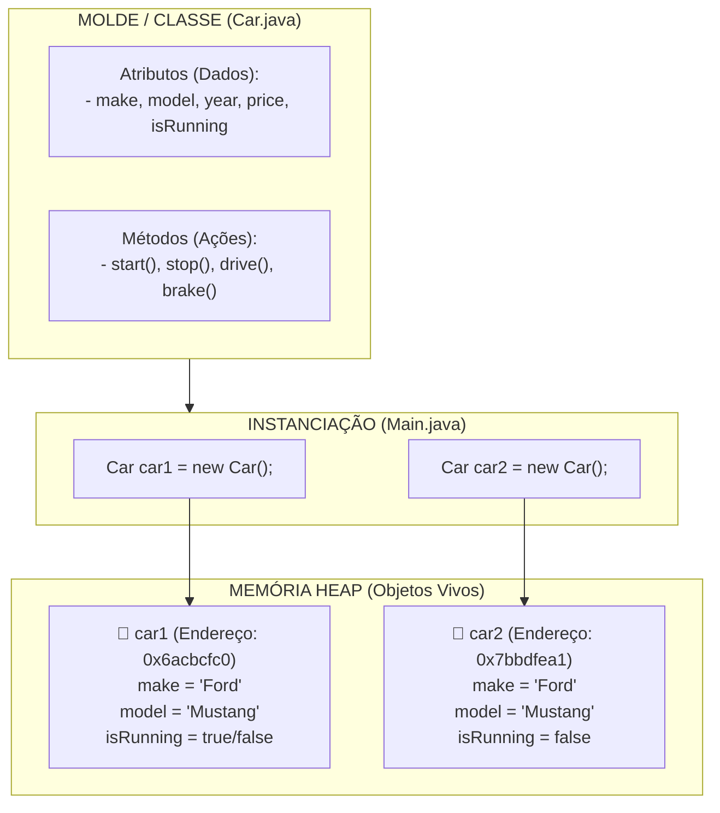

# 🧱 Capítulo 39: Programação Orientada a Objetos (OOP) em Java — Parte 8 (FINAL)
## 🚗 O Efeito dos "Carros Clones" (Os 3 Mustangs Vermelhos), a Limitação dos Atributos Fixos e a Conclusão do Capítulo 39

> **Arquivos de Estudo:** `Car.java` e `Main.java`  
> **Timestamp do Vídeo:** `6:50:56` até `6:51:xx` / `12:00:00` (Conclusão Oficial do Capítulo 39)  
> **Canal:** Bro Code — *Java Full Course for free*  
> **Objetivo:** Explicar para um iniciante absoluto cada detalhe das 2 telas finais do Capítulo 39: o significado da imagem bem-humorada dos **três Mustangs vermelhos idênticos** sobrepostos pelo professor na tela, o problema pedagógico de ter valores fixos (*hardcoded*) dentro do molde `Car.java`, o gancho/teaser crucial para o próximo capítulo (**Construtores / Constructors**) e a revisão arquitetural completa de tudo o que aprendemos sobre Programação Orientada a Objetos.

---

## 📸 Reconstituição Visual Completa das 2 Imagens (Sem Precisar do Vídeo)

Se você estiver lendo este material no Google Docs ou impresso, aqui está a descrição minuciosa do que aconteceu na tela do Bro Code em cada um dos 2 momentos de encerramento do capítulo:

```
+---------------------------------------------------------------------------------------------------+
| MOMENTO 1: A Metáfora dos 3 Mustangs Vermelhos Idênticos Sobrepostos                              |
+---------------------------------------------------------------------------------------------------+
| NA JANELA DO INTELLIJ IDEA:                                                                       |
| À esquerda vemos o código do Main.java com as linhas:                                             |
|                                                                                                   |
|    Car car1 = new Car();                                                                          |
|    Car car2 = new Car();                                                                          |
|    System.out.println(car1.make + " " + car1.model);                                              |
|    System.out.println(car2.make + " " + car2.model);                                              |
|                                                                                                   |
| SOBREPOSIÇÃO VISUAL DO PROFESSOR (À DIREITA DA TELA):                                             |
| Bro Code insere na tela uma coluna vertical com TRÊS FOTOS REAIS DE CARROS IDÊNTICOS:             |
|                                                                                                   |
|    +----------------------------------------------------+                                         |
|    |  [FOTO 1]: Um Ford Mustang esportivo VERMELHO vivo |                                         |
|    +----------------------------------------------------+                                         |
|    |  [FOTO 2]: Outro Ford Mustang esportivo VERMELHO   | (Exatamente a mesma imagem!)            |
|    +----------------------------------------------------+                                         |
|    |  [FOTO 3]: Mais um Ford Mustang esportivo VERMELHO | (Uma cópia idêntica clonada!)           |
|    +----------------------------------------------------+                                         |
|                                                                                                   |
| O professor explica: "Lembram que cada new Car() cria um novo carro? Mas como nosso Car.java tem  |
| valores fixos lá dentro, nós acabamos de construir três Mustangs vermelhos iguaizinhos!".         |
+---------------------------------------------------------------------------------------------------+
```

```
+---------------------------------------------------------------------------------------------------+
| MOMENTO 2 (Conclusão Oficial do Capítulo 39):                                                     |
+---------------------------------------------------------------------------------------------------+
| NA JANELA DO CÓDIGO (Main.java):                                                                  |
| A imagem dos carros desaparece e a tela volta para o editor de código limpo.                      |
| O cursor do teclado pisca na linha 5:                                                             |
|                                                                                                   |
|    // Object = An entity that holds data (attributes)                                             |
|                                                                                                   |
| Bro Code encerra o vídeo resumindo a conquista dos alunos:                                        |
| "Parabéns! Vocês acabaram de dominar o conceito de Classes e Objetos em Java! Nós aprendemos      |
| como guardar dados (atributos), como executar ações (métodos) e como instanciar objetos.          |
| No próximo vídeo, nós vamos resolver o problema dos carros clones aprendendo CONSTRUTORES,        |
| para que cada carro possa nascer com sua própria marca, cor e preço!".                            |
+---------------------------------------------------------------------------------------------------+
```

---

## 🧠 Explicação Didática Extrema (Para Leigos Absolutos)

### 1. O Que a Imagem dos "3 Mustangs Vermelhos" Representa?

Pense numa fábrica de brinquedos com uma esteira rolante:
* Se a máquina injetora de plástico estiver abastecida apenas com plástico vermelho e o molde for de um carrinho Mustang, adivinhe o que vai sair na ponta da esteira toda vez que você apertar o botão?
* **Um Mustang vermelho!**
* Aperta de novo: **Outro Mustang vermelho!**
* Aperta uma terceira vez: **Mais um Mustang vermelho!**

Isso é exatamente o que está acontecendo no nosso código agora:
* Em [`Car.java`](file:///c:/Users/mickel%201/Downloads/JAVA%20APRENDER/Car.java), nós escrevemos valores fixos (*hardcoded*):
  ```java
  String make = "Ford";
  String model = "Mustang";
  int year = 2025;
  double price = 58000.99;
  ```
* Como o molde só sabe fazer Ford Mustang de 2025 custando \$58.000,99, todo objeto construído com `new Car()` nasce como um clone idêntico!

---

### 2. O Problema Prático: E se quisermos carros diferentes?

No mundo real, uma concessionária não vende apenas Mustangs vermelhos de 2025.  
Ela vende caminhonetes, sedãs, carros elétricos, caminhões e SUVs de marcas variadas!

Com o que aprendemos até agora no Capítulo 39, como faríamos para ter um Fusca e uma Ferrari?  
Nós teríamos que fabricar o clone primeiro e depois alterar atributo por atributo manualmente:
```java
// Criamos o carro 1 (nasce Mustang) e alteramos na mão:
Car car1 = new Car();
car1.make = "Volkswagen";
car1.model = "Fusca";
car1.year = 1970;
car1.price = 15000.00;

// Criamos o carro 2 (nasce Mustang) e alteramos na mão:
Car car2 = new Car();
car2.make = "Ferrari";
car2.model = "F40";
car2.year = 2024;
car2.price = 350000.00;
```

> **O Desconforto do Programador Inteligente:**  
> *"Isso funciona? Sim! Mas é feio, cansativo e sujeito a erros. Imagine ter que alterar 10 atributos de 100 carros na mão linha por linha!"*

---

### 3. O Gancho para o Futuro: O que são os "Construtores" (*Constructors*)?

No Momento 2, Bro Code faz uma prévia do que vem no próximo capítulo (**Capítulo 40: Construtores**).  
Ele nos dá um spoiler de como resolver esse problema de forma elegante:

Em vez de criar um carro genérico para depois ter que alterar as gavetas uma a uma, nós criaremos um **Construtor Personalizado** que nos permitirá dizer as características do carro **no momento exato em que ele nasce**:

```java
// O JEITO DO PRÓXIMO CAPÍTULO (MÁGICO E ELEGANTE):
Car car1 = new Car("Volkswagen", "Fusca", 1970, 15000.00);
Car car2 = new Car("Ferrari", "F40", 2024, 350000.00);
```
O carro já sai da barriga da fábrica com a sua certidão de nascimento preenchida com perfeição!

---

## 🏛️ A Grande Retrospectiva do Capítulo 39: O Que Você Dominou?

Você acabou de cruzar um dos maiores marcos da carreira de qualquer desenvolvedor de software: a transição da programação básica para a **Orientação a Objetos**.  
Aqui está o resumo dos 7 grandes conceitos dominados neste capítulo:

```
+---------------------------------------------------------------------------------------------------+
|                             OS 7 PILARES DOMINADOS NO CAPÍTULO 39                                 |
+---------------------------------------------------------------------------------------------------+
| 1. CONCEITO DE OBJETO    -> Entidade com dados (atributos), ações (métodos) e tipo por referência.|
| 2. CLASSE vs OBJETO      -> A Classe é a Planta Baixa (Molde). O Objeto é a Construção Real.      |
| 3. MODELO DE MEMÓRIA     -> A variável mora na Stack (Pilha) e aponta para o objeto no Heap.      |
| 4. O OPERADOR "new"      -> A ordem de compra: aloca espaço no Heap e instancia o objeto.         |
| 5. O OPERADOR PONTO (.)  -> A chave do gaveteiro: acessa atributos (car.make) e ações (car.drive()).|
| 6. MÉTODOS DE INSTÂNCIA  -> Métodos sem "static" que agem sobre aquele objeto específico.        |
| 7. MÚLTIPLOS OBJETOS     -> Uma única classe pode gerar infinitos objetos independentes no Heap.  |
+---------------------------------------------------------------------------------------------------+
```

---

## 🗺️ Mapa Mental da Arquitetura do Capítulo 39



---

## 🔍 Análise Linha por Linha de Todo o Código Final

### Arquivo 1: [`Car.java`](file:///c:/Users/mickel%201/Downloads/JAVA%20APRENDER/Car.java)

```java
 1: public class Car {
 2: 
 3:     String make = "Ford";
 4:     String model = "Mustang";
 5:     int year = 2025;
 6:     double price = 58000.99;
 7:     boolean isRunning = false;
 8: 
 9:     void start(){
10:         isRunning = true;
11:         System.out.println("You start the engine");
12:     }
13: 
14:     void stop(){
15:         isRunning = false;
16:         System.out.println("You stop the engine");
17:     }
18: 
19:     void drive(){
20:         System.out.println("You drive the " + model);
21:     }
22: 
23:     void brake(){
24:         System.out.println("You brake the " + model);
25:     }
26: }
```
* **Linhas 3-7:** Os 5 atributos de fábrica que todo carro herda ao nascer.  
* **Linhas 9-12 (`start`):** Liga o motor (`isRunning = true`) e avisa no console.  
* **Linhas 14-17 (`stop`):** Desliga o motor (`isRunning = false`) e avisa no console.  
* **Linhas 19-21 (`drive`):** Lê o atributo `model` e imprime `"You drive the Mustang"`.  
* **Linhas 23-25 (`brake`):** Lê o atributo `model` e imprime `"You brake the Mustang"`.

---

### Arquivo 2: [`Main.java`](file:///c:/Users/mickel%201/Downloads/JAVA%20APRENDER/Main.java)

```java
 1: public class Main {
 2:     public static void main(String[] args) {
 3: 
 4:         // Object = An entity that holds data (attributes)
 5:         //          and can perform actions (methods)
 6:         //          It is a reference data type
 7: 
 8:         Car car1 = new Car();
 9:         Car car2 = new Car();
10: 
11:         System.out.println(car1.make + " " + car1.model);
12:         System.out.println(car2.make + " " + car2.model);
13:     }
14: }
```
* **Linha 8:** Instancia o primeiro carro (`car1`) no Heap.  
  * No console: Nada.
* **Linha 9:** Instancia o segundo carro independente (`car2`) no Heap.  
  * No console: Nada.
* **Linha 11:** Imprime a marca e modelo do primeiro carro.  
  * No console: `Ford Mustang`
* **Linha 12:** Imprime a marca e modelo do segundo carro.  
  * No console: `Ford Mustang`

---

## 📜 Código-Fonte Completo e Oficial dos Arquivos

### Arquivo 1: [`Car.java`](file:///c:/Users/mickel%201/Downloads/JAVA%20APRENDER/Car.java)
```java
public class Car {

    String make = "Ford";
    String model = "Mustang";
    int year = 2025;
    double price = 58000.99;
    boolean isRunning = false;

    void start(){
        isRunning = true;
        System.out.println("You start the engine");
    }

    void stop(){
        isRunning = false;
        System.out.println("You stop the engine");
    }

    void drive(){
        System.out.println("You drive the " + model);
    }

    void brake(){
        System.out.println("You brake the " + model);
    }
}
```

### Arquivo 2: [`Main.java`](file:///c:/Users/mickel%201/Downloads/JAVA%20APRENDER/Main.java)
```java
public class Main {
    public static void main(String[] args) {

        // Object = An entity that holds data (attributes)
        //          and can perform actions (methods)
        //          It is a reference data type

        Car car1 = new Car();
        Car car2 = new Car();

        System.out.println(car1.make + " " + car1.model);
        System.out.println(car2.make + " " + car2.model);
    }
}
```

---

## 🏆 Conclusão do Capítulo 39

Você concluiu com maestria a introdução à **Programação Orientada a Objetos**!  
Agora você entende não apenas a sintaxe de como criar e usar classes e métodos, mas principalmente o **modelo mental de memória** (Stack vs Heap, ponteiros e referências) que separa os programadores amadores dos profissionais de verdade.  
Você está mais do que pronto para mergulhar no próximo capítulo e aprender como usar os **Construtores** para dar personalidade única a cada objeto!
