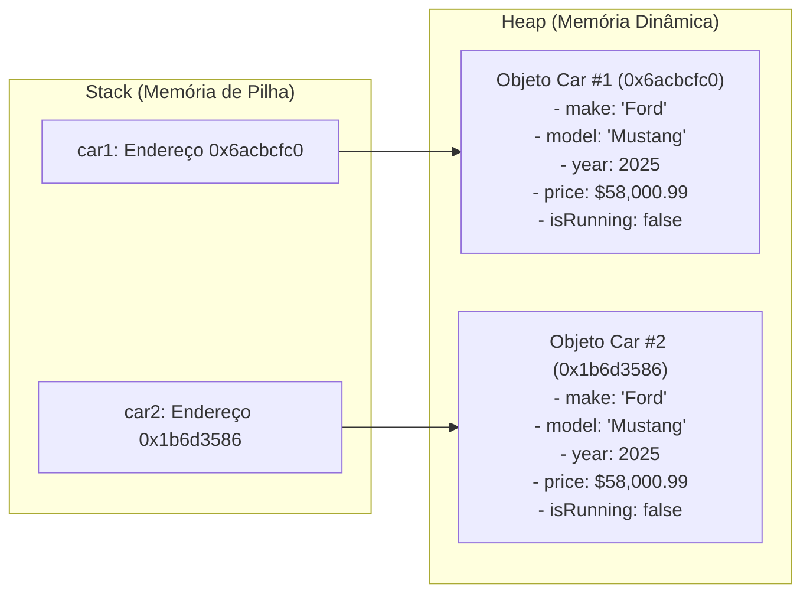

# 🧱 Capítulo 39: Programação Orientada a Objetos (OOP) — Classes e Objetos em Java

> **Módulo Pedagógico:** Trilha de Fundamentos em Java e Arquitetura de Software  
> **Referência:** Bro Code — *Java Full Course for free* (Capítulo 39)

---

## 🧭 Visão Geral

O **Capítulo 39** marca o divisor de águas na formação do desenvolvedor Java: a transição da programação puramente procedural/estruturada para o paradigma da **Programação Orientada a Objetos (POO / OOP)**.

Neste módulo, modelamos a classe automotiva [`Car.java`](file:///c:/Users/mickel%201/Downloads/JAVA%20APRENDER/src/main/java/com/mickaelgeronimo/mastery/core/oop/Car.java), explorando os seguintes pilares fundamentais:

- **Definição Canônica de Objeto**:
  > *"An entity that holds data (attributes) and can perform actions (methods). It is a reference data type."*
- **A Metáfora da Planta Baixa (*Blueprint*) vs Objeto Real**:
  - **Classe (`Car.java`)**: A planta técnica desenhada no papel pelo engenheiro. Não ocupa espaço na garagem, não consome combustível e não pode ser dirigida.
  - **Objeto (`new Car()`)**: O carro físico de metal construído na linha de montagem e alocado na memória.
- **Topologia de Memória do Computador (Stack vs Heap)**:
  - **Stack (Pilha)**: Guarda a variável de referência local (ex: `car1`), que armazena apenas o endereço/ponteiro de memória.
  - **Heap (Monte)**: Região onde o objeto reside fisicamente com todos os seus atributos e valores.
- **O Enigma do `Car@6acbcfc0`**:
  - A explicação do porquê imprimir uma variável de referência diretamente exibe a representação padrão do `Object.toString()` (`NomeDaClasse@HashCodeHexadecimal`).
- **Atributos de Instância (Substantivos / Estado)**:
  - `make = "Ford"`
  - `model = "Mustang"`
  - `year = 2025`
  - `price = 58000.99`
  - `isRunning = false`
- **Operador Ponto (`.`)**:
  - Utilizado tanto para **leitura** (`car.make`, `car.model`) quanto para **mutação de estado** (`car.year = 2026`).
- **Métodos de Instância (Verbos / Comportamento)**:
  - A ausência intencional da palavra-chave `static`: o método pertence à **instância específica** alocada no Heap, e não à classe estática global.
  - Métodos implementados:
    - `start()`: altera `isRunning = true` e avisa `"You start the engine"`.
    - `stop()`: altera `isRunning = false` e avisa `"You stop the engine"`.
    - `drive()`: acessa internamente o atributo `model` e avisa `"You drive the Mustang"`.
    - `brake()`: avisa `"You brake the Mustang"`.
- **Independência de Múltiplas Instâncias**:
  - Criação de `car1` e `car2` a partir do mesmo molde. Modificar atributos de `car1` não afeta `car2`.
- **O Efeito dos "Carros Clones" e o Gancho para o Capítulo 40**:
  - A limitação pedagógica de valores fixos (*hardcoded*) na classe e a necessidade dos **Construtores (*Constructors*)** para que cada objeto nasça com características personalizadas.

---

## 🗂️ Estrutura de Aulas e Documentos

| Arquivo | Título / Tema Principal |
| :--- | :--- |
| [01_fundamentos_classes_objetos_e_memoria.md](file:///c:/Users/mickel%201/Downloads/JAVA%20APRENDER/docs/curriculum/capitulo_39_oop/01_fundamentos_classes_objetos_e_memoria.md) | O despertar da OOP: conceito formal de objeto, analogias do mundo real (iPhone, caneca, microfone), classe vs objeto e arquitetura Stack vs Heap. |
| [02_atributos_instanciacao_operador_ponto_e_hashcode.md](file:///c:/Users/mickel%201/Downloads/JAVA%20APRENDER/docs/curriculum/capitulo_39_oop/02_atributos_instanciacao_operador_ponto_e_hashcode.md) | Criação da classe `Car`, operador `new`, o mistério do hash `Car@6acbcfc0` e o operador ponto (`.`). |
| [03_leitura_completa_atributos_operador_ponto.md](file:///c:/Users/mickel%201/Downloads/JAVA%20APRENDER/docs/curriculum/capitulo_39_oop/03_leitura_completa_atributos_operador_ponto.md) | Extração e exibição no console de todos os atributos (`make`, `model`, `year`, `price`, `isRunning`). |
| [04_modificacao_atributos_estado_e_transicao.md](file:///c:/Users/mickel%201/Downloads/JAVA%20APRENDER/docs/curriculum/capitulo_39_oop/04_modificacao_atributos_estado_e_transicao.md) | Mutação dinâmica de variáveis de instância em tempo de execução e inspeção de transição de estado. |
| [05_metodos_acoes_start_stop_e_encapsulamento_de_estado.md](file:///c:/Users/mickel%201/Downloads/JAVA%20APRENDER/docs/curriculum/capitulo_39_oop/05_metodos_acoes_start_stop_e_encapsulamento_de_estado.md) | Métodos de instância `start()` e `stop()`, ausência do `static` e alternância do boolean `isRunning` (`false -> true -> false`). |
| [06_metodos_drive_brake_e_acesso_a_atributos.md](file:///c:/Users/mickel%201/Downloads/JAVA%20APRENDER/docs/curriculum/capitulo_39_oop/06_metodos_drive_brake_e_acesso_a_atributos.md) | Ações `drive()` e `brake()` dialogando diretamente com variáveis de instância (`model`). |
| [07_multiplos_objetos_car1_car2_e_independencia.md](file:///c:/Users/mickel%201/Downloads/JAVA%20APRENDER/docs/curriculum/capitulo_39_oop/07_multiplos_objetos_car1_car2_e_independencia.md) | Instanciação de múltiplos objetos (`car1` e `car2`) e demonstração prática do isolamento no Heap. |
| [08_clone_cars_conclusao.md](file:///c:/Users/mickel%201/Downloads/JAVA%20APRENDER/docs/curriculum/capitulo_39_oop/08_clone_cars_conclusao.md) | O fenômeno dos "3 Mustangs vermelhos", o diagnóstico dos valores *hardcoded*, teaser do Cap. 40 (Construtores) e síntese dos 7 grandes pilares. |
| [README.md](file:///c:/Users/mickel%201/Downloads/JAVA%20APRENDER/docs/curriculum/capitulo_39_oop/README.md) | Guia curricular geral e mapa conceitual de OOP. |

---

## 🏛️ Topologia de Memória: Stack vs Heap

---

## 💻 Código-Fonte e Testes no Projeto
- Classe de Entidade do Domínio: [`Car.java`](file:///c:/Users/mickel%201/Downloads/JAVA%20APRENDER/src/main/java/com/mickaelgeronimo/mastery/core/oop/Car.java)
- Demonstração Interativa / CLI de Objetos: [`OOPCarDemo.java`](file:///c:/Users/mickel%201/Downloads/JAVA%20APRENDER/src/main/java/com/mickaelgeronimo/mastery/core/oop/OOPCarDemo.java)
- Suíte de Testes Automatizados: [`OOPCarTest.java`](file:///c:/Users/mickel%201/Downloads/JAVA%20APRENDER/src/test/java/com/mickaelgeronimo/mastery/core/OOPCarTest.java)
