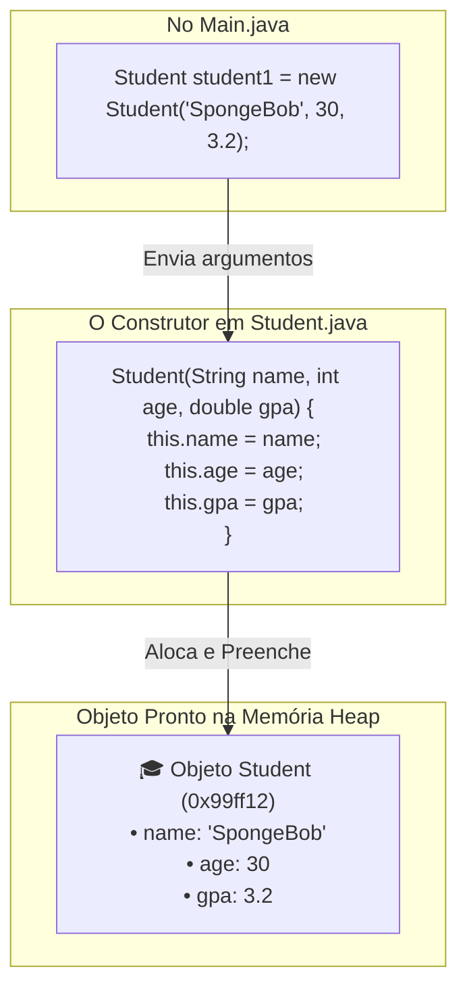

# 🔨 Capítulo 40: Construtores (*Constructors*) em Java — Parte 1
## 🎓 O Despertar dos Construtores: O que é um Constructor, a Ficha de Matrícula e a Criação da Classe `Student.java`

> **Arquivos de Estudo:** `Main.java` e `Student.java`  
> **Timestamp do Vídeo:** `6:51:xx` até `6:52:15` / `12:00:00` (Início Oficial do Capítulo 40)  
> **Canal:** Bro Code — *Java Full Course for free*  
> **Objetivo:** Explicar para um iniciante absoluto cada detalhe das 5 telas de abertura do Capítulo 40: a definição em três linhas do que é um **Construtor (*Constructor*)**, por que ele resolve de vez a limitação dos "objetos clones", o passo a passo exato da interface do IntelliJ IDEA para criar um novo arquivo Java (`Student.java`), e a preparação da nova classe que modelará um Estudante.

---

## 📸 Reconstituição Visual Completa das 5 Imagens (Sem Precisar do Vídeo)

Se você estiver lendo este material no Google Docs ou impresso, aqui está a descrição minuciosa do que aconteceu na tela do Bro Code em cada um dos 5 momentos iniciais:

```
+---------------------------------------------------------------------------------------------------+
| MOMENTO 1 (6:51:30): A Definição do Construtor no Main.java                                       |
+---------------------------------------------------------------------------------------------------+
| NA JANELA DO CÓDIGO (Main.java):                                                                  |
| Bro Code limpa o método main e escreve a definição oficial em três linhas comentadas:             |
|                                                                                                   |
| 1: public class Main {                                                                            |
| 2:     public static void main(String[] args) {                                                   |
| 3:                                                                                                |
| 4:         // constructor = A special method to initialize objects                                |
| 5:         //               You can pass arguments to a constructor                               |
| 6:         //               and set up initial values                                             |
| 7:                                                                                                |
| 8:     }                                                                                          |
| 9: }                                                                                              |
|                                                                                                   |
| Observação Visual: O cursor do teclado pisca na linha 5. Não há código executável ainda.          |
+---------------------------------------------------------------------------------------------------+
```

```
+---------------------------------------------------------------------------------------------------+
| MOMENTO 2 (6:51:50): Limpando o Projeto e Acessando o Menu do IntelliJ                            |
+---------------------------------------------------------------------------------------------------+
| O que Bro Code faz:                                                                              |
| Na barra lateral esquerda (Project Explorer), sob a pasta "src", o arquivo Car.java foi fechado/   |
| removido, restando apenas "Main".                                                                 |
| O professor move o cursor do mouse até o canto superior esquerdo da tela e clica no ícone de      |
| MENU PRINCIPAL HAMBÚRGUER (três risquinhos horizontais [≡]).                                      |
+---------------------------------------------------------------------------------------------------+
```

```
+---------------------------------------------------------------------------------------------------+
| MOMENTO 3 (6:52:02): Navegando pelos Menus: File -> New -> Java Class                             |
+---------------------------------------------------------------------------------------------------+
| O menu suspenso principal do IntelliJ IDEA se abre:                                               |
|                                                                                                   |
|   [ File ] -> [ New > ] -> Submenu se expande para a direita:                                     |
|                            • Project...                                                           |
|                            • Project from Existing Sources...                                     |
|                            • Module...                                                            |
|                            • Java Class  <-- [O MOUSE PAIRA AQUI! Ícone azul com 'c']            |
|                            • Kotlin Class/File                                                    |
|                            • File                                                                 |
|                                                                                                   |
| Bro Code demonstra o caminho oficial de como programadores profissionais criam uma nova classe.   |
+---------------------------------------------------------------------------------------------------+
```

```
+---------------------------------------------------------------------------------------------------+
| MOMENTO 4 (6:52:07): A Caixa Flutuante "New Java Class" (Student)                                 |
+---------------------------------------------------------------------------------------------------+
| Uma caixa de diálogo retangular modal surge no centro da tela:                                    |
|                                                                                                   |
|           +-----------------------------------------------+                                       |
|           |                 New Java Class                |                                       |
|           |                                               |                                       |
|           |  (c) Stu|                                     |                                       |
|           |  -------------------------------------------  |                                       |
|           |  (c) Class                                    | <-- Selecionado por padrão            |
|           |  (I) Interface                                |                                       |
|           |  (R) Record                                   |                                       |
|           |  (E) Enum                                     |                                       |
|           +-----------------------------------------------+                                       |
|                                                                                                   |
| DETALHE VISUAL DO PROFESSOR:                                                                      |
| Acima da janelinha, Bro Code coloca um título gráfico estilizado em letras brancas: "Student"!    |
| Ele termina de digitar "Student" e aperta ENTER.                                                  |
+---------------------------------------------------------------------------------------------------+
```

```
+---------------------------------------------------------------------------------------------------+
| MOMENTO 5 (6:52:15): A Nova Classe Student.java Aberta no Editor                                  |
+---------------------------------------------------------------------------------------------------+
| O IntelliJ cria instantaneamente o arquivo físico Student.java na pasta src e abre uma nova aba:  |
|                                                                                                   |
| Abas abertas no topo: [Main.java]  [Student.java]                                                 |
|                                                                                                   |
| Conteúdo gerado automaticamente:                                                                  |
| 1: public class Student {                                                                         |
| 2:                                                                                                |
| 3: }                                                                                              |
|                                                                                                   |
| O cursor pisca na linha 2, no coração da nova classe, pronto para recebermos o novo modelo!       |
+---------------------------------------------------------------------------------------------------+
```

---

## 🧠 Explicação Didática Extrema (Para Leigos Absolutos)

### 1. Por que Precisamos de Construtores? A Conexão com o Fim do Capítulo 39

Lembra do drama dos **"Três Mustangs Vermelhos Clones"** no final do capítulo anterior?
* Nós tínhamos a classe `Car`, mas como os valores eram fixos (`make = "Ford"`, `model = "Mustang"`), todo carro construído com `new Car()` nascia exatamente igual!
* Se você quisesse um carro diferente, tinha que fabricar o Mustang primeiro e depois, na mão grande, mudar linha por linha:
  `car.make = "Ferrari";`
  `car.model = "F40";`

Agora imagine que você está desenvolvendo o sistema para uma universidade de verdade:
* Você cria a classe `Student` (Estudante).
* **Você não pode fazer todos os alunos nascerem clones!**
  * Um aluno se chama **SpongeBob**, tem **30 anos** e nota **3.2**.
  * Outro aluno se chama **Patrick**, tem **34 anos** e nota **1.5**.
  * Outro se chama **Sandy**, tem **27 anos** e nota **4.0**.

> **O Papel do Construtor:**  
> O Construtor é a **Ficha de Matrícula** ou a **Certidão de Nascimento** do objeto!  
> Ele é o mecanismo oficial do Java que nos permite entregar os dados do estudante **no exato milissegundo em que ele é fabricado no Heap**, sem precisar de retrabalho depois!

---

### 2. Dissecando a Definição de Construtor (Linhas 4 a 6)

Bro Code escreveu três linhas que definem com precisão cirúrgica o que é essa ferramenta:

```java
// constructor = A special method to initialize objects
//               You can pass arguments to a constructor
//               and set up initial values
```

#### Parte A: "A special method to initialize objects" (Um método especial para inicializar objetos)
* Por que ele é chamado de **"especial"**?
  1. Ele tem **obrigatoriamente o mesmo nome exato da classe** (se a classe se chama `Student`, o construtor se chamará `Student()`).
  2. Ele **não tem tipo de retorno** (ele não tem `int`, não tem `String` e **nem mesmo tem `void`**!).
  3. Você não chama o construtor como um método comum (`objeto.metodo()`). Ele é disparado automaticamente pela palavra-chave `new` na hora do nascimento do objeto!

#### Parte B: "You can pass arguments to a constructor" (Você pode passar argumentos para um construtor)
* Assim como você passava números para uma função matemática nos capítulos anteriores, você pode passar dados para dentro dos parênteses do construtor:
  ```java
  new Student("SpongeBob", 30, 3.2);
  ```

#### Parte C: "and set up initial values" (e configurar os valores iniciais)
* O construtor pega o nome `"SpongeBob"`, a idade `30` e a nota `3.2` que você enviou e preenche as gavetas internas do novo objeto recém-nascido no Heap antes mesmo de entregá-lo para você!

---

### 3. A Metáfora do "Bebê na Maternidade" vs "O Boneco sem Nome"

```
+---------------------------------------------------------------------------------------------------+
| SEM CONSTRUTOR PERSONALIZADO (Capítulo 39):  | COM CONSTRUTOR PERSONALIZADO (Capítulo 40):       |
+---------------------------------------------------------------------------------------------------+
| 1. Você fabrica um boneco genérico sem rosto. | 1. Você entrega os dados no formulário de parto:   |
| 2. Depois você pega uma caneta e desenha o    |    new Student("SpongeBob", 30, 3.2);             |
|    rosto, escreve o nome na camisa e troca    |                                                   |
|    as roupas dele na marra uma a uma:         | 2. O bebê já nasce com certidão de nascimento,    |
|    student.name = "SpongeBob";                |    nome oficial, pulseirinha de identificação e   |
|    student.age = 30;                          |    dados prontos na memória Heap!                 |
|    student.gpa = 3.2;                         |                                                   |
+---------------------------------------------------------------------------------------------------+
```

---

### 4. O Caminho das Pedras no IntelliJ IDEA: Como Criar Novas Classes

No Momento 2, 3 e 4, o Bro Code ensina uma habilidade prática fundamental para o dia a dia de qualquer programador: como criar novos arquivos de classe em uma IDE moderna.

1. **O Menu Hambúrguer `[≡]`:** Dá acesso à barra de ferramentas do sistema (`File`, `Edit`, `View`).
2. **`File -> New -> Java Class`:** Diz ao IntelliJ que você quer um novo arquivo de código-fonte Java.
3. **A Janela Modal:** Você digita o nome da classe (`Student`).  
   * *Atenção à Regra de Ouro:* Em Java, toda classe **DEVE começar com Letra Maiúscula** (`Student`, e nunca `student`).
4. **O Resultado:** O IntelliJ cria no disco rígido o arquivo `Student.java` dentro da pasta `src/` e já escreve para você a estrutura básica:
   ```java
   public class Student {

   }
   ```

---

## 🗺️ Mapa Mental do Funcionamento do Construtor



---

## 🔍 Análise Linha por Linha do Código Atual

### Arquivo 1: [`Main.java`](file:///c:/Users/mickel%201/Downloads/JAVA%20APRENDER/Main.java)

```java
1: public class Main {
2:     public static void main(String[] args) {
3: 
4:         // constructor = A special method to initialize objects
5:         //               You can pass arguments to a constructor
6:         //               and set up initial values
7: 
8:     }
9: }
```

* **Linhas 1-2:** Estrutura padrão da classe executável `Main` e do método de entrada `main`.  
  * No console: Nada.
* **Linhas 4-6:** Comentários conceituais definindo Construtor: um método especial para inicializar objetos, receber argumentos e configurar os valores iniciais.  
  * No console: Nada.
* **Linhas 8-9:** Fechamento do método e da classe.

---

### Arquivo 2: [`Student.java`](file:///c:/Users/mickel%201/Downloads/JAVA%20APRENDER/Student.java)

```java
1: public class Student {
2: 
3: }
```

* **Linha 1 (`public class Student {`):**  
  * O que faz: Declara o novo molde público chamado `Student`. Todo estudante criado no programa respeitará as regras que escrevermos dentro deste arquivo.  
  * No console: Nada.
* **Linha 2 (Linha em branco):** Espaço onde escreveremos os atributos (`name`, `age`, `gpa`) e o construtor nas próximas telas.  
  * No console: Nada.
* **Linha 3 (`}`):** Fecha a classe `Student`.  
  * No console: Nada.

---

## 📜 Código-Fonte Atual dos Arquivos do Projeto

### Arquivo 1: [`Main.java`](file:///c:/Users/mickel%201/Downloads/JAVA%20APRENDER/Main.java)
```java
public class Main {
    public static void main(String[] args) {

        // constructor = A special method to initialize objects
        //               You can pass arguments to a constructor
        //               and set up initial values

    }
}
```

### Arquivo 2: [`Student.java`](file:///c:/Users/mickel%201/Downloads/JAVA%20APRENDER/Student.java)
```java
public class Student {

}
```

---

## ❓ Perguntas Frequentes de Iniciantes (Dúvidas Cruciais)

### 1. Se nós já usávamos parênteses em `new Car()`, nós já estávamos chamando um construtor antes?
**Resposta:**  
**SIM! Exatamente isso!**  
Quando você escreve `new Car()`, aqueles parênteses vazios `()` estavam chamando o **Construtor Padrão (*Default Constructor*)** que o próprio compilador do Java cria invisivelmente nos bastidores quando nós não escrevemos nenhum!  
A diferença mágica agora é que nós aprenderemos a escrever **o nosso próprio construtor**, capaz de receber dados dentro dos parênteses!

---

### 2. Por que o Bro Code trocou o exemplo de `Car` para `Student`?
**Resposta:**  
Porque modelar pessoas e estudantes torna o aprendizado de construtores infinitamente mais intuitivo e humano! É muito fácil imaginar uma sala de aula onde cada carteira tem um aluno com um nome diferente, uma idade diferente e uma média escolar (GPA) diferente.

---

### 3. Se eu rodar o programa agora, o que sai no console?
**Resposta:**  
Absolutamente nada! O programa termina com código 0 porque até este momento nós apenas preparamos a fundação teórica e criamos o arquivo da classe `Student.java`. Nos próximos minutos da aula, Bro Code começará a escrever o código do construtor na prática!
