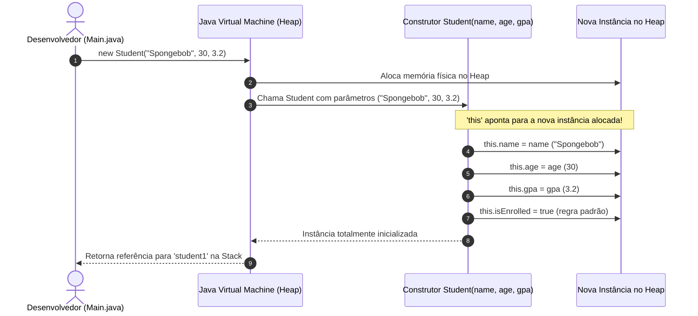

# 🔨 Capítulo 40: Construtores (*Constructors*) em Java

> **Módulo Pedagógico:** Trilha de Fundamentos em Java e Arquitetura de Software  
> **Referência:** Bro Code — *Java Full Course for free* (Capítulo 40)

---

## 🧭 Visão Geral

O **Capítulo 40** resolve a maior limitação pedagógica apresentada no capítulo anterior (os "objetos clones"), introduzindo o mecanismo canônico de inicialização de instâncias: os **Construtores (*Constructors*)**.

Neste módulo, construímos a classe [`Student.java`](file:///c:/Users/mickel%201/Downloads/JAVA%20APRENDER/src/main/java/com/mickaelgeronimo/mastery/core/oop/Student.java) e a testamos com os personagens icônicos da Fenda do Biquíni: **Bob Esponja**, **Patrick Estrela** e **Sandy Bochechas**.

### 🌟 Pilares Fundamentais do Capítulo

1. **Definição Sagrada de Construtor**:
   > *"Constructor = A special method that is called when an object is instantiated (created). It has the same name as the class, no return type, and can be used to set initial values for attributes."*
2. **Anatomia do Construtor**:
   - Possui o **mesmo nome exato** da classe (`Student(...)`).
   - **Não possui tipo de retorno**, nem mesmo `void`.
   - É disparado no momento exato da chamada do operador `new`.
3. **A Palavra-Chave `this` e o Sombreamento de Variáveis (*Variable Shadowing*)**:
   - Quando o parâmetro possui o mesmo nome do atributo (`String name`), o Java dá preferência ao escopo local (parâmetro).
   - O qualificador `this` aponta inequivocamente para a **instância atual** no Heap: `this.name = name;`.
   - Por que não podemos escrever `student1.name` dentro da classe? Porque a classe é o molde universal e não tem acesso às variáveis de referência locais da `main`.
4. **Parâmetros Genéricos (`a, b, c`) vs `this` (*Clean Code*)**:
   - Por que nomear parâmetros como `a, b, c` funciona sintaticamente, mas viola todas as boas práticas de legibilidade da engenharia de software profissional.
5. **Atributos com Regras de Negócio Padrão**:
   - Atributos podem ser inicializados no construtor sem precisar vir de argumentos externos (ex: `this.isEnrolled = true;`).
6. **Ações de Instância Dinâmicas**:
   - O método `study()` imprime `this.name + " is studying"`.
   - Embora o código do método seja único na classe, a saída é 100% dinâmica dependendo de qual aluno invocou o comportamento.

---

## 🗂️ Estrutura de Aulas e Documentos

| Arquivo | Título / Tema Principal |
| :--- | :--- |
| [01_definicao_e_criacao_classe_student.md](file:///c:/Users/mickel%201/Downloads/JAVA%20APRENDER/docs/curriculum/capitulo_40_constructors/01_definicao_e_criacao_classe_student.md) | Definição formal em 3 linhas, superação dos clones e criação do arquivo `Student.java` na IDE. |
| [02_atributos_student_e_o_problema_dos_clones.md](file:///c:/Users/mickel%201/Downloads/JAVA%20APRENDER/docs/curriculum/capitulo_40_constructors/02_atributos_student_e_o_problema_dos_clones.md) | Declaração dos 4 atributos (`name`, `age`, `gpa`, `isEnrolled`) e a constatação dos dois "Spongebobs" idênticos. |
| [03_analise_console_clones_e_transicao.md](file:///c:/Users/mickel%201/Downloads/JAVA%20APRENDER/docs/curriculum/capitulo_40_constructors/03_analise_console_clones_e_transicao.md) | O momento chave: fechamento da aba `Run` e a decisão técnica de parametrizar o nascimento dos objetos. |
| [04_passagem_argumentos_criacao_this_e_erro_compilacao.md](file:///c:/Users/mickel%201/Downloads/JAVA%20APRENDER/docs/curriculum/capitulo_40_constructors/04_passagem_argumentos_criacao_this_e_erro_compilacao.md) | Passagem de argumentos na `main`, indução intencional do erro de compilação e criação do construtor com `this`. |
| [05_por_que_usar_this_e_nao_student1_ou_student2.md](file:///c:/Users/mickel%201/Downloads/JAVA%20APRENDER/docs/curriculum/capitulo_40_constructors/05_por_que_usar_this_e_nao_student1_ou_student2.md) | Análise profunda de escopo: por que tentar usar `student1.name` dentro de `Student.java` gera erro vermelho. |
| [06_parametros_a_b_c_vs_this_e_boas_praticas.md](file:///c:/Users/mickel%201/Downloads/JAVA%20APRENDER/docs/curriculum/capitulo_40_constructors/06_parametros_a_b_c_vs_this_e_boas_praticas.md) | O dilema dos parâmetros `a, b, c`: comparação entre atalhos preguiçosos e o padrão canônico da indústria. |
| [07_isEnrolled_valores_padrao_e_student3.md](file:///c:/Users/mickel%201/Downloads/JAVA%20APRENDER/docs/curriculum/capitulo_40_constructors/07_isEnrolled_valores_padrao_e_student3.md) | Regras de negócio automáticas (`this.isEnrolled = true`) e impressão de valores booleanos. |
| [08_criacao_sandy_student3_e_12_saidas_console.md](file:///c:/Users/mickel%201/Downloads/JAVA%20APRENDER/docs/curriculum/capitulo_40_constructors/08_criacao_sandy_student3_e_12_saidas_console.md) | A chegada de Sandy Cheeks (`student3`), auditoria das 12 saídas no console e independência total. |
| [09_panoramica_this_argumentos_e_metodos.md](file:///c:/Users/mickel%201/Downloads/JAVA%20APRENDER/docs/curriculum/capitulo_40_constructors/09_panoramica_this_argumentos_e_metodos.md) | Visão panorâmica unificando atributos, construtores e o método de instância `study()`. |
| [10_metodo_study_this_name_e_conclusao.md](file:///c:/Users/mickel%201/Downloads/JAVA%20APRENDER/docs/curriculum/capitulo_40_constructors/10_metodo_study_this_name_e_conclusao.md) | Implementação de `study()`, o poder de `this.name` e as ações personalizadas de cada estudante. |
| [11_por_que_usar_this_name_no_metodo_study.md](file:///c:/Users/mickel%201/Downloads/JAVA%20APRENDER/docs/curriculum/capitulo_40_constructors/11_por_que_usar_this_name_no_metodo_study.md) | Teste intencional proibido (`student3.name` no método) e a comprovação matemática de que `this.name` é indispensável. |
| [12_revisao_conceitual_e_fechamento.md](file:///c:/Users/mickel%201/Downloads/JAVA%20APRENDER/docs/curriculum/capitulo_40_constructors/12_revisao_conceitual_e_fechamento.md) | Fechamento pedagógico, conexão entre as 3 linhas de teoria e o software real em execução. |
| [README.md](file:///c:/Users/mickel%201/Downloads/JAVA%20APRENDER/docs/curriculum/capitulo_40_constructors/README.md) | Guia curricular geral e tabela comparativa dos estudantes. |

---

## 👥 A Turma da Fenda do Biquíni (Dados Oficiais)

| Instância | Nome (`name`) | Idade (`age`) | Coeficiente (`gpa`) | Matriculado (`isEnrolled`) | Ação `study()` |
| :---: | :---: | :---: | :---: | :---: | :--- |
| `student1` | `"Spongebob"` | 30 | 3.2 | `true` | `"Spongebob is studying"` |
| `student2` | `"Patrick"` | 34 | 1.5 | `true` | `"Patrick is studying"` |
| `student3` | `"Sandy"` | 27 | 4.0 | `true` | `"Sandy is studying"` |

---

## 🏛️ Fluxo de Execução do Construtor com `this`

---

## 💻 Código-Fonte e Testes no Projeto
- Classe com Construtores: [`Student.java`](file:///c:/Users/mickel%201/Downloads/JAVA%20APRENDER/src/main/java/com/mickaelgeronimo/mastery/core/oop/Student.java)
- Demonstração Interativa / CLI: [`ConstructorsDemo.java`](file:///c:/Users/mickel%201/Downloads/JAVA%20APRENDER/src/main/java/com/mickaelgeronimo/mastery/core/oop/ConstructorsDemo.java)
- Suíte de Testes Automatizados: [`ConstructorsStudentTest.java`](file:///c:/Users/mickel%201/Downloads/JAVA%20APRENDER/src/test/java/com/mickaelgeronimo/mastery/core/ConstructorsStudentTest.java)
