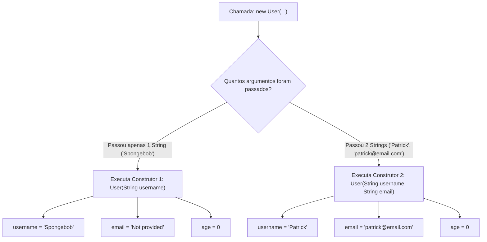

# Curso de Java (Bro Code) — Capítulo 41: Overloaded Constructors 🛠️
## Parte 5: O Segundo Construtor, o Erro de Assinatura Duplicada (Ondinha Vermelha) e a Resolução

---

> [!NOTE]
> **Contexto de Estudo para o Google Docs:**
> Este documento foi elaborado com riqueza visual descritiva e didática descomplicada para que você possa copiar e colar diretamente no seu Google Docs. Mesmo sem as imagens originais na tela, você entenderá exatamente cada detalhe visual do IntelliJ IDEA, cada linha de código, o motivo de cada erro e como o Java pensa nos bastidores.

---

## 1. O Que Aconteceu Nesta Sequência de 3 Imagens? (Visão Geral)

Nas imagens anteriores, tínhamos a classe `User.java` com apenas **um construtor** (que recebia somente o `username` e preenchia o resto com `"Not provided"` e `0`).

Nesta nova sequência de 3 capturas de tela do vídeo:
1. **Imagem 1 (`media_1791323991547.png`):** O professor Bro Code dá um famoso **Ctrl+C / Ctrl+V** (copiar e colar) no primeiro construtor dentro de `User.java`. Imediatamente, o IntelliJ IDEA entra em pânico e desenha uma **linha ondulada vermelha** embaixo dos dois construtores! É o erro de **Construtor Duplicado**.
2. **Imagem 2 (`media_1791324026135.png`):** O professor altera a assinatura do segundo construtor, adicionando um segundo parâmetro: `User(String username, String email)`. Ele ajusta o corpo para receber o e-mail real (`this.email = email;`). Na mesma hora, **todas as ondinhas vermelhas somem**! O código volta a ficar 100% limpo e válido.
3. **Imagem 3 (`media_1791324057217.png`):** O autor revisa a classe `User.java` agora possuindo **dois construtores sobrecarregados** oficiais e prontos para atender o programa principal.

---

## 2. Descrição Visual Detalhada das Telas (Para Seu Google Docs)

### 📸 Imagem 1: O Flagrante do Erro de Construtor Duplicado
* **Aba ativa no topo:** `User.java` com um pequeno pontinho/ícone de erro no canto superior direito do editor.
* **Linhas visíveis:**
  * Linha 7: `User(String username){` — está com uma **ondinha vermelha** (squiggly red line) bem embaixo do nome e dos parênteses.
  * Linhas 8 a 10: o corpo do primeiro construtor.
  * Linha 12: `User(String username){` — **também está com ondinha vermelha** embaixo! O cursor do mouse ou caixa de seleção cinza está sobre a palavra `username`.
  * Linhas 13 a 15: cópia exata das linhas 8 a 10.
* **O que a IDE está gritando:** 
  > *"Constructor 'User(String)' is already defined in class 'User'"* (O construtor que aceita 1 String já existe nesta classe!).

---

### 📸 Imagem 2: A Correção Mágica (Adeus Ondinhas Vermelhas)
* **Aba ativa:** `User.java`.
* **Linha 12 modificada:** Agora lê `User(String username, String email){`.
* **Linha 14 modificada:** Agora lê `this.email = email;` (em vez de `"Not provided"`).
* **Linha 15:** Mantém `this.age = 0;`.
* **Estado visual:** As ondinhas vermelhas **desapareceram completamente**! O IntelliJ não vê mais nenhum erro porque os dois construtores agora têm "rostos" (assinaturas) diferentes.
* **Cursor:** O cursor de digitação pisca na linha 10, bem no meio de `this.age = 0;`.

---

### 📸 Imagem 3: A Estrutura Estabilizada de `User.java`
* Mostra a classe `User.java` perfeitamente estruturada com os seus 3 atributos lá no topo e os seus **2 construtores sobrecarregados** lado a lado, sem erros de compilação.

---

## 3. Por Que Deu Erro na Imagem 1? (Explicado para um Lezado Amador)

Imagine que você entra em uma lanchonete e diz ao atendente:
> *"Quero o Combo 1!"*

E o atendente olha no cardápio e vê:
* **Combo 1:** Hambúrguer.
* **Combo 1:** Hambúrguer.

O atendente vai travar e perguntar: *"Ué, por que tem dois combos com o mesmo nome e o mesmo pedido? Qual dos dois você quer que eu prepare?!"*

É **exatamente isso** que aconteceu no Java quando o Bro Code copiou e colou:

```java
// CONSTRUTOR 1:
User(String username){ ... }

// CONSTRUTOR 2 (CÓPIA IDÊNTICA):
User(String username){ ... } // 💥 ERRO! O Java não sabe qual escolher!
```

### O Que é a "Assinatura" de um Construtor?
Para o Java, o que diferencia um construtor de outro não é o código que está dentro das chaves `{ }`, mas sim a **lista de parâmetros entre os parênteses `( )`**:
* Quantos parâmetros tem?
* Quais são os tipos desses parâmetros? (`String`, `int`, etc.)
* Qual é a ordem deles?

Se dois construtores tiverem **a mesma quantidade e os mesmos tipos na mesma ordem**, o Java considera que são **gêmeos idênticos**. Ele proíbe isso terminantemente para evitar ambiguidade!

---

## 4. Como o Bro Code Resolveu o Erro na Imagem 2?

Ele mudou a lista de parâmetros do segundo construtor:
* Construtor 1: Recebe **1 texto** -> `(String username)`
* Construtor 2: Recebe **2 textos** -> `(String username, String email)`

Agora o Java olha e pensa:
> *"Ahhh, entendi! Se o programador mandar só 1 texto (`new User("Bob")`), eu chamo o Construtor 1. Se ele mandar 2 textos (`new User("Bob", "bob@email.com")`), eu chamo o Construtor 2! Agora sei diferenciar perfeitamente!"*

---

## 5. Código Completo de `User.java` Linha por Linha

Aqui está o arquivo `User.java` exatamente como ficou ao final da Imagem 3:

```java
 1: public class User {
 2: 
 3:     String username;
 4:     String email;
 5:     int age;
 6: 
 7:     User(String username){
 8:         this.username = username;
 9:         this.email = "Not provided";
10:         this.age = 0;
11:     }
12: 
13:     User(String username, String email){
14:         this.username = username;
15:         this.email = email;
16:         this.age = 0;
17:     }
18: 
19: }
```

### Explicação Minuciosa Linha por Linha:

* **Linha 1 (`public class User {`):**
  * Declara a classe pública chamada `User` (Molde do Usuário).
  * Saída no console: Nenhuma (é apenas a definição da classe).

* **Linha 2 (` `):** Linha em branco para manter o código organizado e legível.

* **Linha 3 (`String username;`):**
  * Atributo (variável de instância): guarda o nome/apelido do usuário como texto.
  * Saída no console: Nenhuma.

* **Linha 4 (`String email;`):**
  * Atributo: guarda o endereço de e-mail do usuário como texto.
  * Saída no console: Nenhuma.

* **Linha 5 (`int age;`):**
  * Atributo: guarda a idade do usuário como um número inteiro.
  * Saída no console: Nenhuma.

* **Linha 6 (` `):** Linha em branco separadora.

---

### 🔨 Construtor 1: A "Opção Econômica" (Apenas Nome)

* **Linha 7 (`User(String username){`):**
  * Cabeçalho do primeiro construtor sobrecarregado.
  * Recebe **apenas 1 parâmetro**: o `username`.
  * É acionado quando alguém cria um usuário passando só o nome: `new User("Spongebob");`.

* **Linha 8 (`this.username = username;`):**
  * Pega o nome que foi entregue nos parênteses (`username`) e guarda na gaveta do próprio objeto que está nascendo (`this.username`).

* **Linha 9 (`this.email = "Not provided";`):**
  * Como quem chamou este construtor não informou um e-mail, nós definimos o valor padrão `"Not provided"` (Não fornecido).
  * Isso impede que o e-mail fique com o perigoso valor `null`.

* **Linha 10 (`this.age = 0;`):**
  * Como a idade não foi informada, definimos a idade padrão como `0`.

* **Linha 11 (`}`):**
  * Fecha o bloco do primeiro construtor.

* **Linha 12 (` `):** Linha em branco separadora entre os dois construtores.

---

### 🛠️ Construtor 2: A "Opção Intermediária" (Nome + E-mail)

* **Linha 13 (`User(String username, String email){`):**
  * Cabeçalho do **segundo construtor sobrecarregado**.
  * Recebe **2 parâmetros**: o `username` (texto) e o `email` (texto), separados por vírgula.
  * É acionado quando alguém cria um usuário passando nome e e-mail: `new User("Patrick", "patrick@email.com");`.

* **Linha 14 (`this.username = username;`):**
  * Pega o nome recebido nos parênteses e salva no atributo `this.username` do objeto.

* **Linha 15 (`this.email = email;`):**
  * **A grande diferença!** Aqui nós **não** colocamos `"Not provided"`.
  * Pegamos o e-mail real que a pessoa digitou (`email`) e colocamos no atributo do objeto (`this.email`).

* **Linha 16 (`this.age = 0;`):**
  * Como este construtor ainda não pede a idade nos parênteses, continuamos protegendo o objeto e atribuindo `0` para a idade.

* **Linha 17 (`}`):**
  * Fecha o bloco do segundo construtor.

* **Linha 18 e 19 (`}`):**
  * Fecha a classe `User`.

---

## 6. Diagrama de Decisão do Java: Como ele Sabe Qual Construtor Executar?



---

## 7. O Que Sai no Console?

Como as 3 imagens mostram a edição do arquivo `User.java`, criar ou editar construtores **não produz saída nenhuma no console** por si só.

Porém, se rodarmos o programa com o [`Main.java`](../../../src/main/java/com/mickaelgeronimo/mastery/core/concurrency/Main.java) atual:

```java
public class Main {
    public static void main(String[] args) {

        User user1 = new User("Spongebob");

        System.out.println(user1.username);
        System.out.println(user1.email);
        System.out.println(user1.age);
    }
}
```

O console imprime exatamente:
```text
Spongebob
Not provided
0
```

> [!TIP]
> **O que vem a seguir no vídeo?**
> No próximo passo, o Bro Code irá criar um terceiro construtor que aceita os 3 dados `(username, email, age)`, e depois irá para o [`Main.java`](../../../src/main/java/com/mickaelgeronimo/mastery/core/concurrency/Main.java) instanciar `user2` e `user3` para testar todos eles!

---

## 8. Resumo "Meteórico" para Guardar no Bolso

1. **Copiar e colar construtor sem mudar os parâmetros dá erro vermelho:** O Java não permite assinaturas idênticas.
2. **Para sobrecarregar (overload), a lista de parâmetros precisa ser diferente:** Mais parâmetros, tipos diferentes ou ordem diferente.
3. **No segundo construtor:** O `email` agora recebe o valor real (`this.email = email;`), e a `age` continua com o valor padrão de segurança `0`.
