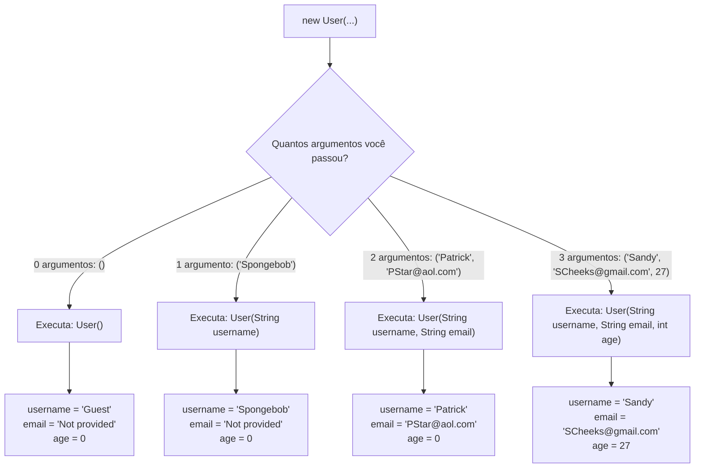

# Curso de Java (Bro Code) — Capítulo 41: Overloaded Constructors 🛠️
## Parte 9: A Execução de `user4`, a Saída `"Guest"` no Console e a Grande Revisão de Fechamento do Capítulo

---

> [!NOTE]
> **Contexto de Estudo para o Google Docs:**
> Este documento foi elaborado com riqueza visual descritiva e didática descomplicada para que você possa copiar e colar diretamente no seu Google Docs. Mesmo sem as imagens originais na tela, você entenderá exatamente cada detalhe visual do IntelliJ IDEA, cada linha de código, o motivo de cada comando e como o Java pensa nos bastidores.

---

## 1. O Que Aconteceu Nesta Sequência de 2 Imagens? (Visão Geral)

Nas imagens anteriores, o professor Bro Code havia criado o quarto construtor `User()` (sem parâmetros) dentro de [`User.java`](file:///c:/Users/mickel%201/Downloads/JAVA%20APRENDER/User.java) e instanciado `User user4 = new User();` no [`Main.java`](file:///c:/Users/mickel%201/Downloads/JAVA%20APRENDER/Main.java).

Nesta nova sequência de 2 capturas de tela:
1. **Imagem 1 (`media_1791324880432.png` - Timestamp `7:07:40`):**
   * O autor finaliza o ajuste das 3 linhas de impressão para exibir os atributos do `user4`:
     ```java
     System.out.println(user4.username);
     System.out.println(user4.email);
     System.out.println(user4.age);
     ```
   * O cursor do mouse está posicionado no canto superior direito do IntelliJ IDEA, sobre o botão verde triangular de **Play (Run 'Main')**.
2. **Imagem 2 (`media_1791324900373.png`):**
   * O autor clica no botão Play!
   * A janela inferior do terminal **Run** abre com o texto verde:
     ```text
     Guest
     Not provided
     0
     ```
   * O autor **seleciona com o mouse a palavra `Guest`** (criando uma barra azul de destaque) para provar visualmente ao aluno:
     > *"Vejam só! Como não passamos nada para o `user4`, ele ativou o construtor vazio e nasceu automaticamente como um Convidado (`Guest`), com e-mail não informado (`Not provided`) e idade `0`!"*

---

## 2. Descrição Visual Detalhada das Telas (Para Seu Google Docs)

### 📸 Imagem 1: O Código Pronto para o Teste Final
* **Tempo do vídeo:** `7:07:40 / 12:00:00` no capítulo `41.overloaded constructors ...`.
* **Aba ativa:** `Main.java` (em azul claro no topo).
* **Estrutura de arquivos visível à esquerda:** `MyFirstProject > src > Main` e `User`.
* **Editor de código (linhas 1 a 14):**
  * Linhas 5 a 8: Declaração dos 4 objetos (`user1`, `user2`, `user3`, `user4`).
  * Linhas 10 a 12: Impressão dos atributos do `user4`.
* **Ação do autor:** O mouse está em cima do ícone verde de Play no topo direito da barra de ferramentas do IntelliJ.

---

### 📸 Imagem 2: O Console com `"Guest"` Destacado em Azul
* **Janela inferior aberta:** Ferramenta **Run** com a aba `Main`.
* **Linha de execução:** `C:\Users\HP\.jdks\openjdk-23\bin\java.exe ...` (OpenJDK 23 rodando).
* **Linhas impressas no console:**
  1. `Guest` ➔ **Destacado com seleção azul pelo mouse**!
  2. `Not provided` ➔ Cursor de texto em barra vertical `|` logo ao lado.
  3. `0`
* **Linha final:** `Process finished with exit code 0` (sucesso absoluto na execução).

---

## 3. Código Completo de [`Main.java`](file:///c:/Users/mickel%201/Downloads/JAVA%20APRENDER/Main.java) Linha por Linha

Aqui está o código exato presente no arquivo:

```java
 1: public class Main {
 2:     public static void main(String[] args) {
 3: 
 4: 
 5:         User user1 = new User("Spongebob");
 6:         User user2 = new User("Patrick", "PStar@aol.com");
 7:         User user3 = new User("Sandy", "SCheeks@gmail.com", 27);
 8:         User user4 = new User();
 9: 
10:         System.out.println(user4.username);
11:         System.out.println(user4.email);
12:         System.out.println(user4.age);
13:     }
14: }
```

### Explicação Linha por Linha:

* **Linha 1 (`public class Main {`):** Declara a classe executável `Main`. *(Console: nada)*.
* **Linha 2 (`public static void main(String[] args) {`):** Método principal, ponto de partida do Java. *(Console: nada)*.
* **Linhas 3 e 4 (` `):** Linhas em branco de espaçamento.
* **Linha 5 (`User user1 = new User("Spongebob");`):**
  * Cria o objeto do Bob Esponja na memória.
  * Aciona o construtor `User(String username)`.
  * *(Console: nada — operação de memória)*.
* **Linha 6 (`User user2 = new User("Patrick", "PStar@aol.com");`):**
  * Cria o objeto do Patrick na memória.
  * Aciona o construtor `User(String username, String email)`.
  * *(Console: nada)*.
* **Linha 7 (`User user3 = new User("Sandy", "SCheeks@gmail.com", 27);`):**
  * Cria o objeto da Sandy na memória.
  * Aciona o construtor `User(String username, String email, int age)`.
  * *(Console: nada)*.
* **Linha 8 (`User user4 = new User();`):**
  * Cria o quarto objeto na memória.
  * **O Grande Destaque:** Os parênteses estão **completamente vazios `()`**!
  * O Java busca um construtor que não exige nenhum parâmetro: `User()`.
  * O construtor atribui: `username = "Guest"`, `email = "Not provided"`, `age = 0`.
  * *(Console: nada)*.
* **Linha 9 (` `):** Linha em branco.
* **Linha 10 (`System.out.println(user4.username);`):**
  * Manda imprimir o apelido do `user4`.
  * **Sai no console:**
    ```text
    Guest
    ```
* **Linha 11 (`System.out.println(user4.email);`):**
  * Manda imprimir o e-mail do `user4`.
  * **Sai no console:**
    ```text
    Not provided
    ```
* **Linha 12 (`System.out.println(user4.age);`):**
  * Manda imprimir a idade do `user4`.
  * **Sai no console:**
    ```text
    0
    ```
* **Linha 13 (`}`):** Fecha o bloco do método `main`.
* **Linha 14 (`}`):** Fecha o bloco da classe `Main`.

---

## 4. O Que Sai no Console? (Resultado Exato)

```text
Guest
Not provided
0
```

### Análise das 3 Saídas:
1. **`Guest`**: Como quem chamou `new User()` não passou nome nenhum, o construtor padrão atribuiu `"Guest"` (Convidado).
2. **`Not provided`**: Como o e-mail não foi informado, foi preenchido com o texto padrão seguro.
3. **`0`**: Idade padrão segura de fábrica.

---

## 5. A Grande Tabela Comparativa de Todo o Capítulo 41

Para resumir tudo o que aprendemos com maestria neste capítulo de **Overloaded Constructors**:

| Objeto | Chamada no `Main` | Quantos Argumentos? | Qual Construtor foi Acionado? | `username` | `email` | `age` |
| :---: | :--- | :---: | :--- | :---: | :---: | :---: |
| **`user1`** | `new User("Spongebob");` | 1 | `User(String username)` | `"Spongebob"` | `"Not provided"` | `0` |
| **`user2`** | `new User("Patrick", "PStar@aol.com");` | 2 | `User(String username, String email)` | `"Patrick"` | `"PStar@aol.com"` | `0` |
| **`user3`** | `new User("Sandy", "SCheeks@gmail.com", 27);` | 3 | `User(String username, String email, int age)` | `"Sandy"` | `"SCheeks@gmail.com"` | `27` |
| **`user4`** | `new User();` | 0 | `User()` | `"Guest"` | `"Not provided"` | `0` |

---

## 6. Diagrama de Fluxo: A Decisão do Java ao Ver `new User(...)`



---

## 7. Perguntas Frequentes de Iniciantes sobre Este Fechamento

### 1. "Por que `user1`, `user2` e `user3` não saíram no console dessa vez?"
Porque o autor removeu os comandos `System.out.println` deles antes de rodar! Mas atenção: os objetos **continuam existindo na memória do computador** (linhas 5, 6 e 7). Apenas não foram mandados para a tela.

### 2. "O que acontece se eu tentar chamar `new User("Bob", 25);` (nome e idade, sem e-mail)?"
Dará um **erro de compilação vermelho**! Porque nós não criamos nenhum construtor que aceite `(String, int)`. O Java só aceita as combinações exatas que nós definimos na classe `User`! Se quiséssemos permitir isso, bastaria criar um 5º construtor: `User(String username, int age)`.

### 3. "Qual é a principal vantagem de aprender Overloaded Constructors?"
A **flexibilidade**! O seu software fica pronto para lidar com a vida real. Na vida real, alguns clientes preenchem todo o formulário de cadastro, outros só colocam o nome, e outros apenas entram como visitantes anônimos. Com construtores sobrecarregados, sua classe `User` atende a todos eles com elegância e sem travar!
