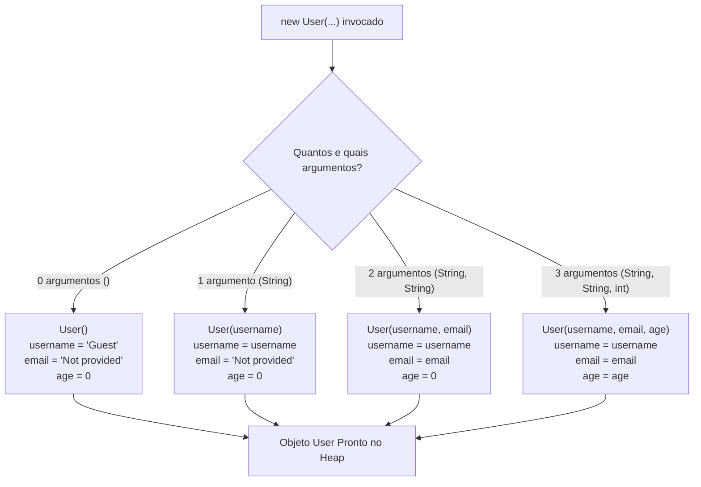

# 🛠️ Capítulo 41: Construtores Sobrecarregados (*Overloaded Constructors*) em Java

> **Módulo Pedagógico:** Trilha de Fundamentos em Java e Arquitetura de Software  
> **Referência:** Bro Code — *Java Full Course for free* (Capítulo 41)

---

## 🧭 Visão Geral

O **Capítulo 41** aprofunda a Orientação a Objetos em Java apresentando uma das técnicas mais utilizadas em bibliotecas e frameworks profissionais: os **Construtores Sobrecarregados (*Overloaded Constructors*)**.

Neste módulo, modelamos a classe de autenticação de usuários [`User.java`](../../../src/main/java/com/mickaelgeronimo/mastery/core/oop/User.java), permitindo que contas sejam instanciadas de 4 maneiras diferentes conforme a quantidade de dados disponíveis no momento do cadastro.

### 🌟 Pilares Fundamentais do Capítulo

1. **A Definição Sagrada**:
   > *"Overloaded constructors = Allow a class to have multiple constructors with different parameter lists. Enable objects to be initialized in various ways."*
2. **A Regra de Ouro das Assinaturas (*Constructor Signature*)**:
   - Uma assinatura é composta pelo **nome do construtor + lista ordenada dos tipos de parâmetros**.
   - O Java não se importa com o nome da variável de parâmetro, mas sim com seu **tipo** e **ordem**.
   - Criar dois construtores que recebem os mesmos tipos (ex: `(String, String)`) resulta no erro de compilação clássico:  
     `'User(String, String)' is already defined in 'User'`.
3. **Tratamento Inteligente de Valores Padrão (*Fallback Defaults*)**:
   - Quando um dado opcional não é fornecido pelo chamador, o construtor aplica valores padrão amigáveis:
     - E-mail não informado $\rightarrow$ `"Not provided"`
     - Idade não informada $\rightarrow$ `0`
     - Modo anônimo / Convidado $\rightarrow$ `"Guest"`
4. **Encadeamento Limpo de Construtores (*Constructor Chaining*)**:
   - Como conectar construtores menores ao construtor mestre utilizando `this(...)` para respeitar o princípio de engenharia **DRY (*Don't Repeat Yourself*)**.

---

## 🗂️ Estrutura de Aulas e Documentos

| Arquivo | Título / Tema Principal |
| :--- | :--- |
| [01_definicao_e_conceito.md](01_definicao_e_conceito.md) | A definição de 3 linhas de Bro Code e a flexibilidade de múltiplos pontos de entrada. |
| [02_criacao_classe_user.md](02_criacao_classe_user.md) | Criação da classe `User.java` no IntelliJ IDEA e preparação dos 3 atributos (`username`, `email`, `age`). |
| [03_atributos_e_primeiro_construtor_user.md](03_atributos_e_primeiro_construtor_user.md) | O primeiro construtor de 1 parâmetro: `User(String username)`. |
| [04_user1_not_provided_e_valores_padrao.md](04_user1_not_provided_e_valores_padrao.md) | Instanciação de `user1` ("Spongebob"), preenchimento de `"Not provided"` e `0`, e saída no console. |
| [05_segundo_construtor_e_erro_assinatura_duplicada.md](05_segundo_construtor_e_erro_assinatura_duplicada.md) | Implementação de `User(username, email)` e a demonstração prática do erro de assinatura duplicada. |
| [06_instanciando_user2_e_saida_console.md](06_instanciando_user2_e_saida_console.md) | Criação de `user2` ("Patrick", "ps@gmail.com") e a convivência pacífica dos dois construtores. |
| [07_terceiro_construtor_sandy_e_9_saidas_console.md](07_terceiro_construtor_sandy_e_9_saidas_console.md) | O terceiro construtor completo com 3 parâmetros (`user3` Sandy), completando 9 saídas no terminal. |
| [08_construtor_padrao_user4_guest_capitulo41_parte8.md](08_construtor_padrao_user4_guest.md) | O quarto construtor sem parâmetros `User()` para usuários convidados (`"Guest"`). |
| [09_execucao_user4_guest_e_fechamento.md](09_execucao_user4_guest_e_fechamento.md) | Execução do `user4` no terminal com `"Guest"` destacado em azul e sucesso da sobrecarga. |
| [10_revisao_conceitual_e_fechamento.md](10_revisao_conceitual_e_fechamento.md) | A grande revisão conceitual conectando teoria, assinaturas de métodos e a independência das 4 instâncias. |
| [README.md](README.md) | Guia curricular geral e tabela comparativa dos 4 construtores. |

---

## 👥 Matriz de Construtores e Instâncias Canônicas

| Objeto | Assinatura Utilizada | `username` | `email` | `age` | Perfil do Usuário |
| :---: | :--- | :---: | :---: | :---: | :--- |
| `user1` | `User(String)` | `"Spongebob"` | `"Not provided"` | `0` | Cadastro rápido (apenas apelido) |
| `user2` | `User(String, String)` | `"Patrick"` | `"ps@gmail.com"` | `0` | Cadastro padrão web (sem idade) |
| `user3` | `User(String, String, int)` | `"Sandy"` | `"sc@gmail.com"` | `27` | Perfil completo verificado |
| `user4` | `User()` *(sem argumentos)* | `"Guest"` | `"Not provided"` | `0` | Visitante anônimo / Convidado |

---

## 🏛️ Árvore de Decisão do Compilador na Sobrecarga

---

## 💻 Código-Fonte e Testes no Projeto
- Classe com Sobrecargas: [`User.java`](../../../src/main/java/com/mickaelgeronimo/mastery/core/oop/User.java)
- Demonstração Executável: [`OverloadedConstructorsDemo.java`](../../../src/main/java/com/mickaelgeronimo/mastery/core/oop/OverloadedConstructorsDemo.java)
- Suíte de Testes Automatizados: [`OverloadedConstructorsTest.java`](../../../src/test/java/com/mickaelgeronimo/mastery/core/OverloadedConstructorsTest.java)
