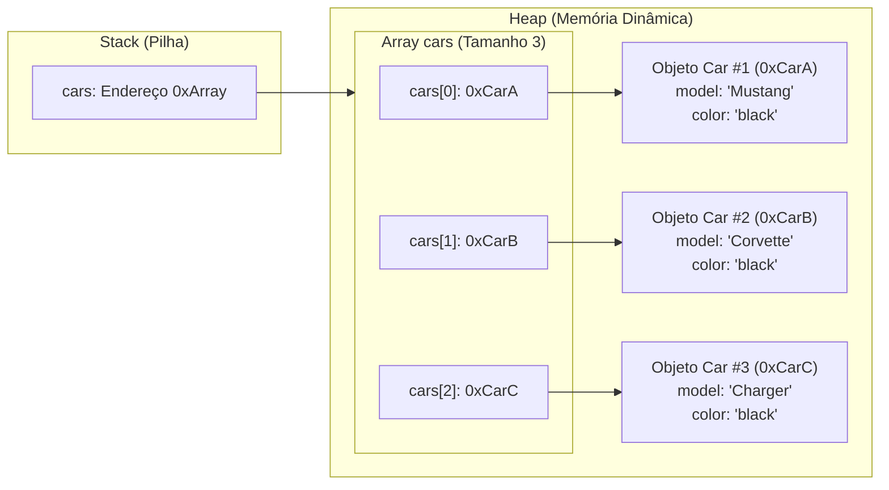

# 🗃️ Capítulo 42: Array de Objetos (*Array of Objects*) em Java

> **Módulo Pedagógico:** Trilha de Fundamentos em Java e Arquitetura de Software  
> **Referência:** Bro Code — *Java Full Course for free* (Capítulo 42)

---

## 🧭 Visão Geral

O **Capítulo 42** une dois pilares previamente estudados de forma independente: **Arrays (Capítulo 31)** e **Orientação a Objetos (Capítulos 39, 40 e 41)**, demonstrando como gerenciar frotas e coleções de objetos na memória do computador.

Neste módulo, gerenciamos uma concessionária com carros esportivos ([`GarageVehicle.java`](file:///c:/Users/mickel%201/Downloads/JAVA%20APRENDER/src/main/java/com/mickaelgeronimo/mastery/core/oop/GarageVehicle.java)), explorando a criação de arrays de referências, objetos anônimos, iteração com `for-each` e operações de mutação em lote.

### 🌟 Pilares Fundamentais do Capítulo

1. **O que é um Array de Objetos?**:
   - Um vetor que armazena **referências (endereços de memória)** para instâncias alocadas no Heap.
   - O array em si é um objeto no Heap contendo ponteiros que apontam para os outros objetos no Heap.
2. **Evolução das Sintaxes de Criação**:
   - **Forma 1 (Manual / Array Vazio com Índices):**
     ```java
     Car[] cars = new Car[3];
     cars[0] = car1;
     cars[1] = car2;
     cars[2] = car3;
     ```
   - **Forma 2 (Sintaxe Literal com Variáveis Nomeadas):**
     ```java
     Car[] cars = {car1, car2, car3};
     ```
   - **Forma 3 (Objetos Anônimos / Inline Initialization):**
     ```java
     Car[] cars = {
         new Car("Mustang", "Red"),
         new Car("Corvette", "Blue"),
         new Car("Charger", "Yellow")
     };
     ```
3. **Iteração Eficiente: `for` Tradicional vs `for-each`**:
   - O laço tradicional `for (int i = 0; i < cars.length; i++)` exige controle de índice.
   - O laço aprimorado `for-each` (`for (Car car : cars)`) melhora a legibilidade do código ("para cada carro na frota, execute a ação").
4. **Mutação em Lote (*Batch Attribute Mutation*)**:
   - Modificar características de todos os objetos através de uma passada no array:
     ```java
     for (Car car : cars) {
         car.color = "black";
     }
     ```
   - Cada carro agora passa a reportar `"You drive the black Mustang"`, comprovando a alteração física do estado no Heap.

---

## 🗂️ Estrutura de Aulas e Documentos

| Arquivo | Título / Tema Principal |
| :--- | :--- |
| [01_inicio_criacao_nova_classe.md](file:///c:/Users/mickel%201/Downloads/JAVA%20APRENDER/docs/curriculum/capitulo_42_array_of_objects/01_inicio_criacao_nova_classe.md) | Limpeza do `Main.java` e passo a passo no menu do IntelliJ IDEA (`File -> New -> Java Class`). |
| [02_classe_car_instanciacao_e_loop_drive.md](file:///c:/Users/mickel%201/Downloads/JAVA%20APRENDER/docs/curriculum/capitulo_42_array_of_objects/02_classe_car_instanciacao_e_loop_drive.md) | Criação da classe `Car(model, color)`, instanciação dos 3 carros e a primeira versão do array com `for`. |
| [03_execucao_loop_for_e_saida_console.md](file:///c:/Users/mickel%201/Downloads/JAVA%20APRENDER/docs/curriculum/capitulo_42_array_of_objects/03_execucao_loop_for_e_saida_console.md) | Execução do loop no console, análise das 3 saídas e a dica da lâmpada amarela do IntelliJ. |
| [04_for_each_e_objetos_anonimos.md](file:///c:/Users/mickel%201/Downloads/JAVA%20APRENDER/docs/curriculum/capitulo_42_array_of_objects/04_for_each_e_objetos_anonimos.md) | A revolução do código limpo: adoção do `for-each` e instanciação direta com objetos anônimos no array. |
| [05_modificando_atributos_em_lote_black.md](file:///c:/Users/mickel%201/Downloads/JAVA%20APRENDER/docs/curriculum/capitulo_42_array_of_objects/05_modificando_atributos_em_lote_black.md) | Modificação de atributos em lote: pintando toda a garagem de preto (`car.color = "black"`) e execução final. |
| [README.md](file:///c:/Users/mickel%201/Downloads/JAVA%20APRENDER/docs/curriculum/capitulo_42_array_of_objects/README.md) | Guia curricular geral e topologia de memória do array de objetos. |

---

## 🚗 A Garagem Canônica do Bro Code

| Índice | Modelo (`model`) | Cor Original (`color`) | Cor Após Pintura em Lote | Mensagem de Condução Final |
| :---: | :---: | :---: | :---: | :--- |
| `[0]` | `"Mustang"` | `"Red"` | `"black"` | `"You drive the black Mustang"` |
| `[1]` | `"Corvette"` | `"Blue"` | `"black"` | `"You drive the black Corvette"` |
| `[2]` | `"Charger"` | `"Yellow"` | `"black"` | `"You drive the black Charger"` |

---

## 🏛️ Topologia de Memória do Array de Objetos



---

## 💻 Código-Fonte e Testes no Projeto
- Entidade Veículo para Coleções: [`GarageVehicle.java`](file:///c:/Users/mickel%201/Downloads/JAVA%20APRENDER/src/main/java/com/mickaelgeronimo/mastery/core/oop/GarageVehicle.java)
- Gerenciador de Frota / Coleção de Objetos: [`GarageFleetManager.java`](file:///c:/Users/mickel%201/Downloads/JAVA%20APRENDER/src/main/java/com/mickaelgeronimo/mastery/core/oop/GarageFleetManager.java)
- Demonstração Executável: [`ArrayOfObjectsDemo.java`](file:///c:/Users/mickel%201/Downloads/JAVA%20APRENDER/src/main/java/com/mickaelgeronimo/mastery/core/oop/ArrayOfObjectsDemo.java)
- Suíte de Testes Automatizados: [`ArrayOfObjectsTest.java`](file:///c:/Users/mickel%201/Downloads/JAVA%20APRENDER/src/test/java/com/mickaelgeronimo/mastery/core/ArrayOfObjectsTest.java)
