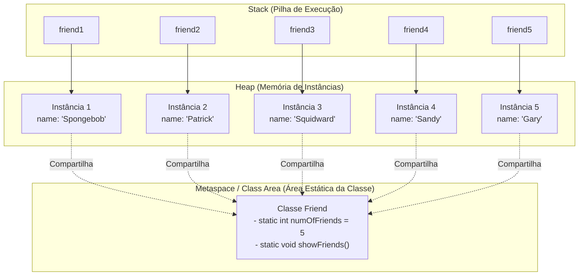

# 🤝 Capítulo 43: O Modificador `static` em Java

> **Módulo Pedagógico:** Trilha de Fundamentos em Java e Arquitetura de Software  
> **Referência:** Bro Code — *Java Full Course for free* (Capítulo 43)

---

## 🧭 Visão Geral

O **Capítulo 43** desmistifica uma das palavras-chave mais emblemáticas e essenciais da linguagem Java: o modificador **`static`**.

Desde o primeiro dia de aprendizado em Java, nos deparamos com o `static` na declaração do método de entrada `public static void main(String[] args)`. Neste módulo, aprendemos detalhadamente o seu propósito arquitetural através da modelagem da classe [`Friend.java`](file:///c:/Users/mickel%201/Downloads/JAVA%20APRENDER/src/main/java/com/mickaelgeronimo/mastery/core/oop/Friend.java) e de uma análise comparativa profunda com a classe [`java.lang.Math`](file:///c:/Users/mickel%201/Downloads/JAVA%20APRENDER/src/main/java/com/mickaelgeronimo/mastery/core/oop/MathUtilityDemo.java).

### 🌟 Pilares Fundamentais do Capítulo

1. **A Definição Sagrada**:
   > *"static = Makes a variable or method belong to the class rather than to any specific object. Commonly used for utility methods or shared resources."*
2. **Variáveis de Instância vs Variáveis Estáticas**:
   - **Variável Comum / Instância (`String name;`):** Cada objeto possui sua própria cópia independente no Heap.
   - **Variável Estática (`static int numOfFriends;`):** Uma única gaveta de memória gerenciada pela classe (na área de classes/Metaspace), compartilhada por todas as instâncias existentes.
3. **O Clássico Bug do Contador de Amigos**:
   - Sem `static`: Cada chamada a `new Friend(...)` incrementa sua própria variável isolada, resultando na impressão errônea `1, 1, 1`.
   - Com `static`: Todos os construtores compartilham a mesma variável global da classe, gerando a sequência correta `1, 2, 3, 4, 5`.
4. **Boas Práticas de Acesso e o Alerta Amarelo da IDE**:
   - Acessar `friend1.numOfFriends` dispara o aviso: *Static member accessed via instance reference*.
   - A forma oficial, expressiva e profissional da indústria é sempre acessar diretamente pelo nome da classe:  
     `Friend.numOfFriends`.
5. **Métodos Estáticos (*Static Methods*) e a Proibição do `this`**:
   - Métodos estáticos pertencem à classe e são invocados sem necessidade de objetos: `Friend.showFriends()`.
   - **Regra de Ouro:** Métodos estáticos **não possuem contexto de instância** (`this`). Tentar usar `this` dentro de um método estático causa erro imediato de compilação ❗.
6. **Aplicações Reais: Classes Utilitárias do JDK (`java.lang.Math`)**:
   - Classes utilitárias agrupam funções puras e constantes matemáticas (`Math.round()`, `Math.PI`, `Math.sqrt()`).
   - Padrão arquitetural de **Construtor Privado (`private Math() {}`)** para impedir qualquer tentativa de instanciação indevida com `new`.

---

## 🗂️ Estrutura de Aulas e Documentos

| Arquivo | Título / Tema Principal |
| :--- | :--- |
| [01_definicao_e_criacao_classe_friend.md](file:///c:/Users/mickel%201/Downloads/JAVA%20APRENDER/docs/curriculum/capitulo_43_static/01_definicao_e_criacao_classe_friend.md) | Definição do `static`, criação de `Friend.java` e instanciação do primeiro amigo (*Spongebob*). |
| [02_o_problema_da_variavel_comum_vs_static.md](file:///c:/Users/mickel%201/Downloads/JAVA%20APRENDER/docs/curriculum/capitulo_43_static/02_o_problema_da_variavel_comum_vs_static.md) | Demonstração intencional do bug da contagem isolada (`1` e `1`), conserto com `static int numOfFriends` e vitória no terminal (`2` e `2`). |
| [03_adicionando_squidward_e_aviso_ide.md](file:///c:/Users/mickel%201/Downloads/JAVA%20APRENDER/docs/curriculum/capitulo_43_static/03_adicionando_squidward_e_aviso_ide.md) | Chegada do 3º amigo (*Squidward*), a saída `3, 3, 3` e a explicação da ondinha amarela da IDE (*static member accessed via instance*). |
| [04_acesso_pela_classe_e_metodo_showfriends.md](file:///c:/Users/mickel%201/Downloads/JAVA%20APRENDER/docs/curriculum/capitulo_43_static/04_acesso_pela_classe_e_metodo_showfriends.md) | Acesso canônico `Friend.numOfFriends`, adição de *Sandy*, método `showFriends()` e o erro vermelho do `this`. |
| [05_chamando_showfriends_com_gary.md](file:///c:/Users/mickel%201/Downloads/JAVA%20APRENDER/docs/curriculum/capitulo_43_static/05_chamando_showfriends_com_gary.md) | Execução de `Friend.showFriends()`, adição de *Gary* e a saída oficial *"You have 5 total friends"*. |
| [06_exemplo_real_classe_math_do_java.md](file:///c:/Users/mickel%201/Downloads/JAVA%20APRENDER/docs/curriculum/capitulo_43_static/06_exemplo_real_classe_math_do_java.md) | Mergulho no código-fonte do JDK: inspeção de `java.lang.Math`, construtor privado e métodos/constantes estáticas. |
| [07_conclusao_recursos_compartilhados_e_utilitarios.md](file:///c:/Users/mickel%201/Downloads/JAVA%20APRENDER/docs/curriculum/capitulo_43_static/07_conclusao_recursos_compartilhados_e_utilitarios.md) | Fechamento do capítulo: revisão de *Shared Resources* vs *Utility Methods* e consolidação conceitual. |
| [README.md](file:///c:/Users/mickel%201/Downloads/JAVA%20APRENDER/docs/curriculum/capitulo_43_static/README.md) | Guia curricular geral e diagrama de memória estática vs dinâmica. |

---

## 👥 A Turma dos 5 Amigos do Bro Code

| Ordem | Variável de Referência | Nome (`name`) | `Friend.numOfFriends` Após Criação |
| :---: | :---: | :---: | :---: |
| 1º | `friend1` | `"Spongebob"` | **1** |
| 2º | `friend2` | `"Patrick"` | **2** |
| 3º | `friend3` | `"Squidward"` | **3** |
| 4º | `friend4` | `"Sandy"` | **4** |
| 5º | `friend5` | `"Gary"` | **5** |

---

## 🏛️ Topologia de Memória: Variável Estática vs Objetos de Instância

---

## 💻 Código-Fonte e Testes no Projeto
- Classe com Recursos Compartilhados: [`Friend.java`](file:///c:/Users/mickel%201/Downloads/JAVA%20APRENDER/src/main/java/com/mickaelgeronimo/mastery/core/oop/Friend.java)
- Utilitário Matemático no Padrão `java.lang.Math`: [`MathUtilityDemo.java`](file:///c:/Users/mickel%201/Downloads/JAVA%20APRENDER/src/main/java/com/mickaelgeronimo/mastery/core/oop/MathUtilityDemo.java)
- Demonstração Executável: [`StaticDemo.java`](file:///c:/Users/mickel%201/Downloads/JAVA%20APRENDER/src/main/java/com/mickaelgeronimo/mastery/core/oop/StaticDemo.java)
- Suíte de Testes Automatizados: [`StaticModifierTest.java`](file:///c:/Users/mickel%201/Downloads/JAVA%20APRENDER/src/test/java/com/mickaelgeronimo/mastery/core/StaticModifierTest.java)
