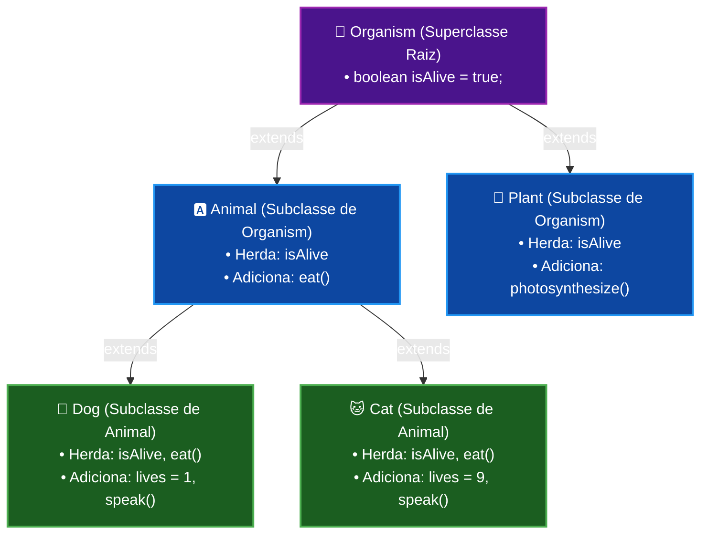

# Curso de Java — Capítulo 44: Herança (`inheritance 👨‍👧‍👦`)
## Parte 8: Teste do "Avô" Organism no Console e a Criação da Classe `Plant` (Herança Hierárquica)

> **Contexto de Estudo:** Este material é uma transcrição e dissecação pedagógica minuciosa baseada no curso *"Java Full Course for free"* do canal **Bro Code** (timestamp aproximado `07:26:30` até `07:28:30`).  
> **Objetivo:** Explicar para um iniciante absoluto ("do zero", sem jargões indecifráveis) exatamente o que o professor fez na tela da IDE IntelliJ IDEA, o significado de cada linha de código, o que apareceu no console e por que a arquitetura de classes agora possui múltiplos ramos.  
> **Formato para Google Docs:** Todo o contexto visual que estava nas capturas de tela foi descrito minuciosamente em texto corrido e tabelas, permitindo leitura e estudo completos sem a necessidade das imagens originais.

---

## 1. Contexto Geral da Cena: O Teste do Avô e o Surgimento do "Reino Vegetal"

Até a Parte 7, tínhamos uma linha reta de herança multinível:
$$\text{Organism (Avô)} \longrightarrow \text{Animal (Pai)} \longrightarrow \text{Dog / Cat (Filhos)}$$

Nesta sequência de 5 capturas de tela, o professor Bro Code faz dois movimentos essenciais de um desenvolvedor Java profissional:

1. **A Prova Real no Console (Imagens 1 e 2):**  
   Ele executa o programa em `Main.java` chamando `System.out.println(dog.isAlive);` e `System.out.println(cat.isAlive);`.  
   O console imprime `true` duas vezes! Isso prova na prática que um objeto da classe neta (`Dog` ou `Cat`) herda com sucesso uma variável que está lá no topo da árvore genealógica (`Organism`), mesmo que `Animal`, `Dog` e `Cat` não tenham declarado `boolean isAlive` dentro de si!
2. **A Expansão da Família — A Classe `Plant` (Imagens 3, 4 e 5):**  
   O autor cria uma nova classe chamada `Plant` (Planta).  
   Ele demonstra o poder da **Herança Hierárquica** (Hierarchical Inheritance): uma planta é um ser vivo (`Organism`), mas **NÃO** é um animal (`Animal`). Uma planta não late, não mia e não come comida como um animal (`eat()`), mas ela faz fotossíntese (`photosynthesize()`) e está viva (`isAlive = true`).  
   Portanto, `Plant extends Organism` se conecta diretamente ao topo, criando um novo galho na árvore!

---

## 2. Radiografia Visual Minuciosa das 5 Imagens do Vídeo

Para quem está lendo este documento no Google Docs sem ter as imagens abertas, aqui está a descrição exata de cada frame exibido no vídeo do Bro Code:

### Imagem 1 (`media_1791354846814.png`): Preparando para rodar o teste de `isAlive`
* **Ambiente Visual da IDE:** IntelliJ IDEA em tema escuro (Dark Mode).
* **Abas Abertas no Topo do Editor:**
  * `Main.java` (aba ativa, com fundo mais claro e o botão `x` de fechar).
  * `Organism.java`
  * `Animal.java`
  * `Dog.java`
  * `Cat.java`
* **Painel Lateral Esquerdo (Project Tree):**
  * Pasta `src` contendo 5 arquivos `.java`: `Animal`, `Cat`, `Dog`, `Main` (com o ícone verde de execução) e `Organism`.
* **Código Visível no Editor:**
  * Linhas 9 e 10 instanciam `Dog dog = new Dog();` e `Cat cat = new Cat();`.
  * Linhas 12 e 13 mandam imprimir `dog.isAlive` e `cat.isAlive`.
* **Onde está o Mouse / Cursor do Autor:**
  * O cursor de texto pisca na linha 13, dentro de `cat.isAlive`.
  * O ponteiro do mouse está posicionado exatamente em cima do botão verde com a setinha de Play triangular (**Run 'Main'** / `Current File ▶`) no canto superior direito da janela do IntelliJ, pronto para dar o clique de execução.

---

### Imagem 2 (`media_1791354853597.png`): O Console abre e confirma o sucesso da herança
* **O que mudou na tela:**
  * A parte inferior da tela foi ocupada pela janela **Run** (terminal de saída do IntelliJ).
  * A barra de abas da janela Run mostra a aba `Main`.
  * O caminho interno do executável Java é mostrado: `C:\Users\HP\.jdks\openjdk-23\bin\java.exe ...`.
* **Texto impresso no Console:**
  ```text
  true
  true
  
  Process finished with exit code 0
  ```
* **Destaque do Mouse do Autor:**
  * O professor clica e arrasta o mouse sobre a primeira palavra `true`, deixando-a selecionada com um retângulo azul de destaque.
  * O cursor do mouse em formato de "I" maiúsculo (cursor de texto) repousa logo abaixo, ao lado do segundo `true`.
  * Ele faz isso para enfatizar aos alunos: *"Vejam só! Deu `true` e `true`! O cachorro e o gato estão vivos porque herdaram isso do avô Organism!"*

---

### Imagem 3 (`media_1791354886425.png`): Criando a nova classe `Plant.java`
* **Ação do Autor:**
  * O professor clica com o botão direito na pasta `src` (ou pressiona o atalho `Alt + Insert`) e seleciona `New -> Java Class`.
* **Janela Modal Flutuante ("New Java Class"):**
  * Um pequeno menu suspenso retangular aparece no meio do editor com o título cinza `New Java Class`.
  * No campo de digitação, o professor digitou: `Plant`.
  * A opção `Class` está selecionada em azul.
  * Logo abaixo aparecem as outras opções que o IntelliJ oferece: `Interface`, `Record`, `Enum`, `Annotation`, `Exception`.
* **Efeito Especial de Edição do Vídeo:**
  * Na parte inferior central do vídeo, aparece uma legenda gigante em fonte grossa branca com contorno preto escrito: **Plant**.

---

### Imagem 4 (`media_1791354927983.png`): Digitando o método da Planta e o erro proposital
* **Nova Aba Aberta:** O IntelliJ abre automaticamente a aba recém-criada `Plant.java` com uma linha azul embaixo indicando que ela é a aba em foco.
* **Código sendo digitado:**
  ```java
  public class Plant extends {

      void photosynthesize(){
          System.out.println("The plant absorbs sunlight");
      }

  }
  ```
* **O Erro de Sintaxe (Sublinhado Vermelho Ondulado):**
  * Na linha 1, logo após a palavra `extends `, existe uma cobrinha vermelha ondulada (`~~~`).
  * No canto superior direito do editor, surge um símbolo vermelho com o número `! 2` (indicando 2 erros de compilação).
  * **Por que deu erro?** Porque a palavra `extends` em Java é uma palavra-chave reservada que exige obrigatoriamente o nome de uma superclasse logo em seguida. Como o autor abriu a chave `{` antes de escrever qual classe ela estende, o Java avisa: *"Ei, você disse que a planta herda (`extends`), mas não disse de quem!"*.

---

### Imagem 5 (`media_1791354938054.png`): Conectando a Planta à sua verdadeira mãe/avó: `Organism`
* **Código Corrigido e Completo em `Plant.java`:**
  ```java
  public class Plant extends Organism{

      void photosynthesize(){
          System.out.println("The plant absorbs sunlight");
      }

  }
  ```
* **O que mudou:**
  * O autor digitou `Organism` entre `extends` e `{`.
  * Os sublinhados vermelhos sumiram instantaneamente.
  * O cursor de texto pisca logo após a chave de abertura `{`.
  * Agora `Plant` é oficialmente uma subclasse de `Organism`!

---

## 3. A Nova Árvore Genealógica (Herança Hierárquica)

Com a chegada da classe `Plant`, a hierarquia do projeto deixou de ser uma linha reta de 3 andares e virou uma árvore com ramos ramificados:



### Por que `Plant` NÃO herda de `Animal`?
Essa é a pergunta mais importante que o Bro Code faz aos alunos:
* Uma planta está viva? **Sim.** Logo, ela é um `Organism`.
* Uma planta tem boca e come comida como os animais? **Não!** Uma planta não mastiga, não engole carne nem ração. O método `eat()` que imprime `"This animal is eating"` não se aplica a uma árvore ou girassol.
* Se fizéssemos `public class Plant extends Animal`:
  * A planta herdaria o método `eat()` indevidamente.
  * Você poderia chamar `plant.eat()`, o que geraria uma incoerência biológica absurda no seu software.
* **A Solução de Design Limpo:**  
  Fazer `Plant extends Organism`.  
  Dessa forma:
  * A planta ganha `isAlive = true` de graça.
  * A planta NÃO recebe o método `eat()` do `Animal`.
  * A planta ganha seu próprio comportamento exclusivo: `photosynthesize()`.

---

## 4. Análise Linha por Linha de Todos os Códigos Envolvidos

### Arquivo 1: `Main.java` (Imagens 1 e 2)

```java
1  public class Main {
2      public static void main(String[] args) {
3  
4          // Inheritance = One class inherits the attributes and methods
5          //               from another class.
6          //               Child <- Parent <- Grandparent
7  
8          Dog dog = new Dog();
9          Cat cat = new Cat();
10 
11         System.out.println(dog.isAlive);
12         System.out.println(cat.isAlive);
13     }
14 }
```

#### Explicação Detalhada Linha por Linha de `Main.java`:

* **Linha 1 (`public class Main {`):**  
  Declaração da classe pública principal do projeto Java. É nela que fica o ponto de partida do programa.
* **Linha 2 (`public static void main(String[] args) {`):**  
  O método fundamental `main`. Sem ele, a máquina virtual Java (JVM) não sabe por onde começar a execução.
* **Linhas 4 a 6 (Comentários):**  
  O professor atualizou o comentário teórico para refletir a nova realidade do código:  
  `Child <- Parent <- Grandparent` (Filho <- Pai <- Avô).  
  Isso resume a herança em múltiplos níveis.
* **Linha 8 (`Dog dog = new Dog();`):**  
  Criação de um novo objeto da classe `Dog` na memória RAM.  
  *O que acontece nos bastidores:*  
  1. Primeiro, o construtor do avô `Organism()` roda e define `isAlive = true`.  
  2. Em seguida, o construtor do pai `Animal()` é executado.  
  3. Por fim, o construtor do filho `Dog()` finaliza, definindo `lives = 1`.
* **Linha 9 (`Cat cat = new Cat();`):**  
  Criação de um novo objeto da classe `Cat` na memória RAM.  
  *O que acontece nos bastidores:*  
  1. O construtor de `Organism` inicializa `isAlive = true`.  
  2. O construtor de `Animal` inicializa a parte animal.  
  3. O construtor de `Cat` finaliza, definindo `lives = 9`.
* **Linha 11 (`System.out.println(dog.isAlive);`):**  
  * **O que faz:** Solicita à JVM que busque a variável `isAlive` no objeto `dog` e imprima seu valor no console.  
  * **Como o Java encontra essa variável:** O compilador procura `isAlive` dentro de `Dog.java`. Não acha. Sobe um degrau e procura em `Animal.java`. Não acha. Sobe mais um degrau e procura em `Organism.java`. Encontra `boolean isAlive` com valor `true`!  
  * **Saída no Console:**  
    ```text
    true
    ```
* **Linha 12 (`System.out.println(cat.isAlive);`):**  
  * **O que faz:** Mesma coisa para o gato `cat`. Busca `isAlive` através da linha de sucessão até encontrar em `Organism`.  
  * **Saída no Console:**  
    ```text
    true
    ```
* **Linhas 13 e 14 (`}` e `}`):**  
  Fechamento do método `main` e da classe `Main`.

---

### Arquivo 2: `Plant.java` (Imagens 4 e 5)

```java
1  public class Plant extends Organism{
2  
3      void photosynthesize(){
4          System.out.println("The plant absorbs sunlight");
5      }
6  }
```

#### Explicação Detalhada Linha por Linha de `Plant.java`:

* **Linha 1 (`public class Plant extends Organism{`):**  
  * `public class Plant`: Cria uma classe pública com o nome `Plant` (Planta).
  * `extends Organism`: A palavra mágica da herança! Diz ao Java que `Plant` é uma subclasse (filha) da classe `Organism`.  
  * **Efeito imediato:** A planta ganha automaticamente a variável `boolean isAlive`, herdada de `Organism`, sem precisar redigitá-la!
* **Linha 2 (` `):**  
  Linha em branco para manter o código limpo, arejado e legível.
* **Linha 3 (`void photosynthesize(){`):**  
  * `void`: Significa que este método realiza uma ação, mas não devolve nenhum valor de retorno (como número ou texto).
  * `photosynthesize()`: Nome do método ("fotossintetizar" em inglês). Representa a habilidade biológica exclusiva dos vegetais de produzir energia a partir da luz solar.
  * `{`: Abre o bloco de comandos que serão executados quando o método for chamado.
* **Linha 4 (`System.out.println("The plant absorbs sunlight");`):**  
  * Imprime no console a frase `"The plant absorbs sunlight"` (*A planta absorve a luz solar*).
  * Este comportamento é exclusivo de plantas! Cães e gatos não têm esse método.
* **Linha 5 (`}`):**  
  Fecha o método `photosynthesize()`.
* **Linha 6 (`}`):**  
  Fecha a classe `Plant`.

---

## 5. Tabela Comparativa de Membros Herdados vs. Próprios

Para fixar de vez na sua mente quem tem o que nesta arquitetura, observe a tabela a seguir:

| Classe | Estende quem? | Atributos/Variáveis | Métodos (Ações) | Pode fazer fotossíntese? | Pode comer com a boca? | Está vivo? |
| :--- | :--- | :--- | :--- | :---: | :---: | :---: |
| **`Organism`** | *(Ninguém - Raiz)* | `isAlive = true` | *(Nenhum)* | ❌ Não | ❌ Não | ✅ Sim |
| **`Animal`** | `Organism` | `isAlive` (herdado) | `eat()` (próprio) | ❌ Não | ✅ Sim | ✅ Sim |
| **`Dog`** | `Animal` | `isAlive` (avô), `lives = 1` | `eat()` (pai), `speak()` | ❌ Não | ✅ Sim | ✅ Sim |
| **`Cat`** | `Animal` | `isAlive` (avô), `lives = 9` | `eat()` (pai), `speak()` | ❌ Não | ✅ Sim | ✅ Sim |
| **`Plant`** | `Organism` | `isAlive` (herdado) | `photosynthesize()` | ✅ Sim | ❌ Não | ✅ Sim |

---

## 6. Saída Completa e Fiel do Console nesta Etapa

Ao rodar o arquivo `Main.java` com as linhas 11 e 12:

```text
true
true
```

* **Linha 1 do Console (`true`):** Resultado direto de `dog.isAlive`, comprovando a herança avô $\rightarrow$ pai $\rightarrow$ neto.
* **Linha 2 do Console (`true`):** Resultado direto de `cat.isAlive`, comprovando a mesma cadeia para a gata.

---

## 7. Resumo para o Google Docs (Pontos-Chave para Lembrar)

1. **A herança em Java pode ter quantos níveis você precisar:** Neto herda de Pai, que herda de Avô, que herda de Bisavô. Todos os membros não-privados chegam até o neto.
2. **Herança Hierárquica evita aberrações no código:** Se plantas e animais compartilham apenas o fato de estarem vivos, a propriedade `isAlive` deve pertencer a uma superclasse comum superior (`Organism`).
3. **Subclasses paralelas não se misturam:** `Dog` e `Plant` são "primos" distantes. `Plant` tem `photosynthesize()`, mas não tem `speak()` nem `eat()`. Cada subclasse mantém suas próprias especializações sem contaminar as outras.
