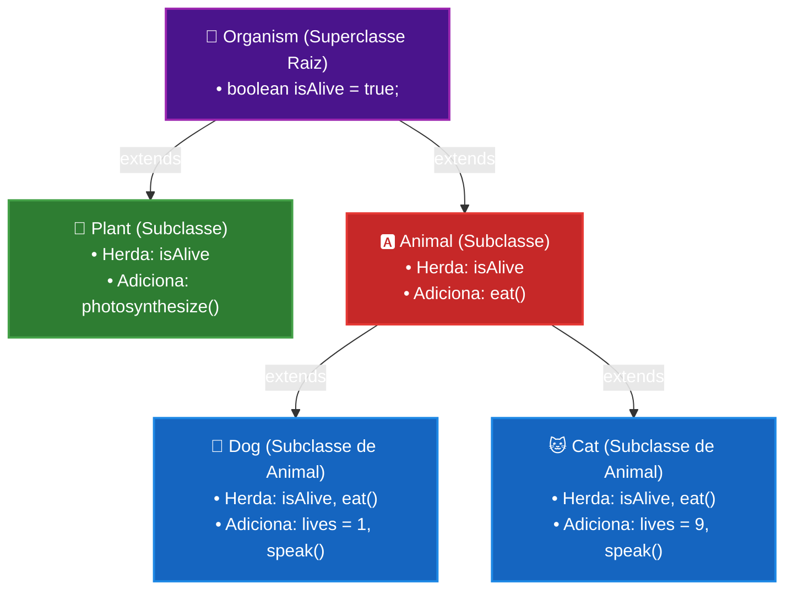

# Curso de Java — Capítulo 44: Herança (`inheritance 👨‍👧‍👦`)
## Parte 10 (Final): A Árvore Completa, o Erro Proposital `dog.photosynthesize()` e a Conclusão do Capítulo

> **Contexto de Estudo:** Este material é uma transcrição e dissecação pedagógica minuciosa baseada no curso *"Java Full Course for free"* do canal **Bro Code** (timestamp `07:30:10` até `07:31:00` / 12:00:00).  
> **Objetivo:** Explicar para um iniciante absoluto ("do zero", passo a passo) como interpretar o diagrama final da árvore genealógica, o que acontece quando tentamos forçar um objeto a usar um método de outro ramo da família (o famoso erro `cannot find symbol`), e como revisar o conceito de Herança em Java.  
> **Formato para Google Docs:** Todo o contexto visual exibido no vídeo (menus, gráficos, marcações de mouse, sublinhados vermelhos da IDE e telas de erro) foi minuciosamente convertido em texto e diagramas Markdown para cópia e estudo sem necessidade das imagens originais.

---

## 1. Visão Geral da Cena: O Clímax do Capítulo 44

Nestas 5 capturas de tela finais do capítulo sobre Herança, o professor Bro Code realiza três atos pedagógicos brilhantes:

1. **Apresentação da Árvore Genealógica Completa (Imagem 1):**  
   Ele pausa a digitação de código e coloca na tela um diagrama ilustrado com ícones resumindo toda a arquitetura criada:
   * **`Organism` 🦠** no topo (Superclasse Raiz).
   * Dela descem dois ramos irmãos: **`Plant` 🌱** e **`Animal` 🅰️**.
   * De `Animal` descem dois filhos: **`Dog` 🐶** e **`Cat` 🐱**.
2. **O Experimento do Erro Proposital (Imagens 2, 3 e 4):**  
   Para provar que a herança **só desce** pela sua própria linha de sangue e **nunca pula de lado para um ramo primo**, o professor tenta fazer o cachorro realizar fotossíntese:  
   `dog.photosynthesize();`  
   A IDE IntelliJ fica vermelha e o compilador se recusa a rodar o programa, disparando o erro clássico:  
   `java: cannot find symbol - method photosynthesize() in variable dog of type Dog`.
3. **A Síntese Teórica e Encerramento (Imagem 5):**  
   Ele apaga o erro e destaca com o mouse as palavras-chave no comentário do código:  
   `attributes and methods` (*atributos e métodos*), consolidando a regra de ouro: herança serve para reaproveitar variáveis e funções em uma hierarquia lógica.

---

## 2. Radiografia Visual Minuciosa das 5 Imagens

Para quem está estudando no Google Docs sem as imagens originais, aqui está a descrição detalhada de tudo o que apareceu na tela:

### Imagem 1 (`media_1791355020119.png`): O Infográfico da Árvore Genealógica
* **Ambiente Visual:** A interface da IDE IntelliJ IDEA aparece totalmente desfocada (*blur*) em segundo plano.
* **Diagrama Central Sobreposto:** Um organograma estilizado com 5 cartões brancos de bordas arredondadas e pretas, conectados por linhas pretas ramificadas:
  * **Topo (Nível 1):** Caixa com o título **`Organism`** e a ilustração de um micróbio/ameba azul 🦠.
  * **Meio (Nível 2 — Irmãos):** Duas caixas conectadas a `Organism`:
    * À esquerda: **`Plant`** com a ilustração de um brotinho vegetal verde com duas folhinhas 🌱.
    * À direita: **`Animal`** com a ilustração de um quadrado vermelho contendo a letra **A** em branco 🅰️.
  * **Base (Nível 3 — Filhos de Animal):** Duas caixas conectadas a `Animal`:
    * À esquerda: **`Dog`** com o rostinho de um cãozinho fofo 🐶.
    * À direita: **`Cat`** com o rostinho de um gatinho amarelo 🐱.
* **Lição Visual:** O galho da planta (`Plant`) termina em si mesmo. O galho do animal (`Animal`) segue adiante para cão e gato.

---

### Imagem 2 (`media_1791355034498.png`): Selecionando a Linha da Planta
* **Ambiente Visual:** O foco volta para a IDE IntelliJ IDEA nítida.
* **Código em `Main.java`:**
  * Linha 9: `Dog dog = new Dog();`
  * Linha 10: `Cat cat = new Cat();`
  * Linha 11: `Plant plant = new Plant();`
* **Ação do Professor:**
  * O professor clica e arrasta o mouse sobre toda a linha 11 (`Plant plant = new Plant();`), deixando-a selecionada com uma faixa retangular azul/cinza.
  * Ele faz isso para chamar a atenção da turma antes de demonstrar a incompatibilidade entre ramos diferentes.

---

### Imagem 3 (`media_1791355046636.png`): Digitando o Comando Proibido (`dog.photosynthesize()`)
* **Código em `Main.java`:**
  * A linha da planta foi removida ou comentada.
  * Na linha 12, o professor digita:
    ```java
    dog.photosynthesize();
    ```
* **Alertas Visuais Imediatos na IDE:**
  * A palavra `photosynthesize` não fica na cor padrão de métodos; ela fica em **vermelho vivo**.
  * Embaixo da palavra surge um **sublinhado ondulado vermelho** de aviso de erro de compilação.
  * Os parênteses `()` aparecem com destaque de cursor.
* **Linha do Tempo do Vídeo:** No rodapé, o player marca `7:30:31 / 12:00:00` no capítulo `44.inheritance 👨‍👧‍👦`.

---

### Imagem 4 (`media_1791355055257.png`): Clicando em Executar e a Janela Vermelha de Erro
* **Ação do Autor:** O autor não se intimida com o sublinhado vermelho e clica de propósito no botão verde **Run ▶** no canto superior direito para forçar a compilação.
* **Painel Inferior ("Build Output"):**
  * A metade de baixo da tela é tomada pela janela de compilação com um ícone de exclamação vermelho `!`.
  * Caminho do arquivo: `C:\Users\HP\IdeaProjects\MyFirstProject\src\Main.java:12:12`
  * Mensagem de Erro em letras vermelhas gigantescas:
    ```text
    java: cannot find symbol
      symbol:   method photosynthesize()
      location: variable dog of type Dog
    ```
* **Canto Superior Direito da IDE:** Surge o emblema de erro `🔴 1 ⚠️ 1` (1 erro fatal de compilação e 1 aviso).
* **Significado:** O compilador Java diz: *"Eu não encontrei o símbolo (método) chamado photosynthesize() dentro da variável dog do tipo Dog!"*.

---

### Imagem 5 (`media_1791355088806.png`): O Fechamento com Chave de Ouro do Capítulo
* **Código Restaurado e Limpo:**
  * O autor deleta a linha com erro e deixa em `Main.java`:
    ```java
    Dog dog = new Dog();
    Cat cat = new Cat();
    Plant plant = new Plant();
    ```
* **O Destaque do Autor:**
  * Na linha 5, no comentário do topo, o professor seleciona com o mouse as palavras:
    `attributes and methods`
  * Ficando assim: `// Inheritance = One class inherits the [attributes and methods]`
* **Canto Superior Direito:** A bolinha vermelha desaparece e surge um lindo visto verde: `✔️ 3` (compilação limpa, zero erros!).

---

## 3. A Árvore Genealógica em Mermaid (Para o Google Docs)



---

## 4. Dissecação Cirúrgica do Erro `cannot find symbol`

Este é um dos erros que mais assustam quem está começando em Java. Vamos dissecá-lo palavra por palavra para você nunca mais ter medo dele:

```text
java: cannot find symbol
  symbol:   method photosynthesize()
  location: variable dog of type Dog
```

1. **`java: cannot find symbol`**:  
   * O que significa: *"Java: não consegui encontrar esse símbolo (nome)"*.  
   * No Java, variáveis, métodos e classes são chamados de "símbolos". Quando o compilador não reconhece o que você escreveu naquele contexto, ele diz que o símbolo não existe.
2. **`symbol: method photosynthesize()`**:  
   * O que significa: O símbolo que o Java não conseguiu achar é especificamente um **método chamado `photosynthesize()`**.
3. **`location: variable dog of type Dog`**:  
   * O que significa: Onde o Java procurou? Ele procurou dentro da **variável `dog`**, que pertence à **classe `Dog`**.

### O Rastreamento que a JVM fez na Memória:
Quando você mandou `dog.photosynthesize();`, a JVM fez a seguinte investigação:
1. Ela abriu a classe `Dog.java`. Procurou `photosynthesize()`. **Não achou** (lá só tem `lives = 1` e `speak()`).
2. Ela subiu para a classe pai [`Animal.java`](../../../src/main/java/com/mickaelgeronimo/mastery/core/oop/inheritance/Animal.java). Procurou `photosynthesize()`. **Não achou** (lá só tem `eat()`).
3. Ela subiu para a classe avô `Organism.java`. Procurou `photosynthesize()`. **Não achou** (lá só tem `isAlive`).
4. Como `Organism` não herda de ninguém (além da classe mãe `Object` do próprio Java), a árvore genealógica do cachorro **acabou**.
5. O Java **NÃO** vai olhar para a classe `Plant.java`! Por quê? Porque `Plant` não é pai nem avô de `Dog`. Na programação orientada a objetos, **herança não pula de galho para galho lateralmente**.
6. Resultado: Erro fatal de compilação! O programa nem sequer começa a rodar.

---

## 5. Código por Código, Linha por Linha

### Versão com Erro Proposital ([`Main.java`](../../../src/main/java/com/mickaelgeronimo/mastery/core/concurrency/Main.java) — Imagens 3 e 4)

```java
1:  public class Main {
2:      public static void main(String[] args) {
3:  
4:          // Inheritance = One class inherits the attributes and methods
5:          //               from another class.
6:          //               Child <- Parent <- Grandparent
7:  
8:          Dog dog = new Dog();
9:          Cat cat = new Cat();
10: 
11:         dog.photosynthesize();
12:     }
13: }
```

* **Linhas 1 a 6:** Definição da classe e comentários teóricos.
* **Linhas 8 e 9:** Instanciação do cachorro e do gato.
* **Linha 11 (`dog.photosynthesize();`):**  
  * Tentativa ilegal de invocar o método de uma planta em um objeto cachorro.
  * **O que sai no console:** O programa é interrompido imediatamente na compilação com a mensagem:
    ```text
    Main.java:11: error: cannot find symbol
            dog.photosynthesize();
               ^
      symbol:   method photosynthesize()
      location: variable dog of type Dog
    1 error
    ```

---

### Versão Final Consolidada e Limpa ([`Main.java`](../../../src/main/java/com/mickaelgeronimo/mastery/core/concurrency/Main.java) — Imagem 5)

```java
1:  public class Main {
2:      public static void main(String[] args) {
3:  
4:          // Inheritance = One class inherits the attributes and methods
5:          //               from another class.
6:          //               Child <- Parent <- Grandparent
7:  
8:          Dog dog = new Dog();
9:          Cat cat = new Cat();
10:         Plant plant = new Plant();
11: 
12:     }
13: }
```

* **Linha 8 (`Dog dog = new Dog();`):** Objeto cachorro pronto, possui `isAlive`, `eat()`, `lives = 1` e `speak()`.
* **Linha 9 (`Cat cat = new Cat();`):** Objeto gato pronto, possui `isAlive`, `eat()`, `lives = 9` e `speak()`.
* **Linha 10 (`Plant plant = new Plant();`):** Objeto planta pronto, possui `isAlive` e `photosynthesize()`.
* **Linhas 12 e 13:** Fechamento limpo do método e da classe.
* **O que sai no console:** Como não há comandos de impressão nessa versão de encerramento, o programa compila e encerra sem erros com:
  ```text
  Process finished with exit code 0
  ```

---

## 6. O Grande Resumo de Ouro do Capítulo 44 (Herança em Java)

Ao selecionar com o mouse as palavras **`attributes and methods`** na Imagem 5, o professor Bro Code resume os pilares de Herança que você deve levar para a sua vida de programador:

1. **O que é Herança?**  
   É o mecanismo em que uma classe filha (`subclass`) herda automaticamente atributos (variáveis) e métodos (funções) de uma classe pai (`superclass`), usando a palavra-chave reservada **`extends`**.
2. **Por que usamos Herança?**  
   * **Reutilização de Código:** Você escreve `boolean isAlive` e `void eat()` uma única vez, em vez de repetir em dezenas de animais e plantas.
   * **Organização e Manutenção:** Se a forma como os animais comem mudar, você altera apenas dentro de `Animal.java` e automaticamente todos os animais do sistema herdam a alteração!
3. **Tipos de Herança que aprendemos:**  
   * **Herança Simples:** `Animal extends Organism` (um filho para um pai).
   * **Herança Multinível:** `Dog extends Animal` e `Animal extends Organism` (neto herda do pai, que herda do avô).
   * **Herança Hierárquica:** `Plant extends Organism` e `Animal extends Organism` (múltiplas classes diferentes herdam da mesma superclasse comum).
4. **Regra de Isolamento dos Ramos:**  
   Subclasses irmãs (como `Plant` e `Animal`, ou `Dog` e `Plant`) não têm acesso aos métodos e atributos específicos umas das outras. Herança desce na vertical, nunca pula na horizontal!
