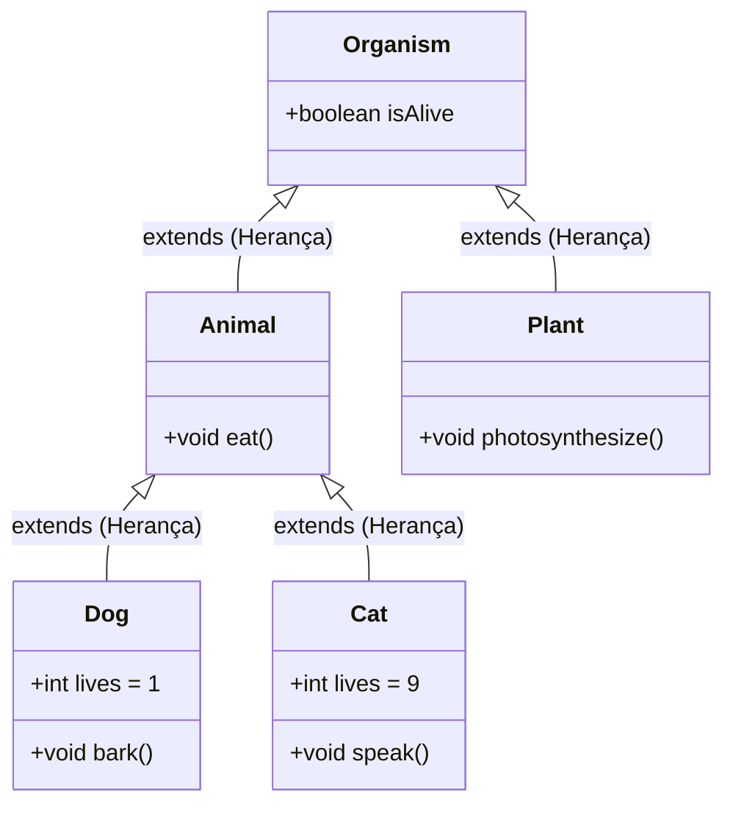

# 👨‍👧‍👦 Capítulo 44: Herança (*Inheritance*) em Java

> **Módulo Pedagógico:** Trilha de Fundamentos em Java e Arquitetura de Software  
> **Referência:** Bro Code — *Java Full Course for free* (Capítulo 44)

---

## 🧭 Visão Geral

O **Capítulo 44** introduz um dos quatro pilares sagrados da Programação Orientada a Objetos: a **Herança (*Inheritance*)**.

Neste módulo, construímos uma hierarquia biológica completa inspirada no reino dos seres vivos ([`Organism.java`](../../../src/main/java/com/mickaelgeronimo/mastery/core/oop/inheritance/Organism.java)), explorando a eliminação radical de duplicação de código (*DRY*), herança multinível, herança hierárquica e o isolamento entre ramos colaterais da árvore genealógica.

### 🌟 Pilares Fundamentais do Capítulo

1. **A Definição Sagrada de Herança**:
   > *"Inheritance = One class inherits the attributes and methods from another class. Child <- Parent."*
2. **A Palavra-Chave `extends`**:
   - Estabelece a relação "é-um" (*is-a relationship*):
     - `Dog` **é um** `Animal`.
     - `Cat` **é um** `Animal`.
     - `Animal` e `Plant` **são** `Organisms`.
3. **Reaproveitamento de Código (*DRY — Don't Repeat Yourself*)**:
   - Atributos e comportamentos compartilhados (como `isAlive = true` e `eat()`) são declarados uma única vez na superclasse pai e herdados automaticamente por todas as subclasses filhas.
4. **Especialização de Subclasses**:
   - Cada classe filha herda o que é comum e implementa suas próprias peculiaridades exclusivas:
     - `Dog`: possui `lives = 1` e método `bark()` (*woof*).
     - `Cat`: possui `lives = 9` e método `speak()` (*meow*).
5. **Herança Multinível (*Multilevel Inheritance*)**:
   - Transmissão transgeracional de características:
     $$\text{Organism} \longrightarrow \text{Animal} \longrightarrow \text{Dog}$$
   - O `Dog` herda `isAlive` do avô `Organism` e `eat()` do pai `Animal`.
6. **Herança Hierárquica (*Hierarchical Inheritance*)**:
   - Uma superclasse servindo como tronco comum para múltiplos ramos especializados:
     $$\text{Organism} \longrightarrow \begin{cases} \text{Animal} \longrightarrow \text{Dog}, \text{Cat} \\ \text{Plant} \end{cases}$$
7. **Isolamento de Ramos Colaterais (O Erro do `dog.photosynthesize()`)**:
   - A herança em Java flui exclusivamente no sentido **Pai $\rightarrow$ Filho**.
   - Ramos colaterais (irmãos/primos) não compartilham métodos específicos entre si. Tentar invocar `dog.photosynthesize()` gera erro fatal em tempo de compilação: `cannot find symbol`.

---

## 🗂️ Estrutura de Aulas e Documentos

| Arquivo | Título / Tema Principal |
| :--- | :--- |
| [01_definicao_e_criacao_classe_animal.md](01_definicao_e_criacao_classe_animal.md) | O que é Herança, a relação *Child <- Parent* e a criação da classe `Animal.java`. |
| [02_classe_animal_atributos_metodo_eat_e_criando_dog.md](02_classe_animal_atributos_metodo_eat_e_criando_dog.md) | Atributos e método `eat()` em `Animal` e criação da classe filha `Dog extends Animal`. |
| [03_criando_cat_extends_animal_e_heranca_em_acao.md](03_criando_cat_extends_animal_e_heranca_em_acao.md) | Criação da classe `Cat extends Animal` e a consolidação do reaproveitamento de código. |
| [04_testando_dog_cat_isalive_eat_e_eliminando_duplicacao.md](04_testando_dog_cat_isalive_eat_e_eliminando_duplicacao.md) | Testes no console: `dog.isAlive`, `cat.isAlive`, `eat()` e a vitória contra a redundância. |
| [05_atributos_e_metodos_exclusivos_das_filhas.md](05_atributos_e_metodos_exclusivos_das_filhas.md) | Especialização das filhas: `lives = 1` e `bark()` no cão vs `lives = 9` e `speak()` no gato. |
| [06_multinivel_organism_grandparent.md](06_multinivel_organism_grandparent.md) | Herança multinível: promoção de `isAlive` para a superclasse avó `Organism.java`. |
| [07_diagrama_arvore_genealogica_organism.md](07_diagrama_arvore_genealogica_organism.md) | Árvore genealógica de classes: relações de ascendência e descendência na memória. |
| [08_hierarquica_criando_classe_plant.md](08_hierarquica_criando_classe_plant.md) | Herança hierárquica: criação de `Plant extends Organism` com o método `photosynthesize()`. |
| [09_instanciando_plant_isalive_e_photosynthesize.md](09_instanciando_plant_isalive_e_photosynthesize.md) | Execução da planta: comprovação de que `plant.isAlive` vem da raiz `Organism`. |
| [10_arvore_completa_erro_dog_photosynthesize_e_conclusao.md](10_arvore_completa_erro_dog_photosynthesize_e_conclusao.md) | Árvore completa, indução do erro proibido `dog.photosynthesize()` e fechamento pedagógico. |
| [README.md](README.md) | Guia curricular geral e diagrama de classes da árvore genealógica. |

---

## 🌳 A Árvore Genealógica Canônica de Classes

---

## 💻 Código-Fonte e Testes no Projeto
- Superclasse Raiz: [`Organism.java`](../../../src/main/java/com/mickaelgeronimo/mastery/core/oop/inheritance/Organism.java)
- Ramo Animal: [`Animal.java`](../../../src/main/java/com/mickaelgeronimo/mastery/core/oop/inheritance/Animal.java)
- Ramo Vegetal: [`Plant.java`](../../../src/main/java/com/mickaelgeronimo/mastery/core/oop/inheritance/Plant.java)
- Subclasse Cão: [`Dog.java`](../../../src/main/java/com/mickaelgeronimo/mastery/core/oop/inheritance/Dog.java)
- Subclasse Gato: [`Cat.java`](../../../src/main/java/com/mickaelgeronimo/mastery/core/oop/inheritance/Cat.java)
- Demonstração Executável: [`InheritanceDemo.java`](../../../src/main/java/com/mickaelgeronimo/mastery/core/oop/inheritance/InheritanceDemo.java)
- Suíte de Testes Automatizados: [`InheritanceTest.java`](../../../src/test/java/com/mickaelgeronimo/mastery/core/InheritanceTest.java)
