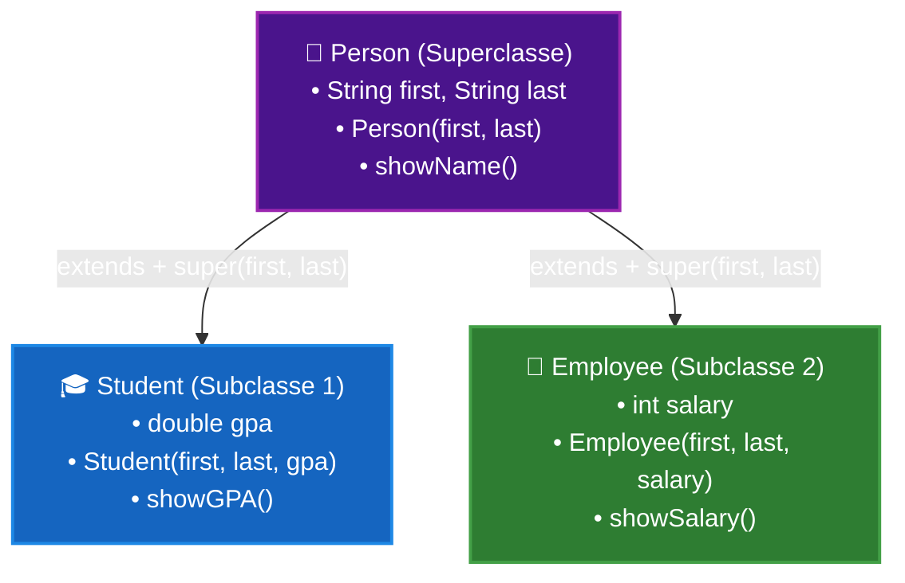

# Curso de Java — Capítulo 45: Palavra-chave `super` (`super 🔝`)
## Parte 6: Criando a Classe `Employee`, o Salário, a Resolução com `super` e o Teste com "Rubeus Hagrid"

> **Contexto de Estudo:** Este material é uma transcrição e dissecação pedagógica minuciosa baseada no curso *"Java Full Course for free"* do canal **Bro Code** (timestamp `07:38:30` até `07:40:00` / 12:00:00).  
> **Objetivo:** Explicar para um iniciante absoluto ("do zero", passo a passo) como a segunda classe filha, `Employee` (Funcionário), é criada estendendo `Person`, como ela enfrenta exatamente o mesmo erro de construtor que o `Student` enfrentou, como resolvemos com `super(first, last);`, e como testamos o funcionário "Rubeus Hagrid" em `Main.java`, imprimindo seu salário no console.  
> **Formato para Google Docs:** Todo o contexto visual da interface do IntelliJ IDEA (janelas modais, tooltips de erro, destaques de código e comandos de execução) foi convertido em texto e tabelas para estudo e cópia direta no Google Docs sem depender das imagens.

---

## 1. Visão Geral da Cena: Consolidando o Padrão com um Segundo Filho

No início do capítulo, aprendemos que:
* `Person` é a Superclasse (pai de todos) com `first`, `last`, construtor e `showName()`.
* `Student` é a primeira subclasse (filho 1), que adicionou `gpa` e usou `super(first, last)` para acionar o construtor do pai.

Agora, o professor Bro Code introduz a segunda subclasse da família: a classe [`Employee.java`](file:///c:/Users/mickel%201/Downloads/JAVA%20APRENDER/Employee.java) (Funcionário).

Nesta sequência de 5 imagens:
1. **Criação da Classe (Imagem 1):**  
   O professor abre a janela modal do IntelliJ e digita `Employee`.
2. **O Mesmo Erro Reaparece de Propósito (Imagens 2 e 3):**  
   Ao tentar criar o construtor do funcionário atribuindo `this.first = first;` e `this.last = last;` na mão, o Java dá o mesmíssimo erro:  
   **`There is no parameterless constructor available in 'Person'`**!  
   Isso prova para o aluno que a regra do `super` não foi um caso isolado do estudante: **qualquer classe filha** que herde de `Person` tem a obrigação de chamar o construtor do pai!
3. **A Correção Elegante com `super` e `showSalary()` (Imagem 4):**  
   Ele substitui a duplicação por `super(first, last);`, adiciona `this.salary = salary;` e cria o método `showSalary()`.
4. **Instanciando "Rubeus Hagrid" em `Main.java` (Imagem 5):**  
   Ele cria o funcionário Rubeus Hagrid (o famoso guarda-caça de Hogwarts) com salário de `$50.000`, e prepara o clique no Play para rodar `employee.showSalary();`.

---

## 2. Radiografia Visual Minuciosa das 5 Imagens

Para quem está estudando no Google Docs sem as imagens originais, aqui está a descrição detalhada de tudo o que apareceu na tela:

### Imagem 1 (`media_1791356348273.png`): Criando a Classe `Employee`
* **Ambiente Visual da IDE:** IntelliJ IDEA (Dark Mode).
* **Janela Modal Flutuante ("New Java Class"):**
  * Aberta no meio da tela sobre o arquivo `Main.java`.
  * No campo de digitação, o professor começou a escrever: `Emplo`.
  * A opção `Class` está selecionada em azul.
* **Legenda Gigante de Edição do Vídeo:**
  * Na parte inferior central, aparece um letreiro em letras brancas com contorno preto: **Employee**.

---

### Imagem 2 (`media_1791356399110.png`): O Erro se Repetindo em `Employee.java`
* **Aba Ativa:** `Employee.java` (no topo vemos 4 abas: `Main.java`, `Person.java`, `Student.java` e `Employee.java`).
* **Código Digitado:**
  ```java
  public class Employee extends Person{

      int salary;

      Employee(String first, String last, int salary){
          this.first = first;
          this.last = last;
          this.salary = salary;
      }

  }
  ```
* **O Alerta Vermelho:**
  * A linha do construtor (`Employee(String first, String last, int salary){`) está com um sublinhado ondulado vermelho contínuo.
  * Surge a mesma caixa preta de tooltip do IntelliJ:
    * **Mensagem:** `There is no parameterless constructor available in 'Person'`.
    * **Sugestão:** `Insert 'super();' Alt+Shift+Enter`.

---

### Imagem 3 (`media_1791356409551.png`): A Pausa Didática
* **A mesma tela da Imagem 2**, exibindo a barra do player do YouTube:
  * Marcador de tempo: `7:39:19 / 12:00:00`.
  * Capítulo: `45.super 🔝`.
  * O professor explica: *"Viram só? Aconteceu exatamente a mesma coisa que aconteceu com a classe Student. O compilador não deixa compilar enquanto não chamarmos o construtor do pai!"*.

---

### Imagem 4 (`media_1791356448035.png`): Código Corrigido e Método `showSalary()`
* **Código Atualizado em `Employee.java`:**
  ```java
  public class Employee extends Person{

      int salary;

      Employee(String first, String last, int salary){
          super(first, last);
          this.salary = salary;
      }

      void showSalary(){
          System.out.println(this.first + "'s salary is $" + this.salary);
      }
  }
  ```
* **Destaques Visuais:**
  * Linha 6: O `super(first, last);` fez todos os erros vermelhos desaparecerem!
  * Linha 11: O método `showSalary()` concatena `this.first` (herdado de `Person`), o texto `"'s salary is $"` e `this.salary` (próprio de `Employee`).
  * Na margem esquerda da linha 11, há uma pequena bolinha amarela (aviso de inspeção opcional da IDE).

---

### Imagem 5 (`media_1791356483363.png`): Adicionando Rubeus Hagrid em `Main.java`
* **Aba Ativa:** `Main.java`.
* **Código Visível:**
  ```java
  Person person = new Person("Tom", "Riddle");
  Student student = new Student("Harry", "Potter", 3.25);
  Employee employee = new Employee("Rubeus", "Hagrid", 50000);

  employee.showSalary();
  ```
* **Destaques Visuais:**
  * Linha 11: Criação do objeto `employee` com os argumentos `"Rubeus"`, `"Hagrid"` e `50000`.
  * Linha 13: Chamada do método `employee.showSalary();`.
  * O cursor de texto pisca logo após o ponto e vírgula na linha 13.
  * O ponteiro do mouse está sobre o botão verde Play (`Current File ▶`) no topo direito, pronto para dar o clique de execução.

---

## 3. A Família Completa em Diagrama (Herança Hierárquica com `super`)

Agora o nosso sistema possui duas subclasses irmãs derivadas da mesma superclasse `Person`:



### O que Ambos os Filhos Têm em Comum?
* Ambos chamam `super(first, last)` na primeira linha de seus construtores.
* Ambos herdam o método `showName()` de `Person`.
* Ambos têm acesso a `this.first` e `this.last`.

### O que Cada Filho Tem de Exclusivo?
* `Student` tem nota (`gpa`) e o método `showGPA()`. Não tem salário!
* `Employee` tem salário (`salary`) e o método `showSalary()`. Não tem nota!

---

## 4. Análise Linha por Linha de Todo o Código

### Arquivo 1: [`Employee.java`](file:///c:/Users/mickel%201/Downloads/JAVA%20APRENDER/Employee.java) (Imagem 4)

```java
1:  public class Employee extends Person{
2:  
3:      int salary;
4:  
5:      Employee(String first, String last, int salary){
6:          super(first, last);
7:          this.salary = salary;
8:      }
9:  
10:     void showSalary(){
11:         System.out.println(this.first + "'s salary is $" + this.salary);
12:     }
13: }
```

#### Explicação Detalhada:
* **Linha 1 (`public class Employee extends Person{`):** Declara a subclasse pública `Employee` (Funcionário) herdando da classe pai `Person`.
* **Linha 3 (`int salary;`):** Declara a variável inteira `salary` (salário anual em dólares). É o atributo exclusivo dos funcionários.
* **Linha 5 (`Employee(String first, String last, int salary){`):** Construtor que recebe nome, sobrenome e o salário.
* **Linha 6 (`super(first, last);`):**  
  * Repassa o primeiro nome e o sobrenome para o construtor da superclasse [`Person`](file:///c:/Users/mickel%201/Downloads/JAVA%20APRENDER/Person.java).  
  * É a primeira linha obrigatória do construtor.
* **Linha 7 (`this.salary = salary;`):** Guarda o salário recebido na variável do próprio funcionário.
* **Linha 8 (`}`):** Encerra o construtor.
* **Linha 10 (`void showSalary(){`):** Cria o método `showSalary()` (mostrar salário).
* **Linha 11 (`System.out.println(this.first + "'s salary is $" + this.salary);`):**  
  * Concatena o nome herdado do pai (`this.first`), o texto com o cifrão `"'s salary is $"` e o salário (`this.salary`).
* **Linhas 12 e 13 (`}` e `}`):** Encerra o método e a classe.

---

### Arquivo 2: [`Main.java`](file:///c:/Users/mickel%201/Downloads/JAVA%20APRENDER/Main.java) (Imagem 5)

```java
1:  public class Main {
2:      public static void main(String[] args) {
3:  
4:          // super = Refers to the parent class (subclass <- superclass)
5:          //         Used in constructors and method overriding
6:          //         Calls the parent constructor to initialize attributes
7:  
8:          Person person = new Person("Tom", "Riddle");
9:          Student student = new Student("Harry", "Potter", 3.25);
10:         Employee employee = new Employee("Rubeus", "Hagrid", 50000);
11: 
12:         employee.showSalary();
13:     }
14: }
```

#### Explicação Detalhada:
* **Linhas 1 a 6:** Estrutura básica e comentários teóricos sobre `super`.
* **Linha 8:** Cria a pessoa Tom Riddle.
* **Linha 9:** Cria o estudante Harry Potter com nota `3.25`.
* **Linha 10 (`Employee employee = new Employee("Rubeus", "Hagrid", 50000);`):**  
  * Cria o funcionário Rubeus Hagrid com salário de `50000`.  
  * Internamente, `super("Rubeus", "Hagrid")` alimenta o pai `Person`.
* **Linha 12 (`employee.showSalary();`):**  
  * Executa o método exclusivo do funcionário.
  * **O que sai no console:**
    ```text
    Rubeus's salary is $50000
    ```
* **Linhas 13 e 14 (`}` e `}`):** Encerra o método `main` e a classe `Main`.

---

## 5. Saída Fiel do Console nesta Etapa

Ao executar o [`Main.java`](file:///c:/Users/mickel%201/Downloads/JAVA%20APRENDER/Main.java) chamando `employee.showSalary()`:

```text
Rubeus's salary is $50000

Process finished with exit code 0
```

* **Linha 1:** `"Rubeus's salary is $50000"` (impresso por `employee.showSalary()`).
* **Linha 2:** Finalização limpa com código de saída 0.

---

## 6. Resumo para Fixação no Google Docs

1. **A regra do `super` vale para todos:** Sempre que a superclasse exigir parâmetros no construtor, **todas** as subclasses (seja `Student`, `Employee` ou qualquer outra futura) devem chamar `super(...)` como primeiro comando.
2. **Reaproveitamento em escala:** Em vez de repetir a lógica de `first` e `last` em dezenas de classes de um sistema corporativo real (como `Manager`, `Director`, `Customer`), você cria uma superclasse `Person` e apenas chama `super(first, last)` em todas elas.
3. **Cuidado com os tipos:** No `Student`, passamos uma nota com vírgula (`double gpa`). No `Employee`, passamos um salário inteiro (`int salary`). Cada classe filha define o tipo do seu atributo exclusivo com precisão.
