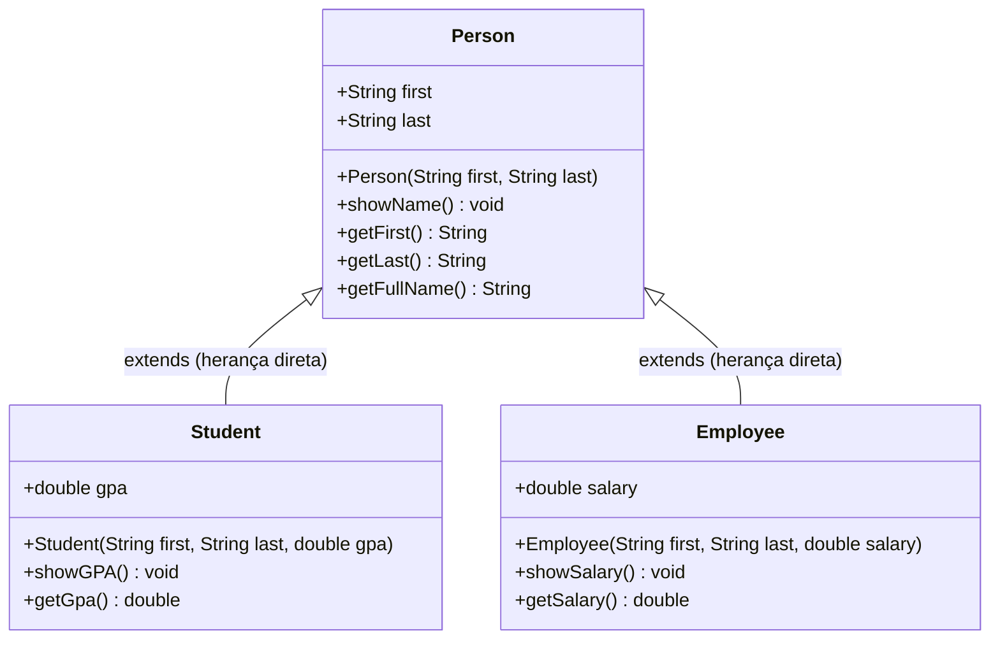

# Capítulo 45: A Palavra-chave `super` em Java (`super 🦸‍♂️`)

Bem-vindo ao guia de referência consolidado do **Capítulo 45** do curso de Java. Após o domínio da **Herança (`inheritance`)** no Capítulo 44, este capítulo mergulha no mecanismo fundamental que viabiliza a cooperação limpa entre superclasses e subclasses: a palavra-chave reservada **`super`**.

---

## 🧭 Visão Geral e Arquitetura Conceitual

Na Programação Orientada a Objetos, quando uma classe filha herda de uma classe pai, ela herda seus campos e comportamentos. No entanto, os **construtores não são herdados**. A responsabilidade de construir a fundação herdada recai sobre a palavra-chave `super`.

---

## 🔑 Os Três Pilares da Palavra-chave `super`

1. **Referência à Superclasse (Semelhante a `this`):**
   - Enquanto `this` referencia a instância atual do objeto, `super` referencia diretamente o contexto da classe pai imediata.
2. **Encadeamento de Construtores (`super(...)`):**
   - Usado na subclasse para repassar argumentos e delegar a inicialização dos atributos herdados ao construtor da superclasse.
   - **Regra Inegociável:** A chamada `super(...)` DEVE ser a **primeira instrução** dentro do corpo do construtor da subclasse.
3. **Acesso a Métodos e Membros Sobrescritos (`super.metodo()`):**
   - Permite que uma subclasse execute o comportamento original do pai, mesmo quando ela própria sobrescreve esse método.

---

## ⚠️ Armadilhas Clássicas e Regras do Compilador

| Erro / Comportamento | Causa Raiz | Solução Correta |
| :--- | :--- | :--- |
| **`There is no parameterless constructor available in 'Person'`** | O pai tem um construtor parametrizado `Person(first, last)`, logo o Java removeu o construtor padrão invisível `Person()`. A filha tentou ser construída sem chamar o construtor existente do pai. | Inserir `super(first, last);` como a primeiríssima linha do construtor da subclasse. |
| **Tentar chamar `Person(first, last)` dentro da filha** | Erro de compilação: Construtores não são métodos convencionais e não podem ser chamados pelo identificador nominal da classe pai. | Usar a sintaxe reservada `super(first, last);`. |
| **Remover `super(...)` quando o pai tem construtor vazio** | Os parâmetros recebidos na filha (`first`, `last`) são ignorados. O objeto é instanciado com os campos herdados valendo `null` (*Desastre das Variáveis Fantasma*). | Sempre repassar os dados de identificação para o pai via `super(...)`. |

---

## 📚 Índice Modular das 8 Aulas do Capítulo

Todos os documentos detalhados para estudo e cópia direta para documentação estão catalogados abaixo:

| Parte | Arquivo | Tema Central Dissecado |
| :---: | :--- | :--- |\n| **01** | [**01_definicao_e_criacao_classe_person.md**](./01_definicao_e_criacao_classe_person.md) | Curso de Java — Capítulo 45: Palavra-chave `super` (`super 🔝`) |
| **02** | [**02_implementando_person_atributos_construtor_e_showname.md**](./02_implementando_person_atributos_construtor_e_showname.md) | Curso de Java — Capítulo 45: Palavra-chave `super` (`super 🔝`) |
| **03** | [**03_criando_student_o_grande_erro_do_construtor_pai.md**](./03_criando_student_o_grande_erro_do_construtor_pai.md) | Curso de Java — Capítulo 45: Palavra-chave `super` (`super 🔝`) |
| **04** | [**04_super_em_acao_com_student_harry_potter.md**](./04_super_em_acao_com_student_harry_potter.md) | Curso de Java — Capítulo 45: Palavra-chave `super` (`super 🔝`) |
| **05** | [**05_adicionando_metodo_showgpa_no_student.md**](./05_adicionando_metodo_showgpa_no_student.md) | Curso de Java — Capítulo 45: Palavra-chave `super` (`super 🔝`) |
| **06** | [**06_criando_employee_com_salary_e_hagrid.md**](./06_criando_employee_com_salary_e_hagrid.md) | Curso de Java — Capítulo 45: Palavra-chave `super` (`super 🔝`) |
| **07** | [**07_saida_hagrid_e_o_experimento_do_construtor_vazio.md**](./07_saida_hagrid_e_o_experimento_do_construtor_vazio.md) | Curso de Java — Capítulo 45: Palavra-chave `super` (`super 🔝`) |
| **08** | [**08_o_que_acontece_sem_super_first_last_e_o_perigo_do_null.md**](./08_o_que_acontece_sem_super_first_last_e_o_perigo_do_null.md) | Curso de Java — Capítulo 45: Palavra-chave `super` (`super 🔝`) |\n\n---\n\n> 💡 **Dica de Estudo:** Siga as partes em ordem sequencial para uma progressão pedagógica natural do conceito à maestria prática.\n
