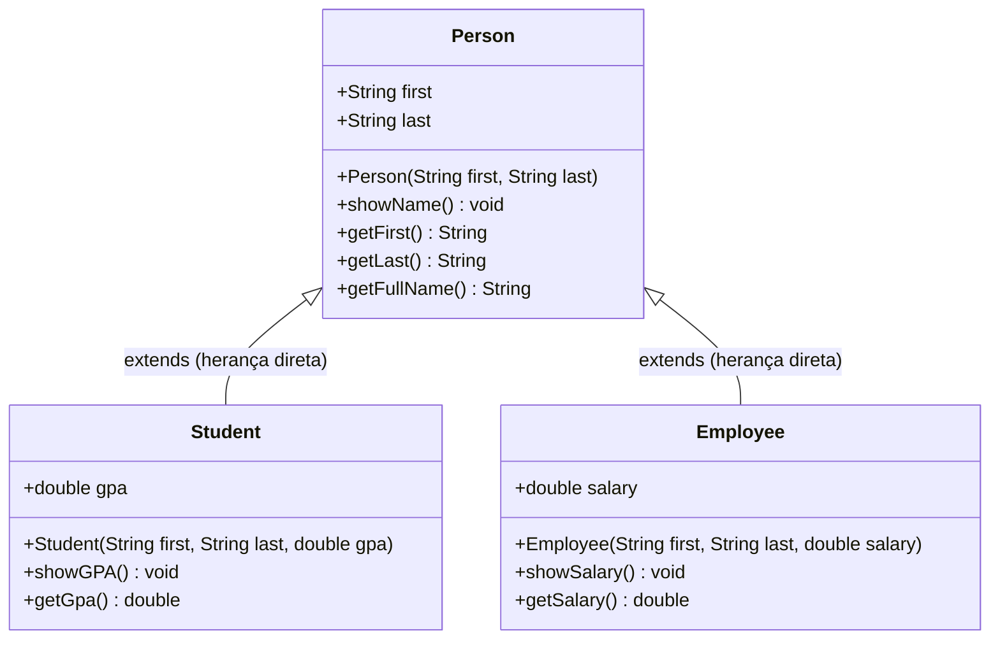

# Capítulo 45: A Palavra-chave `super` em Java (`super 🦸‍♂️`)

Bem-vindo ao guia de referência consolidado do **Capítulo 45** do curso de Java. Após o domínio da **Herança (`inheritance`)** no Capítulo 44, este capítulo mergulha no mecanismo fundamental que viabiliza a cooperação limpa entre superclasses e subclasses: a palavra-chave reservada **`super`**.

---

## 🧭 Visão Geral e Arquitetura Conceitual

Na Programação Orientada a Objetos, quando uma classe filha herda de uma classe pai, ela herda seus campos e comportamentos. No entanto, os **construtores não são herdados**. A responsabilidade de construir a fundação herdada recai sobre a palavra-chave `super`.

---

## 🔑 Os Três Pilares da Palavra-chave `super`

1. **Referência à Superclasse (Semelhante a `this`):**
   - Enquanto `this` referencia a instância atual do objeto, `super` referencia diretamente o contexto da classe pai imediata.
2. **Encadeamento de Construtores (`super(...)`):**
   - Usado na subclasse para repassar argumentos e delegar a inicialização dos atributos herdados ao construtor da superclasse.
   - **Regra Inegociável:** A chamada `super(...)` DEVE ser a **primeira instrução** dentro do corpo do construtor da subclasse.
3. **Acesso a Métodos e Membros Sobrescritos (`super.metodo()`):**
   - Permite que uma subclasse execute o comportamento original do pai, mesmo quando ela própria sobrescreve esse método.

---

## ⚠️ Armadilhas Clássicas e Regras do Compilador

| Erro / Comportamento | Causa Raiz | Solução Correta |
| :--- | :--- | :--- |
| **`There is no parameterless constructor available in 'Person'`** | O pai tem um construtor parametrizado `Person(first, last)`, logo o Java removeu o construtor padrão invisível `Person()`. A filha tentou ser construída sem chamar o construtor existente do pai. | Inserir `super(first, last);` como a primeiríssima linha do construtor da subclasse. |
| **Tentar chamar `Person(first, last)` dentro da filha** | Erro de compilação: Construtores não são métodos convencionais e não podem ser chamados pelo identificador nominal da classe pai. | Usar a sintaxe reservada `super(first, last);`. |
| **Remover `super(...)` quando o pai tem construtor vazio** | Os parâmetros recebidos na filha (`first`, `last`) são ignorados. O objeto é instanciado com os campos herdados valendo `null` (*Desastre das Variáveis Fantasma*). | Sempre repassar os dados de identificação para o pai via `super(...)`. |

---

## 📚 Índice Modular das 8 Aulas do Capítulo

Todos os documentos detalhados para estudo e cópia direta para documentação estão catalogados abaixo:

| Parte | Arquivo | Tema Central Dissecado |
| :---: | :--- | :--- |
| **01** | [**`01_definicao_e_criacao_classe_person.md`**](file:///c:/Users/mickel%201/Downloads/JAVA%20APRENDER/docs/curriculum/capitulo_45_super/01_definicao_e_criacao_classe_person.md) | O que é `super`? Os 3 pilares teóricos nos comentários e criação da classe base `Person`. |
| **02** | [**`02_implementando_person_atributos_construtor_e_showname.md`**](file:///c:/Users/mickel%201/Downloads/JAVA%20APRENDER/docs/curriculum/capitulo_45_super/02_implementando_person_atributos_construtor_e_showname.md) | Atributos `first`/`last`, construtor com `this`, método `showName()` e teste inicial com Tom Riddle. |
| **03** | [**`03_criando_student_o_grande_erro_do_construtor_pai.md`**](file:///c:/Users/mickel%201/Downloads/JAVA%20APRENDER/docs/curriculum/capitulo_45_super/03_criando_student_o_grande_erro_do_construtor_pai.md) | Subclasse `Student extends Person`, atributo `gpa` e dissecação do erro vermelho do compilador. |
| **04** | [**`04_super_em_acao_com_student_harry_potter.md`**](file:///c:/Users/mickel%201/Downloads/JAVA%20APRENDER/docs/curriculum/capitulo_45_super/04_super_em_acao_com_student_harry_potter.md) | A solução definitiva com `super(first, last)`, por que `Person()` é ilegal e teste com Harry Potter. |
| **05** | [**`05_adicionando_metodo_showgpa_no_student.md`**](file:///c:/Users/mickel%201/Downloads/JAVA%20APRENDER/docs/curriculum/capitulo_45_super/05_adicionando_metodo_showgpa_no_student.md) | Criação de `showGPA()`, acesso unificado ao atributo herdado (`first`) e ao próprio (`gpa`). |
| **06** | [**`06_criando_employee_com_salary_e_hagrid.md`**](file:///c:/Users/mickel%201/Downloads/JAVA%20APRENDER/docs/curriculum/capitulo_45_super/06_criando_employee_com_salary_e_hagrid.md) | Segunda subclasse `Employee`, atributo `salary`, `showSalary()` e teste prático com Rubeus Hagrid. |
| **07** | [**`07_saida_hagrid_e_o_experimento_do_construtor_vazio.md`**](file:///c:/Users/mickel%201/Downloads/JAVA%20APRENDER/docs/curriculum/capitulo_45_super/07_saida_hagrid_e_o_experimento_do_construtor_vazio.md) | Saída de console formatada e o experimento arquitetural de esvaziar o construtor de `Person`. |
| **08** | [**`08_o_que_acontece_sem_super_first_last_e_o_perigo_do_null.md`**](file:///c:/Users/mickel%201/Downloads/JAVA%20APRENDER/docs/curriculum/capitulo_45_super/08_o_que_acontece_sem_super_first_last_e_o_perigo_do_null.md) | Efeito dominó, quebra de contratos de tipo, perigo dos atributos fantasmas com `null` e conclusão. |

---

## 💻 Implementação no Projeto Java

As classes prontas e executáveis do domínio estão implementadas no pacote:
👉 [`com.mickaelgeronimo.mastery.core.oop.superkeyword`](file:///c:/Users/mickel%201/Downloads/JAVA%20APRENDER/src/main/java/com/mickaelgeronimo/mastery/core/oop/superkeyword)

A suíte de testes automatizados com cobertura completa de regras de herança e encadeamento encontra-se em:
👉 [`SuperKeywordTest.java`](file:///c:/Users/mickel%201/Downloads/JAVA%20APRENDER/src/test/java/com/mickaelgeronimo/mastery/core/SuperKeywordTest.java)
