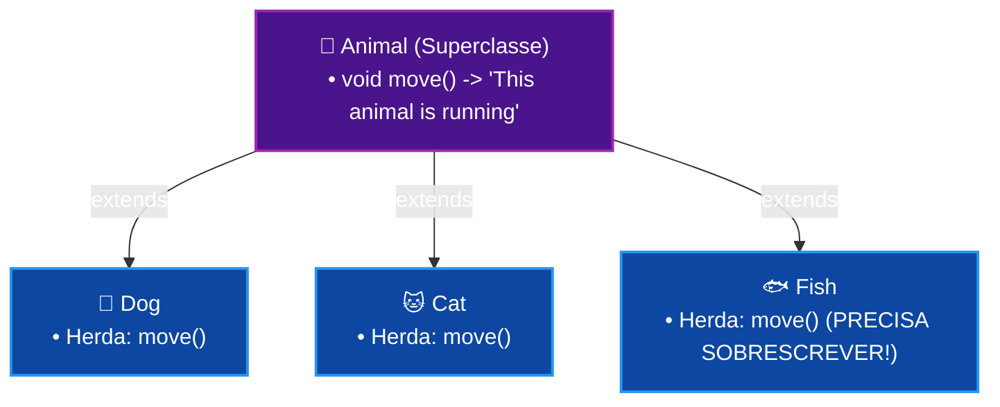

# Curso de Java — Capítulo 46: Sobrescrita de Método (`method overriding ♻️`)
## Parte 2: Criando a Classe `Fish`, `Dog extends Animal` e o Método Padrão `move()` em `Animal.java`

> **Contexto de Estudo:** Este material é uma transcrição e dissecação pedagógica minuciosa baseada no curso *"Java Full Course for free"* do canal **Bro Code** (timestamp `07:42:15` até `07:43:00` / 12:00:00).  
> **Objetivo:** Explicar para um iniciante absoluto ("do zero", passo a passo) a criação da classe `Fish` (Peixe), a conexão de herança `Dog extends Animal`, e a implementação do método de locomoção padrão `move()` na superclasse `Animal.java`, demonstrando o dilema que torna a Sobrescrita de Método indispensável na programação.  
> **Formato para Google Docs:** Todo o contexto visual da interface gráfica da IDE IntelliJ IDEA foi minuciosamente convertido em texto e tabelas para estudo e cópia direta no Google Docs sem depender das imagens.

---

## 1. Visão Geral da Cena: O Cenário Perfeito para a Sobrescrita

No início do Capítulo 46, aprendemos que **Sobrescrita de Métodos** (*Method Overriding*) é quando uma classe filha substitui a implementação padrão de um método que herdou da classe pai.

Nestas 3 novas capturas de tela, o professor Bro Code prepara o exemplo mais didático e intuitivo possível:

1. **A Chegada do Peixe — `Fish.java` (Imagem 1):**  
   Além de cães e gatos, o professor cria uma terceira subclasse: [`Fish.java`](file:///c:/Users/mickel%201/Downloads/JAVA%20APRENDER/Fish.java) (Peixe).  
   *Por que um peixe?* Porque cães e gatos correm, mas **peixes não correm, peixes nadam**!
2. **Ativando a Herança — `Dog extends Animal` (Imagem 2):**  
   Ele abre [`Dog.java`](file:///c:/Users/mickel%201/Downloads/JAVA%20APRENDER/Dog.java) e adiciona a cláusula `extends Animal`, conectando o cão à superclasse pai.
3. **O Método Genérico Padrão em `Animal.java` (Imagem 3):**  
   Na superclasse [`Animal.java`](file:///c:/Users/mickel%201/Downloads/JAVA%20APRENDER/Animal.java), ele cria o método de movimento:
   ```java
   void move(){
       System.out.println("This animal is running");
   }
   ```
   **O Grande Dilema:** Todos os animais herdaram esse método. Isso significa que, se você mandar o peixe se mover (`fish.move()`), ele vai imprimir *"This animal is running"* (*Este animal está correndo*)! Isso é um absurdo biológico. É exatamente esse problema que o peixe resolverá sobrescrevendo o método com a sua própria versão especializada!

---

## 2. Radiografia Visual Minuciosa das 3 Imagens

Para quem está estudando no Google Docs sem as imagens originais, aqui está a descrição detalhada de tudo o que apareceu na tela:

### Imagem 1 (`media_1791356778963.png`): Criando a Classe `Fish`
* **Ambiente Visual da IDE:** IntelliJ IDEA (Dark Mode).
* **Abas Abertas no Topo:** `Main.java`, `Animal.java`, `Dog.java` e `Cat.java` (ativa).
* **Janela Modal Flutuante ("New Java Class"):**
  * O menu central suspenso está aberto no meio da tela sobre o arquivo `Cat.java`.
  * O professor digitou: `Fish`.
  * A opção `Class` está selecionada em azul.
* **Legenda Gigante de Edição do Vídeo:** Na parte inferior central surge o letreiro em letras garrafais brancas: **Fish**.
* **Painel Esquerdo (Project Tree):** A pasta `src` já possui `Animal`, `Cat`, `Dog` e `Main`.

---

### Imagem 2 (`media_1791356792923.png`): Conectando o Cão ao Animal (`extends Animal`)
* **Aba Ativa:** `Dog.java` (no topo vemos as abas: `Main.java`, `Animal.java`, `Dog.java`, `Cat.java` e a recém-criada `Fish.java`).
* **Código em `Dog.java`:**
  ```java
  public class Dog extends Animal{

  }
  ```
* **Destaques Visuais:**
  * O autor acabou de digitar `extends Animal`.
  * A palavra `Animal` possui um fundo sombreado cinza-claro.
  * O cursor de texto pisca logo após a chave de abertura `{` da linha 1 (`Animal{|`).
  * Agora a classe `Dog` é oficialmente uma subclasse de `Animal` e herda todos os seus métodos!

---

### Imagem 3 (`media_1791356823578.png`): O Método `move()` em `Animal.java`
* **Aba Ativa:** `Animal.java` (em foco com a linha azul no topo).
* **Código Digitado:**
  ```java
  public class Animal {

      void move(){
          System.out.println("This animal is running");
      }
  }
  ```
* **Posição do Cursor:** O cursor de texto pisca na linha 4, logo após a palavra `running` e as aspas (`running"|);`).
* **Barra Superior do Navegador:** Na parte de cima da tela aparece a barra de busca do YouTube com o termo: `java bro code`.
* **Marcação de Tempo no Vídeo:** `4:51` na contagem regressiva / aproximadamente `7:42:50` no total.

---

## 3. O Dilema do Peixe Corredor (Para um Iniciante Absoluto)

Entenda com clareza o problema que estamos construindo:

1. A classe pai [`Animal`](file:///c:/Users/mickel%201/Downloads/JAVA%20APRENDER/Animal.java) tem o método:
   ```java
   void move(){
       System.out.println("This animal is running");
   }
   ```
2. As classes filhas herdaram esse método:
   * `Dog extends Animal` $\longrightarrow$ herda `move()`.
   * `Cat extends Animal` $\longrightarrow$ herda `move()`.
   * `Fish extends Animal` $\longrightarrow$ herda `move()`.
3. Se você rodar no `Main.java`:
   ```java
   Dog dog = new Dog();
   dog.move(); // Imprime: "This animal is running" (Faz sentido! Cães correm)

   Fish fish = new Fish();
   fish.move(); // Imprime: "This animal is running" (ABSURDO! Peixes não correm!)
   ```
4. **A Pergunta de Ouro:** Como fazemos para o peixe dizer `"This animal is swimming"` (*Este animal está nadando*), mantendo o nome do método como `move()` para todo mundo?  
   **A Resposta:** **Method Overriding!** O peixe vai reescrever o método `move()` dentro de [`Fish.java`](file:///c:/Users/mickel%201/Downloads/JAVA%20APRENDER/Fish.java).

---

## 4. Análise Linha por Linha de Todo o Código

### Arquivo 1: [`Animal.java`](file:///c:/Users/mickel%201/Downloads/JAVA%20APRENDER/Animal.java) (Imagem 3)

```java
1:  public class Animal {
2:  
3:      void move(){
4:          System.out.println("This animal is running");
5:      }
6:  }
```

#### Explicação Detalhada:
* **Linha 1 (`public class Animal {`):** Declara a superclasse pública `Animal`. Ela representa o reino animal como um todo.
* **Linha 3 (`void move(){`):**  
  * Cria o método de locomoção `move()` (*mover-se*).
  * Retorno `void`: apenas exibe mensagem na tela, sem devolver valores.
* **Linha 4 (`System.out.println("This animal is running");`):**  
  * Comportamento padrão atribuído pelo pai: avisa que o animal está correndo.
  * Serve de comportamento genérico para os animais que não sobrescreverem essa ação.
* **Linhas 5 e 6 (`}` e `}`):** Encerra o método e a classe.

---

### Arquivo 2: [`Dog.java`](file:///c:/Users/mickel%201/Downloads/JAVA%20APRENDER/Dog.java) (Imagem 2)

```java
1: public class Dog extends Animal{
2: 
3: }
```

#### Explicação Detalhada:
* **Linha 1 (`public class Dog extends Animal{`):**  
  * `public class Dog`: Cria a classe do cachorro.
  * `extends Animal`: Ativa a herança! O cachorro agora possui automaticamente o método `move()` criado no pai.
* **Linha 3 (`}`):** Encerra a classe.

---

### Arquivo 3: [`Fish.java`](file:///c:/Users/mickel%201/Downloads/JAVA%20APRENDER/Fish.java) (Imagem 1)

```java
1: public class Fish extends Animal{
2: 
3: }
```

#### Explicação Detalhada:
* **Linha 1 (`public class Fish extends Animal{`):**  
  * Cria a classe do peixe estendendo `Animal`.
  * Como ainda não sobrescreveu nada, ele herdou o `move()` genérico do pai.
* **Linha 3 (`}`):** Encerra a classe.

---

## 5. O que Sai no Console Nesta Etapa?

Como os métodos apenas foram definidos nas classes e nenhum animal foi mandado se mover dentro de `Main.java` ainda, o projeto compila perfeitamente sem saídas textuais.

Se você compilar e rodar agora:
```text
Process finished with exit code 0
```
* **Significado:** Todas as classes (`Animal`, `Dog`, `Cat`, `Fish` e `Main`) compilam com sucesso e estão prontas para a demonstração da sobrescrita!

---

## 6. Resumo para Fixação no Google Docs



1. **Método Padrão do Pai:** A superclasse define um método que faz sentido para a maioria, mas que pode não servir para todos.
2. **O Papel do Filho Especial:** O peixe é a prova viva de que a herança simples não basta. Ele precisa ter o poder de dizer: *"Pai, eu te amo, mas eu não corro, eu nado!"*.
3. **Nas próximas telas:** Veremos o peixe reescrever `move()` e o uso da anotação profissional `@Override`!
