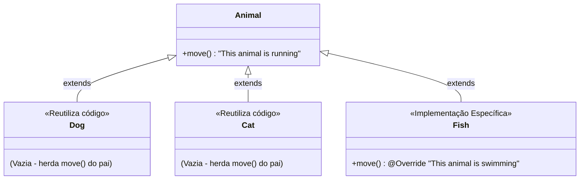

# Curso de Java — Capítulo 46: Sobrescrita de Método (`method overriding ♻️`)
## Parte 7: Conclusão do Capítulo — A Anatomia da Definição, Reuso de Código e Fechamento

> **Contexto de Estudo:** Este material é uma transcrição e dissecação pedagógica minuciosa baseada no curso *"Java Full Course for free"* do canal **Bro Code** (timestamp `07:45:45` até o encerramento do capítulo / 12:00:00).  
> **Objetivo:** Explicar para um iniciante absoluto ("do zero", passo a passo) o fechamento triunfal do Capítulo 46, analisando por que o professor destacou com o mouse a palavra **`method`** no comentário de definição, como a sobrescrita garante ao mesmo tempo o **reuso de código** e a **especialização**, e estabelecer a distinção definitiva entre *Overriding* e *Overloading*.  
> **Formato para Google Docs:** Todo o contexto visual da interface do IntelliJ IDEA (seleção com o cursor, linhas vazias, abas e saídas do terminal) foi minuciosamente convertido em texto, diagramas e tabelas para estudo e cópia direta no Google Docs sem depender das imagens originais.

---

## 1. Visão Geral da Imagem (`media_1791357330737.png`): O Fechamento do Capítulo

Nesta cena final do capítulo, o professor Bro Code retorna ao arquivo [`Main.java`](../../../src/main/java/com/mickaelgeronimo/mastery/core/concurrency/Main.java) para fazer a recapitulação teórica final.

Com o mouse, ele dá um clique duplo sobre a palavra **`method`** no comentário explicativo da linha 6, deixando-a destacada em azul:

```text
//                     implementation of a [method] that is already defined.
```

O autor faz isso para fixar na memória do aluno o núcleo de tudo o que foi construído nos últimos 15 minutos:
1. **Você está sobrescrevendo um MÉTODO** (não uma variável, não um construtor).
2. O método precisa **já estar previamente definido** na superclasse pai.
3. Isso entrega os dois maiores pilares da Orientação a Objetos: **Reuso de Código** e **Especialização de Comportamento**.

---

## 2. Radiografia Visual Minuciosa da IDE

Para quem estuda pelo Google Docs sem acesso à imagem original:

* **Ambiente Visual da IDE:** IntelliJ IDEA (Tema Dark).
* **Abas Abertas no Topo:**
  1. `Main.java` (Aba ativa, com a linha azul na base).
  2. `Animal.java`
  3. `Dog.java`
  4. `Cat.java`
  5. `Fish.java`
* **Painel Esquerdo (Navegador de Projeto - `Project`):**
  * Projeto: `MyFirstProject`.
  * Pasta `src` contendo todos os 5 arquivos de classe criados no capítulo:
    * `Animal` (Superclasse mãe)
    * `Cat` (Subclasse)
    * `Dog` (Subclasse)
    * `Fish` (Subclasse)
    * `Main` (Classe executora)
* **Editor de Código (`Main.java`):**
  * O código agora possui 18 linhas bem espaçadas.
  * Na margem esquerda (gutter):
    * Linha 2 tem o ícone verde de Play `▶` (para rodar a classe `Main`).
    * Linha 3 tem o ícone verde de Play `▶` (para rodar o método `main`).
  * Na linha 6, a palavra **`method`** está com fundo retangular azul de seleção do mouse.
  * Na linha 7, um ponto final `.` foi adicionado ao término da frase: `...give specific implementations.`.

---

## 3. Dissecação da Definição: O que Cada Palavra Realmente Significa?

Vamos dissecar o bloco de comentários das linhas 5 a 7 como um cientista:

```java
// Method overriding = When a subclass provides its own
//                     implementation of a method that is already defined.
//                     Allows for code reusability and give specific implementations.
```

### A. *"When a subclass provides its own implementation..."*
* **Tradução:** *"Quando uma subclasse fornece a sua própria implementação..."*
* **Explicação para iniciantes:** A classe filha não é obrigada a aceitar tudo o que o pai faz do mesmo jeito. Se o pai tem uma ação genérica, a filha pode levantar a mão e dizer: *"Para mim, essa ação funciona de um jeito diferente e próprio!"*. No nosso projeto, a classe [`Fish`](../../../src/main/java/com/mickaelgeronimo/mastery/core/ecology/Fish.java) levantou a mão e implementou o nado.

### B. *"...of a METHOD that is already defined."*
* **Tradução:** *"...de um MÉTODO que já está definido [na classe pai]."*
* **Por que o autor selecionou a palavra `method`?**
  * Porque a sobrescrita **só acontece com métodos**!
  * O método tem que existir antes na superclasse ([`Animal`](../../../src/main/java/com/mickaelgeronimo/mastery/core/oop/inheritance/Animal.java)). Você não pode "sobrescrever" algo que não existe.
  * O nome do método, a quantidade de parâmetros e o tipo de retorno precisam ser idênticos.

### C. *"Allows for code reusability..."*
* **Tradução:** *"Permite a reutilização de código..."*
* **Onde vimos isso?**
  * Nas classes `Dog` e [`Cat`](../../../src/main/java/com/mickaelgeronimo/mastery/core/oop/inheritance/Cat.java)!
  * Essas duas classes estão **completamente vazias** dentro do corpo `{ }`.
  * Nós não precisamos digitar `System.out.println("This animal is running")` nem para o cachorro, nem para o gato. Eles **reutilizaram 100%** o código escrito uma única vez na classe [`Animal`](../../../src/main/java/com/mickaelgeronimo/mastery/core/oop/inheritance/Animal.java). Economizamos código e evitamos repetição!

### D. *"...and give specific implementations."*
* **Tradução:** *"...e dar implementações específicas."*
* **Onde vimos isso?**
  * Na classe [`Fish`](../../../src/main/java/com/mickaelgeronimo/mastery/core/ecology/Fish.java)!
  * Para o peixe, reutilizar a corrida do pai seria uma aberração da natureza ("peixe correndo"). Então ele forneceu a sua **implementação específica**: `"This animal is swimming"`.

### E. O Emoji da Reciclagem `♻️`:
* No título do vídeo, o professor usa o emoji de reciclagem: `method overriding ♻️`.
* **A analogia:** Nós estamos **reciclando o mesmo nome de método (`move()`)** em toda a família de animais. Quem quiser usar o modelo padrão da fábrica, usa; quem precisar de um modelo sob medida, recicla o método e põe o seu próprio recheio!

---

## 4. Diagrama de Arquitetura da Solução Completa

Abaixo está o mapa mental de como todo o capítulo se conecta:



---

## 5. Análise Código por Código e Linha por Linha de [`Main.java`](../../../src/main/java/com/mickaelgeronimo/mastery/core/concurrency/Main.java)

Abaixo está a listagem fiel de cada linha do arquivo principal com a sua numeração exata e o que acontece em cada uma delas:

```java
1:  public class Main {
2:  
3:      public static void main(String[] args) {
4:  
5:          // Method overriding = When a subclass provides its own
6:          //                     implementation of a method that is already defined.
7:          //                     Allows for code reusability and give specific implementations.
8:  
9:          Dog dog = new Dog();
10:         Cat cat = new Cat();
11:         Fish fish = new Fish();
12: 
13:         dog.move();
14:         cat.move();
15:         fish.move();
16: 
17:     }
18: }
```

### Explicação Detalhada Linha por Linha:

* **Linha 1 (`public class Main {`):** Declara a classe pública executora `Main`. *(Nada sai no console).*
* **Linha 2 (Linha em branco):** Espaçamento visual para legibilidade.
* **Linha 3 (`public static void main(String[] args) {`):** O método principal (`main`), porta de entrada obrigatória onde a JVM começa a trabalhar. *(Nada sai no console).*
* **Linha 4 (Linha em branco):** Separa a assinatura do método do bloco de notas.
* **Linhas 5 a 7 (Comentários de definição com `//`):**
  * Linha 5: Define que sobrescrita ocorre quando a subclasse dá sua própria versão.
  * Linha 6: Enfatiza que isso se aplica a um método já existente no pai. *(Palavra `method` selecionada pelo autor).*
  * Linha 7: Conclui destacando o reuso de código e a flexibilidade de especialização.
  * *(Linhas ignoradas pelo compilador, nada sai no console).*
* **Linha 8 (Linha em branco):** Separa os comentários das declarações de variáveis.
* **Linha 9 (`Dog dog = new Dog();`):**
  * Cria uma nova instância de `Dog` na memória Heap.
  * *(Nada sai no console).*
* **Linha 10 (`Cat cat = new Cat();`):**
  * Cria uma nova instância de [`Cat`](../../../src/main/java/com/mickaelgeronimo/mastery/core/oop/inheritance/Cat.java) na memória Heap.
  * *(Nada sai no console).*
* **Linha 11 (`Fish fish = new Fish();`):**
  * Cria uma nova instância de [`Fish`](../../../src/main/java/com/mickaelgeronimo/mastery/core/ecology/Fish.java) na memória Heap.
  * *(Nada sai no console).*
* **Linha 12 (Linha em branco):** Separa a criação dos objetos das chamadas de métodos.
* **Linha 13 (`dog.move();`):**
  * O objeto `dog` chama o método `move()`. Como `Dog` não tem método próprio, herda de [`Animal`](../../../src/main/java/com/mickaelgeronimo/mastery/core/oop/inheritance/Animal.java).
  * **Saída no Console:**
    ```text
    This animal is running
    ```
* **Linha 14 (`cat.move();`):**
  * O objeto `cat` chama o método `move()`. Como `Cat` também não tem método próprio, herda de [`Animal`](../../../src/main/java/com/mickaelgeronimo/mastery/core/oop/inheritance/Animal.java).
  * **Saída no Console:**
    ```text
    This animal is running
    ```
* **Linha 15 (`fish.move();`):**
  * O objeto `fish` chama o método `move()`. Como `Fish` possui a anotação `@Override` e implementou sua própria lógica, o Java executa a versão local!
  * **Saída no Console:**
    ```text
    This animal is swimming
    ```
* **Linha 16 (Linha em branco):** Espaço antes do fechamento.
* **Linha 17 (`}`):** Fecha o método `main`.
* **Linha 18 (`}`):** Fecha a classe `Main`.

---

## 6. A Batalha dos Conceitos: *Overriding* vs *Overloading*

Uma das maiores pegadinhas em entrevistas de emprego e provas de certificação Java é confundir **Sobrescrita** com **Sobrecarga**. Use esta tabela para nunca mais errar:

| Critério Comparativo | Sobrescrita de Método (*Method Overriding*) ♻️ | Sobrecarga de Método (*Method Overloading*) 🛠️ |
| :--- | :--- | :--- |
| **Onde acontece?** | Entre classes diferentes ligadas por **Herança** (Classe Pai e Classe Filha). | Na **mesma classe** (ou herdado sem substituir). |
| **Nome do método:** | **Exatamente o mesmo.** | **Exatamente o mesmo.** |
| **Lista de parâmetros:** | **Exatamente os mesmos** (mesma quantidade, mesmos tipos na mesma ordem). | **Obrigatoriamente diferentes** (tipos ou quantidades distintas). |
| **Tipo de Retorno:** | Deve ser o mesmo (ou subtipo covariante). | Pode ser igual ou diferente. |
| **Anotação Recomendada:** | **`@Override`** (essencial para evitar erros de digitação). | Nenhuma (não se usa `@Override` em sobrecarga). |
| **Quando a decisão é tomada?** | Em **tempo de execução** (*Runtime / Polimorfismo Dinâmico*). | Em **tempo de compilação** (*Compile-time / Polimorfismo Estático*). |
| **Propósito Principal:** | Especializar o comportamento de um animal ou entidade filha. | Oferecer várias maneiras convenientes de chamar a mesma ação com dados diferentes. |

---

## 7. Saída Oficial do Console ao Executar o Projeto

Quando o botão de execução `▶` é pressionado no IntelliJ:

```text
This animal is running
This animal is running
This animal is swimming

Process finished with exit code 0
```

* **Linha 1:** `"This animal is running"` (Produzido pela chamada `dog.move()`).
* **Linha 2:** `"This animal is running"` (Produzido pela chamada `cat.move()`).
* **Linha 3:** `"This animal is swimming"` (Produzido pela chamada `fish.move()`).
* **Linha 4:** Linha vazia de separação.
* **Linha 5:** `Process finished with exit code 0` (Indica que o programa executou sem nenhuma falha).

---

## 8. Resumo Geral do Capítulo 46 para o Google Docs

1. **Herança dá o pontapé inicial:** Para haver *Method Overriding*, é obrigatório existir uma relação de herança através da palavra-chave `extends`.
2. **Reuso de código inteligente:** Subclasses herdam tudo o que a superclasse tem. Se o comportamento padrão for suficiente, você não precisa escrever nenhuma linha de código (como fizemos em `Dog` e `Cat`).
3. **Especialização com responsabilidade:** Se o comportamento do pai não fizer sentido para o filho (como peixes correndo), a subclasse reescreve o método fornecendo a sua versão (`Fish` nadando).
4. **O anjo da guarda `@Override`:** Sempre declare `@Override` antes do método sobrescrito. Ele instrui o compilador a conferir se você não cometeu nenhum errinho bobo de digitação no nome ou nos parâmetros.
