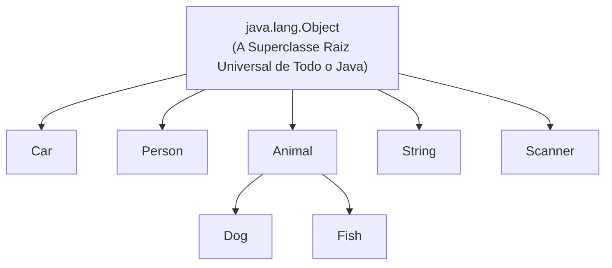

# Curso de Java — Capítulo 47: O Método `.toString()` (`tostring method 🎉`)
## Parte 1: O Que é `.toString()`, a Classe Mãe `Object` e a Viagem ao Código-Fonte do JDK

> **Contexto de Estudo:** Este material é uma transcrição e dissecação pedagógica minuciosa baseada no curso *"Java Full Course for free"* do canal **Bro Code** (timestamp `07:46:11` até `07:46:30` / 12:00:00).  
> **Objetivo:** Explicar para um iniciante absoluto ("do zero", passo a passo) o nascimento do conceito do método `.toString()`, a revelação fundamental de que **toda classe em Java é filha da classe `Object`**, e acompanhar a demonstração do professor navegando diretamente no código-fonte oficial da OpenJDK 23 através do comando `Jump to Source`.  
> **Formato para Google Docs:** Todo o contexto visual da interface do IntelliJ IDEA (janelas de documentação flutuantes, seleções com o mouse, menus de contexto e abas do sistema) foi minuciosamente convertido em texto, diagramas e tabelas para estudo e cópia direta no Google Docs sem depender das imagens originais.

---

## 1. Visão Geral da Cena: O Segredo Mais Bem Guardado do Java Revelado

Bem-vindo ao Capítulo 47! Após dominar herança (`extends`), a palavra `super` e a sobrescrita de métodos (`@Override`), você agora está pronto para entender como o Java funciona por baixo do capô.

Nesta abertura de capítulo, o professor Bro Code introduz o método **`.toString()`** e faz uma pergunta intrigante:
> *"De onde vêm os métodos que todo objeto Java parece ter, mesmo quando nós não escrevemos nada dentro da classe?"*

Para demonstrar isso, o professor escreve 4 linhas de definição teórica, instancia um objeto misterioso chamado `new Object()` e, usando o mouse, clica com o botão direito para dar um **`Jump to Source` (F4)**, mergulhando diretamente no código-fonte original escrito pelos criadores da linguagem Java!

---

## 2. Radiografia Visual Minuciosa das 5 Imagens

Para quem está estudando pelo Google Docs sem acesso às imagens, aqui está a descrição detalhada do que aconteceu na tela do professor:

### Imagem 1 (`media_1791357399462.png` — 07:46:11): A Definição em Foco
* **Ambiente Visual da IDE:** IntelliJ IDEA (Tema Dark).
* **Aba Ativa:** `Main.java`.
* **Painel Esquerdo (`Project`):** A pasta `src` foi limpa dos arquivos antigos (`Animal`, `Cat`, etc.) e agora contém apenas `Main`.
* **Editor de Código:** O professor escreveu um bloco de notas entre as linhas 5 e 8:
  ```java
  // .toString() = Method inherited from the Object class.
  //               Used to return a string representation of an object.
  //               By default, it returns a hash code as a unique identifier.
  //               It can be overridden to provide meaningful details.
  ```
* **Gesto com o Mouse:** O professor deu um duplo clique com o mouse sobre a palavra **`.toString()`** na linha 5, deixando-a destacada com uma caixa azul de seleção.

### Imagem 2 (`media_1791357418807.png` — 07:46:18): Instanciando `Object` e a Janela de Informações
* **Abas no Topo:** `Main.java` (em foco), `Object.java` e `Car.java` (uma nova classe criada na pasta `src`).
* **Editor de Código:** Na linha 10, o professor escreveu:
  ```java
  Object object = new Object();
  ```
* **Janela Flutuante (Tooltip de Documentação):** Ao posicionar o cursor sobre a palavra `Object`, o IntelliJ abriu uma janela preta exibindo a documentação oficial da classe:
  > **`java.lang.Object`**  
  > *"Class `Object` is the root of the class hierarchy. Every class has `Object` as a superclass. All objects, including arrays, implement the methods of this class."*
* **Menu de Contexto:** Sobre a janela, abre-se um menu com as opções:
  * `Back (Ctrl+Alt+Left)`
  * `Forward (Ctrl+Alt+Right)`
  * **`Jump to Source (F4)`** — O cursor do mouse em formato de seta branca está prestes a clicar nessa opção!

### Imagem 3 (`media_1791357443980.png`): O Zoom no Javadoc Oficial
* Um corte ampliado da janela de documentação mostrando o texto sagrado do Java:
  * Pertence ao pacote: `java.lang`.
  * Declaração: `public class Object`.
  * Explicação: É a **raiz (*root*)** de toda a hierarquia de classes.
  * Versão: `Since: 1.0` (existe desde o primeiro dia do Java, em 1996!).
  * Versão do Java instalada na máquina do professor: `<openjdk-23>`.

### Imagem 4 (`media_1791357461502.png`): O Clique em `Jump to Source`
* Um close-up milimétrico da mãozinha/cursor do mouse clicando no botão azul **`Jump to Source`** com o atalho de teclado `F4`.

### Imagem 5 (`media_1791357473602.png`): Dentro das Entranhas do Java (`Object.java`)
* O IntelliJ salta instantaneamente para dentro do arquivo original do próprio Java: **`Object.java`**!
* **Aba Ativa:** `Object.java` (com o aviso `Reader Mode` no canto superior direito, indicando que é um arquivo protegido do sistema que não pode ser alterado).
* **Caminho no Rodapé:** `(JRT) > java.base > java > lang > Object`.
* **Trechos Visíveis do Código-Fonte Real:**
  ```java
  package java.lang;

  public class Object {

      @IntrinsicCandidate
      public Object() {}
  ...
  ```

---

## 3. Dissecação da Definição de 4 Linhas: O que é o `.toString()`?

Vamos analisar linha por linha o que o professor escreveu no comentário:

```java
// .toString() = Method inherited from the Object class.
//               Used to return a string representation of an object.
//               By default, it returns a hash code as a unique identifier.
//               It can be overridden to provide meaningful details.
```

### 1ª Linha: *"Method inherited from the Object class."*
* **Tradução:** *"Método herdado da classe Object."*
* **Explicação para iniciantes:** Você não precisa inventar o método `.toString()`. Ele já vem de fábrica dentro do Java, porque ele foi criado dentro da classe mãe universal chamada `Object`.

### 2ª Linha: *"Used to return a string representation of an object."*
* **Tradução:** *"Usado para retornar uma representação em texto (String) de um objeto."*
* **Explicação para iniciantes:** Um objeto na memória é um amontoado de bytes invisíveis. Quando você quer mostrar esse objeto na tela (imprimir no console, exibir numa interface), você precisa converter esse objeto em palavras legíveis para humanos. É isso que o `.toString()` faz: ele traduz um objeto para texto!

### 3ª Linha: *"By default, it returns a hash code as a unique identifier."*
* **Tradução:** *"Por padrão, ele retorna um código hash como um identificador único."*
* **O que é um Hash Code?** Pense no hash code como o **CPF** ou o **endereço de memória** do objeto. Se você mandar imprimir um objeto sem configurar nada, o Java vai imprimir algo feio como: `Car@7a8114c0`. Isso não ajuda em nada o usuário final!

### 4ª Linha: *"It can be overridden to provide meaningful details."*
* **Tradução:** *"Ele pode ser sobrescrito (com `@Override`) para fornecer detalhes úteis e significativos."*
* **A Conexão com o Capítulo Anterior:** Aqui está a mágica! Como você acabou de aprender no Capítulo 46 sobre **Method Overriding**, nós podemos usar a anotação `@Override` dentro da nossa classe (como [`Car`](../../../src/main/java/com/mickaelgeronimo/mastery/core/oop/Car.java)) para ensinar o Java a imprimir: `"Ford Mustang 2025 Vermelho"` em vez de imprimir aquele código esquisito `Car@7a8114c0`!

---

## 4. O Grande Segredo do Java: A Classe `Object` (A Mãe de Todos)

Em Java, existe uma regra de ouro que todo desenvolvedor precisa saber:

> **Toda e qualquer classe em Java, sem exceção, herda direta ou indiretamente da classe `java.lang.Object`!**

Mesmo quando você cria uma classe simples e não escreve `extends`:
```java
public class Car {
    // Você não escreveu "extends", mas o Java escreve mentalmente para você:
    // public class Car extends Object
}
```

### Diagrama da Árvore Genealógica Universal do Java:



* Como `Animal` herda de `Object`, e `Dog` herda de `Animal`, o `Dog` também é neto de `Object`!
* Por causa disso, **TODO MUNDO EM JAVA TEM O MÉTODO `.toString()`**!

---

## 5. Análise Código por Código e Linha por Linha de [`Main.java`](../../../src/main/java/com/mickaelgeronimo/mastery/core/concurrency/Main.java)

Abaixo está o código exatamente como visto na tela do professor:

```java
1:  public class Main {
2:      public static void main(String[] args) {
3:  
4:          // .toString() = Method inherited from the Object class.
5:          //               Used to return a string representation of an object.
6:          //               By default, it returns a hash code as a unique identifier.
7:          //               It can be overridden to provide meaningful details.
8:  
9:          Object object = new Object();
10: 
11:     }
12: }
```

### O que faz cada linha e o que sai no console:

* **Linha 1 (`public class Main {`):** Declara a classe executora `Main`. *(Nada sai no console).*
* **Linha 2 (`public static void main(String[] args) {`):** O método principal onde a execução começa. *(Nada sai no console).*
* **Linha 3 (Linha em branco):** Organização visual.
* **Linhas 4 a 7 (`// .toString()...`):** Comentários teóricos sobre o método `.toString()`. *(O compilador ignora completamente, nada sai no console).*
* **Linha 8 (Linha em branco):** Separa os comentários do código executável.
* **Linha 9 (`Object object = new Object();`):**
  * `Object`: É o tipo da variável. Como `Object` é uma classe real do Java, nós podemos declarar variáveis desse tipo!
  * `object`: É o nome de referência da variável.
  * `= new Object();`: Chama o construtor da classe `Object` na memória heap do computador.
  * *(Nada sai no console nesta linha, pois não há nenhum `System.out.println` ainda).*
* **Linha 10 (Linha em branco):** Espaço para próximas instruções.
* **Linhas 11 e 12 (`}` e `}`):** Fecham o método `main` e a classe `Main`.

---

## 6. O Que É o Recurso `Jump to Source` (F4 / Ctrl + Clique)?

O professor Bro Code ensina uma técnica usada diariamente por desenvolvedores seniores:

* Quando você estiver programando no IntelliJ IDEA e quiser ver como os engenheiros da Sun Microsystems / Oracle programaram uma classe interna do Java (como `Object`, `String`, `ArrayList` ou `Scanner`), você não precisa procurar no Google!
* Basta clicar com a tecla **`Ctrl` pressionada** em cima do nome da classe, ou apertar a tecla **`F4`** (`Jump to Source`).
* O IntelliJ abre o arquivo `.java` original descompilado para você ler e aprender diretamente com os mestres que criaram a linguagem!

### O que vimos dentro de `Object.java` (Imagem 5):
* `package java.lang;` — O pacote padrão do Java. Todas as classes dentro de `java.lang` são importadas automaticamente pelo Java em todos os seus arquivos, sem você precisar escrever `import java.lang.Object;`.
* `public class Object { ... }` — A casca da classe mãe universal.
* `@IntrinsicCandidate` — Uma anotação interna da JVM que indica que certas operações da classe `Object` são tão fundamentais que o compilador as traduz diretamente em instruções de máquina ultrarrápidas no processador!

---

## 7. O Que Sai no Console nesta Etapa?

Se você rodar o arquivo [`Main.java`](../../../src/main/java/com/mickaelgeronimo/mastery/core/concurrency/Main.java) agora:

```text
Process finished with exit code 0
```

* **Saída:** Nenhuma linha de texto é impressa ainda na tela, porque o professor apenas criou a variável `object` na memória e abriu o código-fonte para nos dar uma aula de arquitetura do Java!
* O código de término `exit code 0` confirma que o código está 100% livre de erros e pronto para as próximas demonstrações!

---

## 8. Resumo para Fixação no Google Docs

1. **A Classe `Object` é a raiz:** Todo objeto em Java é, em última análise, uma instância de `Object`.
2. **Herança invisível:** Você não precisa escrever `extends Object`. O Java faz isso automaticamente para toda classe que você cria.
3. **O método `.toString()`:** É um método que toda classe herda de `Object`. O objetivo dele é transformar o objeto em texto legível.
4. **O comportamento padrão:** Sem sobrescrita, ele imprime um código feio com o nome da classe e um hash hexadecimal (ex: `Objeto@4f023edb`).
5. **O próximo passo do capítulo:** Aprenderemos a usar o `@Override` para customizar o `.toString()` do nosso próprio objeto ([`Car`](../../../src/main/java/com/mickaelgeronimo/mastery/core/oop/Car.java)), fazendo ele exibir dados úteis e bonitos!
