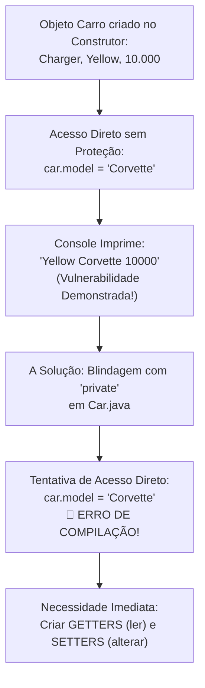

# Curso de Java — Capítulo 52 (Parte 2): Getters e Setters 🔐
## A Falha de Segurança do Acesso Direto (`car.model = "Corvette"`) e a Blindagem com `private`

---

> [!IMPORTANT]
> **Para cópia no Google Docs:** Este documento foi especialmente estruturado de forma autossuficiente e descritiva. Cada detalhe da interface da IDE (IntelliJ IDEA), abas, números de linha, ícones de execução e mensagens do console foi transcrito textualmente para que você possa copiar e colar todo o conteúdo sem perder nenhuma informação visual.

---

### Links Rápidos dos Arquivos do Projeto no seu Computador
* Arquivo Principal de Execução: [`Main.java`](../../../src/main/java/com/mickaelgeronimo/mastery/core/concurrency/Main.java)
* Classe do Carro Blindada: [`Car.java`](../../../src/main/java/com/mickaelgeronimo/mastery/core/oop/Car.java)
* Pasta Raiz do Projeto: `JAVA APRENDER`
* Guia da Aula Anterior (Parte 1): `explicacao_getters_and_setters_definicao_e_exemplo_sem_encapsulamento_capitulo52_parte1.md`

---

## 1. O Que Está Acontecendo Aqui? (Visão Geral para Iniciantes Amadores)

Na aula anterior (Parte 1), o autor criou a classe [`Car.java`](../../../src/main/java/com/mickaelgeronimo/mastery/core/oop/Car.java) com três atributos: `model`, `color` e `price`. Porém, ele **não colocou nenhuma palavra de proteção** antes dessas variáveis.

Nesta sequência de 4 imagens, o professor Bro Code faz uma **demonstração intencional de um perigo gravíssimo** em programação orientada a objetos:
1. **Primeiro**, ele mostra o carro original rodando (`Yellow Charger 10000`).
2. **Segundo**, ele entra no arquivo [`Main.java`](../../../src/main/java/com/mickaelgeronimo/mastery/core/concurrency/Main.java) e digita: `car.model = "Corvette";`.
3. **Terceiro**, ele executa o programa e o console imprime: `Yellow Corvette 10000`. O modelo do carro mudou do nada, sem nenhuma validação, sem regras e sem permissão!
4. **Quarto**, para impedir essa invasão, ele corre para a classe [`Car.java`](../../../src/main/java/com/mickaelgeronimo/mastery/core/oop/Car.java) e adiciona a palavra mágica **`private`** na frente de cada atributo (`private String model;`, `private String color;`, `private int price;`).



---

## 2. Analogia do Mundo Real: A Casa com Porta de Vidro Destrancada

Imagine que você comprou um cofre para a sua casa e guardou lá dentro uma escritura de um carro modelo `"Charger"`.

* **Sem `private` (Acesso Direto / Package-Private):** É como se o cofre não tivesse porta nem chave, e ficasse na calçada aberta da rua. Qualquer pessoa que passa pela rua ([`Main.java`](../../../src/main/java/com/mickaelgeronimo/mastery/core/concurrency/Main.java)) pode enfiar a mão dentro do cofre, rabiscar a palavra `"Charger"` e escrever com canetinha `"Corvette"` (`car.model = "Corvette"`), ou pior, colocar que o preço é `-50000` ou `0` reais! Você perdeu o controle total dos seus próprios dados.
* **Com `private`:** Você coloca uma porta de aço maciço com tranca biométrica. **Ninguém** do lado de fora consegue tocar diretamente nas variáveis.
* **E como alguém mexe no cofre então?** É aí que entram os **Getters** (o visor de vidro blindado para você enxergar o valor) e os **Setters** (uma portinhola segura com segurança armado que só aceita colocar um valor se você seguir as regras da casa).

---

## 3. Dissecando as 4 Imagens da Aula Passo a Passo

### 📸 Imagem 1: O Console Antes da Alteração (`media_1791401717970_e9234fb0.png`)

#### O que se vê na interface do IntelliJ IDEA:
* **Árvore de Projeto à Esquerda:**
  * Projeto: `MyFirstProject`
  * Pastas: `.idea`, `out`, `src`
  * Arquivos dentro de `src`: `Car`, `Main`, `.gitignore`, `MyFirstProject.iml`.
* **Aba Ativa no Editor:** [`Main.java`](../../../src/main/java/com/mickaelgeronimo/mastery/core/concurrency/Main.java).
* **Trecho de Código no Editor:**
  ```java
   9        Car car = new Car("Charger", "Yellow", 10000);
  10
  11 💡    System.out.println(car.color + " " + car.model + " " + car.price);
  12        }
  13    }
  ```
  *(Há uma lâmpada amarela 💡 ao lado da linha 11 sugerindo otimizações de concatenação de Strings na IDE).*
* **Painel Inferior (Aba Run - Main):**
  * Comando executado: `C:\Users\HP\.jdks\openjdk-23\bin\java.exe ...`
  * **Texto impresso em verde brilhante:**
    ```text
    Yellow Charger 10000
    ```
  * Linha de término: `Process finished with exit code 0`.
* **Significado:** O carro acabou de nascer no construtor com modelo `"Charger"`. Até aqui tudo funciona normalmente como visto na Parte 1.

---

### 📸 Imagem 2: A Invasão no [`Main.java`](../../../src/main/java/com/mickaelgeronimo/mastery/core/concurrency/Main.java) (`media_1791401807083_5156684e.png`)

#### O que se vê na interface do IntelliJ IDEA:
* **Aba Ativa:** [`Main.java`](../../../src/main/java/com/mickaelgeronimo/mastery/core/concurrency/Main.java).
* **Cursor do mouse:** Posicionado no canto superior direito sobre o botão verde de reproduzir (`▷ Current File`).
* **Barra de status inferior:** `Parsing java... [MyFirstProject]`.
* **Código Completo exibido na tela:**
  ```java
   1    public class Main {
   2 ▷      public static void main(String[] args) {
   3 ▷
   4
   5            // They help protect object data and add rules for accessing or modif...
   6            // GETTERS = Methods that make a field READABLE.
   7            // SETTERS = Methods that make a field WRITEABLE.
   8
   9            Car car = new Car("Charger", "Yellow", 10000);
  10
  11            car.model = "Corvette";
  12
  13            System.out.println(car.color + " " + car.model + " " + car.price);
  14        }
  15    }
  ```
* **O Ponto Crucial (Linha 11):**
  O autor adicionou uma nova linha antes de imprimir:
  ```java
  car.model = "Corvette";
  ```
  Ele está acessando diretamente a variável `model` do objeto `car` e forçando um novo texto nela, atropelando o `"Charger"` original.

---

### 📸 Imagem 3: O Resultado da Invasão no Console (`media_1791401821357_da08677e.png`)

#### O que se vê na interface do IntelliJ IDEA:
* **Barra de Vídeo do YouTube:** Posição `8:21:44 / 12:00:00`, capítulo `52. getters and setters >`.
* **No editor:** Ao lado da linha 11 (`car.model = "Corvette";`), aparece um marcador vermelho no gutter da IDE.
* **No console inferior (Run):**
  * O programa executou com sucesso (exit code 0).
  * **A saída impressa no console agora é:**
    ```text
    Yellow Corvette 10000
    ```
* **Explicação do Choque Didático:**
  Repare bem na palavra do meio: antes era **`Charger`**, agora virou **`Corvette`**!
  Por que isso é um problema? Porque qualquer classe externa pode sabotar o objeto sem que o objeto possa se defender. Em um sistema bancário, um hacker ou um programador descuidado poderia fazer:
  ```java
  conta.saldo = 999999999; // Sem passar por depósito, sem recibo, sem validação!
  ```
  Ou pior:
  ```java
  car.price = -5000; // Um carro com preço negativo!
  ```

---

### 📸 Imagem 4: A Blindagem com `private` no [`Car.java`](../../../src/main/java/com/mickaelgeronimo/mastery/core/oop/Car.java) (`media_1791401837645_5fc813c0.png`)

#### O que se vê na interface do IntelliJ IDEA:
* **Aba Ativa:** [`Car.java`](../../../src/main/java/com/mickaelgeronimo/mastery/core/oop/Car.java) (sublinhada com a linha azul de seleção ativa).
* **Canto superior direito da janela:** Ícone amarelo de alerta `⚠️ 6 v` (indicando avisos de atributos privados não acessados ou sugestões).
* **Barra de navegação inferior:** `MyFirstProject > src > Car > price`.
* **Cursor de texto:** Piscando na linha 5 bem no final da palavra `price;`.
* **Código Completo exibido na tela:**
  ```java
   1    public class Car {
   2
   3        private String model;
   4        private String color;
   5        private int price;
   6
   7        Car(String model, String color, int price){
   8            this.model = model;
   9            this.color = color;
  10            this.price = price;
  11        }
  12
  13    }
  ```
* **O Grande Movimento do Autor (Linhas 3, 4 e 5):**
  Ele adicionou a palavra-chave **`private`** antes de cada declaração de variável!
  * Antes era: `String model;`
  * Agora virou: `private String model;`
  * Antes era: `String color;`
  * Agora virou: `private String color;`
  * Antes era: `int price;`
  * Agora virou: `private int price;`

---

## 4. Análise Linha por Linha dos Dois Arquivos

### Arquivo A: [`Main.java`](../../../src/main/java/com/mickaelgeronimo/mastery/core/concurrency/Main.java) (O Arquivo de Teste)

```java
 1 public class Main {
 2     public static void main(String[] args) {
 3 
 4         // They help protect object data and add rules for accessing or modifying them.
 5         // GETTERS = Methods that make a field READABLE.
 6         // SETTERS = Methods that make a field WRITEABLE.
 7 
 8         Car car = new Car("Charger", "Yellow", 10000);
 9 
10         car.model = "Corvette";
11 
12         System.out.println(car.color + " " + car.model + " " + car.price);
13     }
14 }
```

| Linha | Código em Java | Explicação Detalhada para Leigo Absoluto | O que sai no Console? |
| :--- | :--- | :--- | :--- |
| **1** | `public class Main {` | Declaração da classe principal `Main`, pública para que a JVM encontre o ponto de partida. | Nada |
| **2** | `public static void main(String[] args) {` | O método mestre executável de onde todo programa Java começa a rodar linha após linha. | Nada |
| **3** | *(linha vazia)* | Organização visual do código para facilitar a leitura. | Nada |
| **4** | `// They help protect...` | Comentário do autor lembrando: *"Eles ajudam a proteger os dados do objeto e adicionam regras para acessá-los ou modificá-los."* | Nada |
| **5** | `// GETTERS = Methods that make a field READABLE.` | Comentário: *"GETTERS = Métodos que tornam um campo LEGÍVEL."* | Nada |
| **6** | `// SETTERS = Methods that make a field WRITEABLE.` | Comentário: *"SETTERS = Métodos que tornam um campo GRAVÁVEL / MODIFICÁVEL."* | Nada |
| **7** | *(linha vazia)* | Separação estética. | Nada |
| **8** | `Car car = new Car("Charger", "Yellow", 10000);` | Instancia um novo objeto `Car` na memória Heap, acionando o construtor com o modelo `"Charger"`, a cor `"Yellow"` e o preço `10000`. | Nada |
| **9** | *(linha vazia)* | Espaço em branco. | Nada |
| **10** | `car.model = "Corvette";` | **O Ataque / A Modificação Direta:** Como o atributo `model` não era privado até a Imagem 3, qualquer classe de fora pode sobrescrever o valor interno sem pedir autorização. O valor anterior `"Charger"` é jogado fora e substituído por `"Corvette"`. | Nada |
| **11** | *(linha vazia)* | Espaço em branco. | Nada |
| **12** | `System.out.println(car.color + " " + car.model + " " + car.price);` | Imprime na tela os três atributos separados por espaços. Como `car.model` foi alterado na linha anterior, será impresso o novo valor adulterado. | `Yellow Corvette 10000` |
| **13** | `}` | Fecha o bloco do método `main`. | Nada |
| **14** | `}` | Fecha o bloco da classe `Main`. | Nada |

---

### Arquivo B: [`Car.java`](../../../src/main/java/com/mickaelgeronimo/mastery/core/oop/Car.java) (A Classe do Carro com a Blindagem `private`)

```java
 1 public class Car {
 2 
 3     private String model;
 4     private String color;
 5     private int price;
 6 
 7     Car(String model, String color, int price){
 8         this.model = model;
 9         this.color = color;
10         this.price = price;
11     }
12 
13 }
```

| Linha | Código em Java | Explicação Detalhada para Leigo Absoluto | O que sai no Console? |
| :--- | :--- | :--- | :--- |
| **1** | `public class Car {` | Declaração da classe molde `Car`, aberta para ser instanciada em outros arquivos. | Nada |
| **2** | *(linha vazia)* | Organização estética. | Nada |
| **3** | `private String model;` | **A Chave do Encapsulamento:** A palavra `private` diz ao compilador Java: *"Esta variável `model` é ESTRITAMENTE PRIVADA. Só quem estiver DENTRO das chaves da classe `Car` pode encostar nela!"*. | Nada |
| **4** | `private String color;` | A cor do carro agora também é protegida com `private`. Nenhuma outra classe pode ler ou alterar diretamente. | Nada |
| **5** | `private int price;` | O preço do carro agora também é `private`. Ninguém de fora pode colocar um preço arbitrário ou negativo. | Nada |
| **6** | *(linha vazia)* | Espaço para separar os atributos do construtor. | Nada |
| **7** | `Car(String model, String color, int price){` | O construtor da classe `Car`. Ele recebe os valores iniciais quando alguém dá `new Car(...)`. | Nada |
| **8** | `this.model = model;` | Como o construtor está **DENTRO** da classe `Car`, ele tem autorização total para ler e gravar nas variáveis `private`. Ele pega o argumento e guarda em `this.model`. | Nada |
| **9** | `this.color = color;` | Guarda a cor inicial recebida na variável privada `this.color`. | Nada |
| **10** | `this.price = price;` | Guarda o preço inicial recebido na variável privada `this.price`. | Nada |
| **11** | `}` | Fecha as chaves do construtor. | Nada |
| **12** | *(linha vazia)* | Espaço em branco antes do fechamento da classe. | Nada |
| **13** | `}` | Fecha as chaves da classe `Car`. | Nada |

---

## 5. O Efeito Imediato: A "Bomba" que Acaba de Explodir no Código! 💥

Assim que o professor colocou `private` em [`Car.java`](../../../src/main/java/com/mickaelgeronimo/mastery/core/oop/Car.java) (Imagem 4), o arquivo [`Main.java`](../../../src/main/java/com/mickaelgeronimo/mastery/core/concurrency/Main.java) **parou de funcionar completamente**!

Se tentarmos compilar o projeto agora, o compilador do Java solta exatamente estes **4 erros no terminal**:

```text
Main.java:10: error: model has private access in Car
        car.model = "Corvette";
           ^
Main.java:12: error: color has private access in Car
        System.out.println(car.color + " " + car.model + " " + car.price);
                              ^
Main.java:12: error: model has private access in Car
        System.out.println(car.color + " " + car.model + " " + car.price);
                                                ^
Main.java:12: error: price has private access in Car
        System.out.println(car.color + " " + car.model + " " + car.price);
                                                                  ^
4 errors
```

### O que o compilador está gritando?
1. *"Ei, [`Main.java`](../../../src/main/java/com/mickaelgeronimo/mastery/core/concurrency/Main.java)! Você está proibido de fazer `car.model = "Corvette"` porque `model` é privado!"*
2. *"Ei, [`Main.java`](../../../src/main/java/com/mickaelgeronimo/mastery/core/concurrency/Main.java)! Você está proibido de tentar ler `car.color`, `car.model` e `car.price` no seu `System.out.println` porque tudo agora é privado!"*

---

## 6. O Cenário Preparado para as Próximas Imagens

O autor armou a armadilha propositalmente para te ensinar a **Solução da Engenharia de Software**:
* Se trancamos as portas com `private`, o objeto está 100% seguro contra invasões.
* Porém, agora precisamos de uma maneira educada e oficial para:
  1. **Ler os dados do carro:** Vamos criar os métodos **GETTERS** (`getModel()`, `getColor()`, `getPrice()`).
  2. **Modificar os dados com segurança:** Vamos criar os métodos **SETTERS** (`setModel()`, `setColor()`, `setPrice()`), onde poderemos colocar regras (por exemplo: só aceitar o preço se for maior que zero!).

---

## 7. Resumo Rápido para Fixar na Cabeça

| Conceito | Sem `private` (Imagens 1, 2 e 3) | Com `private` (Imagem 4) |
| :--- | :--- | :--- |
| **Acesso Direto** | Permitido (`car.model = "Corvette"`) | ❌ Proibido pelo Compilador |
| **Segurança dos Dados** | Nula (qualquer um pode quebrar os dados) | ✅ Máxima (blindado dentro da própria classe) |
| **Como ler o valor?** | `car.model` (perigoso) | Precisará de um **Getter** (`car.getModel()`) |
| **Como mudar o valor?** | `car.model = "novo"` (sem regras) | Precisará de um **Setter** (`car.setModel("novo")`) |
